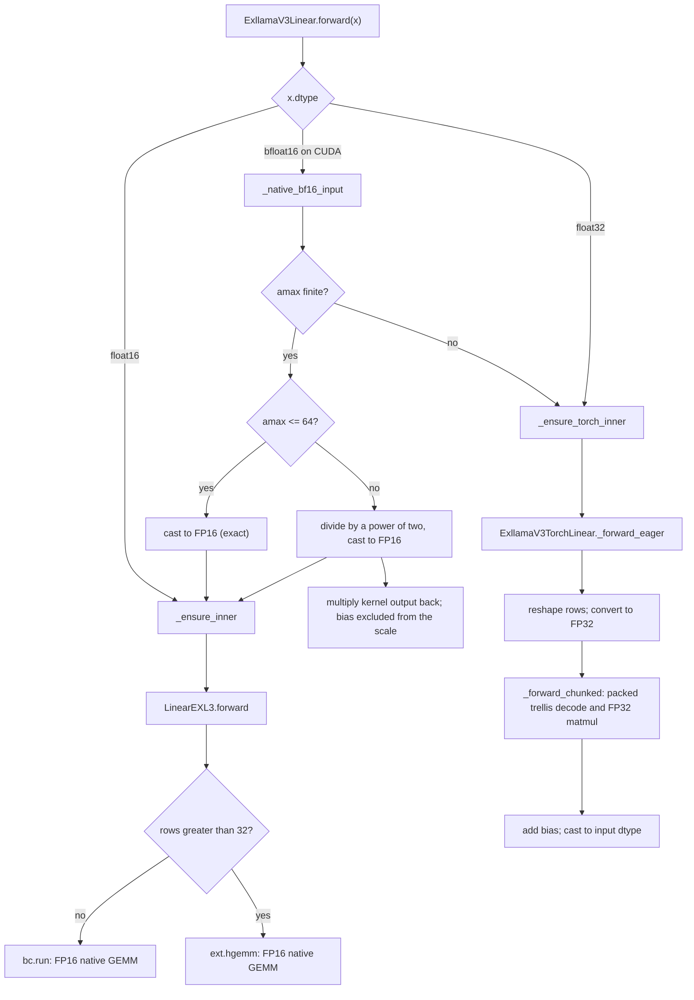

# EXL3 activation dispatch

`ExllamaV3Linear.forward` sends FP16 and BF16 activations to the native EXL3
kernels. FP32 keeps `ExllamaV3TorchLinear`, which computes in FP32, decodes
packed trellis weights in bounded output tiles, and rounds the result once to
the caller's dtype.

BF16 is the default dtype of most EXL3 checkpoints (Llama-3.x, Qwen2.5/3, ...).
Before #4767 every non-FP16 activation took the Torch reconstruction path, so
the default way to run those checkpoints was 20-200x slower than the native
kernel. Native EXL3 still requires FP16 operands; the bridge now supplies them.

## BF16 to FP16 conversion

BF16's 8-bit significand is a subset of FP16's 11-bit one, so every BF16
value inside FP16's finite range converts exactly. That covers ordinary activations and is
bit-exact with the plain FP16 path.

Values above `_FP16_SAFE_AMAX = 64` are divided by a power of two before the
cast, and the kernel output is multiplied back:

- `math.frexp(amax)` gives `2**exponent > amax`, so the scaled magnitude lies in
  `(0.5, 1]`. Power-of-two scaling is exact, so relative rounding is unchanged.
- The Hadamard rotation is bounded by `sqrt(128)` times the input maximum and
  the GEMM accumulation stays far below FP16's 65504 limit. This preserves
  #3731's guarantee: wide BF16 activations neither overflow nor produce NaN.
- The native kernels add the bias to the scaled accumulator. The bridge removes
  the bias, rescales, and restores it in FP32, so the bias is never scaled.
- The decision needs one `amax` reduction and a host read of that scalar per
  BF16 forward. It is a single small kernel plus one synchronization, against
  the hundreds of launches the Torch reconstruction performs.

Non-finite BF16 activations (`inf`/`nan`) keep the FP32 Torch path: there is no
power of two that would make them finite.

## Dispatch contract

The row-count decision is inside `LinearEXL3.forward`. The bridge hands it a
contiguous FP16 tensor for both 32 and 33 rows, so the native class still picks
`bc.run` below 33 rows and `ext.hgemm` above it. A direct call to the
lower-level native class with BF16 or FP32 is outside this bridge contract and
still reaches the native dtype check.

| Mechanism | Before #4767 | After #4767 |
| --- | --- | --- |
| Dtype dispatch | FP16 native; BF16 and FP32 Torch | FP16 and BF16 native; FP32 Torch |
| BF16 input conversion | none (Torch, FP32 compute) | exact FP16 cast, power-of-two pre-scale above 64 |
| Wide-input safety | Torch path, FP32 | native FP16 with exact pre-scale; non-finite stays Torch |
| Native dtype contract | `gptqmodel_ext/exllamav3/quant/exl3_gemm.cu:64` and `hgemm.cu:33` require FP16 | Unchanged; the bridge satisfies it |

The wide Torch path keeps trellis, sign scales, and bias in packed checkpoint
form. `_forward_chunked` decodes at most 512 output columns at a time, then
releases that decoded weight after the forward. For a 128x128 four-bit test
layer, the packed trellis plus scales and bias occupy 8,960 bytes and the FP32
decoded weight chunk occupies 65,536 transient bytes.

## Tests

`tests/test_exl3_wide_input.py` covers the dispatch choice at 1, 32, 33, and 64
rows with a mocked native kernel, the exact FP16 cast, the power-of-two
pre-scale for magnitudes from 1e4 to 1e30, finite numerics against an FP64
reference at 1e4 and 1e5, and the non-finite fallback. The CPU oracle tests use
independently packed EXL3 symbols and a separate float64 weight reconstruction;
CUDA tests exercise the same bridge on NVIDIA when the extension is available.
