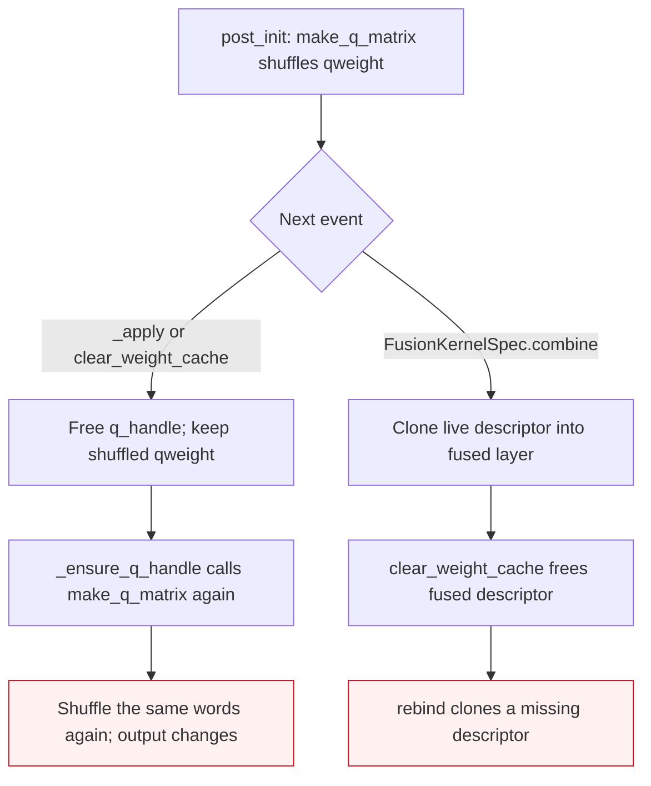
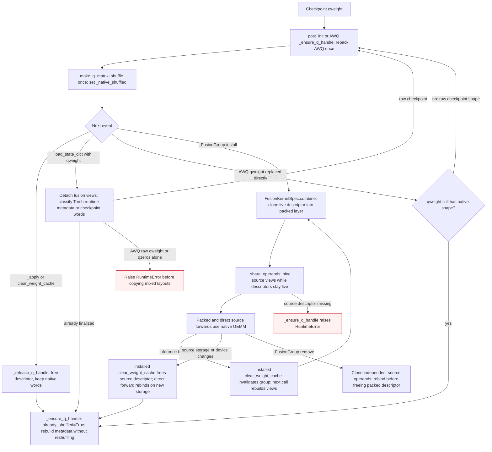

<!-- SPDX-FileCopyrightText: 2026 ModelCloud.ai
SPDX-License-Identifier: Apache-2.0 -->

# ExLlamaV2 descriptor lifecycle

ExLlamaV2 GPTQ and AWQ matrix construction changes packed words in place. AWQ
first repacks checkpoint words, and both formats shuffle the result for the
native GEMM. A descriptor borrows those tensors; freeing the descriptor does
not restore checkpoint words. This applies to separate projections and fused
gate/up or QKV groups.

## Before

## Current flow

| Event | Previous behavior | Current behavior |
| --- | --- | --- |
| Same-device or cross-device move | `_ensure_q_handle` shuffled finalized words again | `_native_shuffled` selects the descriptor-only constructor path; act-order permutations are rebuilt from `g_idx` |
| Explicit cache clear | Freed the descriptor, then reshuffled on demand | Frees the descriptor; next bind leaves packed words intact |
| Checkpoint load | Could treat raw AWQ words as finalized or write into a fused view | Detaches fused operands, restores checkpoint shape, resets native flags; AWQ repacks before its next bind |
| Torch runtime `state_dict()` load | Reshuffled finalized GPTQ words | GPTQ stores layout in local state metadata; AWQ recognizes its distinct runtime shape and binds without reshuffling |
| Partial AWQ checkpoint load | Could mix raw and repacked zeros/weights | Rejects raw qweight or qzeros alone after AWQ finalization; accepts matching runtime metadata |
| Direct AWQ checkpoint-buffer replacement (`gptqmodel/nn_modules/qlinear/exllamav2_awq.py:195-210`) | `_awq_repacked` stayed true after raw words replaced native buffers; the next handle received raw layout | `_ensure_q_handle` detects the raw qweight shape, resets the native flags, and repacks before binding |
| Fusion install | `FusionKernelSpec.combine` freed its new descriptor before `rebind` | Keeps the cloned descriptor; source views clone from live descriptors |
| Fused source device or dtype move | A source descriptor still named the old GPU or scale buffer | Installed cache clear releases the changed source descriptor; direct execution rebinds before fusion resumes |
| Fusion removal | Source handles could be freed before restoring independent operands | Rebinds each source to its restored packed allocation |

Relevant code: `gptqmodel/nn_modules/qlinear/exllamav2.py`,
`gptqmodel/nn_modules/qlinear/exllamav2_awq.py`,
`gptqmodel_ext/exllamav2/cuda/q_matrix.cu`,
`gptqmodel_ext/exllamav2/cuda/q_matrix_awq.cu`, and
`gptqmodel/models/fusion_kernels.py`. Tests in
`tests/module_tree/test_fusion_kernel_backends.py` compare both activation
dtypes and multiple row counts with an independent Torch oracle. Native
descriptors own pointers only; inference retains packed INT4 words, scales,
zeros, and optional act-order indices, with no retained dense weights.

## Measured validation

On 2026-11-11, both RTX 4090 and RTX 5090 passed 20 focused native cases:
FP16 and BF16 gate/up, GQA QKV, MHA QKV, cache clear, checkpoint reload, and
act-order rebind. The maximum fused projection error against the independent
FP32 Torch oracle, rounded to the visible dtype, was `0.000244140625` for
FP16 and `0.001953125` for BF16 on both GPUs (acceptance: `rtol=atol=2e-3`).
The fused 512-by-2048 layer retains 512 KiB of INT4 `qweight`; source leaves
hold views into that allocation. Additional packed-weight cache and retained
dense-weight bytes are both zero. The existing large-row fallback allocates a
transient FP16 reconstruction (2 MiB for that shape) during its GEMM and
releases it before returning; BF16 also creates a transient FP32 cast.

RTX 4090, FP16 Llama MLP parent, 512 input channels, 1024 output channels per
projection; median of five CUDA-event measurements of 100 calls after 20
warmups (milliseconds per parent forward):

| Backend | Rows | Separate | Fused |
| --- | ---: | ---: | ---: |
| GPTQ ExLlamaV2 | 8 | 0.103 | 0.078 |
| GPTQ ExLlamaV2 | 257 | 0.118 | 0.088 |
| AWQ ExLlamaV2 | 8 | 0.113 | 0.075 |
| AWQ ExLlamaV2 | 257 | 0.109 | 0.085 |
