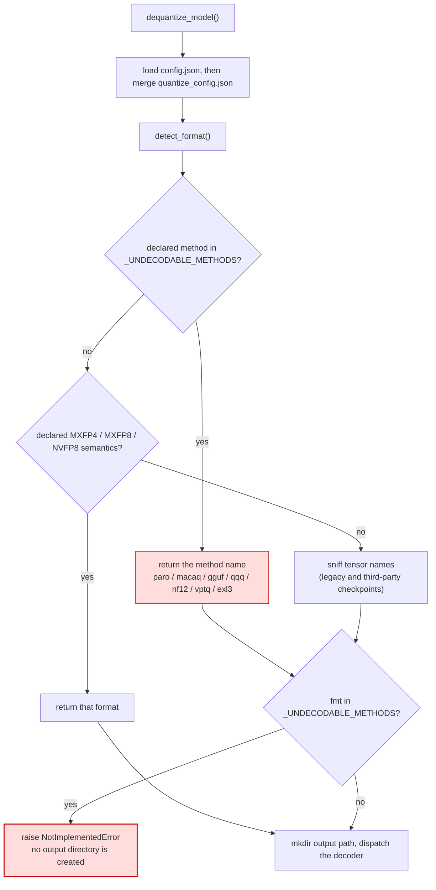

# Dense (`hf`) export: which decoder runs

`GPTQModel.export(path, out, "hf")` converts a quantized checkpoint into dense
weights through `utils/model_dequant.dequantize_model()`. The decoder is chosen
by `detect_format()`, and the checkpoint's **declared** `quant_method` decides:
a method with no dense decoder is refused, instead of being decoded with a
different layout's decoder.

## Flow

The red nodes are the fail-closed exit: `E` classifies the checkpoint by its
method so the caller can refuse it, and `K` refuses before anything is written.
A failed export therefore leaves no half-built output directory behind.

## Why the method decides, not the format

A GPT-QModel method stores its own packed layout, and its `format` is a
**sub-format of that method**:

- `MacaqConfig()` writes `method: "macaq"` with `format: "mxfp4_macaq"`; a
  rotation-free MACaQ checkpoint writes `format: "mxfp4"` with the same
  `method: "macaq"` (`docs/macaq.md`).
- `ParoConfig()` writes `method: "paro"` and a `.qweight` with no `.g_idx`.

Neither a substring match on `mxfp4` nor a `.qweight`-without-`.g_idx` sniff can
tell those apart from a real MXFP4 or AWQ checkpoint, and both decoders silently
drop the rotation.

## Before / after

`detect_format()` (`gptqmodel/utils/model_dequant.py`) and
`dequantize_model()` (same file) before this change:

| checkpoint | `detect_format()` before | `export(..., "hf")` before | after |
| --- | --- | --- | --- |
| Paro (`method: "paro"`) | `awq` — `.qweight` and no `.g_idx` | wrote dense weights, rotation dropped (nll 1.49 -> 13.28) | `NotImplementedError` |
| MACaQ (`method: "macaq"`) | `mxfp4` — substring of `mxfp4_macaq` | wrote dense weights, `BH`/`pre_scale` dropped (nll 1.73 -> 12.64) | `NotImplementedError` |
| GGUF (`method: "gguf"`) | `awq` | `KeyError: Incomplete AWQ buffers ... missing {'qzeros', 'scales'}` | `NotImplementedError` |
| QQQ / NF12 / VPTQ / EXL3 | no match | `ValueError: Unable to detect quantization format` | `NotImplementedError` |

The refusal message names the method and lists the formats that do have a dense
decoder (GPTQ, AWQ, FP8, NVFP4/MXFP4, BitsAndBytes, compressed-tensors).

## Scope

This is a refusal, not a decoder. Paro and MACaQ still have no dense export path;
`GPTQModel.load()` and the quantized checkpoint itself are unaffected. Adding a
dense decoder later means deleting the method from `_UNDECODABLE_METHODS` and
giving `dequantize_model()` a matching branch.
