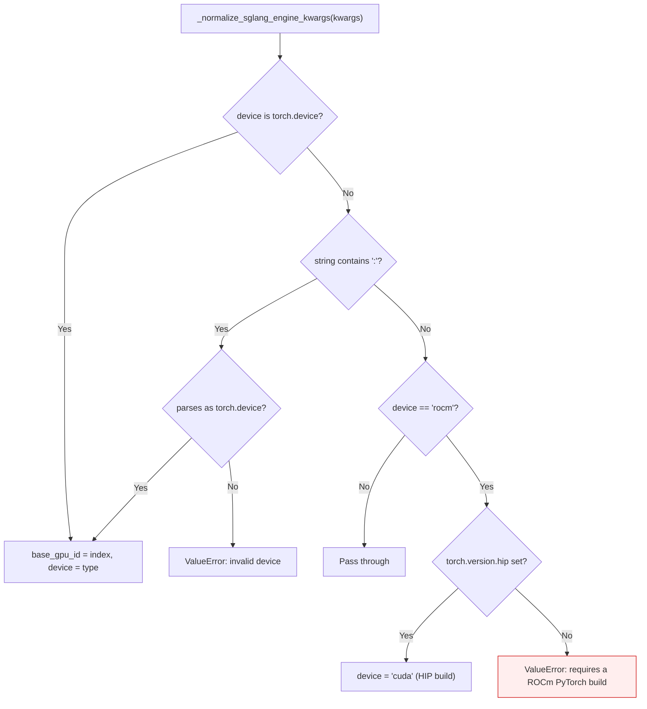

<!-- SPDX-FileCopyrightText: 2026 ModelCloud.ai -->
<!-- SPDX-License-Identifier: Apache-2.0 -->

# External runtime device mapping

GPT-QModel keeps `DEVICE.CUDA` and `DEVICE.ROCM` distinct internally, then
translates them into the vocabulary an external runtime accepts. SGLang and
vLLM both spell every accelerator `cuda`, so an AMD request must be aliased
only where that alias actually names the AMD device.

## SGLang

The `rocm` to `cuda` alias is only a spelling change on a HIP build, where
PyTorch's `cuda` namespace is the AMD device. On an NVIDIA-only build the alias
would silently launch on NVIDIA hardware, so it is rejected instead.

## Previous behavior

| Request | Before | After |
| --- | --- | --- |
| `device="rocm"` on a HIP build | `device="cuda"` | `device="cuda"` (unchanged) |
| `device="rocm"` on an NVIDIA build | `device="cuda"` (silently NVIDIA) | `ValueError` |
| `device="cuda"` on an NVIDIA build | `device="cuda"` | `device="cuda"` (unchanged) |
| `device=torch.device("cuda:1")` | `device="cuda"`, `base_gpu_id=1` | unchanged |

## Validation

`tests/test_sglang_utils.py::test_rocm_device_aliases_to_cuda_only_on_a_hip_build`
and `::test_rocm_device_is_rejected_on_a_cuda_only_build` pin both sides by
setting `torch.version.hip`, so the contract is tested on any host.
