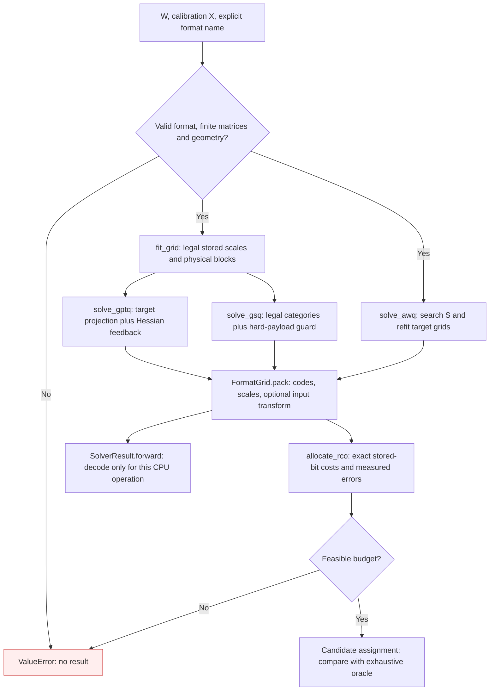

<!-- SPDX-FileCopyrightText: 2026 ModelCloud.ai -->
<!-- SPDX-License-Identifier: Apache-2.0 -->

# Solvers targeting hardware formats: CPU feasibility

**Result:** GPTQ's error feedback, AWQ's diagonal scaling, and GSQ's categorical
optimization can target nonuniform floating-point codebooks directly. RCO can
allocate among those solutions using their actual storage costs. The format's
codebook, block geometry, and *stored* scale precision must participate in the
objective; converting an INT4 solution afterward is not the same optimization.

This is an executable mathematical feasibility study, **not production support**.
`format_reference.py` implements finite CPU codecs; `format_solver_reference.py`
implements small linear reconstruction experiments. Neither is wired into
`QuantizeConfig`, the looper, checkpoint writers, or inference dispatch.
`GPTQModel.export` and protocol `export` fields are deliberately unchanged.

## Format contracts

The sources are [OCP MX v1.0, sections 5–6](https://www.opencompute.org/documents/ocp-microscaling-formats-mx-v1-0-spec-final-pdf),
[NVIDIA's FP8/FP4 primer](https://docs.nvidia.com/deeplearning/transformer-engine/examples/fp8_primer.html),
and [cuDNN block scaling](https://docs.nvidia.com/deeplearning/cudnn/latest/operations/BlockScaling.html).

| Reference name | Element | Contiguous input block | Stored decode scale | Zero point |
| --- | --- | ---: | --- | --- |
| `int4` | Unsigned affine INT4, eight codes per int32 | 32 | FP32 per row/block | uint8 per row/block, 0–15 |
| `mxfp4` | E2M1 | 32 | E8M0 per row/block | None |
| `nvfp4` | E2M1 | 16 | E4M3 per row/block × one FP32 tensor multiplier | None |
| `mxfp8_e4m3` | E4M3FN | 32 | E8M0 per row/block | None |
| `mxfp8_e5m2` | E5M2 | 32 | E8M0 per row/block | None |
| `fp8_e4m3` | E4M3FN | Whole tensor | One FP32 tensor multiplier | None |

**NVFP8 is unresolved:** the cited NVIDIA documentation distinguishes ordinary
FP8, MXFP8, and NVFP4, not a separate NVFP8 encoding. `nvfp8` is rejected rather
than silently mapped to ordinary FP8. An exact specification is needed to add it.

These are finite-value emulators, not implementations of every special-value
conversion policy. Nonfinite inputs and nonfinite element codes are rejected.
E2M1 magnitudes are `0, .5, 1, 1.5, 2, 3, 4, 6`; signed zero is preserved.
E8M0 byte `c` represents `2**(c-127)` for 0–254; byte 255 is rejected as NaN.
Element rounding is saturating round-to-nearest-even, including subnormals.

Scale *selection* is separate from legal scale *storage*. The reference chooses
MX scales using `ceil(log2(amax / max_element))`, clamped to the E8M0 range.
This is a deliberate no-overflow-oriented recipe, not a claim to reproduce
every OCP example, GGUF quantizer, or vendor's preferred conversion algorithm.
NVFP4 uses the FP32 decode multiplier `amax_tensor/(6*448)`, then RNE E4M3 local
scales. Both FP32 and E4M3 scales are rounded to storage **before** payload
selection. Zero blocks and underflow have explicit positive-scale floors.

Payloads use low-nibble-first bytes for FP4, bytes for FP8, and low-bit-first
row-packed int32 words for INT4. This is a canonical proof layout, **not** a
GPTQ/AWQ checkpoint layout, GGUF block layout, or cuBLAS scale swizzle. INT4's
FP32 scales and uint8 zero points are intentional reference choices, not a
claim about existing checkpoint overhead. RCO counts their actual bytes.

## Why each method transfers

Let `W` have shape `[out,in]`, calibration `X` shape `[tokens,in]`, and `D_F(c,s)`
decode legal codes/scales in format F. The reconstruction problem is
`min ||X (D_F(c,s) - W)^T||_F^2`. Floating formats change its feasible set,
not the definition of the objective. The reference keeps scales fixed within
GPTQ/GSQ; it does not claim globally optimal joint code-and-scale solutions.

### GPTQ: arbitrary scalar projection on a fixed block grid

With damped Hessian `H = X^T X / tokens + lambda I` and
`U = chol(H^-1)^T`, at column `j` choose the nearest legal target value `q` and
update the remaining weights by `(w_j-q)/U_jj * U_j,j:`. The constrained
least-squares derivation does not require evenly spaced integers. Any chosen
scalar `q` can be compensated this way, including E2M1/E4M3/E5M2 values times
their already-rounded block scales.

`solve_gptq` implements this reference recurrence, not the production GPTQ
class. Its oracle independently re-solves the remaining normal equations
after each fixed column and requires identical codes. Activation ordering
keeps scale membership in **physical input-column coordinates**; arbitrary
processing order must not silently regroup the hardware blocks.

### AWQ: format-aware search plus a graph transform

For positive diagonal `S`, `X W^T = (X S^-1)(W S)^T` exactly. AWQ can minimize
`||(X S^-1) D_F(W S)^T - X W^T||_F^2` with any format-aware quantizer.
`solve_awq` searches the activation-only family
`s_j = mean(abs(X_j))**alpha` with normalization and FP32 stored transforms.
It refits legal target-format scales for each candidate and includes identity
as a baseline. This is not the full production search/replay/clip pipeline.

The result must retain `S^-1` on inputs or fold it into a valid upstream
producer. **Unscaling the decoded weights generally takes them off the target
grid.** The reference stores the transform explicitly and counts its cost.
No model's residual branches, normalization layers, or AWQ folding are qualified
by this linear experiment; those require the existing model-onboarding gates.

### GSQ: categories need not be integer codes

The production `gsq_training.relaxed_scalar_weights` primitive computes a
Gumbel-softmax weighted mixture of candidate values, with the production
`sampling_schedule`. Categories can be any finite legal decoded values. Here
they are the RTN payload and its adjacent target-format neighbours with frozen
stored scales. Adam optimizes logits, and only an actual hard packed payload
that improves reconstruction can replace the baseline.

This demonstrates the categorical GSQ mechanism with a local linear objective,
not full staged transformer training or its quality. It is also distinct from
the current per-linear affine `gsq_scalar.py` hard coordinate-descent path.
The identity-metric control cannot improve RTN with frozen scales, and the
tests require that it does not invent a gain. RNG draws use a local generator.

### RCO: allocation over solved candidates, not another weight solver

RCO's expected budget, tangent projection, and retraction depend on candidate
costs, not their bit encodings. Tests exercise those production functions on
actual format costs and compare budget gradients to independent autograd.
`allocate_rco` calls production `budget_constrained_argmax` with additive
negative reconstruction errors and exact bit units. The three-layer allocation
is checked against all `6**3` assignments, including infeasible budgets.

Payload, block scales, global scale, zero points, and explicit AWQ transforms
all count. This does not test full RCO model-KL training, the production format
adapters, runtime compatibility, or additive-error accuracy on whole models.
One-bit DP resolution is only suitable for these tiny proofs; production
allocation needs a bounded cost discretization with an exact final budget check.

## Reference flow and production boundary



| Existing production boundary (unchanged) | Reference proof / future requirement |
| --- | --- |
| `quantizer.py:232` supplies affine metadata to `gptq.py:452` | `FormatGrid` supplies legal target projections; decouple this owner before integration |
| `awq_processor.py:3675` returns affine metadata | Score target-format quantization inside search and preserve/fold the transform |
| `gsq_scalar.py:153` refines affine codes; `gsq_training.py:30` supplies categorical training | Prototype reuses the categorical primitive on hardware-codebook neighbours |
| `rco_formats.py:168` declares method-coupled options | Production adapters would need target capabilities and actual storage costs |
| `models/auto.py:1242` and `quantization/protocol.py:31` | `export` is still present; removing it is a subsequent migration, not part of this proof |

## Reproduce

From the repository root with the existing development dependencies:

```bash
python -m pytest tests/test_format_reference.py tests/test_format_solver_reference.py -q
python -m scripts.prove_format_solvers --json results.json --markdown results.md
```

The driver uses one CPU thread, local seeds 0/1/2, three independent 8×64
weights, 256 calibration and 512 held-out activation rows per weight. Inputs
have correlated latent components, independent noise, and nonuniform channel
amplitudes. Held-out inputs use new draws from the same distribution. They are
not model-derived calibration data or an out-of-distribution test.

Mean held-out normalized MSE, with all three seeds retained:

| Format | RTN | GPTQ | AWQ | GSQ | INT4 GPTQ → target |
| --- | ---: | ---: | ---: | ---: | ---: |
| INT4 | 0.00534112 | 0.00342318 | 0.00385958 | 0.00104479 | 0.00439254 |
| MXFP4 | 0.0113250 | 0.00727645 | 0.00915358 | 0.00288845 | 0.0167267 |
| NVFP4 | 0.00747384 | 0.00409037 | 0.00480865 | 0.00146463 | 0.0108059 |
| MXFP8 E4M3 | 0.000602801 | 0.000367831 | 0.000382461 | 0.000110863 | 0.00383871 |
| MXFP8 E5M2 | 0.00294736 | 0.00175956 | 0.00150680 | 0.000667239 | 0.00611203 |
| FP8 E4M3, per tensor | 0.000630071 | 0.000346621 | 0.000408602 | 0.000134189 | 0.00417484 |

Measured on Python 3.12.16 / Torch 2.15.0+cu132 using **CPU only**. Each solver
beat RTN on all 18 held-out format/seed pairs in this experiment, not just on
the means. This is not a universal accuracy guarantee or a solver ranking.
The conversion column refits scales after INT4 solving, so even INT4 → INT4
is a second lossy quantization, not a byte-preserving repack.

RCO chose NVFP4 / INT4 / per-tensor FP8 for the three fixtures, consuming
9,152 bits of a 9,600-bit budget. Its summed calibration NMSE
`0.006995933881485996` equals the exhaustive optimum under that budget.

## Executable evidence and limits

| Evidence | What it establishes |
| --- | --- |
| Every finite FP4/FP8 code, midpoint, and both FP64 neighbours | Exact decoding, RNE, signs, signed zero, and saturation policy |
| Independent scalar decode of stored words; repeat pack/forward | Legal payloads reach a second consumer without re-solving |
| Native Torch FP8 cast comparison | CPU FP8 element parity in the finite range, not native matrix multiplication |
| GPTQ constrained-normal-equation oracle | Nonuniform projection works with error feedback and activation ordering |
| AWQ explicit transform and independently enumerated objective | Format-aware search and the required input-coordinate correction |
| GSQ hard-score, RNG, and identity-metric controls | Actual payload changes, reproducibility, no soft-only claimed improvement |
| RCO autograd budget oracle and exhaustive allocation | Costs need not be integer bit-width labels; format overhead matters |

Not established: GPU instruction behavior, native block-scale swizzles,
FP16/BF16 accumulation, activation quantization, model quality/perplexity,
checkpoint interoperability, model graph folding, free-threaded execution,
or production solver/backend combinations. No expanded inference-weight cache
is introduced; decoding is temporary inside the reference forward operation.
The code is intentionally small-matrix/single-threaded and retains full FP64
solver scratch, not a production memory-scalable implementation.

**Next architectural step (not implemented):** separate solver choice, target
numeric format, checkpoint container/layout, and runtime kernel capability.
Then migrate the public API only with consumer-level conformance tests. A
format name alone is not a promise that every solver, model graph, or device
can execute it.
