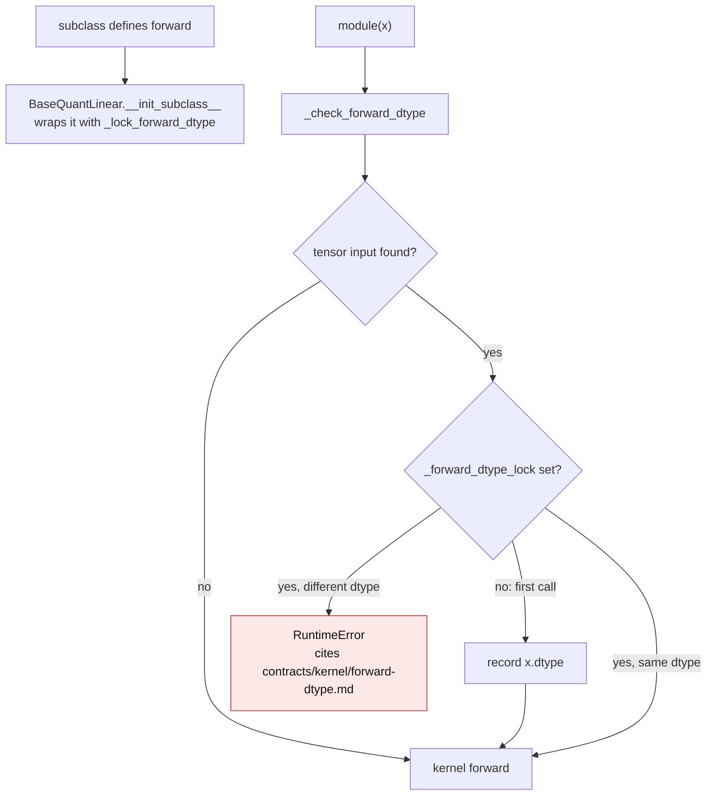

<!-- SPDX-FileCopyrightText: 2026 ModelCloud.ai
SPDX-License-Identifier: Apache-2.0 -->

# Forward dtype lock

This page describes how `BaseQuantLinear` enforces the
[kernel forward dtype contract](../contracts/kernel/forward-dtype.md). The
contract has two parts:

- The first `forward` call fixes a module's activation dtype.
- A later call with a different dtype is a caller bug. It raises
  `RuntimeError`. The module does not adapt to it.

## New flow

The lock is a plain attribute on the module, so `copy.deepcopy` and pickling
carry it over. Two separately built modules each get their own lock and may use
different dtypes.

## Removed dtype-switch mechanisms

Before the lock, these mechanisms existed only to cope with a later call that
used a different dtype.

| Before | Mechanism | Now |
| --- | --- | --- |
| `gguf_triton.py` `_triton_cache_key` returned `(device, qtype, wide_dot)` | `wide_dot` depends on the activation dtype. A model that mixed FP16 and BF16 calls built two cache entries, and the unused one kept a replaced packed weight alive (#5812). | The key is `(device, qtype)`, so there is one entry per device. |
| `paro.py` `_ensure_cpu_layout` | Restored the checkpoint layout and re-packed int4pack when `_cpu_runtime_dtype != dtype`. | Re-packs only when the layout changes. |
| `paro.py` compiled int4pack path | Fell back to dense without warning when `_cpu_runtime_dtype != x_flat.dtype`. | Falls back only when the layout is missing. |
| `tests/kernels/test_awq_runtime_dtype_storage.py` | Ran FP16, then BF16, then FP16 on one module and expected success. | The BF16 call must raise. |
