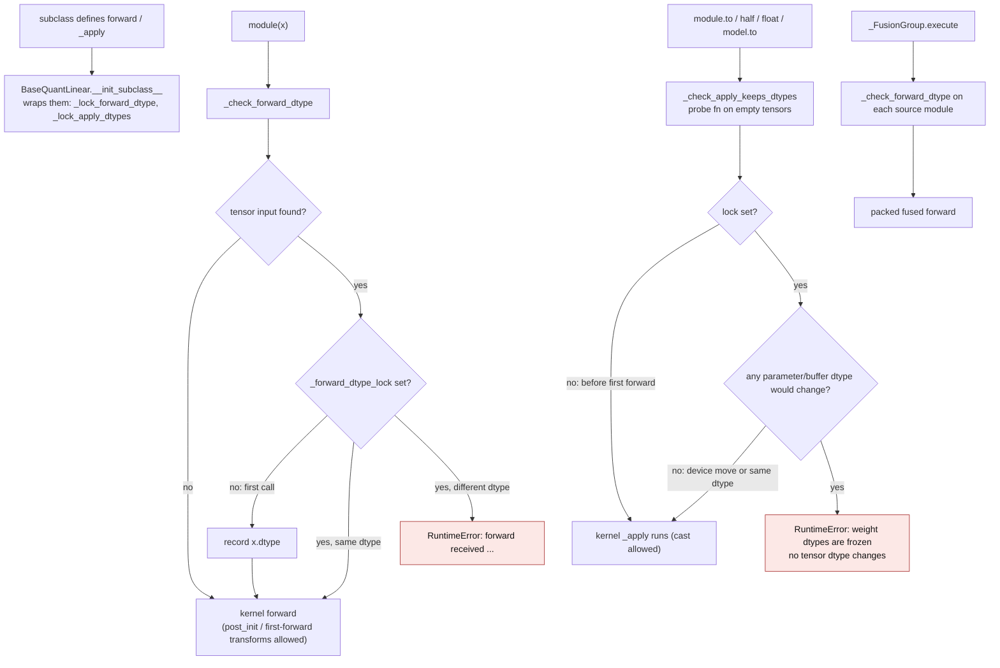

<!-- SPDX-FileCopyrightText: 2026 ModelCloud.ai
SPDX-License-Identifier: Apache-2.0 -->

# Forward dtype lock

This page describes how `BaseQuantLinear` enforces the
[kernel forward dtype contract](../contracts/kernel/forward-dtype.md):

- the first `forward` fixes a module's activation dtype;
- every later forward must use that dtype;
- after the first forward, the module's weight and buffer dtypes are frozen.

Breaking either rule is a bug in the caller. It raises `RuntimeError`; the
module does not adapt.

## New flow

- The lock is a plain attribute on the module, so `copy.deepcopy` and pickling
  carry it.
- Two modules built separately each get their own lock, and may use different
  dtypes.
- The `_apply` guard runs before the kernel's own `_apply` does anything. It
  passes `fn` an empty tensor of each dtype and device the module holds, so
  no tensor changes dtype before the check. A kernel whose `_apply`
  first restores a dropped checkpoint layout may do that (same decoded
  weights) before a nested check rejects the cast.
- On a whole-model cast, modules that come earlier in the traversal may
  already have been cast when a locked module raises. After this error, the
  model is invalid.
- A fused projection group runs a packed executor in place of its source
  projections, so the group applies the lock to each source module. A later
  fallback to the sources in another dtype therefore also raises.

## Removed dtype-switch mechanisms

| Before | Mechanism | Now |
| --- | --- | --- |
| `gguf_triton.py` `_triton_cache_key` returned `(device, qtype, wide_dot)` | `wide_dot` depends on the activation dtype, so a mixed FP16/BF16 model built two cache entries. The unused entry kept a replaced packed weight alive (#5812). | Key is `(device, qtype)`: one entry per device. |
| `paro.py` `_ensure_cpu_layout` | Restored the checkpoint and re-packed int4pack when `_cpu_runtime_dtype != dtype`. | Re-packs only when the layout changes. |
| `paro.py` compiled int4pack path | Silently fell back to dense when `_cpu_runtime_dtype != x_flat.dtype`. | Falls back only when the layout is missing. |
| `_fused_train_state.py` `refinalize_fused_state_after_apply(module, dtype, device)` | Restored the checkpoint snapshot after an FP16↔BF16 `_apply`. | `refinalize_fused_state_after_apply(module, device)`: device moves only. |
| `_apply` in `torch_fused.py`, `torch_fused_awq.py`, `torch_aten_kernel.py`, `torch_aten_kernel_awq.py` | Tracked the pre-move runtime dtype. The Aten variants also re-pointed `_cpu_transform_dtype` at the new dtype to "keep the live layout usable". | Record the device only. |
| `torch_cpu_avx512_awq.py` `_apply` | Held the FP32 `scales`/`bias` across `super()._apply` and reinstalled them after a dtype cast. | Device-move re-finalize only. |
| `torch_aten_kernel.py` / `torch_aten_kernel_awq.py` forward | Kernel-local "transformed for X but received Y" raise, and a transform-dtype comparison in `_fused_input_dtype`. | Replaced by the central lock. `_fused_input_dtype` is a capability check only. |

## Tests rewritten to honour the contract

| Test | Was | Now |
| --- | --- | --- |
| `tests/kernels/test_awq_runtime_dtype_storage.py` | FP16 → BF16 → FP16 on one module | The BF16 call raises |
| `tests/kernels/test_awq_torch.py` (2 tests) | FP16 warm-up, then a BF16 check | BF16 only |
| `tests/kernels/test_awq.py` | One shared module per backend, used for both FP16 and BF16 | One module set per dtype |
| `tests/kernels/test_torch_int8.py` | `(dtype, bf16, fp32, dtype)` on one layer | `(dtype, dtype)` |
| `tests/test_inference_fp16_overflow.py` (2 tests) | FP32 → FP16 on one module | One module per dtype |
| `tests/test_vptq.py` (3 tests) | Oracle FP32 check, CUDA FP32 check and `to(fp16)` on the same module | Separate copy, or same-dtype check |
| `tests/kernels/test_ret_idx_cache_invalidation.py` | Low-precision move re-finalize; `move` lifecycle case | Removed: the move is now rejected |
| `tests/test_kernel_audit_regressions.py` (2 tests) | Move to a new dtype after a forward, then forward | The move raises and the layer stays bit-identical |
| `tests/test_qqq_cpu_residency_4805.py`, `tests/test_torch_weight_storage.py` | `to(bf16)` after a forward | The dtype cast raises; a device move covers restore and invalidation |
| `tests/test_macaq_triton_forward_dtype_4315.py`, `tests/test_torch_cpu_avx512_awq.py` | Second `.to()`, or a `.half()`/`.float()` loop after a forward | Changing casts raise; no-op casts pass |
| `tests/module_tree/test_llama_fusion.py`, `tests/module_tree/test_fusion_kernel_backends.py` (2 tests) | `model.to(bf16)` after fused forwards | The cast raises |
| `tests/benchmark/benchmark_qqq_cpu.py` | One QQQ module timed in FP16 and BF16 | Seeded rebuild per dtype |
