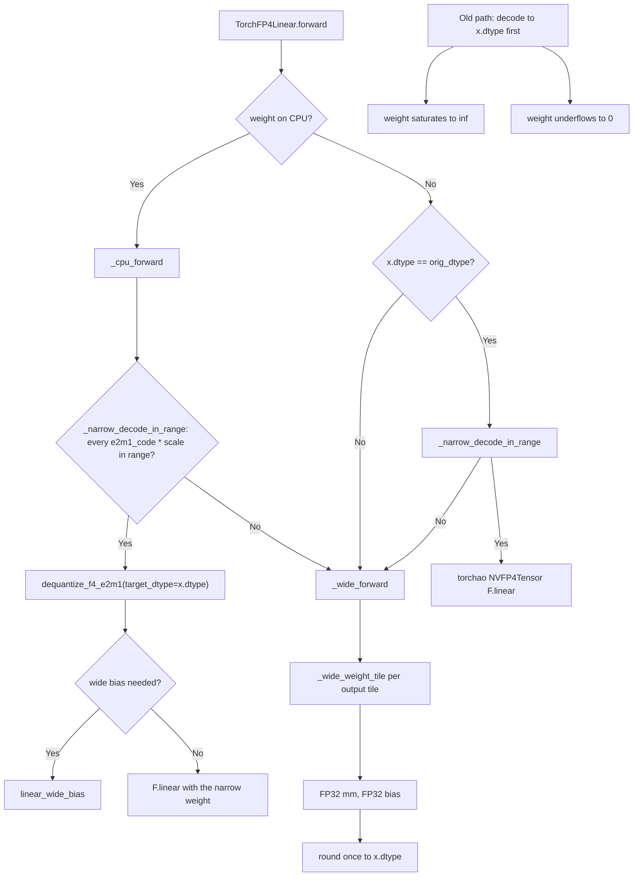

<!-- SPDX-FileCopyrightText: 2026 ModelCloud.ai
SPDX-License-Identifier: Apache-2.0 -->

# FP4 effective-weight range in the decode path

`TorchFP4Linear` executes an NVFP4 checkpoint directly from its packed buffers.
The value it must reconstruct is the *effective* weight

```
effective_weight = e2m1_code * effective_scale
```

where `effective_scale` is the stored `weight_scale` multiplied by ModelOpt's
`weight_scale_2` when the checkpoint has one
(`gptqmodel/models/base.py:_decoder_fp4_effective_scale`). Neither factor is
bounded by the E4M3 range of the stored block scale: the fold can produce an
effective scale far above `448` or far below `2**-9`.

The linear forward used to decode the weight straight to the activation dtype
and multiply afterwards. That rounds the weight, not the result:

- `6 * 16384 = 98304` is above the FP16 maximum, so the FP16 weight became
  `inf` and a final `49152` came out as `NaN`;
- `1 * 2**-30` is below the FP16 sub-normal range, so the FP16 weight became
  `0` and a final `2**-15` came out as `0`.

Both final values are exactly representable. The information was lost before the
product, so no epilogue can recover it.

## Decode selection



`_narrow_decode_in_range` inspects only the scale grid, never the decoded
weight: one block spans `[0.5, 6] * scale`, so the largest and smallest scale
bound every decoded magnitude. It returns `False` when

```
max|scale| * 6    > finfo(x.dtype).max
min|scale| * 0.5  < finfo(x.dtype).tiny * eps   (the smallest sub-normal)
```

A zero block decodes to zeros, so it binds neither bound and is skipped.

| Path | Before | After |
| --- | --- | --- |
| CPU decode (`_cpu_forward`) | `dequantize_f4_e2m1(..., target_dtype=x.dtype)` | narrow decode only when the gate proves every code stays in range; otherwise `_wide_forward` |
| Accelerator wide-bias branch | decoded to `x.dtype`, then `linear_wide_bias` | decoded wide by `_wide_forward`; the bias and the weight are never compared at different widths |
| Accelerator activation dtype != `orig_dtype` | `RuntimeError` from `F.linear` (dtype mismatch) | `_wide_forward` |
| Wide-bias gate on an in-range pack | forced the FP32 weight path | unchanged; the gate is independent of the bias gate |

## Wide fallback

`_wide_forward` decodes output-channel tiles of at most 64 MiB of FP32 scratch,
multiplies each in FP32, concatenates, adds the stored bias in FP32, and rounds
once. Codes are decoded at BF16 (exact for all sixteen E2M1 values) and the FP32
block scale is applied afterwards, so the effective weight is rounded once.
Each tile is released after its own product; the module retains nothing.

| Contract | Behavior |
| --- | --- |
| Persistent weight storage | only the packed `weight` and `weight_scale` buffers survive the call |
| Transient scratch | `min(out_features, 64 MiB / (in_features * 4))` rows per tile, in place-scaled FP32 |
| Autocast | disabled around the wide GEMM, so the operands are not narrowed again |
| `x.dtype` is FP32/FP64 | the gate already returns `True`; the wide path is not entered |
| Empty activation | returns an empty output of the right shape/dtype |

## Live-scale handling

| Context | Decision source |
| --- | --- |
| CPU eager | re-derived from the live `weight_scale`, so even `.data` writes are observed |
| Accelerator eager | re-derived when the stored scale's version or device changes; a device reduction would otherwise synchronize the host every forward |
| Checkpoint tensor without a version counter | `_tensor_version` returns `-1`; the recorded answer is reused instead of raising `RuntimeError: Inference tensors do not track version counter` |
| `torch.compile` / CUDA graph capture | the load-time answer, because a host reduction cannot run inside a capture (same contract as `bias_narrows_losslessly`) |

## Measured cost

One 4096x4096 FP16 layer, resident inputs, best of five runs, 32 threads:

| Case | Latency |
| --- | --- |
| `F.linear` on a narrow decode (what main does) | 22.3 ms |
| E4M3-stored block scale, in range, through `TorchFP4Linear` | 23.6 ms |
| gate for an E4M3-stored scale | 0.0013 ms |
| FP32 effective scale (ModelOpt fold), in range | 34.1 ms |
| gate for an FP32 effective scale | 0.028 ms |
| FP32 effective scale, out of range (wide fallback) | 33.6 ms |

An E4M3-stored block scale is bounded by E4M3 itself (`[2**-9, 448]`), and
`448 * 6 = 2688` and `2**-9 * 0.5` both stay inside FP16's finite range, so the
common NVFP4 checkpoint pays only a dtype test. Only a folded FP32 effective
scale (or an E8M0 MX scale) needs the reduction, which inspects
`out_features * in_features / block_size` values — three orders of magnitude
less than the decoded weight, but a host round trip that scales with the thread
count: about 11.5 ms with 320 threads on the measurement host, against 0.03 ms at
32 threads. The wide fallback costs the FP32 product it must do; the in-range
FP32 case is not sent down it, and pays only the gate.

## Tests

`tests/kernels/test_inference_numeric_range.py` computes the oracle from the
packed nibbles and the effective scale in FP64 and never narrows the reference
weight. It covers the overflow (`0x77`, scale `16384`, output `49152`), the
underflow (`0x22`, scale `2**-30`, output `2**-15`), a pack where both terms
leave the range, the wide-bias branch, the in-range path, a live `.data` scale
write, a device-side `copy_`, a missing version counter, and an activation dtype
that differs from `orig_dtype`, on CPU and every available accelerator.
`tests/kernels/test_fp4_cpu.py` pins that the wide-bias branch never decodes the
weight to the activation dtype.

On the pre-fix tree 17 of these cases fail: `nan` for the overflow, `0` for the
underflow, and `RuntimeError: expected mat1 and mat2 to have the same dtype` for
an activation that differs from `orig_dtype`.
