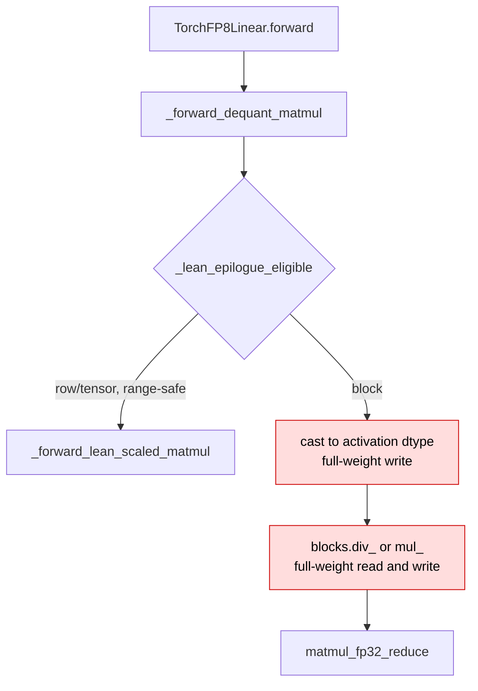
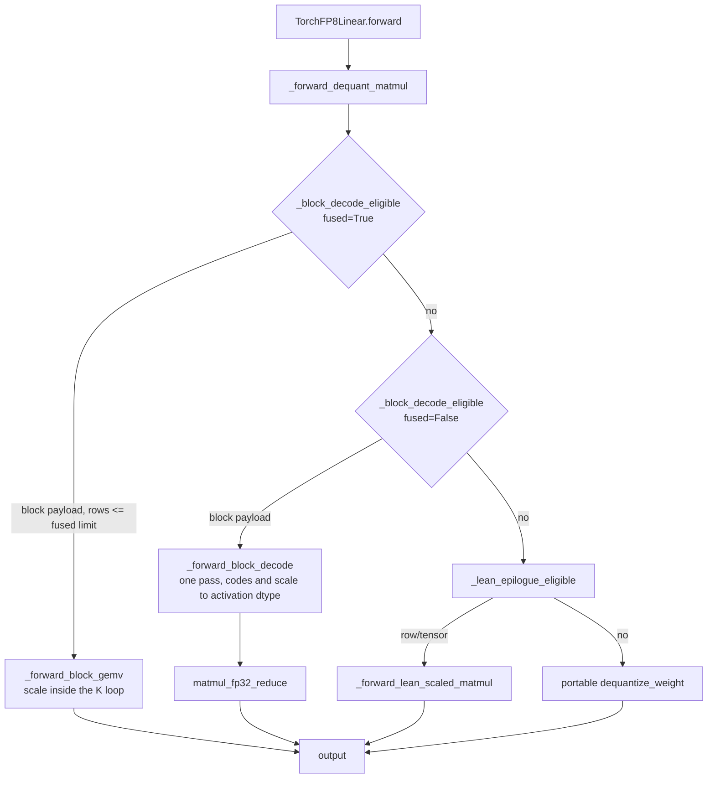
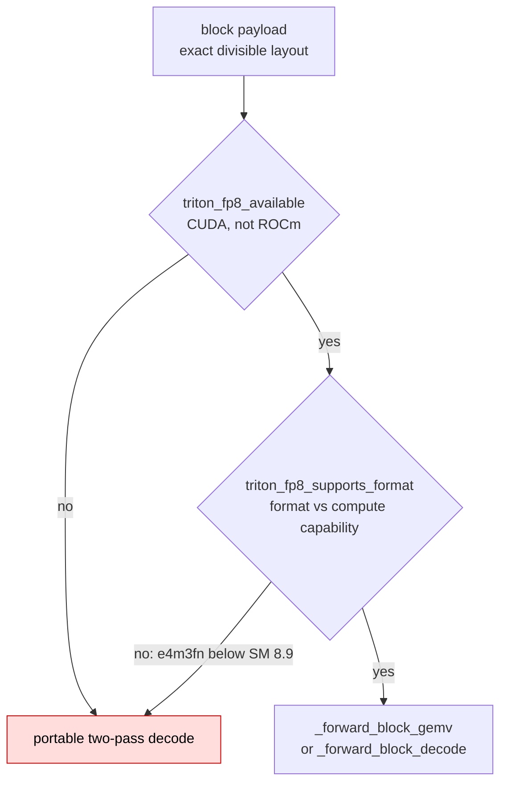

<!-- SPDX-FileCopyrightText: 2026 ModelCloud.ai -->
<!-- SPDX-License-Identifier: Apache-2.0 -->

# FP8 block-scale decode: one pass, and a fused W8A16 product at decode sizes

`TorchFP8Linear` stores E4M3/E5M2 codes plus a scale. The production
block-scaled checkpoints (transformers `FineGrainedFP8`, DeepSeek/Qwen) use
`weight_block_size=[128, 128]` with the `weight_scale_inv` multiplier. The
row/tensor epilogue in [lean decode](fp8-lean-decode-epilogue.md) cannot cover
that layout: a block scale varies along both axes of the reduction, so
`y = sum_k x_k * code_k / s` has no single `s` to move to the output and the
decoded weight has to exist for the GEMM.

The pre-fix block path built it in two full-weight passes on every forward:

1. `codes = weight.to(activation_dtype)` — read 1 B, write 2 B per element;
2. `blocks.div_(scale[:, None, :, None])` — read 2 B, write 2 B per element;
3. `matmul_fp32_reduce(x, codes.t())` — read 2 B per element.

That is ~9 B of traffic per weight element for a 1 B/element format, where
dense FP16 needs 2 B. At batch-1 decode the weight traffic, not the GEMM,
decides the latency.

## Old flow

| Mechanism | Before (`67de3469f`) |
| --- | --- |
| Block decode entry | `_forward_lean_scaled_matmul`, `gptqmodel/nn_modules/qlinear/fp8.py:907` |
| Full-weight cast | `fp8.py:925` |
| In-place block scale | `fp8.py:944` |
| GEMM | `matmul_fp32_reduce`, `fp8.py:947` |

## New flow

| Path | Weight traffic per forward | Enabled when |
| --- | --- | --- |
| `_forward_block_gemv` (`gptqmodel/utils/fp8_block_triton.py`) | reads the 1 B/element payload once; no decoded temporary | block payload, `float8_e4m3fn`/`float8_e5m2`, CUDA, a target that can lower that FP8 operand, FP16/BF16 activations, exact divisible 128-wide column blocks, range-safe FP16 bound, no autograd graph, row count at or below the measured fused limit |
| `_forward_block_decode` | reads 1 B/element, writes the activation dtype once | the same payload conditions without the fused kernel's row/GEMM/grad limits, and a decoded weight that narrows into the activation dtype without overflow |
| `_forward_lean_scaled_matmul` | reads 1 B/element, no decoded temporary | row/tensor scales (unchanged, #5146) |
| portable decode | the two-pass cast and scale | every payload the predicates above reject: E8M0, AMD `fnuz` formats, padded/cropped block scales, non-CUDA, ROCm, an FP8 operand the target cannot lower, `torch.compile`/`export`, non-contiguous activations |

The fused limit is not a correctness boundary. It is where a general GEMM
overtakes the decode-in-the-loop tiling that the fused kernel uses; past it the
single-pass decode plus the shared FP32-reduced GEMM is faster than the fused
kernel. The two thresholds are measured, not tuned per call:

| Projection width | Fused product used up to |
| --- | --- |
| `out_features < 2048` | M = 64 |
| `out_features >= 2048` | M = 192 |

## Device and format qualification

The operand type a block kernel declares is a property of the payload's FP8
format, and Triton's CUDA backend only adds `fp8e4nv` -- the type behind
`torch.float8_e4m3fn` -- to a target's supported operands at SM 8.9 and later.
`float8_e5m2` lowers to `fp8e5`, which every target supports. Before #5400 the
gate qualified the environment (CUDA, not ROCm) but not the concrete device
and format, so an Ampere target selected a kernel that raised
`ValueError: type fp8e4nv not supported in this architecture` inside the
layer's forward.

| Decision input | Before #5400 | After #5400 |
| --- | --- | --- |
| Runtime family | CUDA, not ROCm | unchanged |
| Device capability | not consulted | `TRITON_FP8_MIN_CAPABILITY[format]`, `(8, 9)` for `float8_e4m3fn`, `(0, 0)` for `float8_e5m2` |
| Payload format | membership in `TRITON_FP8_FORMATS` only | the same membership, then the capability lookup for that format |
| Ampere (SM 8.0/8.6) + `float8_e4m3fn` | fused or single-pass launch, Triton compile error | portable decode, reference result |

The capability is read with `torch.cuda.get_device_capability(device)` for the
ordinal that owns the payload, inside the payload-derived decode plan, so it is
resolved once per payload and shares that plan's cache invalidation.

## Failures and fallbacks

- A zero inverse scale decodes a code to `inf` and can turn a zero product
  into `NaN`, so those payloads keep the exact portable reference path.
- The single-pass decode writes the decoded weight in the activation dtype, so
  a payload whose decoded weight exceeds the FP16 finite range (for example
  65536, above the FP16 maximum of 65504) would store `inf` and turn a finite
  dot product into `NaN` (#5405). Those payloads keep the exact FP32 fallback,
  which decodes and multiplies in FP32 and narrows only the result. The fused
  product carries the same requirement; BF16 and FP32 keep the FP32 exponent
  range and are unaffected.
- A target whose Triton backend cannot lower the payload's FP8 operand keeps
  the portable decode (#5400). Triton only accepts `fp8e4nv` (`float8_e4m3fn`)
  at SM 8.9 and later, so an Ampere layer decodes through the portable path
  instead of failing to compile inside its forward.
- `torch.compile`/`export` never see the launch. The decode plan is declined
  inside a trace, so the traced graph keeps the Torch decode, and
  `SUPPORTS_COMPILE_LEVEL` is unchanged. CUDA-graph capture is supported: the
  launch is graph-safe, and the plan is resolved before capture.
- The decode plan (layout, dtype, device family, range bound) is payload-derived
  and cached per module. A reload, device move, dtype move, or weight/scale
  rebind raises a generation counter and recomputes it, so a stale answer
  cannot outlive the payload.

## Validation

| Test | Invariant |
| --- | --- |
| `tests/kernels/test_fp8_block_decode_5318.py::test_block_decode_matches_oracle_and_avoids_the_two_pass_cast` | The forward runs no full-weight in-place scale, and its output matches an independent FP64 oracle for FP16/BF16, biased and bias-free, M in 1/3/16/64/128; fails on the pre-fix tree with `forward ran a full-weight in-place scale: ['div_']` |
| `...::test_block_decode_and_portable_decode_agree` | The accelerated and portable block decodes agree within the activation dtype's rounding limit |
| `...::test_block_decode_keeps_no_decoded_weight_after_forward` | The single-pass temporary is released before the forward returns and is not retained on the module |
| `...::test_block_decode_declines_unsupported_payloads` | Non-Triton devices, padded block scales, non-contiguous activations and row/tensor payloads keep the portable decode |
| `...::test_block_decode_tiles_are_the_measured_ones` | The launch tiles are the measured ones |
| `...::test_block_decode_keeps_an_out_of_fp16_range_payload_finite` | A decoded weight of 65536 (both scale conventions) stays finite and exact in FP16/BF16/FP32; the FP16 payload leaves the single-pass decode, BF16/FP32 keep it; fails on the pre-fix tree with `non-finite output for torch.float16: tensor([[nan, ...]])` |
| `...::test_block_decode_range_gate_keeps_the_in_range_fast_path` | The range gate does not move an in-range payload off the fused product: one fused launch, no single-pass decode |
| `...::test_block_dispatch_skips_an_operand_the_device_cannot_lower` | An SM 8.0 capability keeps the block forward on the portable path and returns the reference value, while the same payload still takes the fused product at the host's real capability; fails on the pre-fix tree with `ValueError: type fp8e4nv not supported in this architecture` |
| `tests/test_fp8.py::test_block_triton_operand_capability_table` | `float8_e4m3fn` needs SM 8.9+, `float8_e5m2` needs no minimum, and a format outside the table is never a Triton operand |
| `tests/kernels/test_fp8_kernel.py`, `tests/test_fp8_dequant_inplace.py`, `tests/test_fp8_packed_weight_lifecycle.py`, `tests/test_rocm_fp8_gating.py` | Existing FP8 forward, decode arithmetic, storage lifecycle and ROCm gating behaviour |

Measured on sm_89 (torch 2.15.0+cu132, Triton 3.9) with an L2 flush before each
timed call, batch-1 decode:

| Projection (K x N) | Before | After | Dense FP16 | Gain |
| --- | --- | --- | --- | --- |
| 4096 x 1024 | 52.2 us | 14.3 us | 19.6 us | 3.6x |
| 4096 x 4096 | 156.7 us | 28.7 us | 48.1 us | 5.5x |
| 4096 x 14336 | 581.6 us | 84.1 us | 128.0 us | 6.9x |
| 14336 x 4096 | 574.5 us | 89.1 us | 136.2 us | 6.4x |

Introduced for issue #5318.
