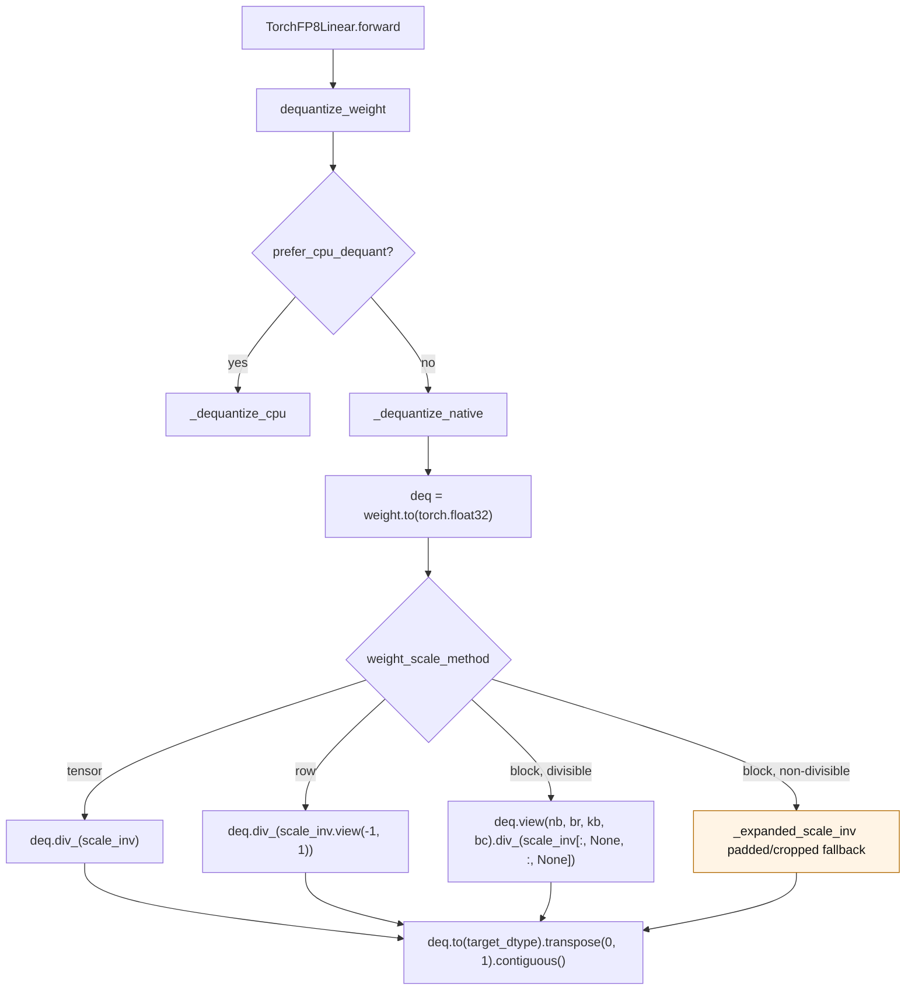
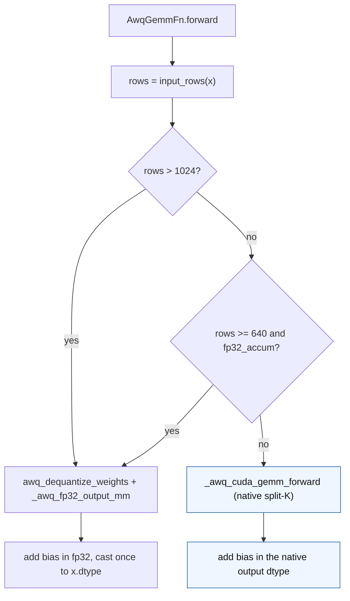

# FP8 dequantization scaling and AWQ GEMM dispatch

FP8 inference keeps the checkpoint weight in its packed FP8 representation and
dequantizes it into a transient FP32 buffer for the current forward. The scale
is stored as an inverse scale (`weight_scale_inv`), so dequantization is an
element-wise division, not a multiplication. This page describes the two
performance paths changed by issue #3971's follow-up work in issue #3984:

1. FP8 dequantization divides the FP32 weight buffer **in place** instead of
   materialising a full `N x K` FP32 scale tensor.
2. AWQ GEMM switches from the native split-K kernel to dequantise + FP32-output
   GEMM from 640 rows, instead of waiting for 1024 rows.

Both changes are fail-closed on shape/scale mismatches and keep no dense weight
or scale cache between calls.

## New FP8 dequantization flow

The common path allocates exactly one full-size buffer: the FP32 dequantization
result. FP8 to FP32 is exact, and the element-wise division order is unchanged,
so the output is bitwise identical to the previous `weight / expanded_scale`
formulation for divisible block shapes.

`_expanded_scale_inv` remains for non-divisible block shapes. It repeats each
block scale and then crops the result to the weight shape; if a floor-shaped
scale leaves rows or columns uncovered, the last scale row/column is replicated
first. The fallback never runs for the common 128x128 block shapes.

## New AWQ GEMM dispatch

`_awq_fp32_output_mm` uses `torch.mm(..., out_dtype=torch.float32)` on CUDA so
the GEMM, the bias add, and the final cast each round once. The `out_dtype`
overload is CUDA-only; the helper uses an FP32-input `torch.mm` on CPU so the
unit tests remain portable. Production `AwqGEMMLinear` is CUDA-only.

Rows below 640 stay on the native split-K kernel, which is faster there. The
historical `rows > 1024` path keeps its dispatch and now also produces FP32,
which removes the fp16-before-bias rounding it previously had.

## Before / after

| Area | Before (`origin/main`) | After |
| --- | --- | --- |
| FP8 block scale | `fp8.py:_dequantize_native` called `_expanded_scale_inv`, which ran two `repeat_interleave` calls, then `weight / expanded` | `fp8.py:520` divides `deq.view(nb, br, kb, bc)` in place with `scale_inv[:, None, :, None]` |
| FP8 row scale | `weight / scale_inv.view(-1, 1)` allocated a second full-size FP32 tensor | `fp8.py:534` `deq.div_(scale_inv.view(-1, 1))` |
| FP8 non-divisible block | full expansion could not broadcast to a smaller weight | `fp8.py:453` `_expanded_scale_inv` pads the last scale row/column and crops to the weight shape |
| AWQ threshold | `gemm_awq.py:84` `rows > 1024` | `gemm_awq.py:101` `rows > 1024 or (rows >= 640 and fp32_accum)` |
| AWQ output precision | `torch.matmul(x_2d, weight.to(x.dtype))` produced fp16/bf16 before the bias add | `gemm_awq.py:40` `_awq_fp32_output_mm` returns FP32; bias is added in FP32 and cast once |
| AWQ CPU tests | n/a | `_awq_fp32_output_mm` falls back to an FP32-input `torch.mm` |

## Contracts

- **No retained dense state.** The FP32 dequantization buffer and the
  dequantized AWQ weight are local to the call. Neither is stored on the module.
- **Bitwise FP8 equivalence.** Divisible tensor/row/block shapes produce the
  same bytes as the previous FP32 division. The regression test compares the
  in-place path with the old formulation using `torch.equal`.
- **Non-divisible fallback.** The fallback pads with the last scale row/column
  and crops to the weight shape. It is the only path that materialises the full
  expanded scale.
- **Dispatch contract.** `rows < 640` always uses the native AWQ kernel.
  `fp32_accum=False` keeps the historical `rows > 1024` dispatch. No
  `GPTQMODEL_*` switch selects either path.
- **Accuracy.** The FP32-output GEMM is accuracy-neutral or better than the
  native split-K kernel against an FP64 reference built from the dequantized
  weight.

Introduced by issue #3984.
