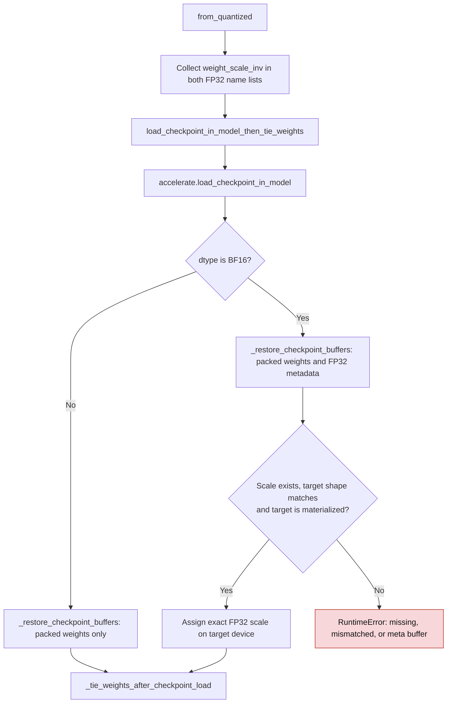

# FP8 inverse-scale checkpoint loading

GPT-QModel stores `TorchFP8Linear.weight_scale_inv` as FP32. A BF16 model load
must preserve that checkpoint value exactly: E5M2 inverse scales can exceed the
FP16 range, and BF16 can round finite FP32 values enough to change inference.
`keep_in_fp32_modules` only protects FP16 loads in Accelerate, so the BF16
checkpoint path restores these buffers from the checkpoint after loading.

## Load flow

| Mechanism | Before | After |
| --- | --- | --- |
| FP16 scale load | `keep_in_fp32_modules` preserved FP32 (`gptqmodel/models/loader.py:2351`) | Same Accelerate path |
| BF16 scale load | The loader passed `keep_in_fp32_modules` to Accelerate, which still cast the scale to BF16 (`gptqmodel/models/loader.py:2355`) | The loader adds the scale to `fp32_bf16_buffer_names`; `_restore_checkpoint_buffers` rereads the checkpoint value |
| Missing or mismatched scale | Could leave a default or rounded buffer | Raises `RuntimeError`; the model is not returned |

For BF16, the restore step reads selected `weight_scale_inv` tensors from a single
`.safetensors` file or the shards named by a `.safetensors.index.json` file.
For single-file checkpoints, it reads the key-converted temporary file when a
model definition remaps checkpoint keys. It validates each buffer's shape,
then places its value in FP32 on the target buffer's device. A missing tensor
or target on the `meta` device fails explicitly. FP16 loads continue to use
Accelerate's FP32 preservation path.

For example, an E5M2 code of `57344` with inverse scale `65792` produces
`0.87109375` for BF16 input `1`. Rounding that scale to BF16 `65536` instead
produces `0.875`, a measured relative difference of about `0.00448`.

Packed weights and FP32 metadata share checkpoint selection and restoration;
see [Packed FP8 weight lifecycle](fp8-packed-weight-lifecycle.md).

Introduced in [PR #3741](https://github.com/ModelCloud/GPTQModel/pull/3741).
