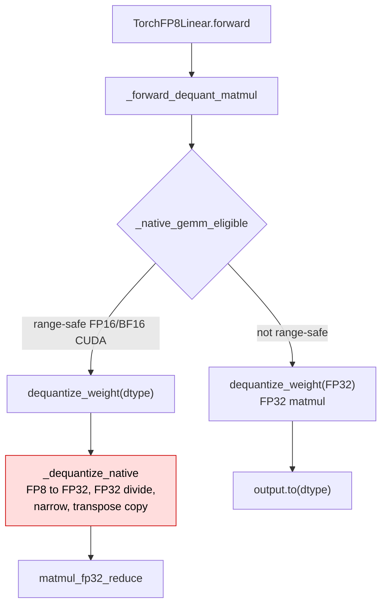
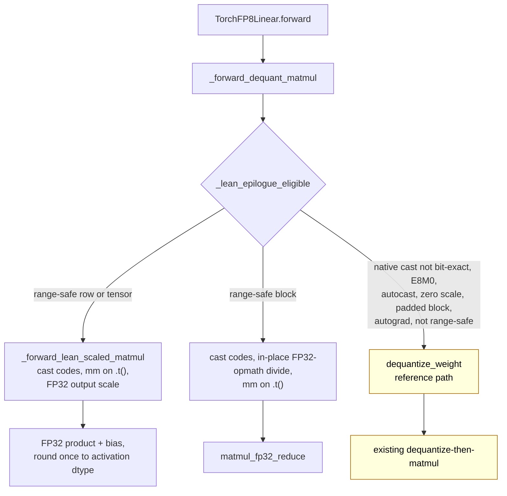

<!-- SPDX-FileCopyrightText: 2026 ModelCloud.ai -->
<!-- SPDX-License-Identifier: Apache-2.0 -->

# FP8 W8A16 decode: exact codes, transposed view, FP32 scale epilogue

`TorchFP8Linear` stores E4M3/E5M2 codes plus a scale. The default
`FP8Config()` is weight-only W8A16: the packed weight is consumed by the
current matmul and activations stay in their input FP16/BF16 dtype. This page
describes how the layer feeds that GEMM without materialising a decoded weight
(#5146).

The pre-fix forward rebuilt the whole decoded weight on every call:

1. `weight.to(torch.float32)` — a 4 B/element write;
2. an in-place FP32 divide by the expanded scale — a read and a write;
3. `.to(activation_dtype)` — an FP32 read and an FP16 write;
4. `.transpose(0, 1).contiguous()` — a full transpose copy, needed only so
   `matmul_fp32_reduce` received an `[in, out]` operand.

That is about 23 B of traffic per weight element for a 1 B/element format,
before the GEMM. At batch-1 decode the weight traffic, not the GEMM, dominates.

## Old flow

| Mechanism | Before (`902f1a42e`) |
| --- | --- |
| Decode entry | `_forward_dequant_matmul`, `gptqmodel/nn_modules/qlinear/fp8.py:938` |
| Full-weight decode | `dequantize_weight`, `:588` |
| Native arithmetic | `_dequantize_native`, `:628` |
| Transpose copy | `_dequantize_native`, `:628-669` |
| GEMM operand | contiguous `[in, out]` weight |

## New flow

The FP8 code is exact in FP16/BF16 (E4M3 has 3 mantissa bits, E5M2 has 2;
both dtypes hold at least 7). CUDA is assumed to qualify that cast; on ROCm,
where it was previously rejected wholesale, a once-per-process probe casts all
256 codes of the layer's format and compares them bit-for-bit with the CPU
cast before the lean path is taken (#5429). For a row or tensor scale, that
scale is constant across the reduction for each output row, so it can move to
the output:

`y = sum_k x_k * code_k / s = (sum_k x_k * code_k) / s`

The GEMM therefore runs on the `[out, in]` weight's transposed view with an
FP32 output, the scale is applied to that FP32 product, and the result is
rounded once. No decoded weight exists, and no transpose copy is made.
The FP32 output is required because the codes carry the inverse scale: the
unscaled product can exceed the activation dtype's finite range even when the
decoded weight is in range.

Block scales vary per `(block_row, block_col)` and cannot be factored out of
the reduction. Those cast the exact codes to the activation dtype and divide
them in place with the scale kept in FP32; the mixed-dtype op promotes to FP32,
divides there and rounds once. That is the same arithmetic as
`weight.float() / scale` followed by `.to(dtype)`, without the FP32 weight
temporary or the transpose copy.

| Mechanism | After |
| --- | --- |
| Decision | `_lean_epilogue_eligible`, `gptqmodel/nn_modules/qlinear/fp8.py:837` |
| Lean decode | `_forward_lean_scaled_matmul`, `:878` |
| Entry point | `_forward_dequant_matmul`, `:938` |
| Row/tensor operand | `codes.t()` view, `:915` |
| Row/tensor scale | FP32 output epilogue, `:920-931` |
| Block scale | in-place FP32-opmath divide, `:899-908` |
| Reference path | `dequantize_weight` + `matmul_fp32_reduce`, unchanged |

## Failure and ambiguity contract

| Situation | Behaviour |
| --- | --- |
| Decoded weight outside the activation dtype's finite range | reference FP32 dequant + FP32 matmul |
| Zero inverse scale | reference path; the epilogue cannot reproduce `0/0` rows |
| Block scale shape does not match the weight | reference path; padded/cropped scales keep `_expanded_scale_inv` |
| `float8_e8m0fnu` | reference path; its CUDA cast produces NaNs |
| Native FP8 cast not bit-exact, or unmeasured in a capture/trace | reference path; CUDA casts are qualified, ROCm is measured once per process (#5429) |
| Autocast active | reference path; the GEMM operands are narrowed by autocast |
| Autograd needs the wide-GEMM `Function` | reference path |
| Native cast previously disabled | reference path |

The lean gate is evaluated per call from host-visible state only, so a module
that moves, reloads or changes its payload re-evaluates it. The range and
zero-scale facts are derived from the packed scale and cached until the payload
changes (`_invalidate_compiled`).

## Storage contract

`_forward_lean_scaled_matmul` allocates the cast codes for the current call and
releases them when the call returns. Block scaling mutates that fresh tensor in
place; it never mutates the packed weight. No decoded tensor is stored in a
module attribute, buffer, closure or compiled graph constant, so repeated
forwards re-read the packed payload and observe any mutation of it.

## Validation

| Test | Invariant |
| --- | --- |
| `tests/kernels/test_fp8_lean_decode_5146.py::test_fp8_lean_decode_matches_fp64_oracle` | Row/tensor epilogue and block in-dtype divide match an independent FP64 oracle for tensor/row/block scales, inverse and multiplier semantics, FP16 and BF16, at M=1 and M=257; the pre-fix path is not more accurate |
| `tests/kernels/test_fp8_lean_decode_5146.py::test_fp8_lean_decode_retains_only_packed_weights` | Repeated forwards leave only FP8 codes, FP32 scales and the FP32 bias; no decoded weight is materialised |
| `tests/kernels/test_fp8_lean_decode_5146.py::test_fp8_lean_decode_does_not_regress_to_fp32_roundtrip` | A 4096x14336 M=1 layer stays within 1.8x of the cast + GEMM + epilogue emulation and 6x of dense FP16 |
| `tests/kernels/test_fp8_kernel.py::test_fp8_default_forward_is_w8a16` | Default W8A16 output matches the FP64 oracle at `rtol=atol=2e-3` |
| `tests/test_fp8_native_cast_probe_5429.py` | The cast probe covers all 256 codes of all four FP8 formats, caches one verdict per device/dtype pair, stays unmeasured (and uncached) during capture/tracing, and the lean gate follows the verdict |
| `tests/test_fp8_dequant_inplace.py` | The reference `_dequantize_native` arithmetic is unchanged |
| `scripts/benchmark_fp8_decode_5146.py --check` | Manual/CI ratio check for the Llama-3.1-8B projection shapes |

Measured on an RTX 4090 (sm_89, torch 2.15.0+cu132), M=1, 4096x14336:
dense FP16 96.9 us, pre-fix FP8 1552 us, lean FP8 299 us (5.2x faster than
pre-fix, 3.1x dense). The remaining cost is the per-call code cast; a fused
W8A16 FP8 kernel is the follow-up that would remove it.

Introduced for issue #5146.
