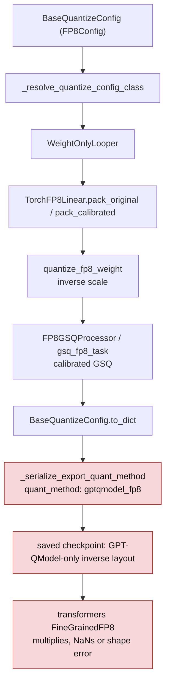
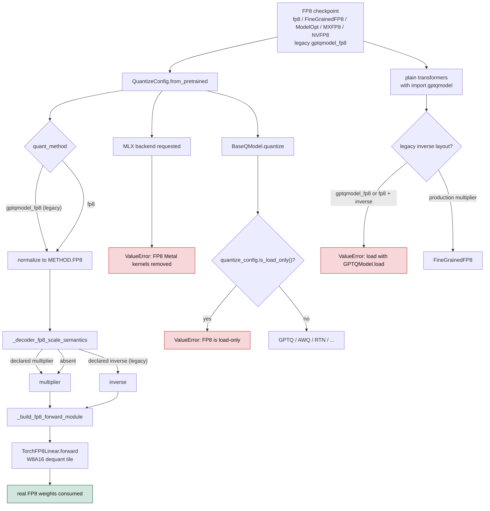

<!-- SPDX-FileCopyrightText: 2026 ModelCloud.ai -->
<!-- SPDX-License-Identifier: Apache-2.0 -->

# FP8 is load-only: production checkpoints in, no invented export

FP8 checkpoints are a production interchange format. GPT-QModel consumes the
formats real producers write — `transformers` `FineGrainedFP8` and
DeepSeek/Qwen block scales (`amax / 448` stored under `weight_scale_inv` and
multiplied), NVIDIA ModelOpt per-tensor scales, and MXFP8/NVFP8 where the
device supports them — and no longer writes a checkpoint of its own.

The previous FP8 export was a GPT-QModel-only format: `FP8Config` quantized
weights with an inverse scale (`weight = fp8 / weight_scale_inv`), published a
`gptqmodel_fp8` alias, and could not be read by any other runtime. That layout
is removed, including the calibrated GSQ-FP8 path, the MLX encoder and its
Metal decode kernels, and the `TorchFP8Linear.pack*` encode entry points. Legacy checkpoints that store the
inverse convention still load when they declare
`weight_scale_semantics="inverse"`, including checkpoints that still carry
the read-only `quant_method: "gptqmodel_fp8"` name written between #5181 and
#5242. That name is normalized to `METHOD.FP8` on load and is never written
again.

## Old flow: quantize and publish a private layout

## New flow: load a production checkpoint

## Removed surface

| Mechanism | Before | After |
| --- | --- | --- |
| Weight-only FP8 quantize/export | `WeightOnlyLooper` accepted `FP8Config` | `_resolve_quantize_config_class` raises `ValueError` for weight-only FP8 |
| `BaseQModel.quantize()` | ran the FP8 packer | raises `ValueError` via `BaseQuantizeConfig.is_load_only()` |
| `TorchFP8Linear.pack*` | wrote FP8 codes and inverse scales | `_refuse_fp8_encode` raises `ValueError` |
| `quant_method` alias | published `gptqmodel_fp8` | removed from export; `_serialize_export_quant_method` returns `fp8`. The legacy `gptqmodel_fp8` name is accepted on load and normalized to `METHOD.FP8` |
| Calibrated GSQ-FP8 | `FP8GSQProcessor`, `gsq_fp8`, `gsq_fp8_task`, `gsq_calibration` | deleted; GSQ remains for GPTQ, AWQ, RTN, QQQ and Paro |
| MLX FP8 runtime | `quantization/mlx_fp8.py` encoder and `nn_modules/qlinear/mlx_fp8.py` Metal decode kernels | both deleted; the MLX backend rejects `FORMAT.FP8` and FP8 loads use the Torch backend |
| HF save warning | warned that `FineGrainedFP8` misreads GPT-QModel scales | removed with the export |

## Failure and ambiguity contract

| Situation | Result |
| --- | --- |
| `model.quantize()` with `FP8Config` | `ValueError` naming the production layouts to load instead |
| FP8 checkpoint with `backend="mlx"` | `ValueError` naming the removed Metal kernels and directing the load to the Torch backend |
| `TorchFP8Linear.pack_original` / `pack_block` / `pack_gpu` | `ValueError: FP8 is load-only` |
| `quant_method: "gptqmodel_fp8"` in a checkpoint | loads through `GPTQModel.load` as the legacy FP8 layout; plain `transformers` refuses it with the `GPTQModel.load` remedy |
| Legacy `quant_method: "fp8"` with `weight_scale_semantics="inverse"` | loads through `GPTQModel.load`; plain `transformers` refuses it because `FineGrainedFP8` would multiply the inverse scale |
| Legacy inverse-scale checkpoint with `weight_scale_semantics="inverse"` | loads; the scale convention is honoured |
| Production block/multiplier checkpoint | loads through `TorchFP8Linear` W8A16 |
| `weight_scale_semantics` outside `{multiplier, inverse}` | `ValueError` |

## Tests

| Test | Invariant |
| --- | --- |
| `tests/test_fp8.py::test_fp8_config_round_trip_is_load_only` | `FP8Config` survives a dict round trip and reports `is_load_only()` |
| `tests/test_fp8.py::test_quantize_refuses_load_only_fp8` | `BaseQModel.quantize()` refuses FP8 before any calibration |
| `tests/test_fp8.py::test_weight_only_fp8_export_is_rejected` | the weight-only FP8 config class resolution raises |
| `tests/test_fp8.py::test_torch_fp8_pack_entry_points_refuse` | every `pack*` entry point raises |
| `tests/test_fp8.py::test_legacy_gptqmodel_fp8_quant_method_is_accepted_on_load` | the legacy alias normalizes to `METHOD.FP8` and re-saves as `fp8` |
| `tests/test_fp8.py::test_legacy_gptqmodel_fp8_checkpoint_loads_and_forwards` | row, block and alias-only legacy checkpoints load and match a dense Torch oracle |
| `tests/test_fp8.py::test_transformers_refuses_gptqmodel_inverse_fp8_checkpoints` | plain `transformers` refuses `gptqmodel_fp8` and `fp8` + `inverse` with the `GPTQModel.load` remedy |
| `tests/test_mlx_fp8_removed.py` | no MLX FP8 kernel or holder exists, the MLX loader rejects `FORMAT.FP8`, and Torch still selects `TorchFP8Linear` |
| `tests/test_checkpoint_modules.py::test_checkpoint_persists_effective_dynamic_fp8_settings` | the multiplier default round-trips and legacy `inverse` is still accepted |
| `tests/kernels/test_fp8_kernel.py` | production W8A16 decode still matches an FP64 oracle |

Related pages: [FP8 scale semantics](fp8-scale-semantics.md),
[FP8 weight-only dispatch](fp8-weight-only-dispatch.md),
[Packed FP8 weight lifecycle](fp8-packed-weight-lifecycle.md).
