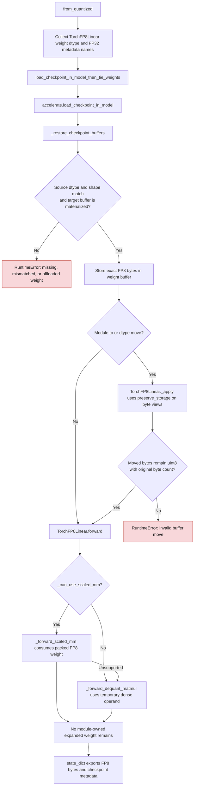

# Packed FP8 weight lifecycle

GPT-QModel stores `TorchFP8Linear.weight` in its FP8 checkpoint dtype, one byte
per code. A requested FP16 or BF16 model dtype controls activations and ordinary
model tensors; it must not widen packed codes or narrow the FP32 inverse scale
and checkpoint bias. Accelerate casts floating checkpoint tensors during load,
so the loader restores selected FP8 buffers from the checkpoint. Module moves
apply the requested device change to byte views and restore their native dtypes.

## Checkpoint, move, and forward flow

| Operation | Before | After |
| --- | --- | --- |
| FP16/BF16 checkpoint load (`gptqmodel/utils/model.py:2757`) | Accelerate widened FP8 `weight` to the requested model dtype | `_restore_checkpoint_buffers` rereads the native FP8 value, checks source dtype, shape, and device, and assigns it to the buffer |
| Module dtype/device move (`gptqmodel/nn_modules/qlinear/fp8.py:636`) | `nn.Module._apply` cast FP8 codes and FP32 scale/bias to the requested dtype | `preserve_storage` applies the move to byte views, then restores the source dtype and shape |
| BF16 bias reload (`gptqmodel/models/loader.py:2369`) | FP8 bias could be rounded to BF16 | The existing FP32 metadata restore path includes FP8 bias |
| Invalid source or target | Could retain a widened or default buffer | Raises before returning the loaded model |

The restore step accepts a single checkpoint file, an indexed safetensors
checkpoint, or a directory resolved the same way as Accelerate. For a
single-file key conversion, it reads the converted temporary checkpoint.
Packed tensors must have the module's declared FP8 dtype; a widened source
cannot be silently re-encoded as FP8. BF16 scales and biases use the FP32
restore names, while FP16 metadata uses Accelerate's existing FP32
preservation behavior. `TorchFP8Linear._apply` preserves the original dtype
of each packed weight, scale, and bias when the module moves.

For a measured 32×32 E5M2 weight, the checkpoint and restored buffer each
contain **1,024 bytes**. The previous FP16/BF16 reload held **2,048 bytes**.
With bias, the CPU forward creates a **4,096-byte** FP32 dequantized operand
for the current matmul; the module retains no reference after the call.
Tests compare every packed byte and the visible FP16/BF16 output with an
independent Torch decode and matmul oracle.

Introduced in [PR #3749](https://github.com/ModelCloud/GPTQModel/pull/3749).
