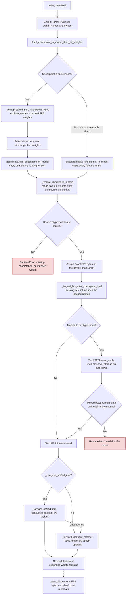

# Packed FP8 weight lifecycle

GPT-QModel stores `TorchFP8Linear.weight` in its FP8 checkpoint dtype, one byte
per code. A requested FP16 or BF16 model dtype controls activations and ordinary
model tensors; it must not widen packed codes or narrow the FP32 inverse scale
and checkpoint bias. Accelerate casts floating checkpoint tensors during load,
so the loader hands Accelerate a temporary checkpoint without the packed
weights and restores those bytes from the source checkpoint. Module moves apply
the requested device change to byte views and restore their native dtypes.

## Checkpoint, move, and forward flow

| Operation | Before | After |
| --- | --- | --- |
| FP16/BF16 checkpoint load (`gptqmodel/utils/model.py:3478`, `:3540`) | Accelerate read every FP8 `weight`, cast it to the requested model dtype, and staged the whole shard on the target device | `_remap_safetensors_checkpoint_keys` (`:3095`) writes a temporary checkpoint without the packed weights, so Accelerate never sees them |
| Packed-weight restore (`gptqmodel/utils/model.py:3310`) | `_restore_checkpoint_buffers` reread the FP8 value after the widened copy existed | It reads the FP8 value from the source checkpoint (`name_map` applies key conversion) and assigns it on the `device_map` target |
| Missing-key detection (`gptqmodel/utils/model.py:2862`) | Used the checkpoint Accelerate received | Adds the packed names the loader restored itself, so `tie_weights(missing_keys=...)` sees the full checkpoint |
| Module dtype/device move (`gptqmodel/nn_modules/qlinear/fp8.py:747`) | `nn.Module._apply` cast FP8 codes and FP32 scale/bias to the requested dtype | `preserve_storage` applies the move to byte views, then restores the source dtype and shape |
| BF16 bias reload (`gptqmodel/models/loader.py:3335`) | FP8 bias could be rounded to BF16 | The existing FP32 metadata restore path includes FP8 bias |
| Invalid source or target | Could retain a widened or default buffer | Raises before returning the loaded model |

The safetensors-only exclusion is a compatibility boundary. A pickle
checkpoint, or an index whose shards are not all safetensors, falls back to the
previous Accelerate load and then restores the packed bytes; it is correct but
keeps the old peak. The fallback is deliberate: rewriting a pickle or a
non-safetensors shard would change the container contract.

The restore step accepts a single checkpoint file, an indexed safetensors
checkpoint, or a directory resolved the same way as Accelerate. For a
key-converted checkpoint without packed weights, it reads the converted
temporary checkpoint; when packed weights are present, it reads the source
checkpoint and applies the key conversion through `name_map`.
Packed tensors must have the module's declared FP8 dtype; a widened source
cannot be silently re-encoded as FP8. BF16 scales and biases use the FP32
restore names, while FP16 metadata uses Accelerate's existing FP32
preservation behavior. `TorchFP8Linear._apply` preserves the original dtype
of each packed weight, scale, and bias when the module moves.

For a measured 32×32 E5M2 weight, the checkpoint and restored buffer each
contain **1,024 bytes**. The previous FP16/BF16 reload held **2,048 bytes**.
With bias, the CPU forward creates a **4,096-byte** FP32 dequantized operand
for the current matmul; the module retains no reference after the call.
Tests compare every packed byte and the visible FP16/BF16 output with an
independent Torch decode and matmul oracle.

## Measured load peak

A GPT-QModel FP8 export of `HuggingFaceTB/SmolLM2-135M` (210 packed E4M3
weights) loaded with `GPTQModel.load(..., device="cuda")` on an NVIDIA GB10.
Peak allocated memory is `torch.cuda.max_memory_allocated()`; host peak is the
process `VmHWM` after the load. Both runs produced the same state-dict SHA-256
(`24c449…` for BF16, `e232d0…` for FP16).

| Load dtype | Resident | Before peak | After peak | Before host peak | After host peak |
| --- | ---: | ---: | ---: | ---: | ---: |
| BF16 | 163,546,624 B | 376,235,520 B | 163,546,624 B | 2,439,828 KiB | 2,127,892 KiB |
| FP16 | 163,546,624 B | 432,599,040 B | 163,546,624 B | 2,461,816 KiB | 2,141,496 KiB |

The same checkpoint split into two safetensors shards measured 296,394,240 B
before and 163,546,624 B after (BF16). All four runs loaded the same state-dict
digest, and a fixed eight-token forward pass produced identical logits.

The after peak equals the resident footprint: no widened FP8 copy is created.
`tests/test_fp8_load_peak_4387.py` pins the same invariant on a synthetic
checkpoint, including a sharded, key-converted checkpoint and a CUDA
`max_memory_allocated` comparison against the pre-fix load.

Introduced in [PR #3749](https://github.com/ModelCloud/GPTQModel/pull/3749).
The checkpoint-load exclusion that removes the widened FP8 copy was added for
issue #4387.
