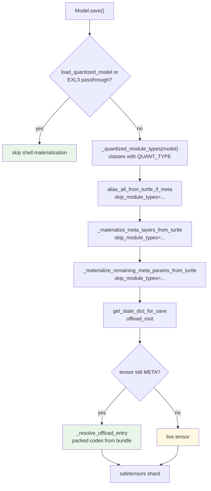
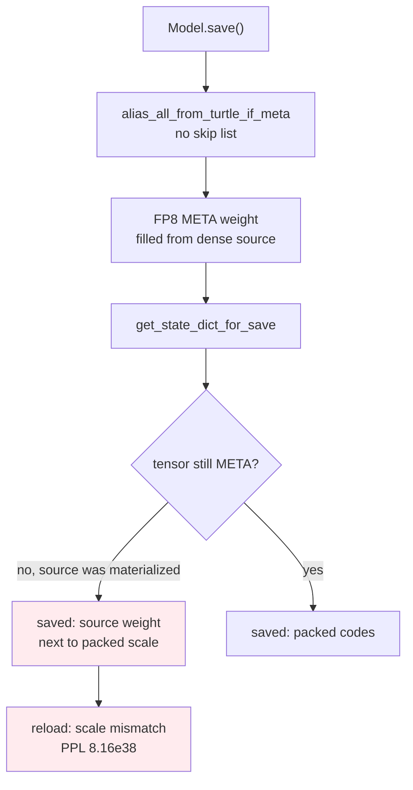
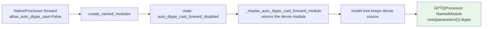
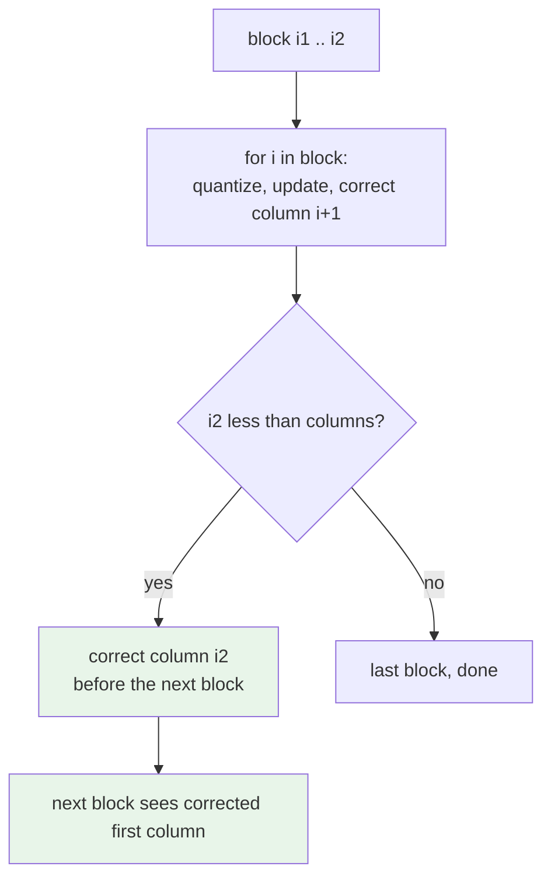

<!-- SPDX-FileCopyrightText: 2026 ModelCloud.ai -->
<!-- SPDX-License-Identifier: Apache-2.0 -->

# Packed payloads and save-time source materialization

A quantized module owns its packed payload. `TorchFP8Linear` keeps FP8 codes in
a buffer named `weight` — the same leaf name as the dense source tensor it was
packed from — and `TorchFP4Linear` keeps its NVFP4 codes there too. The lazy
checkpoint loader (`LazyTurtle`) materializes META tensors **by checkpoint
name**, so any save-time pass that runs before the disk-offload restore will
happily replace packed codes with the original dense weight.

That is a silent corruption: the saved file then holds `float8_e4m3fn` source
weights next to the packed `weight_scale_inv`, and reloading divides by a scale
that belongs to a different tensor. Measured on Qwen2.5-0.5B-Instruct with the
default `offload_to_disk=True`: saved `q_proj.weight` absmax `1.25` (source)
instead of `448.0` (packed codes), reloaded PPL `8.16e38` instead of `2.67`.

This page documents the ownership rule that the writer now follows, the
forward-only AUTO_NF12 boundary that shares the same failure shape, and the
FOEM block-boundary correction that was dead code.

Introduced by PR #4046 (issue #4037).

## The rule

1. A module that declares `QUANT_TYPE` owns its direct tensors. Save-time
   materialization must not fill them from the dense source checkpoint.
2. The on-disk offload bundle is authoritative for those modules. It is written
   from `module.state_dict()` at pack time, so it holds the packed codes,
   scales, and folded biases exactly as the quantizer produced them.
3. A forward pass that has no follow-up quantization task must not install a
   packed AUTO_NF12 wrapper in the model tree. Nothing would restore the dense
   source before the next processor wraps the module.

## Save path

`Model.save()` resolves every published tensor through
`get_state_dict_for_save(model, offload_root=...)`. When a tensor is still META
that helper resolves an `OffloadTensorRef` from the bundle
(`_collect_state_dict_with_offload` -> `_resolve_offload_entry`) and streams
those bytes into the shard. The writer therefore only has to *leave the packed
payload alone*.

`_quantized_module_types()` collects the *classes* present in the model rather
than a hardcoded list, so a plugin quantizer that declares `QUANT_TYPE` is
covered without another edit. The skip list flows through:

- `alias_all_from_turtle_if_meta` -> `LazyTurtle.sync_all_meta`
- `_materialize_meta_layers_from_turtle` -> `alias_from_turtle_for_submodule`
  -> `LazyTurtle.materialize_submodule` ->
  `_copy_checkpoint_tensors_into_submodule`
- `_materialize_remaining_meta_params_from_turtle` (its parameter fallback)

`_copy_checkpoint_tensors_into_submodule` filters by *owner module path*, so a
skipped module's `weight`, `weight_scale_inv`, and `bias` are all left to the
offload restore while its dense neighbours still materialize normally.

### Before

| Area | Before | After |
| --- | --- | --- |
| Save materialization (`gptqmodel/models/writer.py:2088-2107` on the base commit) | every META tensor aliased from the dense source | `skip_module_types=_quantized_module_types(self.model)` on all three helpers |
| Lazy sync (`gptqmodel/utils/structure.py`) | `sync_all_meta` and `_copy_checkpoint_tensors_into_submodule` wrote every leaf by checkpoint name | skipped module classes are filtered by owner path |
| `_materialize_remaining_meta_params_from_turtle` | parameter fallback also read the source | skips params owned by a skipped class |

### Failure contract

| Situation | Result |
| --- | --- |
| Packed tensor is META and present in the offload bundle | packed codes are written (expected) |
| Packed tensor is META and absent from the offload bundle | `get_state_dict_for_save` raises `FileNotFoundError` (fail-closed); it never falls back to the dense source |
| Packed tensor is live (no offload) | written as-is; the skip list is a no-op |
| Non-quantized META tensor | materialized from the source exactly as before |

## Forward-only AUTO_NF12 capture

`auto_dtype_cast=AUTO_NF12` (the default) keeps a dense calibration source
packed for the forward pass. `_maybe_auto_dtype_cast_forward_module` installs an
`AutoNF12HookedLinear` in the model tree and records
`auto_dtype_cast_source_spec`; the *next* pass over the same module in the
`quant_source` role restores the dense source. `NativeProcessor` (GPTAQ, and
FOEM with `alpha > 0`) is a capture-only pass: it has no quantization task, so
nothing restored the source and `NamedModule.__init__` hit
`next(module.parameters())` on a parameterless wrapper (`StopIteration`).

`ForwardConfig.allow_auto_dtype_cast` is the declarative switch. It is `True`
for processors that later materialize a quantization source and `False` for
`NativeProcessor`. `ModuleLooper.create_named_modules` translates it into the
existing `auto_dtype_cast_forward_disabled` state key, which
`_maybe_auto_dtype_cast_forward_module` already honors for EoRA and for replay
of fully excluded layers.

| Situation | Before | After |
| --- | --- | --- |
| Native capture forward (`gptqmodel/looper/native_processor.py:33-38` on the base commit) | default AUTO_NF12 packing | `allow_auto_dtype_cast=False` |
| Looper decision (`gptqmodel/looper/module_looper.py` `create_named_modules`) | only EoRA disabled the cast | any processor whose forward policy forbids it |
| GPTQ pass after the capture | `StopIteration` at `gptqmodel/looper/named_module.py:33` | dense source is wrapped normally |
| Model tree after the capture | packed wrapper left behind | dense module |

## FOEM block-boundary correction

`FOEM.quantize` pulls the next column back toward its raw value before that
column is quantized. The in-block form ran for columns `i1+1 .. i2-1`; the
block-boundary form targeted `W[:, i2+1]` after the inner loop had already
ended (`i == count - 1`), so it never executed. Every block after the first
skipped `beta` for its first column, which made results depend on `blocksize`.

| Area | Before | After |
| --- | --- | --- |
| `gptqmodel/quantization/foem.py:370-371` on the base commit | `if i+1 < count: W[:, i2+1] -= beta * (W[:, i2+1] - W_raw[:, i2+1])` — unreachable, and off by one | `if i2 < columns: W[:, i2] -= beta * (W[:, i2] - W_raw[:, i2])` |

Measured on a synthetic 512-column linear with `group_size=-1`, `beta=0.2`,
`bits=4`: `blocksize=128` vs `512` differed in 136 weights (max `|ΔW|`
`5.89e-3`, avg loss `0.230374` vs `0.223945`) and now differs in 0 weights
(avg loss `0.22394484` vs `0.22394483`). `beta=0` still reduces to GPTQ.

## Tests

| Test | Invariant |
| --- | --- |
| `tests/test_fp8_save_offload.py::test_save_materialization_skips_packed_fp8_payload` | the writer's skip tuple leaves a META FP8 `weight` for the offload restore; without it the source replaces the codes |
| `tests/test_fp8_save_offload.py::test_fp8_default_offload_save_round_trip_keeps_packed_codes` | end to end: saved `q_proj.weight` bytes equal the packed codes and the reloaded PPL is sane |
| `tests/test_auto_dtype_cast.py::test_forward_only_processor_keeps_dense_modules_in_the_tree` | a capture-only forward does not install `AutoNF12HookedLinear` |
| `tests/test_auto_dtype_cast.py::test_native_processor_forward_forbids_auto_dtype_cast` | `NativeProcessor` declares the policy |
| `tests/test_gptaq_foem_batch.py::test_foem_block_boundary_beta_correction_is_blocksize_invariant` | FOEM's `beta` correction reaches the first column of every block |
