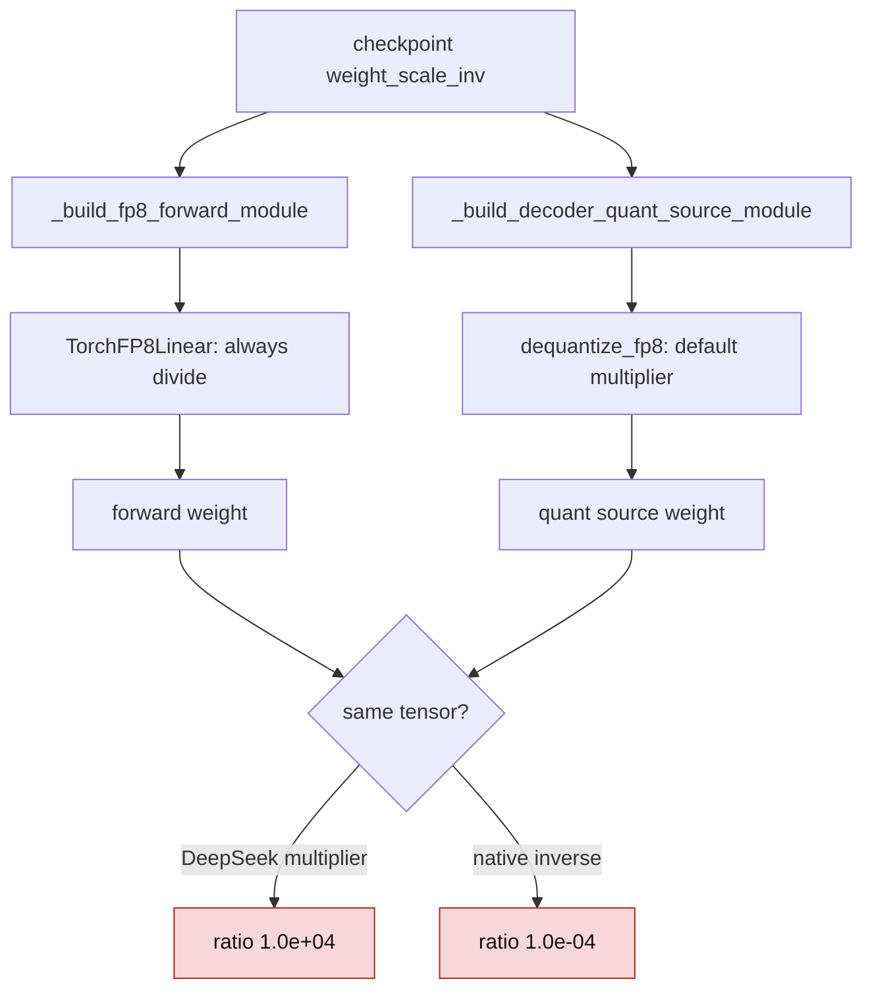
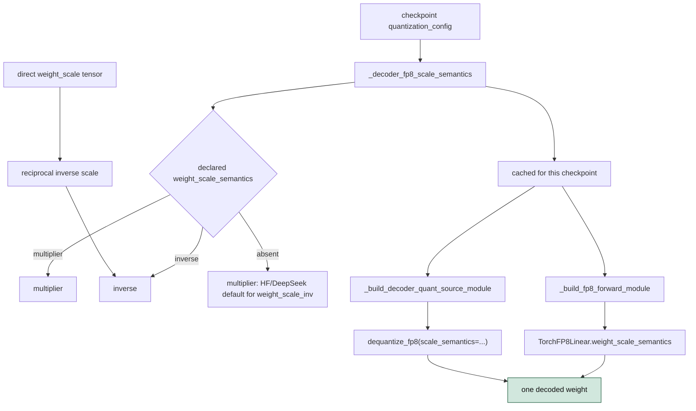

<!-- SPDX-FileCopyrightText: 2026 ModelCloud.ai -->
<!-- SPDX-License-Identifier: Apache-2.0 -->

# FP8 checkpoint scale semantics

An FP8 checkpoint can name its weight scale either `weight_scale` (a direct
multiplier) or `weight_scale_inv` (historically an inverse scale). The two names
are not enough to know the arithmetic: HF/DeepSeek/Qwen checkpoints store
`amax / 448` under `weight_scale_inv` and **multiply** it, while native
GPT-QModel inverse scales **divide** it.

GPT-QModel decodes one checkpoint weight through two paths:

- `BaseQModel._build_fp8_forward_module` builds the native `TorchFP8Linear`
  forward wrapper.
- `BaseQModel._build_decoder_quant_source_module` builds the dense CPU source
  that is quantized to W4A16.

Both paths must apply the same convention. Resolving the semantics inside each
path independently made the forward wrapper divide while the quant source
multiplied, so the same tensor decoded 10^4 apart.

## Old flow

Each consumer decided on its own. The forward wrapper always divided; the quant
source used `dequantize_fp8`'s default, which after #3997 is a multiplier.

## New flow

`BaseQModel._decoder_fp8_scale_semantics()` resolves the convention once per
checkpoint and caches it. The declared
`quantization_config.weight_scale_semantics` wins; when it is absent the
HF/DeepSeek default for `weight_scale_inv` is `multiplier`. A direct
`weight_scale` tensor is normalized to the inverse representation and therefore
always uses `inverse`.

`TorchFP8Linear` now executes both conventions in every arithmetic path:
`_dequantize_native`, `_dequantize_cpu`, `dequantize_weight`, and the
`torch._scaled_mm` weight scale. The `_scaled_mm` path is only used by the
explicit per-token W8A8 opt-in; see
[FP8 weight-only dispatch](fp8-weight-only-dispatch.md). `FP8Config` still emits only GPT-QModel's own
inverse scales; the multiplier spelling is accepted for loaded checkpoints.

## Before / after

| Mechanism | Before | After |
| --- | --- | --- |
| Forward wrapper semantics | `TorchFP8Linear` only divided; a multiplier checkpoint was wrong by 1e4 (`gptqmodel/models/base.py:4045`) | `_build_fp8_forward_module` passes the resolved semantics (`gptqmodel/models/base.py:4070`, `:4114`) |
| Quant-source semantics | `dequantize_fp8` defaulted to multiplier (`gptqmodel/models/base.py:3683`) | Same resolved value is passed explicitly (`gptqmodel/models/base.py:3683-3686`) |
| Resolution | Two independent decisions | One cached `_decoder_fp8_scale_semantics()` per checkpoint (`gptqmodel/models/base.py:4850`) |
| Wrapper arithmetic | `inverse` only; other values raised `NotImplementedError` (`gptqmodel/nn_modules/qlinear/fp8.py:492`) | `multiplier` and `inverse` in native, CPU, and `_scaled_mm` paths (`:532`, `:575`, `:592`) |
| Direct `weight_scale` | Reciprocated and divided | Reciprocated and explicitly `inverse` |

## Failure and ambiguity contract

| Situation | Before | After |
| --- | --- | --- |
| `weight_scale_inv` multiplier, no config field | Forward divided; quant source multiplied | Both multiply |
| `weight_scale_inv` inverse, no config field | Forward divided; quant source multiplied | Both multiply (the HF default); declare `inverse` for a native inverse checkpoint |
| `weight_scale_inv` with `weight_scale_semantics="inverse"` | Forward divided; quant source multiplied | Both divide |
| Direct `weight_scale` | Forward divided by the reciprocal; quant source multiplied the direct scale | Both multiply the direct scale |
| Unknown declared semantics | Silently treated as multiplier by `dequantize_fp8` | `ValueError` from `_decoder_fp8_scale_semantics` |

## Validation

| Test | Invariant |
| --- | --- |
| `tests/test_auto_module_decoder.py::test_fp8_forward_and_quant_source_share_the_declared_scale_semantics` | Forward and quant source match an independent FP64 oracle for both conventions |
| `tests/test_auto_module_decoder.py::test_shell_materialize_forward_defers_fp8_quant_source_until_quantization` | The deferred quant source agrees with the native forward wrapper |
| `tests/test_fp8_dequant_inplace.py` | Native in-place dequantization stays bitwise identical to the expanded-scale arithmetic |

Measured on the issue's repro (FP8 E4M3 weight, one row scale):

| Convention | Before forward / quant source | After |
| --- | --- | --- |
| multiplier, `scale_inv=0.01` | `7.81e-1` / `7.82e-4`, ratio `1.0e+04` | `7.81e-4` / `7.82e-4`, ratio `0.999` |
| inverse, `scale_inv=100` | `7.81e-4` / `7.82e+0`, ratio `1.0e-04` | `7.81e-4` / `7.82e-4`, ratio `0.999` |

The remaining `0.1%` is the quant source's BF16 output rounding; the FP32
forward matches the FP64 oracle to `1e-6`.

Introduced in [PR #4025](https://github.com/ModelCloud/GPTQModel/pull/4025)
(issue #4003). See [checkpoint dtype boundary preservation](dtype-boundary-preservation.md)
for the surrounding dtype rules.
