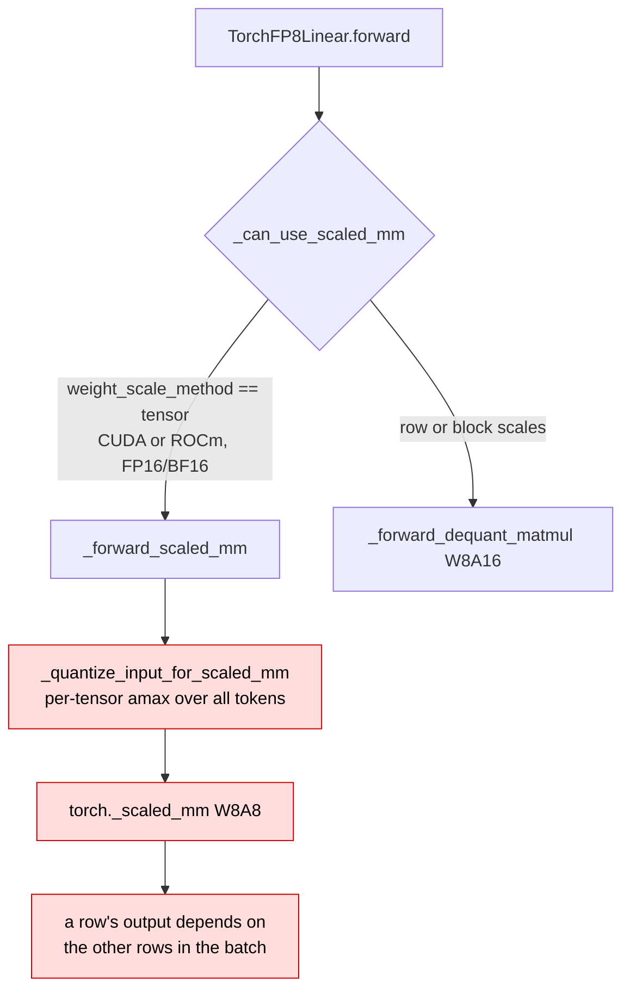
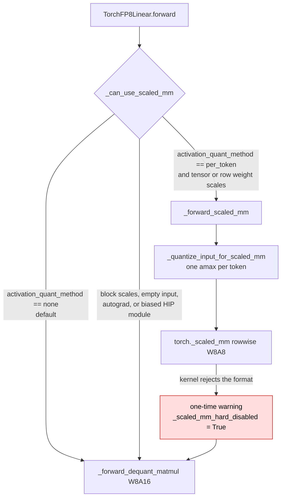

<!-- SPDX-FileCopyrightText: 2026 ModelCloud.ai -->
<!-- SPDX-License-Identifier: Apache-2.0 -->

# FP8 weight-only dispatch: W8A16 by default

`TorchFP8Linear` stores FP8 weights. By default it **dequantizes the weight
tile for the current matmul and keeps activations in their input FP16/BF16
dtype**, so the layer is **W8A16**. The GPU `torch._scaled_mm` path quantizes
activations; it is taken **only** when the module is explicitly switched to
`activation_quant_method="per_token"`, which makes the layer **W8A8** with one
activation scale per token.

There is deliberately no per-tensor activation mode. A per-tensor `amax` makes
one row's output depend on the largest activation batched beside it, so the
same rows produce different results depending on their neighbours. That is a
semantic defect, not an accuracy budget: measured on an R9700, the default
per-tensor W8A8 path was 10-25x over the `2e-3` inference tolerance and moved
rows by ~4% when a `2000.0` activation joined the batch.

## Old flow

`_can_use_scaled_mm` admitted every tensorwise FP8 module on CUDA/ROCm, and
`_quantize_input_for_scaled_mm` reduced the activation `amax` over the whole
batch. A "weight-only" layer therefore ran W8A8 on GPU.



| Mechanism | Before | After |
| --- | --- | --- |
| Dispatch gate | `weight_scale_method == "tensor"` alone selected `_scaled_mm` (`gptqmodel/nn_modules/qlinear/fp8.py:630` at the parent revision) | `activation_quant_method == "per_token"` is required (`:677`) |
| Activation scale | `amax()` over all tokens for tensorwise weights (`:605-613` at the parent revision) | `amax(dim=1, keepdim=True)`, one scale per token (`:650-657`) |
| Default arithmetic | W8A8 on CUDA/ROCm, W8A16 elsewhere | W8A16 everywhere |
| Scale shape passed to `_scaled_mm` | per-tensor scalar | rowwise `scale_a` `(tokens, 1)` and `scale_b` `(1, out_features)` |
| Accuracy coverage | `tests/kernels/test_fp8_kernel.py` disabled the path | the default path is tested against an independent FP64 weight-only oracle |

## New flow

The default module never quantizes activations. The W8A8 opt-in is a separate,
explicit request, and it always uses per-token scales.



The opt-in is the module method `set_activation_quant_method`, or the
`activation_quant_method` constructor keyword:

```python
from gptqmodel.nn_modules.qlinear.fp8 import TorchFP8Linear

weight_only = TorchFP8Linear(..., weight_scale_method="tensor")  # W8A16
weight_only.set_activation_quant_method("per_token")             # explicit W8A8
```

`FP8Config` does not emit this keyword, so loaded checkpoints
stays on the W8A16 default. The opt-in is an inference-time module switch for
callers that want W8A8 and accept its accuracy contract.

## Failure and ambiguity contract

| Situation | Before | After |
| --- | --- | --- |
| Default tensorwise FP8 on GPU | W8A8 with a per-tensor activation scale | W8A16; `_can_use_scaled_mm` returns `False` |
| `activation_quant_method="per_token"`, e4m3, bias-free | not expressible | W8A8 with per-token scales |
| `activation_quant_method="per_token"`, e5m2 | e5m2 W8A8 on ROCm; unsupported on CUDA | `_scaled_mm` rejects it, one warning, W8A16 fallback |
| `activation_quant_method="per_token"`, HIP with bias | fp32 bias epilogue unavailable | stays on W8A16, because hipBLASLt rowwise emits BF16 only and the bias would round after the reduction |
| Unknown `activation_quant_method` | silently per-tensor W8A8 | `ValueError` at construction or `set_activation_quant_method` |
| Autograd or empty input | dequant fallback | unchanged: dequant fallback |

## Hardware support for the W8A8 opt-in

| Device | e4m3 rowwise `_scaled_mm` | e5m2 rowwise `_scaled_mm` |
| --- | --- | --- |
| CUDA (RTX 4090, torch 2.16+cu130) | FP16, BF16, and FP32 output | rejected by cuBLASLt |
| ROCm (R9700/gfx1201, torch 2.16+rocm10.1) | BF16 output only | rejected by hipBLASLt |

Unsupported combinations degrade to the W8A16 dequant path with one warning;
they never fall back to a per-tensor activation scale.

## Validation

| Test | Invariant |
| --- | --- |
| `tests/kernels/test_fp8_kernel.py::test_fp8_default_forward_is_w8a16` | Default tensor/row/block e4m3 and e5m2 match an independent FP64 weight-only oracle within `2e-3`; `_can_use_scaled_mm` is `False` |
| `tests/kernels/test_fp8_kernel.py::test_fp8_default_forward_is_batch_invariant` | The same four rows are unchanged when a `2000.0` row is batched beside them |
| `tests/kernels/test_fp8_kernel.py::test_fp8_w8a8_is_opt_in_and_uses_per_token_scales` | W8A8 is reachable only through the explicit method, `scale_a` is `(tokens, 1)`, and per-row codes/scales are bitwise independent of neighbours |
| `tests/kernels/test_fp8_kernel.py::test_fp8_w8a8_forward_is_batch_invariant` | The explicit W8A8 path is batch-invariant too |
| `tests/kernels/test_fp8_kernel.py::test_fp8_forward_matches_dequantized_reference` | The shipped default path is tested without disabling `_scaled_mm` |

Introduced for issue #4177.
