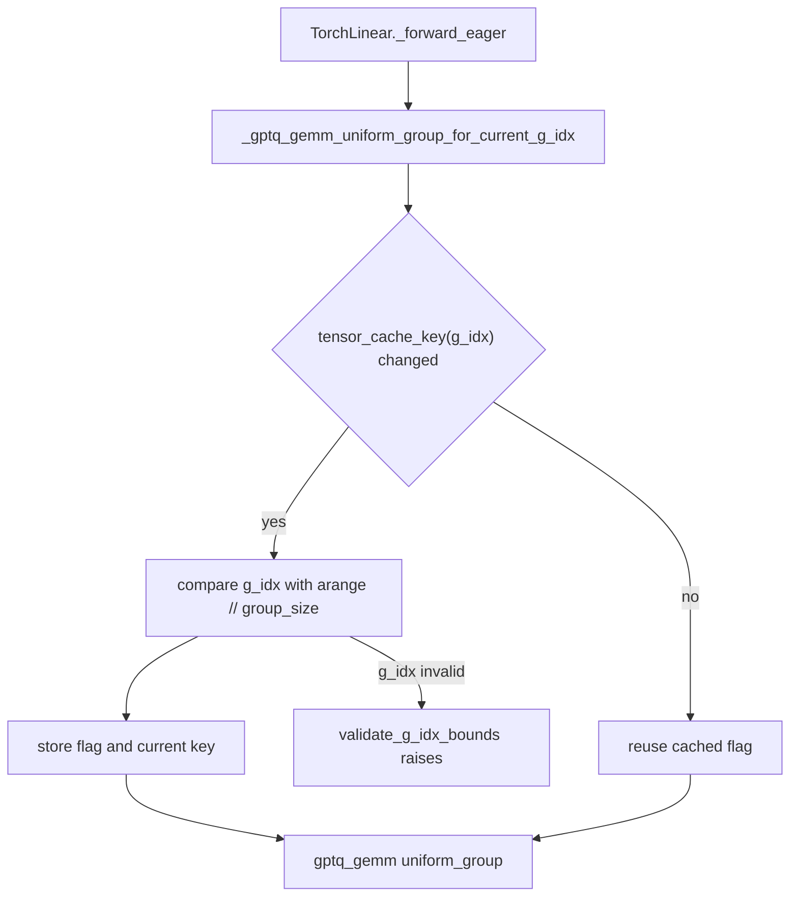
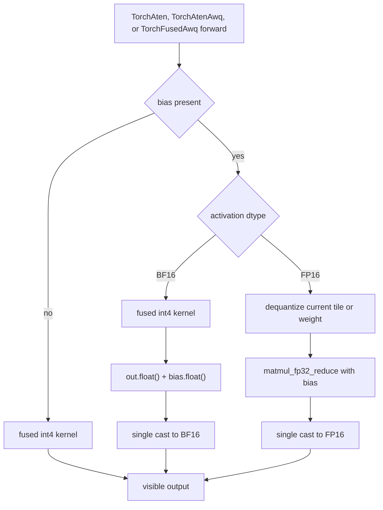
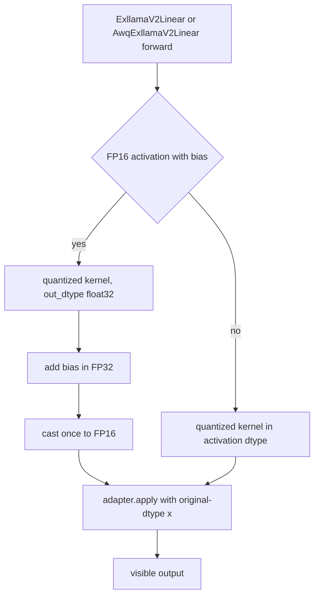

# Fused kernel dispatch and bias epilogues

Fused quantized kernels avoid materializing a dense weight, but their dispatch
metadata and output epilogues must follow the live checkpoint state. This page
describes the flow introduced in PR for issue #4028. It covers the GPTQ
small-M uniform-group decision, CPU BF16 fused dispatch, and FP32-output
epilogues for biased ExLlamaV2 kernels.

## Live GPTQ dispatch metadata

`TorchLinear` may replace a per-row `g_idx` gather with one scale and zero row
per K tile when `g_idx` is the uniform mapping `arange(in_features) //
group_size`. The decision is keyed by `tensor_cache_key(g_idx)`, so a state
dictionary load, device or dtype move, deepcopy, or in-place write cannot retain
the old layout flag.

The gather path remains the safe fallback. A nonuniform `g_idx` never enters
the fused uniform-group load.

## CPU BF16 and FP16 bias dispatch

BF16 has FP32's exponent range, so a BF16 fused product can safely accept a
bias in a FP32 epilogue before the visible cast. FP16 keeps the dense FP32
reduction path when a bias exists because the pre-bias product can exceed
65504.

`TorchFusedLinear` follows the same FP16 gate and now uses
`matmul_fp32_reduce` in its dense branch. Its BF16 fused epilogue adds the bias
in FP32 before casting.

## ExLlamaV2 FP32 output

Biased FP16 ExLlamaV2 and AwqExLlamaV2 calls keep FP16 activations on the
quantized kernel and request a transient FP32 output tensor. The extension
writes FP32 partial sums, Python adds the bias in FP32, and the result is cast
once. This avoids the previous activation upcast, which selected the dense
reconstruction path.

The FP32 output is local to the call. No reconstructed or expanded weight is
retained on the module or native handle.

AwqExLlamaV2 passes the original-dtype activation to `Lora.apply` after the
final cast. LoRA weights therefore remain in the caller's dtype and the output
does not become FP32.

## Failure and ambiguity contract

| Situation | Before | After |
| --- | --- | --- |
| `g_idx` changes after `post_init` | cached uniform flag stayed true; M=2..64 fused GEMM used the wrong scale row | keyed lookup recomputes the flag before dispatch |
| FP16 biased `TorchFusedLinear` | fused or dense product rounded to `inf` before bias | dense FP32 reduction plus bias, then one cast |
| BF16 biased CPU fused layer | forced to dense dequantization on every forward | fused kernel plus FP32 bias epilogue |
| FP16 biased ExLlamaV2 | activations upcast to FP32, selecting dense reconstruction | FP16 activation, FP32 output from the quantized kernel |
| AwqExLlamaV2 with LoRA | adapter received upcast FP32 activations and upcast LoRA weights | adapter receives original-dtype activations after the output cast |

## Scope

The GPTQ ExLlamaV2 FP32-output kernel and the previous dense reconstruction use
different reduction orders. They agree within the inference tolerance but are
not guaranteed bitwise identical. AwqExLlamaV2 matched the previous wide path
bitwise in the measured K=N=4096 fixture. The CPU fused BF16 path also uses a
different reduction order from the dense fallback; its output is checked
against an independent FP64 oracle.

BitsAndBytes INT8 uses its native fused `int8_mm_dequant` epilogue again when
FP16 activations have no bias, where its FP16 rounding cannot destroy a later
cancellation. BF16 and biased calls keep the FP32 Python epilogue until a
fused quant-plus-epilogue kernel is available.
