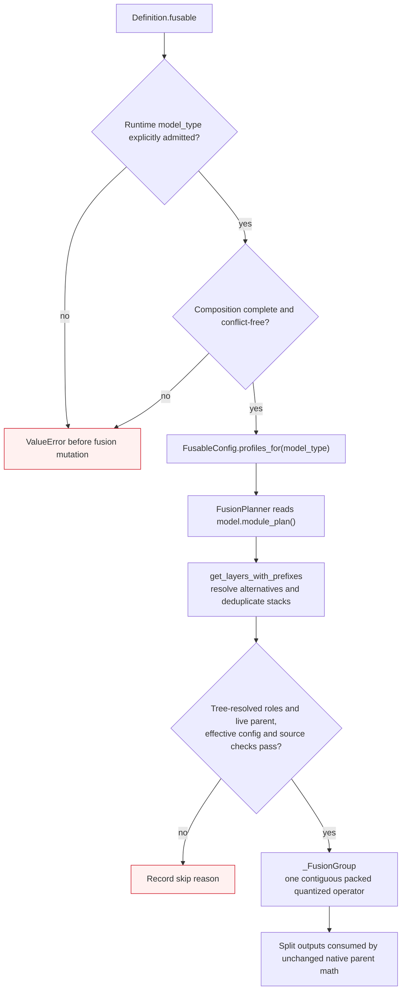

# Fusion model qualification

Fusion is opt-in and post-quantization only. A definition's `fusable` contract
admits explicit model types and sibling role groups. Projection paths, live
parents and roles come exclusively from `model.module_plan()`; matching a name,
shape, or inheritance chain does not grant eligibility.

The checked-in [qualification inventory](../tests/module_tree/fixtures/fusable_models.json)
accounts for all **205 registered model types**: **102 qualified** and **103 not
qualified for the current executor**. Qualified means the real tiny native
model resolves the declared parents and the planner admits them. It does not
mean every layer or quantization setting is compatible. In particular, expert
paths remain excluded, and a model with an attention-only profile has no MoE
expert fusion.

The native numerical matrix covers **117 distinct parent/family pairs**, each
with GPTQ and AWQ, FP16 and BF16: **468 cases** using symmetric INT4,
`group_size=128`, `desc_act=False`, and Marlin on NVIDIA CUDA. All use separate
native-forward baselines plus an independent integer-code weight oracle with
`rtol=atol=2e-3`. Together with one registry contract and 102 real-model topology
checks, the qualification suite has **571 passing cases** in the tested
Transformers 5.22.2 / Torch 2.15.0+cu132 environment. The full-model generation,
accuracy and performance results in the [fusion planner guide](fusion-planner.md)
are measured on Llama 3.2 1B; they are not measurements for every architecture.

## Declaration and consumption



`LlamaFusableConfig()` retains llama-only defaults. Target-first `merge(...)`
composes reusable `qkv` and `gate_up` role profiles without importing source model
identities. No Python class path or parent-type whitelist is part of the config.
The actual parent resolves from the tree's sibling roles and its live `forward`
is validated before fusion. Optional per-model role variants use `model_profiles`.

```python
from gptqmodel import FusableConfig, LlamaFusableConfig
from gptqmodel.models.definitions.qwen2 import Qwen2QModel

fusable = FusableConfig("qwen2").merge(LlamaFusableConfig())
attention_only = FusableConfig("qwen2_moe").merge(LlamaFusableConfig(), profiles=("qkv",))
audio = FusableConfig("qwen2_audio").merge(Qwen2QModel.fusable)

# Repeated merges permit source-specific profile selection and local overrides.
mlp = FusableConfig("mlp_policy").profile("gate_up", roles=("gate", "up"))
custom = (
    FusableConfig("custom_model")
    .merge(LlamaFusableConfig(), profiles=("qkv",))
    .merge(mlp)
    .override("qkv", enabled=False, layers=(0, 1))
)
```

All operations return frozen configurations without changing their inputs.
Identical contributions deduplicate, including diamond composition. Conflicting
profiles require `replace_profile()`; conflicting inherited policy requires
`override()`. Incomplete or unresolved configurations cannot execute fusion.
Profile origins and winning scoped policy appear in the returned plan's printed
and extracted diagnostics. See the [composition flow and precedence contract](fusion-planner.md#merge-extend-and-override).
A definition without a qualified contract rejects `model.fuse()`;
`model.fuse(False)` remains valid. Composition never enables fusion.

The compiler rejects projection calls guarded by conditions, loops, exception
or context-manager scopes, comprehensions or lambdas, as well as rewritten or
in-place-mutated parent inputs. These projections cannot safely move to the
single fused invocation at the first projection. Preamble indexer/cache work
is preserved once, with the original continuation used on fallback. Additional
weight references, decorated forwards, and instance overrides also fail closed.
Gemma4/Gemma3n shared-KV attention is consequently excluded while compatible
MLPs remain eligible. Ripple's value-residual and chunked helper forwards are
not admitted by this executor.

## Qualified model types

The table lists eligibility contracts. Runtime skip reasons still apply for
unsupported layouts, dtypes, hooks, effective config mismatches or excluded
leaves. Multimodal profiles cover only the declared decoder text stack.

| Model type | Definition | Profiles | Observed runtime parents (test evidence) |
| --- | --- | --- | --- |
| `afmoe` | `AfMoeQModel` | `qkv` | `AfmoeAttention` |
| `apertus` | `ApertusQModel` | `qkv` | `ApertusAttention` |
| `cohere` | `LlamaQModel` | `qkv`, `gate_up` | `CohereAttention`, `CohereMLP` |
| `cohere2` | `LlamaQModel` | `qkv`, `gate_up` | `Cohere2Attention`, `Cohere2MLP` |
| `cohere2_moe` | `Cohere2MoeQModel` | `qkv` | `Cohere2MoeAttention` |
| `cohere_compass` | `CohereCompassQModel` | `qkv`, `gate_up` | `CohereCompassAttention`, `CohereCompassMLP` |
| `deepseek_ocr2` | `DeepSeekOCR2QModel` | `qkv` | `DeepseekOcr2TextAttention` |
| `deepseek_vl` | `DeepSeekVLQModel` | `qkv`, `gate_up` | `LlamaAttention`, `LlamaMLP` |
| `diffusion_gemma` | `DiffusionGemmaQModel` | `gate_up` | `DiffusionGemmaText4MLP` |
| `dots1` | `Dots1QModel` | `qkv` | `Dots1Attention` |
| `ernie4_5` | `Ernie4_5QModel` | `qkv`, `gate_up` | `Ernie4_5Attention`, `Ernie4_5MLP` |
| `ernie4_5_moe` | `Ernie4_5_MoeQModel` | `qkv` | `Ernie4_5_MoeAttention` |
| `ernie4_5_vl_moe` | `Ernie4_5_VLMoeQModel` | `qkv` | `Ernie4_5_VLMoeTextAttention` |
| `exaone4` | `Exaone4QModel` | `qkv`, `gate_up` | `Exaone4Attention`, `Exaone4MLP` |
| `exaone4_5` | `Exaone4_5QModel` | `qkv`, `gate_up` | `Exaone4Attention`, `Exaone4MLP` |
| `falcon_h1` | `FalconH1QModel` | `qkv`, `gate_up` | `FalconH1Attention`, `FalconH1MLP` |
| `flint` | `FlintQModel` | `qkv` | `FlintAttention` |
| `gemma` | `LlamaQModel` | `qkv`, `gate_up` | `GemmaAttention`, `GemmaMLP` |
| `gemma2` | `Gemma2QModel` | `qkv`, `gate_up` | `Gemma2Attention`, `Gemma2MLP` |
| `gemma3` | `Gemma3ForConditionalGenerationGPTQ` | `qkv`, `gate_up` | `Gemma3Attention`, `Gemma3MLP` |
| `gemma3_text` | `Gemma3QModel` | `qkv`, `gate_up` | `Gemma3Attention`, `Gemma3MLP` |
| `gemma3n_text` | `Gemma3nTextQModel` | `gate_up` | `Gemma3nTextMLP` |
| `gemma4` | `Gemma4ForConditionalGenerationGPTQ` | `gate_up` | `Gemma4TextMLP` |
| `gemma4_text` | `Gemma4TextQModel` | `gate_up` | `Gemma4TextMLP` |
| `gemma4_unified` | `Gemma4UnifiedForConditionalGenerationGPTQ` | `gate_up` | `Gemma4UnifiedTextMLP` |
| `gemma4_unified_text` | `Gemma4UnifiedTextQModel` | `gate_up` | `Gemma4UnifiedTextMLP` |
| `glm` | `GlmQModel` | `qkv` | `GlmAttention` |
| `glm4` | `GlmQModel` | `qkv` | `Glm4Attention` |
| `glm4_moe` | `GLM4MoEGPTQ` | `qkv` | `Glm4MoeAttention` |
| `glm4v` | `Glm4vGPTQ` | `qkv` | `Glm4vTextAttention` |
| `glm4v_moe` | `Glm4vMoeQModel` | `qkv` | `Glm4vMoeTextAttention` |
| `glm4v_moe_text` | `Glm4vMoeTextQModel` | `qkv` | `Glm4vMoeTextAttention` |
| `glm_ocr` | `GlmOCRGPTQ` | `qkv` | `GlmOcrTextAttention` |
| `gpt_neo` | `GptNeoQModel` | `qkv` | `GPTNeoSelfAttention` |
| `gpt_oss` | `GPTOSSGPTQ` | `qkv` | `GptOssAttention` |
| `gptj` | `GptJQModel` | `qkv` | `GPTJAttention` |
| `granite` | `LlamaQModel` | `qkv`, `gate_up` | `GraniteAttention`, `GraniteMLP` |
| `granitemoe` | `GraniteMoeQModel` | `qkv` | `GraniteMoeAttention` |
| `granitemoehybrid` | `GraniteMoeHybridQModel` | `qkv` | `GraniteMoeHybridAttention` |
| `helium` | `LlamaQModel` | `qkv`, `gate_up` | `HeliumAttention`, `HeliumMLP` |
| `hrm_text` | `HrmTextQModel` | `qkv`, `gate_up` | `HrmTextAttention`, `HrmTextMLP` |
| `hunyuan_v1_dense` | `HunYuanDenseV1QModel` | `qkv`, `gate_up` | `HunYuanDenseV1Attention`, `HunYuanDenseV1MLP` |
| `hunyuan_v1_moe` | `HunYuanMoEV1QModel` | `qkv` | `HunYuanMoEV1Attention` |
| `hunyuan_vl` | `HunYuanVLQModel` | `qkv`, `gate_up` | `HunYuanVLDenseV1Attention`, `HunYuanVLMLP` |
| `hy_v3` | `HYV3QModel` | `qkv` | `HYV3Attention` |
| `inkling_mm_model` | `InklingMMQModel` | `qkv` | `InklingAttention` |
| `internvl` | `InternVLQModel` | `qkv`, `gate_up` | `Qwen2Attention`, `Qwen2MLP` |
| `jamba` | `JambaQModel` | `qkv` | `JambaAttention` |
| `laguna` | `LagunaQModel` | `qkv` | `LagunaAttention` |
| `lfm2` | `LFM2QModel` | `qkv`, `gate_up` | `Lfm2Attention`, `Lfm2MLP` |
| `lfm2_moe` | `LFM2MoeQModel` | `qkv` | `Lfm2MoeAttention` |
| `lfm2_vl` | `LFM2VLQModel` | `qkv`, `gate_up` | `Lfm2Attention`, `Lfm2MLP` |
| `llama` | `LlamaQModel` | `qkv`, `gate_up` | `LlamaAttention`, `LlamaMLP` |
| `llama4` | `Llama4QModel` | `qkv` | `Llama4TextAttention` |
| `llama4_text` | `Llama4TextQModel` | `qkv` | `Llama4TextAttention` |
| `llava` | `LlavaQModel` | `qkv`, `gate_up` | `LlamaAttention`, `LlamaMLP` |
| `longcat_flash` | `LongCatFlashQModel` | `gate_up` | `LongcatFlashMLP` |
| `minicpm3` | `MiniCpm3QModel` | `gate_up` | `MiniCPM3MLP` |
| `minicpmv4_6` | `MiniCPMV4_6QModel` | `qkv`, `gate_up` | `Qwen3_5Attention`, `Qwen3_5MLP` |
| `minimax_m3_vl` | `MiniMaxM3VLGPTQ` | `qkv` | `MiniMaxM3VLAttention` |
| `ministral3` | `Ministral3GPTQ` | `qkv`, `gate_up` | `Ministral3Attention`, `Ministral3MLP` |
| `mistral` | `LlamaQModel` | `qkv`, `gate_up` | `MistralAttention`, `MistralMLP` |
| `mistral3` | `Mistral3GPTQ` | `qkv`, `gate_up` | `MistralAttention`, `MistralMLP` |
| `mixtral` | `MixtralQModel` | `qkv` | `MixtralAttention` |
| `mllama` | `MLlamaQModel` | `qkv`, `gate_up` | `MllamaTextSelfAttention`, `MllamaTextMLP` |
| `mllama_text_model` | `MLlamaTextQModel` | `qkv`, `gate_up` | `MllamaTextSelfAttention`, `MllamaTextMLP` |
| `muse_glimmer` | `MuseGlimmerQModel` | `qkv`, `gate_up` | `MuseGlimmerTextAttention`, `MuseGlimmerTextMLP` |
| `olmo` | `LlamaQModel` | `qkv`, `gate_up` | `OlmoAttention`, `OlmoMLP` |
| `olmo2` | `Olmo2QModel` | `qkv`, `gate_up` | `Olmo2Attention`, `Olmo2MLP` |
| `olmo3` | `Olmo3QModel` | `qkv`, `gate_up` | `Olmo3Attention`, `Olmo3MLP` |
| `olmo_hybrid` | `OlmoHybridQModel` | `qkv`, `gate_up` | `OlmoHybridAttention`, `OlmoHybridMLP` |
| `olmoe` | `OlmoeQModel` | `qkv` | `OlmoeAttention` |
| `opt` | `OptQModel` | `qkv` | `OPTAttention` |
| `ovis2` | `Ovis2QModel` | `qkv`, `gate_up` | `Qwen2Attention`, `Qwen2MLP` |
| `phi` | `PhiQModel` | `qkv` | `PhiAttention` |
| `phimoe` | `PhiMoEGPTQForCausalLM` | `qkv` | `PhimoeAttention` |
| `qwen2` | `Qwen2QModel` | `qkv`, `gate_up` | `Qwen2Attention`, `Qwen2MLP` |
| `qwen2_5_omni` | `Qwen2_5_OmniGPTQ` | `qkv`, `gate_up` | `Qwen2_5OmniAttention`, `Qwen2MLP` |
| `qwen2_5_vl` | `Qwen2_5_VLQModel` | `qkv`, `gate_up` | `Qwen2_5_VLAttention`, `Qwen2MLP` |
| `qwen2_audio` | `Qwen2AudioGPTQ` | `qkv`, `gate_up` | `Qwen2Attention`, `Qwen2MLP` |
| `qwen2_moe` | `Qwen2MoeQModel` | `qkv` | `Qwen2MoeAttention` |
| `qwen2_vl` | `Qwen2VLQModel` | `qkv`, `gate_up` | `Qwen2VLAttention`, `Qwen2MLP` |
| `qwen3` | `Qwen3QModel` | `qkv`, `gate_up` | `Qwen3Attention`, `Qwen3MLP` |
| `qwen3_5` | `Qwen3_5QModel` | `qkv`, `gate_up` | `Qwen3_5Attention`, `Qwen3_5MLP` |
| `qwen3_5_moe` | `Qwen3_5_MoeQModel` | `qkv` | `Qwen3_5MoeAttention` |
| `qwen3_5_moe_text` | `Qwen3_5_MoeTextQModel` | `qkv` | `Qwen3_5MoeAttention` |
| `qwen3_5_text` | `Qwen3_5TextQModel` | `qkv`, `gate_up` | `Qwen3_5Attention`, `Qwen3_5MLP` |
| `qwen3_moe` | `Qwen3MoeQModel` | `qkv` | `Qwen3MoeAttention` |
| `qwen3_next` | `Qwen3NextGPTQ` | `qkv` | `Qwen3NextAttention` |
| `qwen3_omni_moe` | `Qwen3OmniMoeGPTQ` | `qkv` | `Qwen3OmniMoeThinkerTextAttention` |
| `qwen3_vl` | `Qwen3_VLQModel` | `qkv`, `gate_up` | `Qwen3VLTextAttention`, `Qwen3VLTextMLP` |
| `qwen3_vl_moe` | `Qwen3_VL_MoeQModel` | `qkv` | `Qwen3VLMoeTextAttention` |
| `qwen4_exp` | `Qwen4ExpQModel` | `qkv` | `Qwen4ExpTextAttention` |
| `qwen4_exp_text` | `Qwen4ExpTextQModel` | `qkv` | `Qwen4ExpTextAttention` |
| `seed_oss` | `LlamaQModel` | `qkv`, `gate_up` | `SeedOssAttention`, `SeedOssMLP` |
| `smollm3` | `LlamaQModel` | `qkv`, `gate_up` | `SmolLM3Attention`, `SmolLM3MLP` |
| `smolvlm` | `SmolVLMQModel` | `qkv`, `gate_up` | `LlamaAttention`, `LlamaMLP` |
| `solar_open` | `SolarOpenQModel` | `qkv` | `SolarOpenAttention` |
| `stablelm` | `LlamaQModel` | `qkv`, `gate_up` | `StableLmAttention`, `StableLmMLP` |
| `starcoder2` | `Starcoder2QModel` | `qkv` | `Starcoder2Attention` |

## Types without a qualified executor

These entries remain explicit rejections. A missing implementation or fixture
is a qualification gap, not evidence that fusion is mathematically impossible.
Already combined projections need no QKV/gate-up concatenation. Remote code
requires its own actual-parent and numerical validation; an inherited Llama
layout alone does not authorize it.

| Model type | Definition | Reason |
| --- | --- | --- |
| `agnes` | `AgnesQModel` | Package-owned hybrid multimodal implementation; fusion executor and recurrent replay remain unqualified. |
| `apertus1p5` | `Apertus1p5QModel` | Package-owned multimodal implementation; fusion executor remains unqualified. |
| `apertus1p5_text` | `Apertus1p5TextQModel` | Package-owned Apertus 1.5 text implementation; fusion executor remains unqualified. |
| `axk2` | `AXK2QModel` | No separate, non-expert QKV or gate/up role group in the declared module tree. |
| `baichuan` | `BaiChuanQModel` | Package-owned fused-QKV Baichuan implementation; fusion executor remains unqualified. |
| `bailing_hybrid` | `BailingMoeQModel` | Package-owned dense/MLA/recurrent/MoE layouts; no qualified fused executor. |
| `bailing_moe` | `BailingMoeQModel` | Package-owned dense/MLA/recurrent/MoE layouts; no qualified fused executor. |
| `bloom` | `BloomQModel` | No separate, non-expert QKV or gate/up role group in the declared module tree. |
| `brumby` | `BrumbyQModel` | Package-owned power-retention implementation; fusion executor and retention replay remain unqualified. |
| `chatglm` | `ChatGLMQModel` | No separate, non-expert QKV or gate/up role group in the declared module tree. |
| `codegen` | `CodeGenQModel` | No separate, non-expert QKV or gate/up role group in the declared module tree. |
| `dbrx` | `DbrxQModel` | No separate, non-expert QKV or gate/up role group in the declared module tree. |
| `dbrx_converted` | `DbrxConvertedQModel` | Package-owned converted DBRX eager attention; fused projection execution has not been qualified. |
| `deci` | `DeciLMQModel` | Heterogeneous no-op, linear and GQA attention/MLP layouts have no qualified fused executor. |
| `deepseek_v2` | `DeepSeekV2QModel` | MLA has normalized low-rank Q/KV stages; no dense or expert projection fusion is qualified. |
| `deepseek_v3` | `DeepSeekV3QModel` | Native MLA low-rank attention and routed/shared experts have no independently qualified fused executor. |
| `deepseek_v32` | `DeepSeekV32QModel` | No separate, non-expert QKV or gate/up role group in the declared module tree. |
| `deepseek_v4` | `DeepSeekV4QModel` | Native sliding/compressed attention and hash/routed experts have no independently qualified fused executor. |
| `deepseek_vl_v2` | `DeepSeekVLV2QModel` | Dense/MLA attention and routed/shared-expert native fusion are not independently qualified; fusion remains disabled. |
| `dream` | `DreamQModel` | Bidirectional diffusion attention and gated MLP have no qualified fused executor. |
| `ernie4_5_moe_vl` | `Ernie4_5_VLMoeQModel` | Package-owned native ERNIE VL legacy alias; QKV executor admission has not been qualified for this alias. |
| `exaone` | `ExaOneQModel` | Custom/remote implementation: no installed native config; executor has not been qualified. |
| `exaone4_5_text` | `Exaone4QModel` | Custom/remote implementation: no installed native config; executor has not been qualified. |
| `falcon` | `RwgQModel` | No separate, non-expert QKV or gate/up role group in the declared module tree. |
| `falcon_mamba` | `FalconMambaQModel` | No separate, non-expert QKV or gate/up role group in the declared module tree. |
| `gemma3n` | `Gemma3nForConditionalGenerationGPTQ` | Multimodal constructor needs optional timm/torchvision; text-only MLP is qualified separately. |
| `glm4_moe_lite` | `Glm4MoeLiteQModel` | No separate, non-expert QKV or gate/up role group in the declared module tree. |
| `glm5_next` | `Glm5NextQModel` | No separate, non-expert QKV or gate/up role group in the declared module tree. |
| `glm_moe_dsa` | `GlmMoeDsaQModel` | No separate, non-expert QKV or gate/up role group in the declared module tree. |
| `glmasr` | `GlmASRGPTQ` | Installed native layout does not resolve the definition decoder prefix; needs separate layout validation. |
| `granite_swa` | `GraniteSWAQModel` | Per-layer sliding-window attention dispatch and post-attention attention-sink scaling are not modeled by the current fused qkv/gate_up executor. |
| `granitemoe_swa` | `GraniteMoeSWAQModel` | Per-layer sliding-window attention dispatch and post-attention attention-sink scaling are not modeled by the current fused qkv/gate_up executor. |
| `gpt2` | `GPT2QModel` | No separate, non-expert QKV or gate/up role group in the declared module tree. |
| `gpt_bigcode` | `GptBigCodeQModel` | No separate, non-expert QKV or gate/up role group in the declared module tree. |
| `gpt_neox` | `GPTNeoXQModel` | No separate, non-expert QKV or gate/up role group in the declared module tree. |
| `gpt_pangu` | `PanguAlphaQModel` | Custom/remote implementation: no installed native config; executor has not been qualified. |
| `grinmoe` | `GrinMoeQModel` | Package-owned GRIN-MoE implementation; attention and SparseMixer expert fusion have not been qualified. |
| `hymba` | `HymbaQModel` | No separate, non-expert QKV or gate/up role group in the declared module tree. |
| `instella` | `InstellaQModel` | Package-owned Instella implementation; full-width Q/K normalization and projection fusion have not been qualified. |
| `intern_s2_preview` | `InternS2PreviewQModel` | Package-owned Intern-S2 Preview hybrid attention/MoE port; fusion executor has not been qualified. |
| `internlm` | `InternLMQModel` | Package-owned InternLM 1 port; fusion executor has not been qualified. |
| `internlm2` | `InternLM2QModel` | Package-owned InternLM2/2.5 packed KV-group-interleaved QKV; fusion executor has not been qualified. |
| `interns1` | `InternS1QModel` | Package-owned Intern-S1 dense/MoE multimodal implementation; fusion executor has not been qualified. |
| `internvl_chat` | `InternVLChatQModel` | Package-owned legacy wrapper; decoder-specific fusion execution is unqualified. |
| `k2_horizon` | `K2HorizonQModel` | Package-owned K2-Horizon dense/MoVA implementation; fusion executor has not been qualified. |
| `kimi_k2` | `DeepSeekV3QModel` | No separate, non-expert QKV or gate/up role group in the declared module tree. |
| `kimi_k25` | `KimiK25QModel` | Native Kimi-K2.5 MLA/MoE multimodal binding; fusion executor has not been qualified. |
| `klear` | `KlearQModel` | Package-owned Klear MoE with per-head Q/K norms and learned routed/shared expert mixing; fusion executor has not been qualified. |
| `lfm3` | `LFM3QModel` | Native Transformers 5 LFM3 hybrid short-convolution/gated-attention; fusion executor has not been qualified. |
| `lfm3_omni` | `LFM3OmniQModel` | Package-owned LFM3 Omni hybrid multimodal wrapper; fusion executor has not been qualified. |
| `lfm3_vl` | `LFM3VLQModel` | Native Transformers LFM3-VL hybrid conv/attention decoder; fusion executor has not been qualified. |
| `llada2_moe` | `LLaDA2MoeQModel` | Package-owned LLaDA2 packed-QKV diffusion MoE with versioned block masking, routing and edit decoding; fusion executor has not been qualified. |
| `llava_qwen2` | `LlavaQwen2QModel` | Package-owned flat LLaVA-Qwen2 multimodal decoder with MobileCLIP/CLIP vision tower; fusion executor has not been qualified. |
| `locateanything` | `LocateAnythingQModel` | Package-owned LocateAnything block-diffusion/MoonViT/localization wrapper; fusion executor has not been qualified. |
| `longllama` | `LlamaQModel` | Package-owned LongLLaMA memory/cache port; fusion executor has not been qualified. |
| `mage_vl` | `MageVLQModel` | Package-owned Mage-VL custom vision/Qwen3 multimodal binding; fusion executor has not been qualified. |
| `marin` | `Qwen3QModel` | Custom/remote implementation: no installed native config; executor has not been qualified. |
| `mimo` | `MimoQModel` | Package-owned MiMo-7B Qwen2 extension with full-precision auxiliary MTP; fusion executor has not been qualified. |
| `mimo_v2` | `MimoV2QModel` | Package-owned MiMo-V2 hybrid attention; fusion executor has not been qualified. |
| `minicpm` | `MiniCPMGPTQ` | Package-owned original MiniCPM scaled decoder and w1/w3/w2 MoE; fusion executor has not been qualified. |
| `minicpmo` | `MiniCPMOQModel` | Custom/remote implementation: no installed native config; executor has not been qualified. |
| `minicpmv` | `MiniCPMVQModel` | Package-owned legacy MiniCPM-V wrapper with versioned decoder/vision/resampler layouts; fusion executor has not been qualified. |
| `minimax` | `MiniMaxQModel` | Package-owned original MiniMax-Text-01 hybrid attention/cache port; fusion executor has not been qualified. |
| `minimax_m2` | `MiniMaxM2GPTQ` | Native Transformers 5 MiniMax-M2 MoE; fusion executor has not been qualified. |
| `mobilellm` | `MobileLLMQModel` | Package-owned MobileLLM shared embedding/repeated-decoder cache port; fusion executor has not been qualified. |
| `moss` | `MossQModel` | Package-owned MOSS Moon-003 four-way packed Q/V/K and parallel attention/MLP; fusion executor has not been qualified. |
| `mpt` | `MptQModel` | No separate, non-expert QKV or gate/up role group in the declared module tree. |
| `nanbeige` | `NanbeigeQModel` | Package-owned Nanbeige looped decoder with per-execution KV slots; fusion executor has not been qualified. |
| `nemotron-nas` | `DeciLMQModel` | Custom/remote implementation: no installed native config; executor has not been qualified. |
| `nemotron_h` | `NemotronHQModel` | Native Transformers 5 Nemotron-H hybrid Mamba/attention/dense or routed/shared latent MoE; fusion executor has not been qualified. |
| `nemotron_h_puzzle` | `NemotronHPuzzleQModel` | Package-owned Nemotron-H Puzzle heterogeneous Mamba/attention/latent-MoE decoder; fusion executor has not been qualified. |
| `nemotron_labs_diffusion` | `NemotronLabsDiffusionQModel` | Package-owned Nemotron Labs Diffusion tri-mode decoder with read-only diffusion drafting and causal verification; fusion executor has not been qualified. |
| `nemotronh_nano_omni_reasoning_v3` | `NemotronOmniQModel` | Native Transformers 5 Nemotron-H/RADIO/Parakeet with package-owned legacy Omni binding and temporal media merge; fusion executor has not been qualified. |
| `openvla` | `OpenVLAQModel` | Package-owned OpenVLA Prismatic vision-language-action wrapper; fusion executor has not been qualified. |
| `ouro` | `OuroQModel` | Package-owned Ouro recurrent shared decoder with sandwich norms and token-wise exit selection; fusion executor has not been qualified. |
| `ovis` | `OvisQModel` | Package-owned Ovis 1.x visual-vocabulary wrapper with native Llama/Qwen2/Gemma2 decoder; fusion executor has not been qualified. |
| `ovis2_5` | `Ovis2_5QModel` | Package-owned Ovis2.5 Qwen3/Siglip2 NaViT multimodal binding; fusion executor has not been qualified. |
| `ovis2_6_moe` | `Ovis2_6_MoeQModel` | Package-owned Ovis2.6 NaViT/soft-visual-vocabulary wrapper with native Qwen3 MoE; fusion executor has not been qualified. |
| `ovis2_6_next` | `Ovis2_6_NextQModel` | Package-owned Ovis2.6 NaViT/soft-visual-vocabulary wrapper with native Qwen3 Next linear-attention/MoE; fusion executor has not been qualified. |
| `phi3` | `Phi3QModel` | No compatible native projection forward: projections already combined, conditional, or preprocessed. |
| `phi4mm` | `Phi4MMGPTQ` | No separate, non-expert QKV or gate/up role group in the declared module tree. |
| `qwen` | `QwenQModel` | No separate, non-expert QKV or gate/up role group in the declared module tree. |
| `qwen2_5_vl_text` | `Qwen2_5_VLQModel` | Installed native layout does not resolve the definition decoder prefix; needs separate layout validation. |
| `qwen2_vl_text` | `Qwen2VLQModel` | Installed native layout does not resolve the definition decoder prefix; needs separate layout validation. |
| `qwen_drive` | `QwenDriveQModel` | Custom/remote implementation: no installed native config; executor has not been qualified. |
| `raon1_mini` | `Raon1MiniQModel` | Custom/remote implementation: no installed native config; executor has not been qualified. |
| `refinedWeb` | `RwgQModel` | No separate, non-expert QKV or gate/up role group in the declared module tree. |
| `refinedWebModel` | `RwgQModel` | No separate, non-expert QKV or gate/up role group in the declared module tree. |
| `ricursive` | `RicursiveQModel` | Remote Ripple forward preprocesses value residuals and chunks MLP calls through helpers; direct-forward executor is not applicable. |
| `solar_open2` | `SolarOpen2QModel` | Custom/remote implementation: no installed native config; executor has not been qualified. |
| `spark2_5` | `Spark2_5QModel` | Custom/remote implementation: no installed native config; executor has not been qualified. |
| `stablelm_epoch` | `LlamaQModel` | Source-matched native Transformers 5 StableLM Epoch adapter; fusion executor has not been qualified. |
| `telechat` | `TeleChat2QModel` | Custom/remote implementation: no installed native config; executor has not been qualified. |
| `unlimited-ocr` | `UnlimitedOCRQModel` | Custom/remote implementation: no installed native config; executor has not been qualified. |
| `voxtral` | `VoxtralGPTQ` | Installed native layout does not resolve the definition decoder prefix; needs separate layout validation. |
| `xing4_0` | `Xing4_0QModel` | No separate, non-expert QKV or gate/up role group in the declared module tree. |
| `xverse` | `XverseQModel` | Custom/remote implementation: no installed native config; executor has not been qualified. |
| `yi` | `LlamaQModel` | Native Transformers 5 Llama-backed Yi legacy alias; fusion executor has not been qualified. |
| `zamba` | `ZambaQModel` | No separate, non-expert QKV or gate/up role group in the declared module tree. |
| `zamba2` | `Zamba2QModel` | No separate, non-expert QKV or gate/up role group in the declared module tree. |
| `zdtaichu5_0` | `ZDTaichu5QModel` | Custom/remote implementation: no installed native config; executor has not been qualified. |

## Adding or extending a qualification

1. Inspect the real implementation and declared module-plan roles, including
   conditional branches, shared-KV behavior and fused expert conversion.
2. Compose immutable role profiles through target-first `merge(...)`, selecting only the
   eligible families. Concrete module paths and parents must resolve from the
   definition tree; do not add HF class import paths or runtime name heuristics.
3. Add an inventory entry with a tiny real-model config, its concrete loader,
   and independently inspected parent paths/types. Update this coverage table.
4. Run `tests/module_tree/test_fusable_models.py` and the config/consumer suites.
   The registry contract must run on CPU. Native qualification additionally
   requires the GPU matrix in both methods and dtypes; skips do not establish
   numerical qualification.
5. Measure full-model generation and target-workload performance separately
   before making architecture-specific speed or accuracy claims.

```bash
CUDA_VISIBLE_DEVICES=0 PYTHONPATH=. python -m pytest \
  tests/module_tree/test_fusable_models.py \
  tests/module_tree/test_fusable_config.py -q
```

See [PR #3567](https://github.com/ModelCloud/GPTQModel/pull/3567) for the
implementation and Llama end-to-end validation.

`dots3_note`: explicit fork calibration/expert adapter; fusion remains unqualified, with no profile enabled by this extraction.

`kimi_k3`: explicit fork calibration/expert adapter; fusion remains unqualified, with no profile enabled by this extraction.

`kimi_linear`: explicit fork calibration/expert adapter; fusion remains unqualified, with no profile enabled by this extraction.
