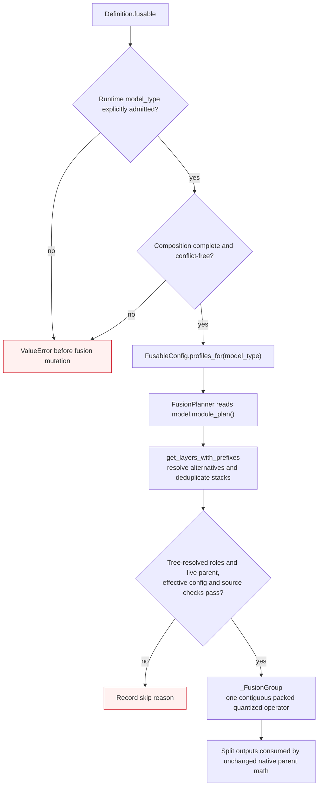

# Fusion model qualification

Fusion is opt-in and post-quantization only. A definition's `fusable` contract
admits explicit model types and sibling role groups. Projection paths, live
parents and roles come exclusively from `model.module_plan()`; matching a name,
shape, or inheritance chain does not grant eligibility.

The checked-in [qualification inventory](../tests/module_tree/fixtures/fusable_models.json)
accounts for all **198 registered model types**: **101 qualified** and **97 not
qualified for the current executor**. Qualified means the real tiny native
model resolves the declared parents and the planner admits them. It does not
mean every layer or quantization setting is compatible. In particular, expert
paths remain excluded, and a model with an attention-only profile has no MoE
expert fusion.

The native numerical matrix covers **116 distinct parent/family pairs**, each
with GPTQ and AWQ, FP16 and BF16: **464 cases** using symmetric INT4,
`group_size=128`, `desc_act=False`, and Marlin on NVIDIA CUDA. All use separate
native-forward baselines plus an independent integer-code weight oracle with
`rtol=atol=2e-3`. Together with one registry contract and 101 real-model topology
checks, the qualification suite has **566 passing cases** in the tested
Transformers 5.22.1 / Torch 2.15.0+cu132 environment. The full-model generation,
accuracy and performance results in the [fusion planner guide](fusion-planner.md)
are measured on Llama 3.2 1B; they are not measurements for every architecture.

## Declaration and consumption



`LlamaFusableConfig()` retains llama-only defaults. Target-first `merge(...)`
composes reusable `qkv` and `gate_up` role profiles without importing source model
identities. No Python class path or parent-type whitelist is part of the config.
The actual parent resolves from the tree's sibling roles and its live `forward`
is validated before fusion. Optional per-model role variants use `model_profiles`.

```python
from gptqmodel import FusableConfig, LlamaFusableConfig
from gptqmodel.models.definitions.qwen2 import Qwen2QModel

fusable = FusableConfig("qwen2").merge(LlamaFusableConfig())
attention_only = FusableConfig("qwen2_moe").merge(LlamaFusableConfig(), profiles=("qkv",))
audio = FusableConfig("qwen2_audio").merge(Qwen2QModel.fusable)

# Repeated merges permit source-specific profile selection and local overrides.
mlp = FusableConfig("mlp_policy").profile("gate_up", roles=("gate", "up"))
custom = (
    FusableConfig("custom_model")
    .merge(LlamaFusableConfig(), profiles=("qkv",))
    .merge(mlp)
    .override("qkv", enabled=False, layers=(0, 1))
)
```

All operations return frozen configurations without changing their inputs.
Identical contributions deduplicate, including diamond composition. Conflicting
profiles require `replace_profile()`; conflicting inherited policy requires
`override()`. Incomplete or unresolved configurations cannot execute fusion.
Profile origins and winning scoped policy appear in the returned plan's printed
and extracted diagnostics. See the [composition flow and precedence contract](fusion-planner.md#merge-extend-and-override).
A definition without a qualified contract rejects `model.fuse()`;
`model.fuse(False)` remains valid. Composition never enables fusion.

The compiler rejects projection calls guarded by conditions, loops, exception
or context-manager scopes, comprehensions or lambdas, as well as rewritten or
in-place-mutated parent inputs. These projections cannot safely move to the
single fused invocation at the first projection. Preamble indexer/cache work
is preserved once, with the original continuation used on fallback. Additional
weight references, decorated forwards, and instance overrides also fail closed.
Gemma4/Gemma3n shared-KV attention is consequently excluded while compatible
MLPs remain eligible. Ripple's value-residual and chunked helper forwards are
not admitted by this executor.

## Qualified model types

The table lists eligibility contracts. Runtime skip reasons still apply for
unsupported layouts, dtypes, hooks, effective config mismatches or excluded
leaves. Multimodal profiles cover only the declared decoder text stack.

| Model type | Definition | Profiles | Observed runtime parents (test evidence) |
| --- | --- | --- | --- |
| `afmoe` | `AfMoeQModel` | `qkv` | `AfmoeAttention` |
| `apertus` | `ApertusQModel` | `qkv` | `ApertusAttention` |
| `cohere` | `LlamaQModel` | `qkv`, `gate_up` | `CohereAttention`, `CohereMLP` |
| `cohere2` | `LlamaQModel` | `qkv`, `gate_up` | `Cohere2Attention`, `Cohere2MLP` |
| `cohere2_moe` | `Cohere2MoeQModel` | `qkv` | `Cohere2MoeAttention` |
| `cohere_compass` | `CohereCompassQModel` | `qkv`, `gate_up` | `CohereCompassAttention`, `CohereCompassMLP` |
| `deepseek_ocr2` | `DeepSeekOCR2QModel` | `qkv` | `DeepseekOcr2TextAttention` |
| `deepseek_vl` | `DeepSeekVLQModel` | `qkv`, `gate_up` | `LlamaAttention`, `LlamaMLP` |
| `diffusion_gemma` | `DiffusionGemmaQModel` | `gate_up` | `DiffusionGemmaText4MLP` |
| `dots1` | `Dots1QModel` | `qkv` | `Dots1Attention` |
| `ernie4_5` | `Ernie4_5QModel` | `qkv`, `gate_up` | `Ernie4_5Attention`, `Ernie4_5MLP` |
| `ernie4_5_moe` | `Ernie4_5_MoeQModel` | `qkv` | `Ernie4_5_MoeAttention` |
| `ernie4_5_vl_moe` | `Ernie4_5_VLMoeQModel` | `qkv` | `Ernie4_5_VLMoeTextAttention` |
| `exaone4` | `Exaone4QModel` | `qkv`, `gate_up` | `Exaone4Attention`, `Exaone4MLP` |
| `exaone4_5` | `Exaone4_5QModel` | `qkv`, `gate_up` | `Exaone4Attention`, `Exaone4MLP` |
| `falcon_h1` | `FalconH1QModel` | `qkv`, `gate_up` | `FalconH1Attention`, `FalconH1MLP` |
| `flint` | `FlintQModel` | `qkv` | `FlintAttention` |
| `gemma` | `LlamaQModel` | `qkv`, `gate_up` | `GemmaAttention`, `GemmaMLP` |
| `gemma2` | `Gemma2QModel` | `qkv`, `gate_up` | `Gemma2Attention`, `Gemma2MLP` |
| `gemma3` | `Gemma3ForConditionalGenerationGPTQ` | `qkv`, `gate_up` | `Gemma3Attention`, `Gemma3MLP` |
| `gemma3_text` | `Gemma3QModel` | `qkv`, `gate_up` | `Gemma3Attention`, `Gemma3MLP` |
| `gemma3n_text` | `Gemma3nTextQModel` | `gate_up` | `Gemma3nTextMLP` |
| `gemma4` | `Gemma4ForConditionalGenerationGPTQ` | `gate_up` | `Gemma4TextMLP` |
| `gemma4_text` | `Gemma4TextQModel` | `gate_up` | `Gemma4TextMLP` |
| `gemma4_unified` | `Gemma4UnifiedForConditionalGenerationGPTQ` | `gate_up` | `Gemma4UnifiedTextMLP` |
| `gemma4_unified_text` | `Gemma4UnifiedTextQModel` | `gate_up` | `Gemma4UnifiedTextMLP` |
| `glm` | `GlmQModel` | `qkv` | `GlmAttention` |
| `glm4` | `GlmQModel` | `qkv` | `Glm4Attention` |
| `glm4_moe` | `GLM4MoEGPTQ` | `qkv` | `Glm4MoeAttention` |
| `glm4v` | `Glm4vGPTQ` | `qkv` | `Glm4vTextAttention` |
| `glm4v_moe` | `Glm4vMoeQModel` | `qkv` | `Glm4vMoeTextAttention` |
| `glm4v_moe_text` | `Glm4vMoeTextQModel` | `qkv` | `Glm4vMoeTextAttention` |
| `glm_ocr` | `GlmOCRGPTQ` | `qkv` | `GlmOcrTextAttention` |
| `gpt_neo` | `GptNeoQModel` | `qkv` | `GPTNeoSelfAttention` |
| `gpt_oss` | `GPTOSSGPTQ` | `qkv` | `GptOssAttention` |
| `gptj` | `GptJQModel` | `qkv` | `GPTJAttention` |
| `granite` | `LlamaQModel` | `qkv`, `gate_up` | `GraniteAttention`, `GraniteMLP` |
| `granitemoe` | `GraniteMoeQModel` | `qkv` | `GraniteMoeAttention` |
| `granitemoehybrid` | `GraniteMoeHybridQModel` | `qkv` | `GraniteMoeHybridAttention` |
| `helium` | `LlamaQModel` | `qkv`, `gate_up` | `HeliumAttention`, `HeliumMLP` |
| `hrm_text` | `HrmTextQModel` | `qkv`, `gate_up` | `HrmTextAttention`, `HrmTextMLP` |
| `hunyuan_v1_dense` | `HunYuanDenseV1QModel` | `qkv`, `gate_up` | `HunYuanDenseV1Attention`, `HunYuanDenseV1MLP` |
| `hunyuan_v1_moe` | `HunYuanMoEV1QModel` | `qkv` | `HunYuanMoEV1Attention` |
| `hunyuan_vl` | `HunYuanVLQModel` | `qkv`, `gate_up` | `HunYuanVLDenseV1Attention`, `HunYuanVLMLP` |
| `hy_v3` | `HYV3QModel` | `qkv` | `HYV3Attention` |
| `inkling_mm_model` | `InklingMMQModel` | `qkv` | `InklingAttention` |
| `internvl` | `InternVLQModel` | `qkv`, `gate_up` | `Qwen2Attention`, `Qwen2MLP` |
| `jamba` | `JambaQModel` | `qkv`, `gate_up` | `JambaAttention`, `JambaMLP` |
| `laguna` | `LagunaQModel` | `qkv` | `LagunaAttention` |
| `lfm2` | `LFM2QModel` | `qkv`, `gate_up` | `Lfm2Attention`, `Lfm2MLP` |
| `lfm2_moe` | `LFM2MoeQModel` | `qkv` | `Lfm2MoeAttention` |
| `lfm2_vl` | `LFM2VLQModel` | `qkv`, `gate_up` | `Lfm2Attention`, `Lfm2MLP` |
| `llama` | `LlamaQModel` | `qkv`, `gate_up` | `LlamaAttention`, `LlamaMLP` |
| `llama4` | `Llama4QModel` | `qkv` | `Llama4TextAttention` |
| `llama4_text` | `Llama4TextQModel` | `qkv` | `Llama4TextAttention` |
| `llava` | `LlavaQModel` | `qkv`, `gate_up` | `LlamaAttention`, `LlamaMLP` |
| `longcat_flash` | `LongCatFlashQModel` | `gate_up` | `LongcatFlashMLP` |
| `minicpm3` | `MiniCpm3QModel` | `gate_up` | `MiniCPM3MLP` |
| `minicpmv4_6` | `MiniCPMV4_6QModel` | `qkv`, `gate_up` | `Qwen3_5Attention`, `Qwen3_5MLP` |
| `minimax` | `MiniMaxQModel` | `qkv` | `MiniMaxAttention` |
| `minimax_m2` | `MiniMaxM2GPTQ` | `qkv` | `MiniMaxM2Attention` |
| `minimax_m3_vl` | `MiniMaxM3VLGPTQ` | `qkv` | `MiniMaxM3VLAttention` |
| `ministral3` | `Ministral3GPTQ` | `qkv`, `gate_up` | `Ministral3Attention`, `Ministral3MLP` |
| `mistral` | `LlamaQModel` | `qkv`, `gate_up` | `MistralAttention`, `MistralMLP` |
| `mistral3` | `Mistral3GPTQ` | `qkv`, `gate_up` | `MistralAttention`, `MistralMLP` |
| `mixtral` | `MixtralQModel` | `qkv` | `MixtralAttention` |
| `mllama` | `MLlamaQModel` | `qkv`, `gate_up` | `MllamaTextSelfAttention`, `MllamaTextMLP` |
| `mllama_text_model` | `MLlamaTextQModel` | `qkv`, `gate_up` | `MllamaTextSelfAttention`, `MllamaTextMLP` |
| `muse_glimmer` | `MuseGlimmerQModel` | `qkv`, `gate_up` | `MuseGlimmerTextAttention`, `MuseGlimmerTextMLP` |
| `olmo` | `LlamaQModel` | `qkv`, `gate_up` | `OlmoAttention`, `OlmoMLP` |
| `olmo2` | `LlamaQModel` | `qkv`, `gate_up` | `Olmo2Attention`, `Olmo2MLP` |
| `olmo3` | `Olmo3QModel` | `qkv`, `gate_up` | `Olmo3Attention`, `Olmo3MLP` |
| `olmoe` | `OlmoeQModel` | `qkv` | `OlmoeAttention` |
| `opt` | `OptQModel` | `qkv` | `OPTAttention` |
| `ovis2` | `Ovis2QModel` | `qkv`, `gate_up` | `Qwen2Attention`, `Qwen2MLP` |
| `phi` | `PhiQModel` | `qkv` | `PhiAttention` |
| `phimoe` | `PhiMoEGPTQForCausalLM` | `qkv` | `PhimoeAttention` |
| `qwen2` | `Qwen2QModel` | `qkv`, `gate_up` | `Qwen2Attention`, `Qwen2MLP` |
| `qwen2_5_omni` | `Qwen2_5_OmniGPTQ` | `qkv`, `gate_up` | `Qwen2_5OmniAttention`, `Qwen2MLP` |
| `qwen2_5_vl` | `Qwen2_5_VLQModel` | `qkv`, `gate_up` | `Qwen2_5_VLAttention`, `Qwen2MLP` |
| `qwen2_audio` | `Qwen2AudioGPTQ` | `qkv`, `gate_up` | `Qwen2Attention`, `Qwen2MLP` |
| `qwen2_moe` | `Qwen2MoeQModel` | `qkv` | `Qwen2MoeAttention` |
| `qwen2_vl` | `Qwen2VLQModel` | `qkv`, `gate_up` | `Qwen2VLAttention`, `Qwen2MLP` |
| `qwen3` | `Qwen3QModel` | `qkv`, `gate_up` | `Qwen3Attention`, `Qwen3MLP` |
| `qwen3_5` | `Qwen3_5QModel` | `qkv`, `gate_up` | `Qwen3_5Attention`, `Qwen3_5MLP` |
| `qwen3_5_moe` | `Qwen3_5_MoeQModel` | `qkv` | `Qwen3_5MoeAttention` |
| `qwen3_5_moe_text` | `Qwen3_5_MoeTextQModel` | `qkv` | `Qwen3_5MoeAttention` |
| `qwen3_5_text` | `Qwen3_5TextQModel` | `qkv`, `gate_up` | `Qwen3_5Attention`, `Qwen3_5MLP` |
| `qwen3_moe` | `Qwen3MoeQModel` | `qkv` | `Qwen3MoeAttention` |
| `qwen3_next` | `Qwen3NextGPTQ` | `qkv` | `Qwen3NextAttention` |
| `qwen3_omni_moe` | `Qwen3OmniMoeGPTQ` | `qkv` | `Qwen3OmniMoeThinkerTextAttention` |
| `qwen3_vl` | `Qwen3_VLQModel` | `qkv`, `gate_up` | `Qwen3VLTextAttention`, `Qwen3VLTextMLP` |
| `qwen3_vl_moe` | `Qwen3_VL_MoeQModel` | `qkv` | `Qwen3VLMoeTextAttention` |
| `qwen4_exp` | `Qwen4ExpQModel` | `qkv` | `Qwen4ExpTextAttention` |
| `qwen4_exp_text` | `Qwen4ExpTextQModel` | `qkv` | `Qwen4ExpTextAttention` |
| `seed_oss` | `LlamaQModel` | `qkv`, `gate_up` | `SeedOssAttention`, `SeedOssMLP` |
| `smollm3` | `LlamaQModel` | `qkv`, `gate_up` | `SmolLM3Attention`, `SmolLM3MLP` |
| `smolvlm` | `SmolVLMQModel` | `qkv`, `gate_up` | `LlamaAttention`, `LlamaMLP` |
| `solar_open` | `SolarOpenQModel` | `qkv` | `SolarOpenAttention` |
| `stablelm` | `LlamaQModel` | `qkv`, `gate_up` | `StableLmAttention`, `StableLmMLP` |
| `starcoder2` | `Starcoder2QModel` | `qkv` | `Starcoder2Attention` |

## Types without a qualified executor

These entries remain explicit rejections. A missing implementation or fixture
is a qualification gap, not evidence that fusion is mathematically impossible.
Already combined projections need no QKV/gate-up concatenation. Remote code
requires its own actual-parent and numerical validation; an inherited Llama
layout alone does not authorize it.

| Model type | Definition | Reason |
| --- | --- | --- |
| `agnes` | `AgnesQModel` | Custom/remote implementation: no installed native config; executor has not been qualified. |
| `apertus1p5` | `Apertus1p5QModel` | Custom/remote implementation: no installed native config; executor has not been qualified. |
| `apertus1p5_text` | `Apertus1p5TextQModel` | Custom/remote implementation: no installed native config; executor has not been qualified. |
| `axk2` | `AXK2QModel` | No separate, non-expert QKV or gate/up role group in the declared module tree. |
| `baichuan` | `BaiChuanQModel` | Custom/remote implementation: no installed native config; executor has not been qualified. |
| `bailing_hybrid` | `BailingMoeQModel` | No compatible native projection forward: projections already combined, conditional, or preprocessed. |
| `bailing_moe` | `BailingMoeQModel` | Custom/remote implementation: no installed native config; executor has not been qualified. |
| `bloom` | `BloomQModel` | No separate, non-expert QKV or gate/up role group in the declared module tree. |
| `brumby` | `BrumbyQModel` | Custom/remote implementation: no installed native config; executor has not been qualified. |
| `chatglm` | `ChatGLMQModel` | No separate, non-expert QKV or gate/up role group in the declared module tree. |
| `codegen` | `CodeGenQModel` | No separate, non-expert QKV or gate/up role group in the declared module tree. |
| `dbrx` | `DbrxQModel` | No separate, non-expert QKV or gate/up role group in the declared module tree. |
| `dbrx_converted` | `DbrxConvertedQModel` | Custom/remote implementation: no installed native config; executor has not been qualified. |
| `deci` | `DeciLMQModel` | Custom/remote implementation: no installed native config; executor has not been qualified. |
| `deepseek_v2` | `DeepSeekV2QModel` | No separate, non-expert QKV or gate/up role group in the declared module tree. |
| `deepseek_v3` | `DeepSeekV3QModel` | No separate, non-expert QKV or gate/up role group in the declared module tree. |
| `deepseek_v32` | `DeepSeekV32QModel` | No separate, non-expert QKV or gate/up role group in the declared module tree. |
| `deepseek_v4` | `DeepSeekV4QModel` | No separate, non-expert QKV or gate/up role group in the declared module tree. |
| `deepseek_vl_v2` | `DeepSeekVLV2QModel` | No separate, non-expert QKV or gate/up role group in the declared module tree. |
| `dream` | `DreamQModel` | Custom/remote implementation: no installed native config; executor has not been qualified. |
| `ernie4_5_moe_vl` | `Ernie4_5_VLMoeQModel` | Custom/remote implementation: no installed native config; executor has not been qualified. |
| `exaone` | `ExaOneQModel` | Custom/remote implementation: no installed native config; executor has not been qualified. |
| `exaone4_5_text` | `Exaone4QModel` | Custom/remote implementation: no installed native config; executor has not been qualified. |
| `falcon` | `RwgQModel` | No separate, non-expert QKV or gate/up role group in the declared module tree. |
| `falcon_mamba` | `FalconMambaQModel` | No separate, non-expert QKV or gate/up role group in the declared module tree. |
| `gemma3n` | `Gemma3nForConditionalGenerationGPTQ` | Multimodal constructor needs optional timm/torchvision; text-only MLP is qualified separately. |
| `glm4_moe_lite` | `Glm4MoeLiteQModel` | No separate, non-expert QKV or gate/up role group in the declared module tree. |
| `glm5_next` | `Glm5NextQModel` | No separate, non-expert QKV or gate/up role group in the declared module tree. |
| `glm_moe_dsa` | `GlmMoeDsaQModel` | No separate, non-expert QKV or gate/up role group in the declared module tree. |
| `glmasr` | `GlmASRGPTQ` | Installed native layout does not resolve the definition decoder prefix; needs separate layout validation. |
| `gpt2` | `GPT2QModel` | No separate, non-expert QKV or gate/up role group in the declared module tree. |
| `gpt_bigcode` | `GptBigCodeQModel` | No separate, non-expert QKV or gate/up role group in the declared module tree. |
| `gpt_neox` | `GPTNeoXQModel` | No separate, non-expert QKV or gate/up role group in the declared module tree. |
| `gpt_pangu` | `PanguAlphaQModel` | Custom/remote implementation: no installed native config; executor has not been qualified. |
| `grinmoe` | `GrinMoeQModel` | Custom/remote implementation: no installed native config; executor has not been qualified. |
| `hymba` | `HymbaQModel` | No separate, non-expert QKV or gate/up role group in the declared module tree. |
| `instella` | `InstellaQModel` | Custom/remote implementation: no installed native config; executor has not been qualified. |
| `intern_s2_preview` | `InternS2PreviewQModel` | Custom/remote implementation: no installed native config; executor has not been qualified. |
| `internlm` | `InternLMQModel` | Custom/remote implementation: no installed native config; executor has not been qualified. |
| `internlm2` | `InternLM2QModel` | Custom/remote implementation: no installed native config; executor has not been qualified. |
| `interns1` | `InternS1QModel` | Custom/remote implementation: no installed native config; executor has not been qualified. |
| `internvl_chat` | `InternVLChatQModel` | Custom/remote implementation: no installed native config; executor has not been qualified. |
| `k2_horizon` | `K2HorizonQModel` | Custom/remote implementation: no installed native config; executor has not been qualified. |
| `kimi_k2` | `DeepSeekV3QModel` | No separate, non-expert QKV or gate/up role group in the declared module tree. |
| `kimi_k25` | `KimiK25QModel` | No separate, non-expert QKV or gate/up role group in the declared module tree. |
| `klear` | `KlearQModel` | Custom/remote implementation: no installed native config; executor has not been qualified. |
| `lfm3` | `LFM3QModel` | Custom/remote implementation: no installed native config; executor has not been qualified. |
| `lfm3_omni` | `LFM3OmniQModel` | Custom/remote implementation: no installed native config; executor has not been qualified. |
| `lfm3_vl` | `LFM3VLQModel` | Custom/remote implementation: no installed native config; executor has not been qualified. |
| `llada2_moe` | `LLaDA2MoeQModel` | No separate, non-expert QKV or gate/up role group in the declared module tree. |
| `llava_qwen2` | `LlavaQwen2QModel` | Custom/remote implementation: no installed native config; executor has not been qualified. |
| `locateanything` | `LocateAnythingQModel` | Custom/remote implementation: no installed native config; executor has not been qualified. |
| `longllama` | `LlamaQModel` | Custom/remote implementation: no installed native config; executor has not been qualified. |
| `mage_vl` | `MageVLQModel` | Custom/remote implementation: no installed native config; executor has not been qualified. |
| `marin` | `Qwen3QModel` | Custom/remote implementation: no installed native config; executor has not been qualified. |
| `mimo` | `MimoQModel` | Custom/remote implementation: no installed native config; executor has not been qualified. |
| `mimo_v2` | `MimoV2QModel` | Custom/remote implementation: no installed native config; executor has not been qualified. |
| `minicpm` | `MiniCPMGPTQ` | Custom/remote implementation: no installed native config; executor has not been qualified. |
| `minicpmo` | `MiniCPMOQModel` | Custom/remote implementation: no installed native config; executor has not been qualified. |
| `minicpmv` | `MiniCPMVQModel` | Custom/remote implementation: no installed native config; executor has not been qualified. |
| `mobilellm` | `MobileLLMQModel` | Custom/remote implementation: no installed native config; executor has not been qualified. |
| `moss` | `MossQModel` | No separate, non-expert QKV or gate/up role group in the declared module tree. |
| `mpt` | `MptQModel` | No separate, non-expert QKV or gate/up role group in the declared module tree. |
| `nanbeige` | `NanbeigeQModel` | Custom/remote implementation: no installed native config; executor has not been qualified. |
| `nemotron-nas` | `DeciLMQModel` | Custom/remote implementation: no installed native config; executor has not been qualified. |
| `nemotron_h` | `NemotronHQModel` | Installed native layout does not resolve the definition decoder prefix; needs separate layout validation. |
| `nemotron_h_puzzle` | `NemotronHPuzzleQModel` | No separate, non-expert QKV or gate/up role group in the declared module tree. |
| `nemotron_labs_diffusion` | `NemotronLabsDiffusionQModel` | Custom/remote implementation: no installed native config; executor has not been qualified. |
| `nemotronh_nano_omni_reasoning_v3` | `NemotronOmniQModel` | Custom/remote implementation: no installed native config; executor has not been qualified. |
| `openvla` | `OpenVLAQModel` | Custom/remote implementation: no installed native config; executor has not been qualified. |
| `ouro` | `OuroQModel` | Custom/remote implementation: no installed native config; executor has not been qualified. |
| `ovis` | `OvisQModel` | Custom/remote implementation: no installed native config; executor has not been qualified. |
| `ovis2_5` | `Ovis2_5QModel` | Custom/remote implementation: no installed native config; executor has not been qualified. |
| `ovis2_6_moe` | `Ovis2_6_MoeQModel` | Custom/remote implementation: no installed native config; executor has not been qualified. |
| `ovis2_6_next` | `Ovis2_6_NextQModel` | Custom/remote implementation: no installed native config; executor has not been qualified. |
| `phi3` | `Phi3QModel` | No compatible native projection forward: projections already combined, conditional, or preprocessed. |
| `phi4mm` | `Phi4MMGPTQ` | No separate, non-expert QKV or gate/up role group in the declared module tree. |
| `qwen` | `QwenQModel` | No separate, non-expert QKV or gate/up role group in the declared module tree. |
| `qwen2_5_vl_text` | `Qwen2_5_VLQModel` | Installed native layout does not resolve the definition decoder prefix; needs separate layout validation. |
| `qwen2_vl_text` | `Qwen2VLQModel` | Installed native layout does not resolve the definition decoder prefix; needs separate layout validation. |
| `qwen_drive` | `QwenDriveQModel` | Custom/remote implementation: no installed native config; executor has not been qualified. |
| `raon1_mini` | `Raon1MiniQModel` | Custom/remote implementation: no installed native config; executor has not been qualified. |
| `refinedWeb` | `RwgQModel` | No separate, non-expert QKV or gate/up role group in the declared module tree. |
| `refinedWebModel` | `RwgQModel` | No separate, non-expert QKV or gate/up role group in the declared module tree. |
| `ricursive` | `RicursiveQModel` | Remote Ripple forward preprocesses value residuals and chunks MLP calls through helpers; direct-forward executor is not applicable. |
| `solar_open2` | `SolarOpen2QModel` | Custom/remote implementation: no installed native config; executor has not been qualified. |
| `spark2_5` | `Spark2_5QModel` | Custom/remote implementation: no installed native config; executor has not been qualified. |
| `stablelm_epoch` | `LlamaQModel` | Custom/remote implementation: no installed native config; executor has not been qualified. |
| `telechat` | `TeleChat2QModel` | Custom/remote implementation: no installed native config; executor has not been qualified. |
| `unlimited-ocr` | `UnlimitedOCRQModel` | Custom/remote implementation: no installed native config; executor has not been qualified. |
| `voxtral` | `VoxtralGPTQ` | Installed native layout does not resolve the definition decoder prefix; needs separate layout validation. |
| `xing4_0` | `Xing4_0QModel` | No separate, non-expert QKV or gate/up role group in the declared module tree. |
| `xverse` | `XverseQModel` | Custom/remote implementation: no installed native config; executor has not been qualified. |
| `yi` | `LlamaQModel` | Custom/remote implementation: no installed native config; executor has not been qualified. |
| `zamba` | `ZambaQModel` | No separate, non-expert QKV or gate/up role group in the declared module tree. |
| `zamba2` | `Zamba2QModel` | No separate, non-expert QKV or gate/up role group in the declared module tree. |
| `zdtaichu5_0` | `ZDTaichu5QModel` | Custom/remote implementation: no installed native config; executor has not been qualified. |

## Adding or extending a qualification

1. Inspect the real implementation and declared module-plan roles, including
   conditional branches, shared-KV behavior and fused expert conversion.
2. Compose immutable role profiles through target-first `merge(...)`, selecting only the
   eligible families. Concrete module paths and parents must resolve from the
   definition tree; do not add HF class import paths or runtime name heuristics.
3. Add an inventory entry with a tiny real-model config, its concrete loader,
   and independently inspected parent paths/types. Update this coverage table.
4. Run `tests/module_tree/test_fusable_models.py` and the config/consumer suites.
   The registry contract must run on CPU. Native qualification additionally
   requires the GPU matrix in both methods and dtypes; skips do not establish
   numerical qualification.
5. Measure full-model generation and target-workload performance separately
   before making architecture-specific speed or accuracy claims.

```bash
CUDA_VISIBLE_DEVICES=0 PYTHONPATH=. python -m pytest \
  tests/module_tree/test_fusable_models.py \
  tests/module_tree/test_fusable_config.py -q
```

See [PR #3567](https://github.com/ModelCloud/GPTQModel/pull/3567) for the
implementation and Llama end-to-end validation.

`dots3_note`: explicit fork calibration/expert adapter; fusion remains unqualified, with no profile enabled by this extraction.

`kimi_k3`: explicit fork calibration/expert adapter; fusion remains unqualified, with no profile enabled by this extraction.

`kimi_linear`: explicit fork calibration/expert adapter; fusion remains unqualified, with no profile enabled by this extraction.
