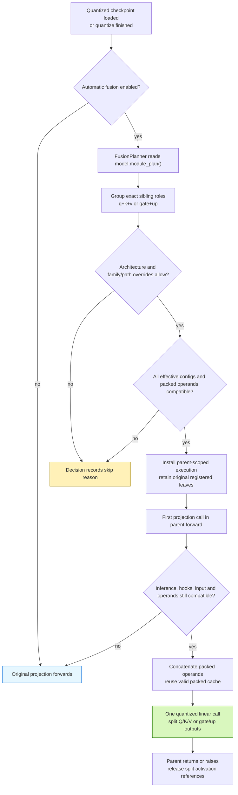
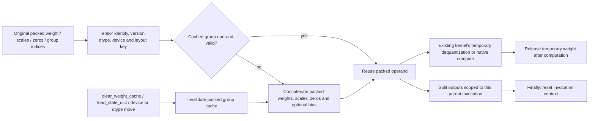

# Post-quantization fusion planner

The fusion planner consumes `model.module_plan()` and combines compatible
Q/K/V or gate/up projections for inference. Initial architecture coverage is
Llama, including Llama 3.2 1B. MoE fusion is outside this first implementation.

Fusion runs automatically after loading a quantized checkpoint or completing
quantization. It is optional:

```python
from gptqmodel import GPTQModel
from gptqmodel.utils.backend import BACKEND

# AUTO selects Marlin for the symmetric INT4/group-128/no-act-order case.
model = GPTQModel.load("/path/to/quantized-llama", backend=BACKEND.AUTO)
model.fusion_plan().print()
decisions = model.fusion_plan().to_dict()

model.fuse(False)                          # Restore separate execution
model.fuse()                               # Rebuild and apply compatible groups
model.fuse(overrides={"qkv": False})        # Fuse only gate/up
model.fuse(overrides={"model.layers.0.mlp": False})

# Disable automatic fusion at loading or for a quantization operation.
model = GPTQModel.load("/path/to/quantized-llama", fuse=False)
# source_model.quantize(calibration, fuse=False)
```

`model.fuse()` returns the wrapper. `model.fusion_plan()` returns the applied
`FusionPlanner`, or `None` when disabled. An enabled plan may have zero eligible
groups; inspect its decisions for per-group skip reasons. The planner
does not convert unsupported backends into a different kernel. A direct
`fuse()` call on an unquantized wrapper raises.

## Selection and execution



The original path called each projection's kernel independently. The new path
adds `FusionPlanner` and `_FusionGroup` in `gptqmodel/models/fusion.py`; it changes
the execution of declared projection calls while preserving the registered
module tree. `BaseQModel.fuse()` installs/removes execution and
`BaseQModel.quantize()` invokes it after finalization. Loader opt-out is consumed
by GPT-QModel before calling Transformers.

| Before | With an eligible fusion group |
| --- | --- |
| Q, K, V execute three quantized linear calls | One wider quantized linear call, split in declared role order. GQA output widths may differ. |
| Gate and up execute two quantized linear calls | One wider call; the existing parent still applies its activation and multiplication. |
| Each leaf is a checkpoint owner | The same leaves and checkpoint keys remain registered. |
| No derived group operand | An additional packed operand may be retained for the group. |

There is no suffix-based selection. Each requested role must resolve to exactly
one distinct quantizable sibling in the compiled tree. Fused leaves carrying
multiple requested roles, excluded/capture-only leaves, incomplete groups, and
MoE paths are not eligible.

## Compatibility and overrides

Every member must have the same **effective** quantization configuration after
per-module dynamic overrides. This includes bit width, group size, symmetry,
activation ordering, format, and other serialized quantization options. Matching
only the global bit width is insufficient. A disabled dynamic target rejects
the group. Identical effective options can still be rejected by kernel/layout
checks.

The canonical acceptance case is **symmetric 4-bit, group size 128,
`desc_act=False`, `BACKEND.AUTO`** on NVIDIA CUDA. AUTO selects `MarlinLinear`
for GPTQ and `AwqMarlinLinear` for AWQ. Fusion preserves the selected concrete
kernel class. Both support 32 groups (QKV plus gate/up across 16 layers) on
Llama 3.2 1B.

Native Marlin fusion requires finalized operands without padding or activation
reordering, equal input widths, and output widths aligned to 64 columns. Its
packing permutations are local to those tiles, so whole-tile concatenation
preserves the existing native layout. The finalized shell is copied without
calling `post_init()` a second time, and owns a separate **zero-initialized**
reduction workspace. Quantization metadata, kernel reduction settings, devices,
dtypes, and bias policies must match. Original registered operands stay intact.

Portable `TorchLinear` / `AwqTorchLinear` executors also remain available for
int32-packed 2/4/8-bit weights. They require equal GPTQ group indices and
compatible unpadded shapes. The portable Torch AWQ GQA QKV case remains
conservatively excluded; that restriction does not apply to the validated native
Marlin executor. Adapters, projection/offload hooks, and online projection
rotation are excluded.

The definition owns architecture enablement and policy:

```python
# Attributes on a BaseQModel definition. Llama currently opts in to "llama".
fusion_model_types = frozenset({"llama"})
fusion_overrides = {
    "qkv": False,
    "model.layers.0.mlp": False,
}
```

The concrete runtime model type must be opted in. The initial parent-forward
validation is limited to native `LlamaAttention`/`LlamaMLP`. Policy lookup prefers
the exact full parent path, then the layer-relative parent path, then the family
(`qkv` or `gate_up`), then `True`. Per-call overrides replace definition values
for the same key. Enabling a policy cannot bypass compatibility checks.

Runtime checks preserve separate execution for training, inputs requiring
gradients, direct projection calls outside the parent, global/projection hooks,
and Torch compilation. A later sibling receiving a different tensor or a
versioned input that changed in place uses its original projection. Only the
validated Llama parent flow is enabled; arbitrary custom forwards require new
evidence before being enabled.

## Operand and activation lifetime



The retained group cache contains packed quantized weights and their associated
metadata. It adds packed storage on top of the original checkpoint-owned
weights; it does not replace or remove those owners. No dense or expanded weight
is retained. Native Marlin dequantizes in its kernel tiles. The optional portable
Torch executor can temporarily dequantize a wider matrix; account for that peak
when using the Torch backend.

Normal tensor mutations/replacements invalidate through the source operand key.
The source projections' `clear_weight_cache()` methods also invalidate the group. This method is installed while fusion is active on kernels that have no original clear method.
Inference tensors have no version counter: code mutating them inside
`torch.inference_mode()` must explicitly call `clear_weight_cache()` on a source
projection. This is the same explicit-clear contract used by the other runtime
weight caches.

Split activations live in a `ContextVar` for one parent invocation and are
released in `finally`, including exception paths. Nested/concurrent invocation
contexts are separate. `fuse(False)` restores the original forwards/cache-clear
methods and releases packed fusion operands. Reapplying fusion builds a fresh
set of decisions.

## Checkpoint and test contract

Fusion preserves registered state-dict keys and tensor values. Saving uses the
ordinary separate projection tensors; loading rebuilds the ordinary modules and
then applies the optional planner. The fusion cache, native workspace, and activation context are
runtime state, not new model-definition weight obligations.

- `tests/module_tree/test_llama_fusion.py` builds a real tiny GQA Llama shell,
  constructs independent integer-code weight oracles, and covers GPTQ/AWQ,
  FP16/BF16, CPU/CUDA, generation, configuration mismatches, overrides,
  invalidation, activation cleanup, and gradient/training fallbacks.
- `tests/models/test_llama3_2_fusion.py` exercises local Llama 3.2 1B GPTQ/AWQ
  checkpoints, logits, greedy tokens, opt-out, automatic fusion after reload,
  and actual checkpoint save/reload. It reports timing and additional packed
  bytes. Checkpoint paths can be supplied through
  `GPTQMODEL_LLAMA32_FUSION_GPTQ` and `GPTQMODEL_LLAMA32_FUSION_AWQ`.

The planner is a correctness-gated execution option, not a guarantee of speedup
for every batch size or device. Evaluate its packed-memory cost and measured
latency on the target workload. Other architectures, MoE, additional backends, and
compiled fused execution need dedicated implementation and validation.

## Measured Llama 3.2 1B results

**Symmetric INT4, group size 128, `desc_act=False`, AUTO selects Marlin in both
modes.** RTX 4090, Torch 2.15.0+cu132, FP16, batch 1, eager attention,
`TORCHDYNAMO_DISABLE=1`. Two warmups and five measured repeats per mode;
median synchronized wall-clock time. Prefill is 128 tokens. Decode is 16 cached
single-token forwards with fixed token 42; cache-building prefill is excluded.
Loading and packed-cache construction are outside timing. Other test workloads
were stopped during these measurements.

| Method | Phase | Kernel off / on | Off latency | On latency | Latency change | Off tok/s | On tok/s |
| --- | --- | --- | ---: | ---: | ---: | ---: | ---: |
| GPTQ | Prefill (128 tokens) | `MarlinLinear` / same | 9.307 ms | 11.194 ms | +20.28% | 13752.98 | 11434.23 |
| GPTQ | Decode (per token) | `MarlinLinear` / same | 8.884 ms | 9.909 ms | +11.54% | 112.57 | 100.92 |
| AWQ | Prefill (128 tokens) | `AwqMarlinLinear` / same | 9.935 ms | 11.182 ms | +12.55% | 12883.69 | 11446.80 |
| AWQ | Decode (per token) | `AwqMarlinLinear` / same | 9.094 ms | 10.208 ms | +12.25% | 109.96 | 97.96 |

| Method | Phase | Max absolute logit drift | RMS logit drift | Relative L2 | Top-1 agreement |
| --- | --- | ---: | ---: | ---: | ---: |
| GPTQ | Prefill | 0.03906250 | 0.00495072 | 0.00146600 | 100.0% |
| GPTQ | Decode | 0.02929688 | 0.00498216 | 0.00231643 | 100.0% |
| AWQ | Prefill | 0.03125000 | 0.00438472 | 0.00135257 | 100.0% |
| AWQ | Decode | 0.02490234 | 0.00394760 | 0.00156669 | 100.0% |

| Projection | Packed operands exact | Max off/on drift | Max off/oracle drift | Max on/oracle drift |
| --- | --- | ---: | ---: | ---: |
| GPTQ `model.layers.0.self_attn` | True | 0.00390625 | 0.00390625 | 0.00390625 |
| GPTQ `model.layers.0.mlp` | True | 0.00195312 | 0.00195312 | 0.00195312 |
| AWQ `model.layers.0.self_attn` | True | 0.01562500 | 0.01562500 | 0.00781250 |
| AWQ `model.layers.0.mlp` | True | 0.00390625 | 0.00390625 | 0.00390625 |


Both native projections pass combined `rtol=atol=2e-3` against an independent
checkpoint-unpacking/FP32 matmul oracle with native FP16 weight/output rounding.
These combined tolerances are not a uniform 0.002 absolute bound at every
magnitude. Sampled packed operands are bitwise equal. Composed model logits
accumulate changes in reduction order and output rounding; their absolute,
RMS, and relative drift are reported above. Top-1 agreement is measured at all
128 prefill and 16 decode positions, not a dataset benchmark accuracy score.

The real save/reload test checks selected kernel types, unchanged checkpoint
keys, fixed-prompt top-1 and 12-token greedy agreement, and bitwise equality
between the fused model and its fused reload. It does not impose an artificial
bitwise off/on requirement on accumulated model logits. Projection-oracle
precision gates remain unchanged.

The slower fused totals are not caused by changing away from Marlin. As a
separate diagnostic on the same hardware, direct first-layer native QKV decode
calls took 0.0591 ms separately versus 0.0230 ms combined; gate/up took 0.0367
versus 0.0235 ms. The planner adds Python interception, context bookkeeping,
input checks, and operand fingerprints. A first-layer fingerprint measurement,
extrapolated to 16 layers, costs about 0.77 ms per token for both families; this
is an estimate, not a complete profiler attribution. This overhead can exceed
the saved kernel-launch time. Fusion does not reduce matrix-multiply FLOPs.
Larger projection shapes can also select different native schedules.

Both methods retain additional packed operands (exact bytes in the raw report)
and reduction workspace. These are additional to checkpoint storage, not dense
weight caches. Latency and memory are explicit tradeoffs; `fuse=False` disables
this initial implementation. Automatic eligibility does not guarantee a speedup.

Raw data: [llama32-fusion.json](benchmarks/llama32-fusion.json). Reproduce with:

```bash
TORCHDYNAMO_DISABLE=1 CUDA_VISIBLE_DEVICES=0 PYTHONPATH=. python tests/benchmark_llama_fusion.py \
  --gptq-path /path/to/symmetric-llama32-gptq \
  --awq-path /path/to/symmetric-llama32-awq \
  --output-json /tmp/fusion-prefill-decode.json
```

The GPTQ fixture is local `Llama-3.2-1B-Instruct-HF-GPTQV2`. The AWQ fixture was
quantized from local `Llama-3.2-1B-Instruct` with the following recipe; this is a
calibration fixture for comparing execution, not a model-quality claim:

```python
import torch
from gptqmodel import GPTQModel
from gptqmodel.quantization import AWQConfig
from gptqmodel.utils.backend import BACKEND

qcfg = AWQConfig(bits=4, group_size=128, sym=True, desc_act=False,
                 offload_to_disk=False)
model = GPTQModel.load("/path/to/Llama-3.2-1B-Instruct", qcfg, device="cuda:0",
                       dtype=torch.float16, fuse=False, attn_implementation="eager")
text = ("The capital of France is Paris. Science and mathematics explain the "
        "natural world. Good software tests verify every important result. ")
model.quantize([text * 12 for _ in range(16)], batch_size=1,
               backend=BACKEND.AWQ_TORCH)
model.save("/path/to/symmetric-llama32-awq")
```
