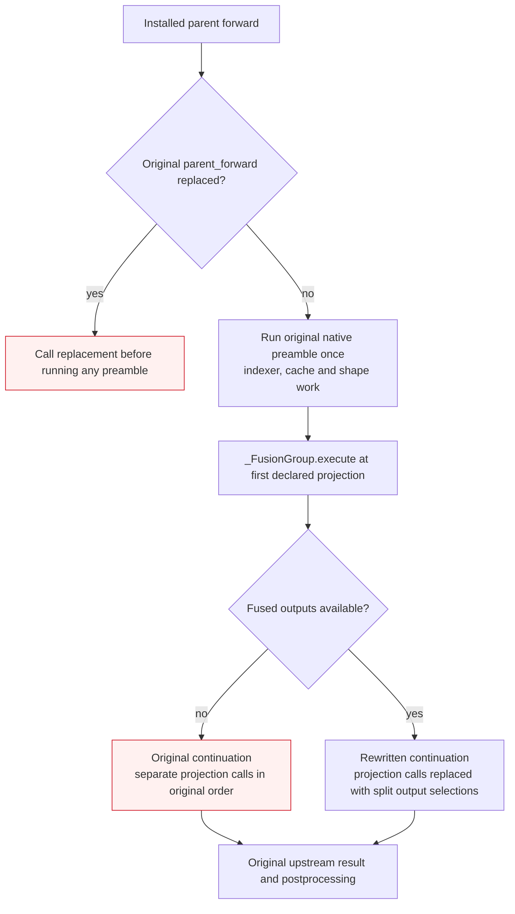
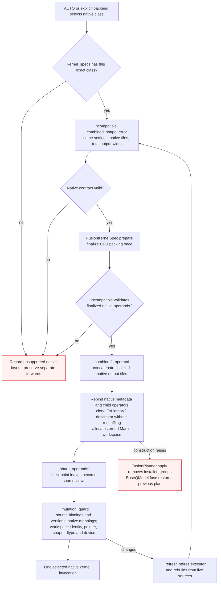
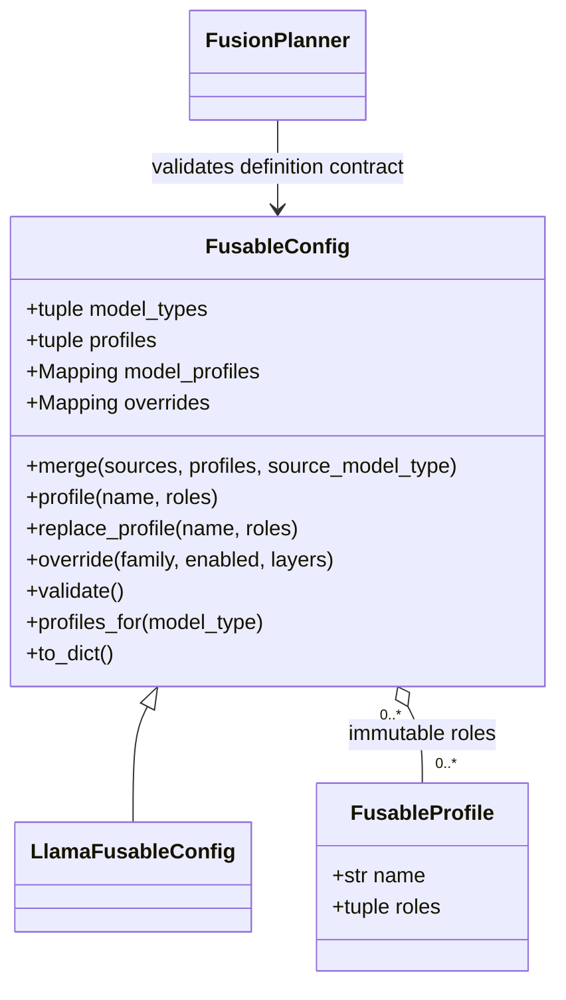
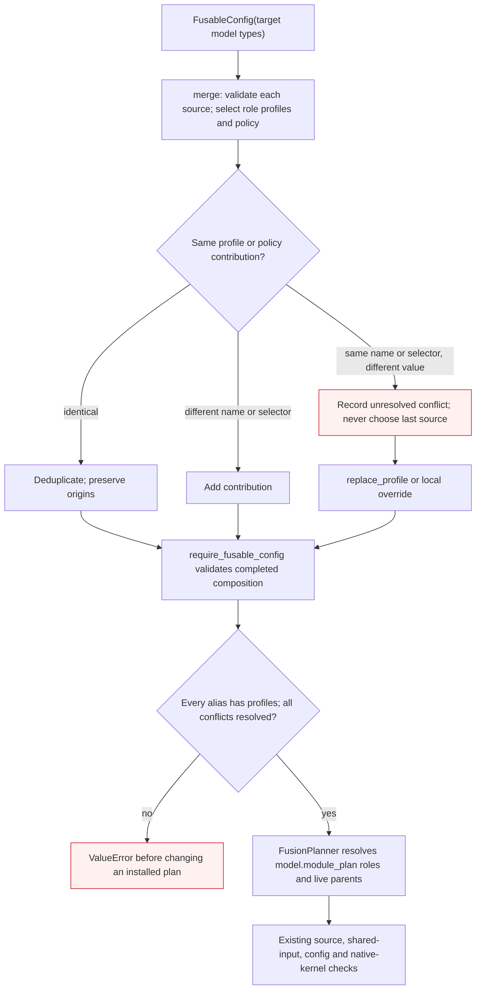
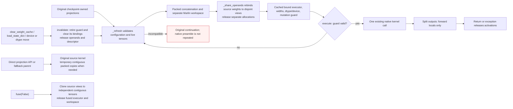
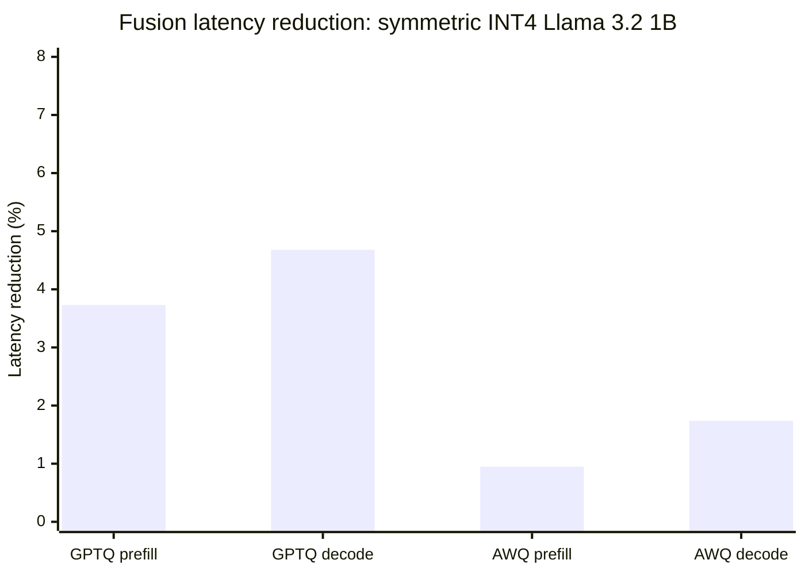

# Post-quantization fusion planner

The fusion planner consumes `model.module_plan()` and combines compatible
Q/K/V or gate/up projections for inference. Definition-owned contracts qualify
101 registered model types, with per-model profiles listed in the
[qualification matrix](fusion-model-coverage.md). MoE expert paths remain
excluded; compatible attention in MoE models can qualify independently.
Introduced in [PR #3567](https://github.com/ModelCloud/GPTQModel/pull/3567).

Fusion requires a definition-owned `FusableConfig` and is disabled by default
for loading and quantization. Enable it explicitly:

```python
from gptqmodel import GPTQModel
from gptqmodel.utils.backend import BACKEND

# AUTO selects Marlin for the symmetric INT4/group-128/no-act-order case.
model = GPTQModel.load("/path/to/quantized-llama", backend=BACKEND.AUTO)
plan = model.fuse()                        # Apply fusion and return its plan
plan.print()
decisions = plan.to_dict()

model.fuse(False)                          # Restore separate execution; returns None
plan = model.fuse()                        # Rebuild and return the applied plan
plan = model.fuse(overrides={"qkv": False}) # Fuse only gate/up
plan = model.fuse(overrides={"model.layers.0.mlp": False})

# Optional opt-in at loading or quantization finalization.
model = GPTQModel.load("/path/to/quantized-llama", fuse=True)
# source_model.quantize(calibration, fuse=True)
# plan = model.fuse()                      # Reapply and receive the current plan
```

`model.fuse()` returns the applied `FusionPlanner`. Keep that object and call
`plan.print()`, `plan.render()`, or `plan.to_dict()` to inspect it. Each enabled
call rebuilds the plan using the current configuration and overrides;
inspection through the retained object performs no model mutation.
`model.fuse(False)` restores separate execution and returns `None`. Previously
returned plans remain inspectable after disabling, with their executors released.
An enabled plan may have zero eligible groups; inspect its decisions for
per-group skip reasons. The planner
does not convert unsupported backends into a different kernel. A direct
`fuse()` call on an unquantized wrapper raises. A definition without
`fusable` is not fusable: enabling fusion raises `ValueError` rather than
returning an empty plan. `fuse(False)` remains valid for every definition.

## Selection and execution

```mermaid
flowchart TD
    API["plan = model.fuse(enabled, overrides)"] --> ENABLED{"enabled?"}
    ENABLED -->|"no"| DISABLE["Remove previous plan; restore source operands<br/>return None"]
    ENABLED -->|"yes"| ADMIT
    DONE["Quantized checkpoint loaded<br/>or quantize finished"] --> AUTO{"Explicit fusion opt-in?"}
    AUTO -->|"no"| OLD["Original projection forwards"]
    AUTO -->|"yes"| ADMIT["require_fusable_config<br/>definition instance, model_type, role profiles"]
    ADMIT --> VALIDPROFILE{"Valid declared FusableConfig?"}
    VALIDPROFILE -->|"no"| ERROR["Raise before mutation<br/>or before calibration when quantize opts in"]
    VALIDPROFILE -->|"yes"| PLAN["FusionPlanner reads model.module_plan()"]
    PLAN --> ROLES["Group exact sibling roles<br/>q+k+v or gate+up"]
    ROLES --> POLICY{"Configured profile and scoped policy allow?"}
    POLICY -->|"no"| SKIP["Decision records skip reason"]
    POLICY -->|"yes"| CONFIG{"All effective configs and packed operands compatible?"}
    CONFIG -->|"no"| SKIP
    CONFIG -->|"yes"| TEMPLATE{"_parent_template validates native forward?"}
    TEMPLATE -->|"no"| SKIP
    TEMPLATE -->|"yes"| UNIQUE{"Only one eligible profile per parent?"}
    UNIQUE -->|"no"| ERROR
    UNIQUE -->|"yes"| INSTALL["_FusionGroup.install<br/>compile direct parent forward"]
    INSTALL --> PREPARE["_refresh before serving tokens<br/>one packed allocation, source views, executor and guard"]
    SKIP --> RETURN["BaseQModel.fuse returns the applied FusionPlanner<br/>including an empty plan when no groups qualify"]
    PREPARE --> RETURN
    RETURN --> INSPECT["Caller retains plan<br/>plan.print / render / to_dict"]
    PREPARE --> PREFIX["Parent invocation preserves native preamble once"]
    PREFIX --> CALL["At first projection: execute once"]
    CALL --> RUNTIME{"Inference, input and hooks allow fusion?"}
    RUNTIME -->|"no"| CONTINUE["Continue original body after preamble"]
    RUNTIME -->|"yes"| GUARD{"Cached mutation guard passes?"}
    GUARD -->|"no"| REFRESH["Cold _refresh revalidates live owners"]
    REFRESH -->|"incompatible"| CONTINUE
    REFRESH -->|"compatible: rebuild descriptors"| GEMM
    GUARD -->|"yes"| GEMM["Bound packed.forward<br/>split Q/K/V or gate/up outputs"]
    GEMM --> END["Upstream parent math consumes local outputs<br/>no projection interception or activation context"]
    style SKIP fill:#fff1f0,stroke:#cf1322
    style ERROR fill:#fff1f0,stroke:#cf1322
    style OLD fill:#e6f7ff,stroke:#096dd9
    style GEMM fill:#d9f7be,stroke:#237804
```



Separate execution calls each projection's kernel independently. The planner
changes the execution of declared projection calls while preserving the
registered module tree. `BaseQModel.fuse()` installs/removes execution and
`BaseQModel.quantize()` invokes it after finalization. Loader opt-out is consumed
by GPT-QModel before calling Transformers.

| Separate execution | With an eligible fusion group |
| --- | --- |
| Q, K, V execute three quantized linear calls | One wider quantized linear call, split in declared role order. GQA output widths may differ. |
| Gate and up execute two quantized linear calls | One wider call; the existing parent still applies its activation and multiplication. |
| Each leaf owns its packed tensors | The same checkpoint leaves reference disjoint views of the combined packed tensors. |
| Independent packed allocations | One combined allocation replaces separate weights; native metadata/workspace follows the backend contract. |

Baseline evidence at main `de7db05`: sibling roles are declared in
`gptqmodel/models/definitions/llama.py:25` (Q/K/V) and `:27` (gate/up).
Each separate projection enters `gptqmodel/nn_modules/qlinear/marlin.py:434`
or `marlin_awq.py:355`. Fusion moves grouping into `FusionPlanner` and the
parent's `_FusionGroup.execute` call; the selected native linear kernel remains
the computation boundary shown in the comparison above.

The compiler reads the actual parent `forward` resolved from the compiled
tree. Profiles declare sibling roles, with no Python class import paths. Each
declared projection must occur exactly once and take the same
parent input without extra arguments; extra weight/metadata references,
decorated functions, instance forward overrides, unavailable source, and
unsupported call shapes reject the group. Conditional projection calls and
reassigned or in-place-mutated input arguments also reject the group. It substitutes tuple selections for
those calls and retains upstream RoPE, cache updates, attention dispatch,
activation, multiplication, output projection, and the public forward signature.
The original preamble runs once before the first projection, including any
indexer/cache updates. The compiler branches into the original continuation on
fallback or the projection-substituted continuation on success; it does not
restart the preamble. Extra input consumers between projections and escaped
input aliases are rejected because they could change a later projection's
input. An explicit forward override still takes the original path before any
preamble executes. No separately maintained architecture forward is used.

The generated forward has one shared preamble and two continuations:



There is no suffix-based selection. Each requested role must resolve to exactly
one distinct quantizable sibling in the compiled tree. Fused leaves carrying
multiple requested roles, excluded/capture-only leaves, incomplete groups, and
MoE paths are not eligible.

## Compatibility and overrides

Every member must have the same **effective** quantization configuration after
per-module dynamic overrides. This includes bit width, group size, symmetry,
activation ordering, format, and other serialized quantization options. Matching
only the global bit width is insufficient. A disabled dynamic target rejects
the group. Identical effective options can still be rejected by kernel/layout
checks.

The canonical acceptance case is **symmetric 4-bit, group size 128,
`desc_act=False`, `BACKEND.AUTO`** on NVIDIA CUDA. AUTO selects `MarlinLinear`
for GPTQ and `AwqMarlinLinear` for AWQ. Fusion preserves the selected concrete
kernel class. Both support 32 groups (QKV plus gate/up across 16 layers) on
Llama 3.2 1B.

Native Marlin fusion requires finalized operands without padding or activation
reordering, equal input widths, and output widths aligned to 64 columns. Its
packing permutations are local to those tiles, so whole-tile concatenation
preserves the existing native layout. The finalized shell is copied without
calling `post_init()` a second time, and owns a separate **zero-initialized**
reduction workspace. Quantization metadata, kernel reduction settings, devices,
dtypes, and bias policies must match. Original checkpoint leaves retain their tensor values through shared storage views.

Portable `TorchLinear` / `AwqTorchLinear` executors also remain available for
int32-packed 2/4/8-bit weights. They require equal GPTQ group indices and
compatible unpadded shapes. The portable Torch AWQ GQA QKV case remains
conservatively excluded; that restriction does not apply to the validated native
Marlin executor. Adapters, projection/offload hooks, and online projection
rotation are excluded.

### Native kernel contracts

`fusion_kernels.kernel_specs()` qualifies exact kernel classes with a
`FusionKernelSpec`. Backend selection happens before fusion. AUTO retains CPU
ATen/AVX512, NVIDIA Marlin, and eligible AMD Torch/Triton implementations;
fusion never substitutes a portable implementation to make a group eligible.
The [kernel inventory](fusion-kernel-inventory.md) accounts for every registered
backend, including architecture/dependency exclusions, other quantization
formats, and the format-specific EXL3/FP4 loaders.

`FusionKernelSpec.axes` and `private_mappings` are immutable, variable-length
collections. They contain only operands and mappings owned by that native
layout. A layout with `zero_name=None`, including native INT8 and symmetric
AllSpark, has no zero-point entry; no placeholder `qzeros` is introduced.



| Finalized layout | Output concatenation and lifecycle |
| --- | --- |
| Torch GPTQ/AWQ, TritonV2, AWQ GEMM/Triton GEMM | Native packed columns; direct source launches compact strided packed operands temporarily. |
| Marlin GPTQ/AWQ | Complete N64 tiles; a new zero-initialized workspace sized for the device. Workspace rebinding/resizing/dtype changes force a cold rebuild. |
| CPU ATen/AVX512/legacy int4pack | Finalized HF packed output rows; grouped scale/zero columns. Rebuild affine metadata and legacy child operators from current sources. |
| AWQ GEMV/Triton GEMV | Native output rows, including scale/zero rows. |
| AWQ fast GEMV/LLM-AWQ | Complete interleaved N4/K64 packed blocks; matching native scale/offset columns. |
| ExLlamaV2 GPTQ/AWQ | Finalized shuffled columns; clone borrowed-pointer descriptors without rerunning the destructive shuffle. Direct source views use transient compact descriptors; unfusing restores independent descriptors. Canonical input order is required. |
| AllSpark GPTQ/AWQ | Native eight-bit N32K16 blocks viewed as output rows; complete unpadded N32 tiles and native per-channel metadata. Scratch is allocated per call by the backend. |
| CPU native INT8 | Output rows of native eight-bit codes and per-channel scales; rebuild the `Int8PackedModule` binding. Lower-bit expansion is prohibited. |
| GPTQ W4AFP8 | Native INT4 columns; temporary E4M3 staging per call. Plain tensor inputs qualify; encoded W4A streams require a separate parent executor and are rejected. |

All sibling settings, including AWQ reduction/scheduler options, must match.
The kernel validates the **combined** output shape before installation and on
cold refresh. Fused native buffers remain contiguous. Temporary compaction is
only for direct source/fallback calls; it is never installed as another weight
cache. `fuse(False)` restores contiguous independent source operands exactly.

## Definition-owned FusableConfig

`BaseQModel.fusable` defaults to `None`. A definition must declare a completed,
validated `FusableConfig` before callers can enable fusion. Construction is
target-first; merges never import source model identities or enable fusion:

```python
from gptqmodel import FusableConfig, LlamaFusableConfig

fusable = FusableConfig("qwen2").merge(LlamaFusableConfig())
```

`LlamaFusableConfig()` supplies immutable `qkv` (`q/k/v`) and `gate_up`
(`gate/up`) profiles. The target can also be a tuple of model-type aliases:
`FusableConfig(("glm", "glm4"))`. Every admitted alias is validated separately.
Concrete projection paths and actual parent modules always resolve through
`model.module_plan()`; there are no HF class import paths or class allowlists.



### Merge, extend and override

Every fluent operation returns a new frozen configuration. Constructor inputs
are copied to immutable tuples/mappings, so shared sources never change.
Repeated merges let each source contribute its own selected profiles:

```python
from gptqmodel import FusableConfig, LlamaFusableConfig

attention = FusableConfig("attention_policy").merge(
    LlamaFusableConfig(), profiles=("qkv",),
)
mlp = FusableConfig("mlp_policy").profile("gate_up", roles=("gate", "up"))

fusable = (
    FusableConfig("custom_model")
    .merge(attention, profiles=("qkv",))
    .merge(mlp, profiles=("gate_up",))
    .override("qkv", enabled=False, layers=(0, 1))
)

# Unrestricted composition also accepts multiple sources in one call.
fusable = FusableConfig("custom_model").merge(attention, mlp)
```

`profiles=` selects exactly the named role profiles and their matching family
policy; it requires a single source. The same applies to `source_model_type=`:
use a separate merge call for each source-specific selection. Omitting selectors
merges all default profiles, while preserving a source's matching target-alias
variants from `model_profiles`. An explicit source alias selects that alias's
role policy for every target:

```python
from gptqmodel.models.definitions.llama import LlamaQModel
from gptqmodel.models.definitions.qwen2 import Qwen2QModel

attention_only = FusableConfig("qwen2_moe").merge(LlamaFusableConfig(), profiles=("qkv",))
audio = FusableConfig("qwen2_audio").merge(Qwen2QModel.fusable)
wrapper = FusableConfig("mistral3").merge(LlamaQModel.fusable, source_model_type="mistral")
```

Use `.profile(name, roles=...)` to add a new role group. An existing name requires
`.replace_profile(name, roles=...)`; replacement is explicit for every target
alias containing that profile, records the target as its origin, and wins over
later merges for that profile. Adding a profile does not create a new native
kernel contract: quantization settings, common inputs, source structure and
native packed layouts must still qualify.



| Composition case | Behavior |
| --- | --- |
| Sources contribute different profile names | Merge in declaration order |
| Identical profiles or policies, including a diamond | Deduplicate; retain contributing origins |
| Same profile name has different roles | Record a conflict; explicit `replace_profile()` is required |
| Inherited values differ for the same policy selector | Record a conflict; explicit local `override()` is required |
| Target already explicitly replaced a profile or set that selector | Its local choice wins over merged contributions |
| Local scoped overrides overlap with conflicting values | Reject the conflicting call atomically |
| Source is incomplete or has unresolved conflicts | Reject that merge source |
| Completed target is empty or still conflicting | Reject definition binding before any fusion mutation |

A target-only constructor is a valid intermediate builder. It cannot execute
fusion. Individual argument errors are immediate; cross-source conflicts remain
inspectable in `to_dict()["conflicts"]` until explicitly resolved. Call
`config.validate()` to check completion yourself. Definition admission and
`profiles_for()` perform the same validation. No implicit last-source-wins rule
exists, and neither merge nor override can relax mandatory compatibility checks.

### Policy lookup and inspection

`.override("qkv", enabled=False, layers=(0, 1))` addresses compiled profile
groups by their local index within the declared decoder stack. It does not name
a Python class, an attention attribute or a projection path. Indices must be
nonnegative integers. A family-wide override omits `layers`.

Policy precedence is: applicable per-call `model.fuse(overrides=...)` policy
(full parent, relative parent, family), then definition policy (full parent,
relative parent, family plus layer index, family), then enabled. Legacy exact
parent keys remain supported by the constructor's `overrides` mapping; the fluent
API uses role families and optional layer indices. Layer-specific rules beat
family-wide rules; local policy wins inherited policy for the same selector.
Conflicting inherited selectors must be resolved even if a more specific rule
would hide them on one layer. Conflicting local rules are rejected rather than
silently overwritten.

`plan = model.fuse()` returns the applied `FusionPlanner`. `plan.print()` and
`plan.render()` show each group's profile origins, winning policy and runtime
acceptance/skip reason. `plan.to_dict()` includes the same data and the completed
configuration, including scoped overrides and conflict diagnostics. Definition
policy resolves during planning; it adds no policy lookup to the token loop.

### Admission and failure contract

| Situation | Behavior |
| --- | --- |
| No definition config | Enabling fusion raises `ValueError`; disabling is allowed |
| Config has the wrong type | `TypeError`; a `FusableConfig` instance is required |
| Runtime model type absent from config | `ValueError`; merge cannot import another model's identity |
| Unknown/duplicate/empty profile selection | Reject before composition |
| Incomplete config or unresolved merge conflict | `ValueError` before changing an installed plan |
| Two eligible profiles target the same parent | `ValueError` before installation; no ambiguous overlapping groups |
| Valid profile, incompatible layer/config/kernel | Record a skipped group and its reason |

Constructor opt-in and `quantize(..., fuse=True)` preflight the same definition
before calibration. The profile grants eligibility; caller opt-in controls
activation. An inherited definition can set `fusable = None` to reject fusion.

Runtime checks preserve separate execution for training, inputs requiring
gradients, direct projection calls outside the parent, global/projection hooks,
and Torch compilation. Trainable operand tensors also fall back. Runtime
projection replacement, forward overrides, and offload hooks invalidate the
descriptor and preserve the original parent path. Every configured parent
forward must pass source validation; custom forwards require dedicated tests.

## Operand and activation lifetime



Each compatible group owns one concatenated packed allocation. `_share_operands()`
rebinds the original projections' weights, scales, zero points, and optional bias
to disjoint views into that allocation. Their checkpoint names, shapes, and
values remain intact; their former separate allocations are released. The wider
native kernel consumes the contiguous fused tensors directly, so source views
add no projection work to the normal fused token path.

CPU sources are an exception while the group is installed: finalizing them
replaces the checkpoint operands with int4pack storage, so the checkpoint shapes
survive only in the `capture_fused_train_state` snapshot that
`FusionKernelSpec.prepare()` takes before it transforms. Saving restores that
snapshot first, and so does `fuse(False)`; the source views are then cloned back
to independent checkpoint-layout tensors instead of being read as native
operands.

Direct source calls and fallback parents still work. Marlin creates temporary
contiguous **packed** copies of strided source operands for that call and releases
them afterward. The portable AWQ executor preserves strided scale views when
its dtype/device already match. No dense or expanded weight is retained. Native
Marlin uses tile scratch; the optional portable Torch executor temporarily
dequantizes inside the consuming computation.

The checkpoint writer distinguishes identical aliases from distinct offset,
shape, stride, or dtype views. It saves every distinct checkpoint-owned weight
under its original key, even when multiple keys share one allocation. Streaming
serialization handles each view independently; the fused runtime allocation is
not an additional checkpoint tensor.

The compiled guard checks direct dictionary bindings and shared tensor versions,
storage pointers, shapes, dtypes, devices, and gradient policy. It also checks
source module identity, frozen kernel settings, hooks, and forward overrides.
Native pointer mappings and executor workspace bindings are checked as well;
workspace contents are scratch and do not participate in version checks.
Scratch resizing/replacement causes a fresh zeroed native allocation.
One version-counter check per packed operand covers writes through any sibling
view; binding, storage, dtype, shape, device, and gradient checks remain per leaf.
There are no full compatibility scans, tensor-key tuple construction, or
projection wrappers on the unchanged token path. A failed guard invokes
`_refresh()`, which revalidates the live owners and either rebuilds the packed
operand/descriptor or falls back to the original parent. This retains detection
of ordinary in-place updates, replacement, and same-storage `.data` dtype/shape
changes; it does not disable mutation safety to obtain the speedup.

The source projections' `clear_weight_cache()` methods also invalidate the
group. This method is installed while fusion is active on kernels that have no
original clear method.
Inference tensors have no version counter: code mutating them inside
`torch.inference_mode()` must explicitly call `clear_weight_cache()` on a source
projection. Unversioned writes through raw `.data`/storage aliases likewise
require explicit clearing when metadata and storage identity stay unchanged.
This is the existing explicit-clear contract used by runtime weight caches.

Split activations are forward locals, with no persistent activation references
in the planner or a context object. `fuse(False)` deactivates the executor,
restores the parent and cache-clear methods when they are still ours, clones
source views back to independent contiguous tensors, and releases the fused
operands, workspace, and descriptors. A third-party wrapper retaining an
old parent method cannot reactivate the removed executor. Reapplying fusion
builds fresh decisions.

Invalidation replaces the generated guard's code with `_retired_guard` and
clears its private global bindings before releasing packed tensors. Retained
guard references return `False` and hold no operand tensors. This also releases
storage promptly on free-threaded Python builds that defer function destruction;
it adds no checks to the token loop.
Completed Torch compiler traces can leave unreachable cycles referencing packed
inputs. For compiled source dequantizers, cold invalidation collects those cycles
so retired allocations do not await automatic collection. Unchanged token
execution performs neither collection nor compiler-cache resets.

## Checkpoint and test contract

| Execution concern | Fusion disabled | Fusion enabled | Implementation |
| --- | --- | --- | --- |
| Projection launches | Original separate calls | One native packed call; split outputs feed the original continuation | `gptqmodel/models/fusion.py:58` (`_parent_template`) |
| Persistent packed operands | Independent source allocations | One contiguous fused allocation with disjoint source views | `gptqmodel/models/fusion.py:435` (`_share_operands`) |
| Group selection | No fusion execution installed | Validated definition policy plus compiled-tree roles and live parents | `gptqmodel/models/fusion.py:637` (`FusionPlanner`) |
| Model lifecycle | Ordinary model execution | Explicit apply/remove; failed admission preserves the installed plan | `gptqmodel/models/base.py:683` (`BaseQModel.fuse`) |

Fusion preserves registered state-dict keys and tensor values. Saving serializes
each projection view under its checkpoint key; loading rebuilds the ordinary modules and
then applies the planner only when explicitly requested. The fusion cache, native workspace, and
compiled descriptor are runtime state, not new model-definition weight obligations.

- `tests/module_tree/test_llama_fusion.py` builds a real tiny GQA Llama shell,
  constructs independent integer-code weight oracles, and covers GPTQ/AWQ,
  FP16/BF16, CPU/CUDA, generation, configuration mismatches, overrides,
  invalidation, activation cleanup, gradient/training/hook/compiler fallbacks,
  and the absence of full compatibility work on the steady-state path.
  Its public API regression checks the returned `FusionPlanner`, terminal/JSON
  inspection, empty eligible plans, and `None` on disable. Benchmarks retain
  this return value and pass it to storage/diagnostic helpers explicitly.
- `tests/module_tree/test_fusable_models.py` pins admission for all 198 aliases,
  exercises 101 real native model definitions through the public module-plan API
  and fusion planner, and checks 116 distinct native parent/family pairs in
  GPTQ/AWQ and FP16/BF16 against separate forwards and integer-weight oracles.
- `tests/module_tree/test_fusable_merge.py` checks target-first construction,
  multiple sources, diamond deduplication, alias variants, explicit conflict
  resolution, local/scoped policy precedence, immutability, printed/extracted
  provenance and failure before changing an installed plan. Actual GPTQ/AWQ
  parents verify that compiled layer policy changes the intended groups.
- `tests/models/test_llama3_2_fusion.py` exercises local Llama 3.2 1B GPTQ/AWQ
  checkpoints, logits, greedy tokens, opt-in after reload,
  and actual checkpoint save/reload. It asserts zero additional packed-weight
  storage and reports retained tensor/workspace bytes. Checkpoint paths can be supplied through
  `GPTQMODEL_LLAMA32_FUSION_GPTQ` and `GPTQMODEL_LLAMA32_FUSION_AWQ`.

The planner is a correctness-gated execution option, not a guarantee of speedup
for every batch size or device. Evaluate its packed-memory cost and measured
latency on the target workload. Full-model measurements below apply to Llama
3.2 1B. Other models need their own workload measurements; expert fusion,
additional backends and compiled fused execution need dedicated validation.

## CPU, CUDA and ROCm validation

The [device validation report](fusion-device-validation.md) records actual CPU,
RTX 4090 CUDA and Radeon AI PRO R9700 ROCm runs. It covers symmetric INT4,
group 128, `desc_act=False`, FP16/BF16, prefill and cached decode, greedy tokens,
mutation invalidation, storage ownership and independent projection oracles.

`BACKEND.AUTO` selects CPU ATen for FP16 and AVX512 for BF16, CUDA Marlin for
both dtypes, ROCm GPTQ Torch, and ROCm AWQ Triton GEMM for FP16 / Torch for BF16.
Full checkpoint tests assert those exact classes before and after fusion.
Portable AWQ GQA keeps QKV separate and fuses gate/up. Native layout, shape,
workspace, descriptor, mutation and source-restoration tests cover the other
available GPTQ/AWQ kernels explicitly. Eligibility and exclusions are listed in
the [complete host inventory](fusion-kernel-inventory.md).

## Measured Llama 3.2 1B results

**Symmetric INT4, group size 128, `desc_act=False`, AUTO selects Marlin in both
modes.** RTX 4090, Torch 2.15.0+cu132, FP16, batch 1, eager attention,
`TORCHDYNAMO_DISABLE=1`. Ten warmups and fifteen measured repeats per mode;
median synchronized wall-clock time. The process was pinned to CPU 17 with one
Torch CPU thread. Other validation processes used different GPUs; host CPU
activity was not isolated. Modes are off
then on for each model, each separately warmed. Prefill is 128 tokens. Decode
is 16 cached single-token forwards with fixed token 42; cache-building prefill,
loading, packed construction, and source-view binding are outside timing.

| Method | Phase | Kernel off / on | Off latency | On latency | Latency change | Off tok/s | On tok/s |
| --- | --- | --- | ---: | ---: | ---: | ---: | ---: |
| GPTQ | Prefill (128 tokens) | `MarlinLinear` / same | 7.553 ms | 7.271 ms | -3.73% | 16947.50 | 17604.21 |
| GPTQ | Decode (per token) | `MarlinLinear` / same | 6.901 ms | 6.578 ms | -4.68% | 144.92 | 152.03 |
| AWQ | Prefill (128 tokens) | `AwqMarlinLinear` / same | 7.557 ms | 7.485 ms | -0.95% | 16938.16 | 17100.35 |
| AWQ | Decode (per token) | `AwqMarlinLinear` / same | 6.959 ms | 6.838 ms | -1.74% | 143.70 | 146.24 |



| Method | Phase | Max absolute logit drift | RMS logit drift | Relative L2 | Top-1 agreement |
| --- | --- | ---: | ---: | ---: | ---: |
| GPTQ | Prefill | 0.03906250 | 0.00495072 | 0.00146600 | 100.0% |
| GPTQ | Decode | 0.02929688 | 0.00498216 | 0.00231643 | 100.0% |
| AWQ | Prefill | 0.03125000 | 0.00438472 | 0.00135257 | 100.0% |
| AWQ | Decode | 0.02490234 | 0.00394760 | 0.00156669 | 100.0% |

| Projection | Packed operands exact | Max off/on drift | Max off/oracle drift | Max on/oracle drift |
| --- | --- | ---: | ---: | ---: | ---: |
| GPTQ `model.layers.0.self_attn` | True | 0.00390625 | 0.00390625 | 0.00390625 |
| GPTQ `model.layers.0.mlp` | True | 0.00195312 | 0.00195312 | 0.00195312 |
| AWQ `model.layers.0.self_attn` | True | 0.01562500 | 0.01562500 | 0.00781250 |
| AWQ `model.layers.0.mlp` | True | 0.00390625 | 0.00390625 | 0.00390625 |

Both native projection families pass combined `rtol=atol=2e-3` against an
independent checkpoint-unpacking/FP32 matmul oracle with native FP16
weight/output rounding. These combined tolerances are not a uniform 0.002
absolute bound at every magnitude. Sampled packed operands are bitwise equal.
Composed logits accumulate reduction-order and output-rounding differences;
their absolute, RMS, and relative drift are reported above.

Top-1 agreement covers all 128 prefill and 16 decode positions in this fixed
workload. Real checkpoint tests verify fixed-prompt top-1, exact 12-token greedy
agreement, unchanged checkpoint keys, native kernel types, and bitwise fused
save/reload parity. Fresh GPTQ V2 quantization tests also compare serialized
view bytes and fused reload logits exactly. These are execution regression
checks, not dataset accuracy or perplexity scores.

### Shared-view performance check

This control keeps the same loaded model, fused executor, kernel classes, and
packed tensors. Only the source projection bindings change between independent
contiguous packed copies and shared views. Independent copies exist solely in
this benchmark control; production fusion always shares storage. Blocks run
in `copies / views / views / copies` order, each with ten warmups and fifteen
samples, giving thirty samples per layout. Binding/allocation is outside timing,
and logits must match bitwise across layouts.

| Method | Phase | Independent source copies | Shared source views | Views latency change |
| --- | --- | ---: | ---: | ---: |
| GPTQ | Prefill (128 tokens) | 9.559 ms | 9.476 ms | -0.86% |
| GPTQ | Decode (per token) | 8.478 ms | 8.567 ms | +1.05% |
| AWQ | Prefill (128 tokens) | 9.607 ms | 9.259 ms | -3.63% |
| AWQ | Decode (per token) | 8.640 ms | 8.614 ms | -0.31% |

The measured GPTQ decode result is **1.05% slower with views** in this run, so
this result does not establish strict zero-regression parity. AWQ decode is
0.31% faster, and both prefill medians improve. All raw samples and separate
guard timings are retained in the report. The normal fused path reads the
contiguous combined tensors directly; source views introduce no extra GEMM or
weight copy there. Direct source calls/fallbacks may need temporary contiguous
packed copies; `fuse(False)` restores independent contiguous source tensors.

### Actual kernel inputs: views versus contiguous concat

The fused executor consumes a real contiguous `torch.cat` allocation. Only the
original Q/K/V or gate/up checkpoint leaves are views of that allocation. For
first-layer Llama QKV, the packed fused weight has shape `(128, 6144)`, stride
`(6144, 1)`, and offset zero. Its Q view has shape `(128, 4096)` and the same
stride `(6144, 1)`, so that source view is strided. K/V views begin at offsets
4096/5120. The gate/up fused weight is `(128, 32768)` with stride `(32768, 1)`;
its two source views are `(128, 16384)`. These are measured packed layouts for
both native GPTQ and AWQ, not dense PyTorch linear-weight shapes.

`tests/benchmark_fusion_weight_layout.py` checks all nonempty packed operands:
the production fused tensor is contiguous, a fresh concat reconstructed from
source views is contiguous in a different allocation, and their values and
outputs match bitwise. Separate source-view calls also match separate
contiguous-source calls bitwise. Fused/separate outputs meet combined
`rtol=atol=2e-3`.

Below are **CUDA-event microseconds per projection group**, not whole-model
latency. Same RTX 4090, symmetric INT4/g128/no-act-order, AUTO Marlin, FP16, one
pinned CPU core. Twenty warmups, 31 samples per mode, 16 calls per sample; mode
order rotates each repeat. Construction is excluded, and operands remain GPU
resident. Separate calls return separate outputs without a timed output concat.

| Method | Family | Rows | Current fused concat | Fresh contiguous concat | Separate source views | Separate contiguous sources |
| --- | --- | ---: | ---: | ---: | ---: | ---: |
| GPTQ | qkv | 1 | 16.13 | 16.01 | 83.97 | 49.92 |
| GPTQ | qkv | 128 | 26.30 | 26.36 | 126.53 | 111.81 |
| GPTQ | gate_up | 1 | 16.81 | 16.88 | 56.19 | 32.45 |
| GPTQ | gate_up | 128 | 34.05 | 34.06 | 60.33 | 42.88 |
| AWQ | qkv | 1 | 16.58 | 16.64 | 90.49 | 49.54 |
| AWQ | qkv | 128 | 25.41 | 25.41 | 121.41 | 50.11 |
| AWQ | gate_up | 1 | 16.70 | 16.70 | 76.62 | 33.34 |
| AWQ | gate_up | 128 | 34.11 | 34.18 | 66.30 | 44.91 |

Both fused columns perform one GEMM with the same contiguous layout; their
measured difference is within 1% across these cases. Both separate columns
perform three QKV or two gate/up GEMMs. The strided-source case additionally
materializes temporary contiguous packed operands. That fallback cost does
not occur in the normal fused path. Comparing fused versus separate columns
therefore includes a different GEMM count; comparing the two separate columns
isolates source-layout/copy overhead. This is a first-layer microbenchmark and
does not replace the full-model wall-clock tables above.

The source-ownership A/B control above keeps the same contiguous fused tensors
in both modes; its 1.05% GPTQ decode difference is not evidence of a strided
fused-kernel layout. Raw layouts, offsets, strides, equality assertions and all
samples: [llama32-fusion-weight-layout.json](benchmarks/llama32-fusion-weight-layout.json).
Reproduce with:

```bash
TORCHDYNAMO_DISABLE=1 CUDA_VISIBLE_DEVICES=0 PYTHONPATH=. taskset -c 17 python tests/benchmark_fusion_weight_layout.py \
  --gptq-path /path/to/symmetric-llama32-gptq \
  --awq-path /path/to/symmetric-llama32-awq \
  --output-json /tmp/fusion-weight-layout.json
```

### Retained weight storage

| Method | Packed storage off | Packed storage on | Additional packed storage | Additional model workspace |
| --- | ---: | ---: | ---: | ---: |
| GPTQ | 501,743,616 B | 501,743,616 B | 0 B | 16,384 B |
| AWQ | 505,544,704 B | 505,544,704 B | 0 B | 16,384 B |

Storage is counted once by allocation identity across original leaves and
unregistered executors. The fused allocation replaces the separate allocations;
the source checkpoint names are views, so additional persistent packed-weight
storage is **zero**. The additional model-owned tensor storage is **16 KiB of
Marlin workspace per model**, across 32 groups. This excludes allocator-reserved
memory, transient activations, Python descriptors, and backend scratch pools.
Concatenation and unfusing temporarily overlap old/new packed storage during
the transition. Source-call fallback copies are temporary packed tensors;
native dequantization remains in kernel tiles. No dense/expanded weight cache
persists. The portable Torch path can dequantize temporarily inside its call.

Current off/on samples, drift and storage counts:
[llama32-fusion-native-backends.json](benchmarks/llama32-fusion-native-backends.json).
The separate shared-source A/B controls retain their original
[llama32-fusion.json](benchmarks/llama32-fusion.json) measurements. Reproduce with an available
CPU from `taskset -pc $$`:

```bash
TORCHDYNAMO_DISABLE=1 CUDA_VISIBLE_DEVICES=0 PYTHONPATH=. taskset -c 17 python tests/benchmark_llama_fusion.py \
  --gptq-path /path/to/symmetric-llama32-gptq \
  --awq-path /path/to/symmetric-llama32-awq \
  --warmups 10 --repeats 15 --compare-storage-layout --storage-rounds 2 \
  --output-json /tmp/fusion-prefill-decode.json
```

The GPTQ fixture is local `Llama-3.2-1B-Instruct-HF-GPTQV2`. The AWQ fixture was
quantized from local `Llama-3.2-1B-Instruct` with the following recipe; this is a
calibration fixture for comparing execution, not a model-quality claim:

```python
import torch
from gptqmodel import GPTQModel
from gptqmodel.quantization import AWQConfig
from gptqmodel.utils.backend import BACKEND

qcfg = AWQConfig(bits=4, group_size=128, sym=True, desc_act=False,
                 offload_to_disk=False)
model = GPTQModel.load("/path/to/Llama-3.2-1B-Instruct", qcfg, device="cuda:0",
                       dtype=torch.float16, fuse=False, attn_implementation="eager")
text = ("The capital of France is Paris. Science and mathematics explain the "
        "natural world. Good software tests verify every important result. ")
model.quantize([text * 12 for _ in range(16)], batch_size=1,
               backend=BACKEND.AWQ_TORCH)
model.save("/path/to/symmetric-llama32-awq")
```
