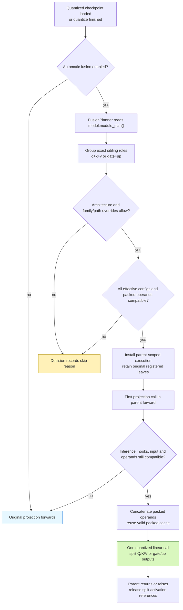
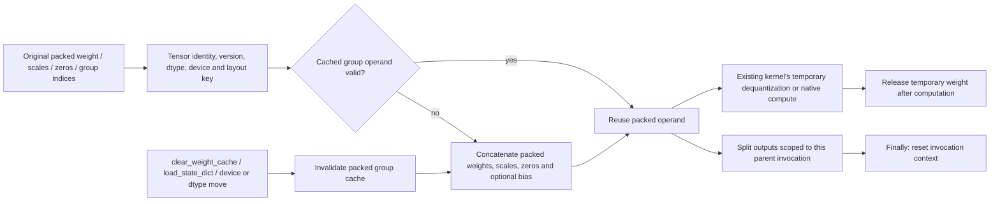

# Post-quantization fusion planner

The fusion planner consumes `model.module_plan()` and combines compatible
Q/K/V or gate/up projections for inference. Initial architecture coverage is
Llama, including Llama 3.2 1B. MoE fusion is outside this first implementation.

Fusion runs automatically after loading a quantized checkpoint or completing
quantization. It is optional:

```python
from gptqmodel import GPTQModel
from gptqmodel.utils.backend import BACKEND

# The initial executor supports the portable Torch GPTQ and Torch AWQ kernels.
model = GPTQModel.load("/path/to/quantized-llama", backend=BACKEND.GPTQ_TORCH)
model.fusion_plan().print()
decisions = model.fusion_plan().to_dict()

model.fuse(False)                          # Restore separate execution
model.fuse()                               # Rebuild and apply compatible groups
model.fuse(overrides={"qkv": False})        # Fuse only gate/up
model.fuse(overrides={"model.layers.0.mlp": False})

# Disable automatic fusion at loading or for a quantization operation.
model = GPTQModel.load("/path/to/quantized-llama", fuse=False)
# source_model.quantize(calibration, fuse=False)
```

`model.fuse()` returns the wrapper. `model.fusion_plan()` returns the applied
`FusionPlanner`, or `None` when disabled. An enabled plan may have zero eligible
groups; inspect its decisions for per-group skip reasons. The initial executor
does not convert unsupported backends into a different kernel. A direct
`fuse()` call on an unquantized wrapper raises.

## Selection and execution



The original path called each projection's kernel independently. The new path
adds `FusionPlanner` and `_FusionGroup` in `gptqmodel/models/fusion.py`; it changes
the execution of declared projection calls while preserving the registered
module tree. `BaseQModel.fuse()` installs/removes execution and
`BaseQModel.quantize()` invokes it after finalization. Loader opt-out is consumed
by GPT-QModel before calling Transformers.

| Before | With an eligible fusion group |
| --- | --- |
| Q, K, V execute three quantized linear calls | One wider quantized linear call, split in declared role order. GQA output widths may differ. |
| Gate and up execute two quantized linear calls | One wider call; the existing parent still applies its activation and multiplication. |
| Each leaf is a checkpoint owner | The same leaves and checkpoint keys remain registered. |
| No derived group operand | An additional packed operand may be retained for the group. |

There is no suffix-based selection. Each requested role must resolve to exactly
one distinct quantizable sibling in the compiled tree. Fused leaves carrying
multiple requested roles, excluded/capture-only leaves, incomplete groups, and
MoE paths are not eligible.

## Compatibility and overrides

Every member must have the same **effective** quantization configuration after
per-module dynamic overrides. This includes bit width, group size, symmetry,
activation ordering, format, and other serialized quantization options. Matching
only the global bit width is insufficient. A disabled dynamic target rejects
the group. Identical effective options can still be rejected by kernel/layout
checks.

The first executor accepts identical concrete `TorchLinear` or
`AwqTorchLinear` classes, 2/4/8-bit storage with int32 packed words, aligned output words, compatible
packed tensor shapes, identical input width, matching operand devices/dtypes,
and matching bias layout. GPTQ additionally requires equal `g_idx` values.
Adapters, online rotation on the projections, offload/projection hooks,
unsupported parent implementations, and mixed kernel classes are excluded.

AWQ GQA QKV groups with unequal output widths are also excluded in this first
executor. On Llama 3.2 1B the concatenated dequantized weights were bitwise
identical, but the wider CUDA GEMM changed rounding and accumulated up to
0.0286 absolute logit drift. The planner keeps those QKV calls separate rather
than relaxing the numerical gate. GPTQ GQA QKV and AWQ gate/up remain eligible;
the real 1B tests expect 32 GPTQ groups and 16 AWQ groups across 16 layers.

The definition owns architecture enablement and policy:

```python
# Attributes on a BaseQModel definition. Llama currently opts in to "llama".
fusion_model_types = frozenset({"llama"})
fusion_overrides = {
    "qkv": False,
    "model.layers.0.mlp": False,
}
```

The concrete runtime model type must be opted in. The initial parent-forward
validation is limited to native `LlamaAttention`/`LlamaMLP`. Policy lookup prefers
the exact full parent path, then the layer-relative parent path, then the family
(`qkv` or `gate_up`), then `True`. Per-call overrides replace definition values
for the same key. Enabling a policy cannot bypass compatibility checks.

Runtime checks preserve separate execution for training, inputs requiring
gradients, direct projection calls outside the parent, global/projection hooks,
and Torch compilation. A later sibling receiving a different tensor or a
versioned input that changed in place uses its original projection. Only the
validated Llama parent flow is enabled; arbitrary custom forwards require new
evidence before being enabled.

## Operand and activation lifetime



The retained group cache contains packed quantized weights and their associated
metadata. It adds packed storage on top of the original checkpoint-owned
weights; it does not replace or remove those owners. No dense or expanded weight
is retained. For this portable executor, temporary dequantization may be wider
than a single original projection; account for that peak when choosing fusion.

Normal tensor mutations/replacements invalidate through the source operand key.
The source kernels' `clear_weight_cache()` methods also invalidate the group.
Inference tensors have no version counter: code mutating them inside
`torch.inference_mode()` must explicitly call `clear_weight_cache()` on a source
projection. This is the same explicit-clear contract used by the other runtime
weight caches.

Split activations live in a `ContextVar` for one parent invocation and are
released in `finally`, including exception paths. Nested/concurrent invocation
contexts are separate. `fuse(False)` restores the original forwards/cache-clear
methods and releases packed fusion operands. Reapplying fusion builds a fresh
set of decisions.

## Checkpoint and test contract

Fusion preserves registered state-dict keys and tensor values. Saving uses the
ordinary separate projection tensors; loading rebuilds the ordinary modules and
then applies the optional planner. The fusion cache and activation context are
runtime state, not new model-definition weight obligations.

- `tests/module_tree/test_llama_fusion.py` builds a real tiny GQA Llama shell,
  constructs independent integer-code weight oracles, and covers GPTQ/AWQ,
  FP16/BF16, CPU/CUDA, generation, configuration mismatches, overrides,
  invalidation, activation cleanup, and gradient/training fallbacks.
- `tests/models/test_llama3_2_fusion.py` exercises local Llama 3.2 1B GPTQ/AWQ
  checkpoints, logits, greedy tokens, opt-out, automatic fusion after reload,
  and actual checkpoint save/reload. It reports timing and additional packed
  bytes. Checkpoint paths can be supplied through
  `GPTQMODEL_LLAMA32_FUSION_GPTQ` and `GPTQMODEL_LLAMA32_FUSION_AWQ`.

The planner is a correctness-gated execution option, not a guarantee of speedup
for every batch size or device. Evaluate its packed-memory cost and measured
latency on the target workload. Other architectures, MoE, other backends, and
compiled fused execution need dedicated implementation and validation.

## Measured Llama 3.2 1B results

RTX 4090, Torch 2.15.0+cu132, FP16, batch 1, eager attention and
`TORCHDYNAMO_DISABLE=1`. Each mode has two warmup sequences and five measured
repeats; latency is the median with CUDA synchronization. Prefill is 128 tokens.
Decode is 16 cached single-token forwards with fixed token IDs; cache-building
prefill is excluded from decode timing. These are execution comparisons on
existing quantized checkpoints, not dataset accuracy scores.

| Method | Phase | Off latency | On latency | Latency change | Off tok/s | On tok/s |
| --- | --- | ---: | ---: | ---: | ---: | ---: |
| GPTQ | Prefill (128 tokens) | 16.208 ms | 16.636 ms | +2.64% | 7897.40 | 7693.96 |
| GPTQ | Decode (per token) | 11.289 ms | 12.951 ms | +14.73% | 88.59 | 77.21 |
| AWQ | Prefill (128 tokens) | 127.858 ms | 127.882 ms | +0.02% | 1001.11 | 1000.92 |
| AWQ | Decode (per token) | 127.486 ms | 126.459 ms | -0.81% | 7.84 | 7.91 |

| Method | Phase | Max absolute logit drift | RMS logit drift | Relative L2 | Top-1 agreement |
| --- | --- | ---: | ---: | ---: | ---: |
| GPTQ | Prefill | 0.03125000 | 0.00466571 | 0.00136932 | 100.0% |
| GPTQ | Decode | 0.02734375 | 0.00455311 | 0.00177423 | 100.0% |
| AWQ | Prefill | 0.03906250 | 0.00461059 | 0.00140850 | 100.0% |
| AWQ | Decode | 0.03247070 | 0.00668630 | 0.00302405 | 100.0% |

| Method / projection | Packed operands match exactly | Max on-vs-off output drift | Max off-vs-oracle drift | Max on-vs-oracle drift |
| --- | --- | ---: | ---: | ---: |
| GPTQ / `model.layers.0.self_attn` (qkv) | True | 0.00781250 | 0.00390625 | 0.00781250 |
| GPTQ / `model.layers.0.mlp` (gate_up) | True | 0.00390625 | 0.00390625 | 0.00195312 |
| AWQ / `model.layers.0.mlp` (gate_up) | True | 0.00781250 | 0.00781250 | 0.00781250 |
| AWQ / `model.layers.1.mlp` (gate_up) | True | 0.01562500 | 0.01562500 | 0.01562500 |

The wider GEMMs change reduction order and output rounding. Packed operands
match exactly, and both paths pass `rtol=atol=2e-3` against the independent
projection oracle (these are combined tolerances, not a uniform 0.002 absolute
error bound at every magnitude). Composed model logits accumulate those
projection differences; the 128-token measurements above are not bitwise equal,
even though top-1 tokens agree at every measured prefill/decode position.
Relative L2 is reported without replacing the absolute drift numbers.

For the separate six-token save/reload acceptance prompt, both methods had
zero observed logit drift and identical 12-token greedy continuations. This
prompt-specific result does not establish zero drift for other contexts.
The rejected AWQ GQA QKV path failed that short-prompt regression with 0.0286
maximum absolute logit drift and remains disabled.

GPTQ retains 315.877 MiB of additional packed operands for 32 groups; AWQ
retains 266 MiB for 16 gate/up groups. The largest fused FP16 dequantized weight
is 64 MiB and is temporary; this does not count integer unpacking scratch or
other activation allocations. These timings show a GPTQ decode regression and
an approximately unchanged AWQ prefill path. Automatic eligibility is not a
latency guarantee; use `fuse=False` when that tradeoff is unsuitable.

Raw measurements and rounding diagnostics are in
[llama32-fusion.json](benchmarks/llama32-fusion.json). Reproduce them with:

```bash
TORCHDYNAMO_DISABLE=1 CUDA_VISIBLE_DEVICES=0 PYTHONPATH=. python tests/benchmark_llama_fusion.py \
  --gptq-path /path/to/llama32-gptq --awq-path /path/to/llama32-awq \
  --output-json /tmp/fusion-prefill-decode.json
```
