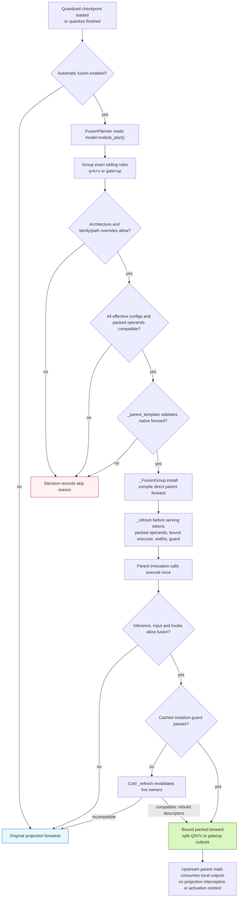
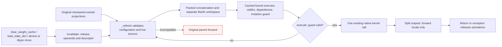
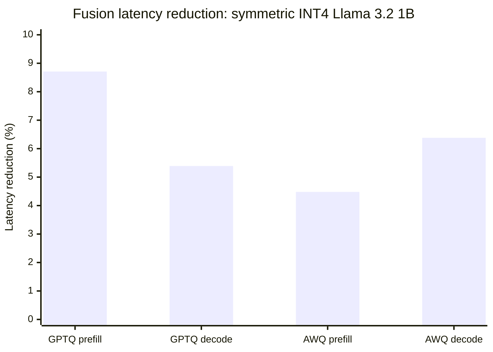

# Post-quantization fusion planner

The fusion planner consumes `model.module_plan()` and combines compatible
Q/K/V or gate/up projections for inference. Initial architecture coverage is
Llama, including Llama 3.2 1B. MoE fusion is outside this first implementation.
Introduced in [PR #3567](https://github.com/ModelCloud/GPTQModel/pull/3567).

Fusion runs automatically after loading a quantized checkpoint or completing
quantization. It is optional:

```python
from gptqmodel import GPTQModel
from gptqmodel.utils.backend import BACKEND

# AUTO selects Marlin for the symmetric INT4/group-128/no-act-order case.
model = GPTQModel.load("/path/to/quantized-llama", backend=BACKEND.AUTO)
model.fusion_plan().print()
decisions = model.fusion_plan().to_dict()

model.fuse(False)                          # Restore separate execution
model.fuse()                               # Rebuild and apply compatible groups
model.fuse(overrides={"qkv": False})        # Fuse only gate/up
model.fuse(overrides={"model.layers.0.mlp": False})

# Disable automatic fusion at loading or for a quantization operation.
model = GPTQModel.load("/path/to/quantized-llama", fuse=False)
# source_model.quantize(calibration, fuse=False)
```

`model.fuse()` returns the wrapper. `model.fusion_plan()` returns the applied
`FusionPlanner`, or `None` when disabled. An enabled plan may have zero eligible
groups; inspect its decisions for per-group skip reasons. The planner
does not convert unsupported backends into a different kernel. A direct
`fuse()` call on an unquantized wrapper raises.

## Selection and execution



The original path called each projection's kernel independently. The planner
changes the execution of declared projection calls while preserving the
registered module tree. `BaseQModel.fuse()` installs/removes execution and
`BaseQModel.quantize()` invokes it after finalization. Loader opt-out is consumed
by GPT-QModel before calling Transformers.

| Before | With an eligible fusion group |
| --- | --- |
| Q, K, V execute three quantized linear calls | One wider quantized linear call, split in declared role order. GQA output widths may differ. |
| Gate and up execute two quantized linear calls | One wider call; the existing parent still applies its activation and multiplication. |
| Each leaf is a checkpoint owner | The same leaves and checkpoint keys remain registered. |
| No derived group operand | An additional packed operand may be retained for the group. |

The first fusion implementation wrapped each leaf and used a `ContextVar` to
share outputs inside the parent. It rebuilt a full `_key()` fingerprint on
every group invocation. The corrected dispatch compiles a direct parent
forward and prepares its execution descriptor before serving tokens:

Historical line references below are from
[`gptqmodel/models/fusion.py` at `38145795`](https://github.com/ModelCloud/GPTQModel/blob/38145795234801cc341814d6e8ade05c513d8a8f/gptqmodel/models/fusion.py).

| Mechanism | First implementation at `38145795` | Current implementation |
| --- | --- | --- |
| Operand validation | `fusion.py:155` built nested fingerprints; `fusion.py:243` called it for each parent invocation | `_refresh()` performs full validation and creates a compiled mutation guard; the warm path only checks the guard |
| Projection dispatch | `fusion.py:235` installed a wrapper on every projection; `fusion.py:257` replaced its forward | `_parent_template()` replaces exactly the declared calls in the installed native parent source; source projection forwards stay intact |
| Activation lifetime | `fusion.py:218` / `fusion.py:222` set/reset a `ContextVar` | Split outputs are ordinary forward locals, released on return or exception |
| Preparation | `fusion.py:248` constructed the combined operand on the first projection call | `install()` calls `_refresh()` before serving tokens; subsequent changes rebuild on the cold path |

The compiler reads the installed `LlamaAttention.forward` or `LlamaMLP.forward`
source. Each declared projection must occur exactly once and take the same
parent input without extra arguments; extra weight/metadata references,
decorated functions, instance forward overrides, unavailable source, and
unsupported call shapes reject the group. It substitutes tuple selections for
those calls and retains upstream RoPE, cache updates, attention dispatch,
activation, multiplication, output projection, and the public forward signature.
It does not maintain a separately copied Llama attention implementation.

There is no suffix-based selection. Each requested role must resolve to exactly
one distinct quantizable sibling in the compiled tree. Fused leaves carrying
multiple requested roles, excluded/capture-only leaves, incomplete groups, and
MoE paths are not eligible.

## Compatibility and overrides

Every member must have the same **effective** quantization configuration after
per-module dynamic overrides. This includes bit width, group size, symmetry,
activation ordering, format, and other serialized quantization options. Matching
only the global bit width is insufficient. A disabled dynamic target rejects
the group. Identical effective options can still be rejected by kernel/layout
checks.

The canonical acceptance case is **symmetric 4-bit, group size 128,
`desc_act=False`, `BACKEND.AUTO`** on NVIDIA CUDA. AUTO selects `MarlinLinear`
for GPTQ and `AwqMarlinLinear` for AWQ. Fusion preserves the selected concrete
kernel class. Both support 32 groups (QKV plus gate/up across 16 layers) on
Llama 3.2 1B.

Native Marlin fusion requires finalized operands without padding or activation
reordering, equal input widths, and output widths aligned to 64 columns. Its
packing permutations are local to those tiles, so whole-tile concatenation
preserves the existing native layout. The finalized shell is copied without
calling `post_init()` a second time, and owns a separate **zero-initialized**
reduction workspace. Quantization metadata, kernel reduction settings, devices,
dtypes, and bias policies must match. Original registered operands stay intact.

Portable `TorchLinear` / `AwqTorchLinear` executors also remain available for
int32-packed 2/4/8-bit weights. They require equal GPTQ group indices and
compatible unpadded shapes. The portable Torch AWQ GQA QKV case remains
conservatively excluded; that restriction does not apply to the validated native
Marlin executor. Adapters, projection/offload hooks, and online projection
rotation are excluded.

The definition owns architecture enablement and policy:

```python
# Attributes on a BaseQModel definition. Llama currently opts in to "llama".
fusion_model_types = frozenset({"llama"})
fusion_overrides = {
    "qkv": False,
    "model.layers.0.mlp": False,
}
```

The concrete runtime model type must be opted in. The initial parent-forward
validation is limited to native `LlamaAttention`/`LlamaMLP`. Policy lookup prefers
the exact full parent path, then the layer-relative parent path, then the family
(`qkv` or `gate_up`), then `True`. Per-call overrides replace definition values
for the same key. Enabling a policy cannot bypass compatibility checks.

Runtime checks preserve separate execution for training, inputs requiring
gradients, direct projection calls outside the parent, global/projection hooks,
and Torch compilation. Trainable operand tensors also fall back. Runtime
projection replacement, forward overrides, and offload hooks invalidate the
descriptor and preserve the original parent path. Only the validated Llama
parent flow is enabled; arbitrary custom forwards require new evidence.

## Operand and activation lifetime



The retained group cache contains packed quantized weights and their associated
metadata. It adds packed storage on top of the original checkpoint-owned
weights; it does not replace or remove those owners. No dense or expanded weight
is retained. Native Marlin dequantizes in its kernel tiles. The optional portable
Torch executor can temporarily dequantize a wider matrix; account for that peak
when using the Torch backend.

The compiled guard checks direct dictionary bindings and tensor versions,
storage pointers, shapes, dtypes, devices, and gradient policy. It also checks
source module identity, frozen kernel settings, hooks, and forward overrides.
There are no full compatibility scans, tensor-key tuple construction, or
projection wrappers on the unchanged token path. A failed guard invokes
`_refresh()`, which revalidates the live owners and either rebuilds the packed
operand/descriptor or falls back to the original parent. This retains detection
of ordinary in-place updates, replacement, and same-storage `.data` dtype/shape
changes; it does not disable mutation safety to obtain the speedup.

The source projections' `clear_weight_cache()` methods also invalidate the
group. This method is installed while fusion is active on kernels that have no
original clear method.
Inference tensors have no version counter: code mutating them inside
`torch.inference_mode()` must explicitly call `clear_weight_cache()` on a source
projection. Unversioned writes through raw `.data`/storage aliases likewise
require explicit clearing when metadata and storage identity stay unchanged.
This is the existing explicit-clear contract used by runtime weight caches.

Split activations are forward locals, with no persistent activation references
in the planner or a context object. `fuse(False)` deactivates the executor,
restores the parent and cache-clear methods when they are still ours, and
releases packed fusion operands/descriptors. A third-party wrapper retaining an
old parent method cannot reactivate the removed executor. Reapplying fusion
builds fresh decisions.

## Checkpoint and test contract

Fusion preserves registered state-dict keys and tensor values. Saving uses the
ordinary separate projection tensors; loading rebuilds the ordinary modules and
then applies the optional planner. The fusion cache, native workspace, and
compiled descriptor are runtime state, not new model-definition weight obligations.

- `tests/module_tree/test_llama_fusion.py` builds a real tiny GQA Llama shell,
  constructs independent integer-code weight oracles, and covers GPTQ/AWQ,
  FP16/BF16, CPU/CUDA, generation, configuration mismatches, overrides,
  invalidation, activation cleanup, gradient/training/hook/compiler fallbacks,
  and the absence of full compatibility work on the steady-state path.
- `tests/models/test_llama3_2_fusion.py` exercises local Llama 3.2 1B GPTQ/AWQ
  checkpoints, logits, greedy tokens, opt-out, automatic fusion after reload,
  and actual checkpoint save/reload. It reports timing and additional packed
  bytes. Checkpoint paths can be supplied through
  `GPTQMODEL_LLAMA32_FUSION_GPTQ` and `GPTQMODEL_LLAMA32_FUSION_AWQ`.

The planner is a correctness-gated execution option, not a guarantee of speedup
for every batch size or device. Evaluate its packed-memory cost and measured
latency on the target workload. Other architectures, MoE, additional backends, and
compiled fused execution need dedicated implementation and validation.

## Measured Llama 3.2 1B results

**Symmetric INT4, group size 128, `desc_act=False`, AUTO selects Marlin in both
modes.** RTX 4090, Torch 2.15.0+cu132, FP16, batch 1, eager attention,
`TORCHDYNAMO_DISABLE=1`. Three warmups and fifteen measured repeats per mode;
median synchronized wall-clock time, with raw samples retained. Modes are
measured off then on for each model, each separately warmed. Prefill is 128
tokens. Decode is 16 cached single-token forwards with fixed token 42;
cache-building prefill is excluded. Loading and packed-cache construction are
outside timing. Other Torch test workloads were stopped during measurement.

| Method | Phase | Kernel off / on | Off latency | On latency | Latency change | Off tok/s | On tok/s |
| --- | --- | --- | ---: | ---: | ---: | ---: | ---: |
| GPTQ | Prefill (128 tokens) | `MarlinLinear` / same | 10.193 ms | 9.304 ms | -8.71% | 12558.19 | 13757.11 |
| GPTQ | Decode (per token) | `MarlinLinear` / same | 9.043 ms | 8.555 ms | -5.39% | 110.59 | 116.89 |
| AWQ | Prefill (128 tokens) | `AwqMarlinLinear` / same | 10.088 ms | 9.636 ms | -4.48% | 12688.29 | 13283.49 |
| AWQ | Decode (per token) | `AwqMarlinLinear` / same | 9.273 ms | 8.682 ms | -6.38% | 107.83 | 115.18 |



| Method | Phase | Max absolute logit drift | RMS logit drift | Relative L2 | Top-1 agreement |
| --- | --- | ---: | ---: | ---: | ---: |
| GPTQ | Prefill | 0.03906250 | 0.00495072 | 0.00146600 | 100.0% |
| GPTQ | Decode | 0.02929688 | 0.00498216 | 0.00231643 | 100.0% |
| AWQ | Prefill | 0.03125000 | 0.00438472 | 0.00135257 | 100.0% |
| AWQ | Decode | 0.02490234 | 0.00394760 | 0.00156669 | 100.0% |

| Projection | Packed operands exact | Max off/on drift | Max off/oracle drift | Max on/oracle drift |
| --- | --- | ---: | ---: | ---: |
| GPTQ `model.layers.0.self_attn` | True | 0.00390625 | 0.00390625 | 0.00390625 |
| GPTQ `model.layers.0.mlp` | True | 0.00195312 | 0.00195312 | 0.00195312 |
| AWQ `model.layers.0.self_attn` | True | 0.01562500 | 0.01562500 | 0.00781250 |
| AWQ `model.layers.0.mlp` | True | 0.00390625 | 0.00390625 | 0.00390625 |

Both native projection families pass combined `rtol=atol=2e-3` against an
independent checkpoint-unpacking/FP32 matmul oracle with native FP16
weight/output rounding. These combined tolerances are not a uniform 0.002
absolute bound at every magnitude. Sampled packed operands are bitwise equal.
Composed model logits accumulate changes in reduction order and output
rounding; absolute, RMS, and relative drift are reported above. The dispatch
fix leaves every reported drift value unchanged from the previous native
Marlin implementation.

Top-1 agreement covers all 128 prefill and 16 decode positions in this fixed
workload. The real save/reload tests also verify fixed-prompt top-1 and exact
12-token greedy agreement, unchanged checkpoint keys, native kernel types,
and bitwise equality of fused results before/after reload. These are execution
regression checks, not dataset benchmark accuracy or perplexity scores.

### Effect of the dispatch correction

| Method | Phase | Previous fusion latency change | Corrected fusion latency change |
| --- | --- | ---: | ---: |
| GPTQ | Prefill | +20.28% | -8.71% |
| GPTQ | Decode | +11.54% | -5.39% |
| AWQ | Prefill | +12.55% | -4.48% |
| AWQ | Decode | +12.25% | -6.38% |

Each percentage compares fusion on/off within its own recorded run. Historical
and current absolute wall times have different baselines; the historical run
used two warmups/five repeats, the current run three/fifteen. The retained
[historical report](benchmarks/llama32-fusion-before-dispatch-fix.json) identifies
the previous implementation. This table does not compare absolute speed across
different hardware or claim a universal speedup.

The original slowdown was Python dispatch/validation overhead, while both paths
already used Marlin. The correction removes per-projection interception and
`ContextVar` bookkeeping, prepares the combined operand and bound executor
before inference, and replaces full fingerprints with direct mutation guards.
`test_steady_state_uses_compiled_descriptors_and_unchanged_leaf_forwards` makes
`_key()` and `_incompatible()` raise after preparation, then verifies repeated
inference succeeds with unchanged leaf forwards. The new warmed token path
therefore executes neither full fingerprint construction nor compatibility
scanning. Tensor/hook changes still trigger cold revalidation.

Both methods retain 32 packed group operands and separate reduction workspace:
GPTQ **328,744,960 bytes (313.52 MiB)** and AWQ **331,235,328 bytes (315.89 MiB)**,
additional to checkpoint storage. No dense/expanded weight cache is retained;
native Marlin uses transient kernel-tile scratch. The optional portable Torch
executor has temporary dense dequantization scratch local to its computation.
The tests cover repeated forwards and activation cleanup on success/exception.
Fusion does not reduce GEMM FLOPs, and different shapes/schedules can still
change its benefit. `fuse=False` remains available.

Raw data and all samples: [llama32-fusion.json](benchmarks/llama32-fusion.json).
Reproduce with:

```bash
TORCHDYNAMO_DISABLE=1 CUDA_VISIBLE_DEVICES=0 PYTHONPATH=. python tests/benchmark_llama_fusion.py \
  --gptq-path /path/to/symmetric-llama32-gptq \
  --awq-path /path/to/symmetric-llama32-awq \
  --warmups 3 --repeats 15 \
  --output-json /tmp/fusion-prefill-decode.json
```

The GPTQ fixture is local `Llama-3.2-1B-Instruct-HF-GPTQV2`. The AWQ fixture was
quantized from local `Llama-3.2-1B-Instruct` with the following recipe; this is a
calibration fixture for comparing execution, not a model-quality claim:

```python
import torch
from gptqmodel import GPTQModel
from gptqmodel.quantization import AWQConfig
from gptqmodel.utils.backend import BACKEND

qcfg = AWQConfig(bits=4, group_size=128, sym=True, desc_act=False,
                 offload_to_disk=False)
model = GPTQModel.load("/path/to/Llama-3.2-1B-Instruct", qcfg, device="cuda:0",
                       dtype=torch.float16, fuse=False, attn_implementation="eager")
text = ("The capital of France is Paris. Science and mathematics explain the "
        "natural world. Good software tests verify every important result. ")
model.quantize([text * 12 for _ in range(16)], batch_size=1,
               backend=BACKEND.AWQ_TORCH)
model.save("/path/to/symmetric-llama32-awq")
```
