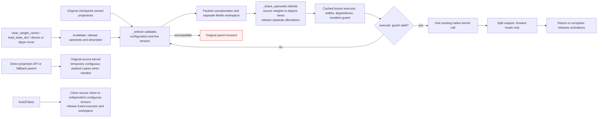
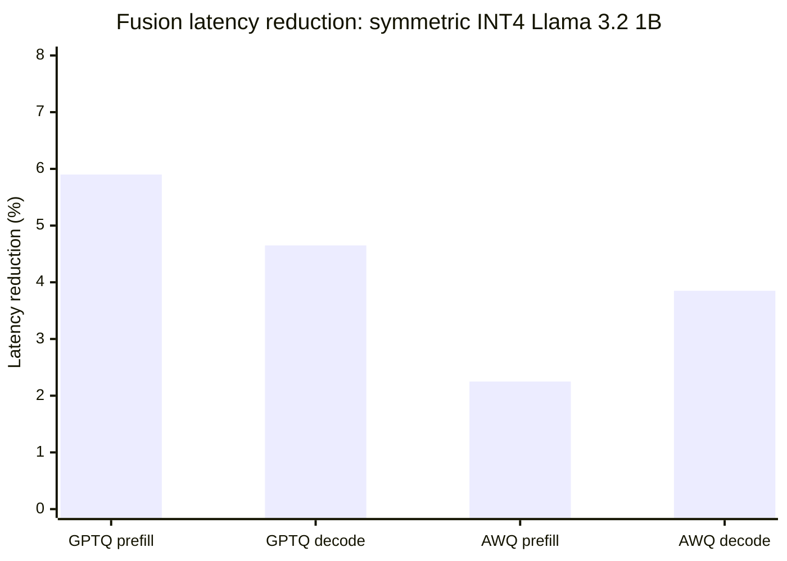

# Post-quantization fusion planner

The fusion planner consumes `model.module_plan()` and combines compatible
Q/K/V or gate/up projections for inference. Initial architecture coverage is
Llama, including Llama 3.2 1B. MoE fusion is outside this first implementation.
Introduced in [PR #3567](https://github.com/ModelCloud/GPTQModel/pull/3567).

Fusion is disabled by default for loading and quantization. Enable it explicitly:

```python
from gptqmodel import GPTQModel
from gptqmodel.utils.backend import BACKEND

# AUTO selects Marlin for the symmetric INT4/group-128/no-act-order case.
model = GPTQModel.load("/path/to/quantized-llama", backend=BACKEND.AUTO)
model.fuse()                               # Explicit post-load opt-in
model.fusion_plan().print()
decisions = model.fusion_plan().to_dict()

model.fuse(False)                          # Restore separate execution
model.fuse()                               # Rebuild and apply compatible groups
model.fuse(overrides={"qkv": False})        # Fuse only gate/up
model.fuse(overrides={"model.layers.0.mlp": False})

# Optional opt-in at loading or quantization finalization.
model = GPTQModel.load("/path/to/quantized-llama", fuse=True)
# source_model.quantize(calibration, fuse=True)
```

`model.fuse()` returns the wrapper. `model.fusion_plan()` returns the applied
`FusionPlanner`, or `None` when disabled. An enabled plan may have zero eligible
groups; inspect its decisions for per-group skip reasons. The planner
does not convert unsupported backends into a different kernel. A direct
`fuse()` call on an unquantized wrapper raises.

## Selection and execution


Separate execution calls each projection's kernel independently. The planner
changes the execution of declared projection calls while preserving the
registered module tree. `BaseQModel.fuse()` installs/removes execution and
`BaseQModel.quantize()` invokes it after finalization. Loader opt-out is consumed
by GPT-QModel before calling Transformers.

| Separate execution | With an eligible fusion group |
| --- | --- |
| Q, K, V execute three quantized linear calls | One wider quantized linear call, split in declared role order. GQA output widths may differ. |
| Gate and up execute two quantized linear calls | One wider call; the existing parent still applies its activation and multiplication. |
| Each leaf owns its packed tensors | The same checkpoint leaves reference disjoint views of the combined packed tensors. |
| Independent packed allocations | One combined allocation replaces the separate allocations; each group adds only reduction workspace. |

The compiler reads the installed `LlamaAttention.forward` or `LlamaMLP.forward`
source. Each declared projection must occur exactly once and take the same
parent input without extra arguments; extra weight/metadata references,
decorated functions, instance forward overrides, unavailable source, and
unsupported call shapes reject the group. It substitutes tuple selections for
those calls and retains upstream RoPE, cache updates, attention dispatch,
activation, multiplication, output projection, and the public forward signature.
It does not maintain a separately copied Llama attention implementation.

There is no suffix-based selection. Each requested role must resolve to exactly
one distinct quantizable sibling in the compiled tree. Fused leaves carrying
multiple requested roles, excluded/capture-only leaves, incomplete groups, and
MoE paths are not eligible.

## Compatibility and overrides

Every member must have the same **effective** quantization configuration after
per-module dynamic overrides. This includes bit width, group size, symmetry,
activation ordering, format, and other serialized quantization options. Matching
only the global bit width is insufficient. A disabled dynamic target rejects
the group. Identical effective options can still be rejected by kernel/layout
checks.

The canonical acceptance case is **symmetric 4-bit, group size 128,
`desc_act=False`, `BACKEND.AUTO`** on NVIDIA CUDA. AUTO selects `MarlinLinear`
for GPTQ and `AwqMarlinLinear` for AWQ. Fusion preserves the selected concrete
kernel class. Both support 32 groups (QKV plus gate/up across 16 layers) on
Llama 3.2 1B.

Native Marlin fusion requires finalized operands without padding or activation
reordering, equal input widths, and output widths aligned to 64 columns. Its
packing permutations are local to those tiles, so whole-tile concatenation
preserves the existing native layout. The finalized shell is copied without
calling `post_init()` a second time, and owns a separate **zero-initialized**
reduction workspace. Quantization metadata, kernel reduction settings, devices,
dtypes, and bias policies must match. Original checkpoint leaves retain their tensor values through shared storage views.

Portable `TorchLinear` / `AwqTorchLinear` executors also remain available for
int32-packed 2/4/8-bit weights. They require equal GPTQ group indices and
compatible unpadded shapes. The portable Torch AWQ GQA QKV case remains
conservatively excluded; that restriction does not apply to the validated native
Marlin executor. Adapters, projection/offload hooks, and online projection
rotation are excluded.

The definition owns architecture enablement and policy:

```python
# Attributes on a BaseQModel definition. Llama currently opts in to "llama".
fusion_model_types = frozenset({"llama"})
fusion_overrides = {
    "qkv": False,
    "model.layers.0.mlp": False,
}
```

The concrete runtime model type must be opted in. The initial parent-forward
validation is limited to native `LlamaAttention`/`LlamaMLP`. Policy lookup prefers
the exact full parent path, then the layer-relative parent path, then the family
(`qkv` or `gate_up`), then `True`. Per-call overrides replace definition values
for the same key. Enabling a policy cannot bypass compatibility checks.

Runtime checks preserve separate execution for training, inputs requiring
gradients, direct projection calls outside the parent, global/projection hooks,
and Torch compilation. Trainable operand tensors also fall back. Runtime
projection replacement, forward overrides, and offload hooks invalidate the
descriptor and preserve the original parent path. Only the validated Llama
parent flow is enabled; arbitrary custom forwards require new evidence.

## Operand and activation lifetime



Each compatible group owns one concatenated packed allocation. `_share_operands()`
rebinds the original projections' weights, scales, zero points, and optional bias
to disjoint views into that allocation. Their checkpoint names, shapes, and
values remain intact; their former separate allocations are released. The wider
native kernel consumes the contiguous fused tensors directly, so source views
add no projection work to the normal fused token path.

Direct source calls and fallback parents still work. Marlin creates temporary
contiguous **packed** copies of strided source operands for that call and releases
them afterward. The portable AWQ executor preserves strided scale views when
its dtype/device already match. No dense or expanded weight is retained. Native
Marlin uses tile scratch; the optional portable Torch executor temporarily
dequantizes inside the consuming computation.

The checkpoint writer distinguishes identical aliases from distinct offset,
shape, stride, or dtype views. It saves every distinct checkpoint-owned weight
under its original key, even when multiple keys share one allocation. Streaming
serialization handles each view independently; the fused runtime allocation is
not an additional checkpoint tensor.

The compiled guard checks direct dictionary bindings and shared tensor versions,
storage pointers, shapes, dtypes, devices, and gradient policy. It also checks
source module identity, frozen kernel settings, hooks, and forward overrides.
One version-counter check per packed operand covers writes through any sibling
view; binding, storage, dtype, shape, device, and gradient checks remain per leaf.
There are no full compatibility scans, tensor-key tuple construction, or
projection wrappers on the unchanged token path. A failed guard invokes
`_refresh()`, which revalidates the live owners and either rebuilds the packed
operand/descriptor or falls back to the original parent. This retains detection
of ordinary in-place updates, replacement, and same-storage `.data` dtype/shape
changes; it does not disable mutation safety to obtain the speedup.

The source projections' `clear_weight_cache()` methods also invalidate the
group. This method is installed while fusion is active on kernels that have no
original clear method.
Inference tensors have no version counter: code mutating them inside
`torch.inference_mode()` must explicitly call `clear_weight_cache()` on a source
projection. Unversioned writes through raw `.data`/storage aliases likewise
require explicit clearing when metadata and storage identity stay unchanged.
This is the existing explicit-clear contract used by runtime weight caches.

Split activations are forward locals, with no persistent activation references
in the planner or a context object. `fuse(False)` deactivates the executor,
restores the parent and cache-clear methods when they are still ours, clones
source views back to independent contiguous tensors, and releases the fused
operands, workspace, and descriptors. A third-party wrapper retaining an
old parent method cannot reactivate the removed executor. Reapplying fusion
builds fresh decisions.

## Checkpoint and test contract

Fusion preserves registered state-dict keys and tensor values. Saving serializes
each projection view under its checkpoint key; loading rebuilds the ordinary modules and
then applies the planner only when explicitly requested. The fusion cache, native workspace, and
compiled descriptor are runtime state, not new model-definition weight obligations.

- `tests/module_tree/test_llama_fusion.py` builds a real tiny GQA Llama shell,
  constructs independent integer-code weight oracles, and covers GPTQ/AWQ,
  FP16/BF16, CPU/CUDA, generation, configuration mismatches, overrides,
  invalidation, activation cleanup, gradient/training/hook/compiler fallbacks,
  and the absence of full compatibility work on the steady-state path.
- `tests/models/test_llama3_2_fusion.py` exercises local Llama 3.2 1B GPTQ/AWQ
  checkpoints, logits, greedy tokens, opt-in after reload,
  and actual checkpoint save/reload. It asserts zero additional packed-weight
  storage and reports retained tensor/workspace bytes. Checkpoint paths can be supplied through
  `GPTQMODEL_LLAMA32_FUSION_GPTQ` and `GPTQMODEL_LLAMA32_FUSION_AWQ`.

The planner is a correctness-gated execution option, not a guarantee of speedup
for every batch size or device. Evaluate its packed-memory cost and measured
latency on the target workload. Other architectures, MoE, additional backends, and
compiled fused execution need dedicated implementation and validation.

## Measured Llama 3.2 1B results

**Symmetric INT4, group size 128, `desc_act=False`, AUTO selects Marlin in both
modes.** RTX 4090, Torch 2.15.0+cu132, FP16, batch 1, eager attention,
`TORCHDYNAMO_DISABLE=1`. Ten warmups and fifteen measured repeats per mode;
median synchronized wall-clock time. The process was pinned to CPU 17 with one
Torch CPU thread, and other Torch test workloads were stopped. Modes are off
then on for each model, each separately warmed. Prefill is 128 tokens. Decode
is 16 cached single-token forwards with fixed token 42; cache-building prefill,
loading, packed construction, and source-view binding are outside timing.

| Method | Phase | Kernel off / on | Off latency | On latency | Latency change | Off tok/s | On tok/s |
| --- | --- | --- | ---: | ---: | ---: | ---: | ---: |
| GPTQ | Prefill (128 tokens) | `MarlinLinear` / same | 9.646 ms | 9.078 ms | -5.90% | 13269.23 | 14100.51 |
| GPTQ | Decode (per token) | `MarlinLinear` / same | 8.977 ms | 8.560 ms | -4.65% | 111.39 | 116.83 |
| AWQ | Prefill (128 tokens) | `AwqMarlinLinear` / same | 9.587 ms | 9.372 ms | -2.25% | 13350.90 | 13657.89 |
| AWQ | Decode (per token) | `AwqMarlinLinear` / same | 9.080 ms | 8.730 ms | -3.85% | 110.14 | 114.54 |



| Method | Phase | Max absolute logit drift | RMS logit drift | Relative L2 | Top-1 agreement |
| --- | --- | ---: | ---: | ---: | ---: |
| GPTQ | Prefill | 0.03906250 | 0.00495072 | 0.00146600 | 100.0% |
| GPTQ | Decode | 0.02929688 | 0.00498216 | 0.00231643 | 100.0% |
| AWQ | Prefill | 0.03125000 | 0.00438472 | 0.00135257 | 100.0% |
| AWQ | Decode | 0.02490234 | 0.00394760 | 0.00156669 | 100.0% |

| Projection | Packed operands exact | Max off/on drift | Max off/oracle drift | Max on/oracle drift |
| --- | --- | ---: | ---: | ---: | ---: |
| GPTQ `model.layers.0.self_attn` | True | 0.00390625 | 0.00390625 | 0.00390625 |
| GPTQ `model.layers.0.mlp` | True | 0.00195312 | 0.00195312 | 0.00195312 |
| AWQ `model.layers.0.self_attn` | True | 0.01562500 | 0.01562500 | 0.00781250 |
| AWQ `model.layers.0.mlp` | True | 0.00390625 | 0.00390625 | 0.00390625 |

Both native projection families pass combined `rtol=atol=2e-3` against an
independent checkpoint-unpacking/FP32 matmul oracle with native FP16
weight/output rounding. These combined tolerances are not a uniform 0.002
absolute bound at every magnitude. Sampled packed operands are bitwise equal.
Composed logits accumulate reduction-order and output-rounding differences;
their absolute, RMS, and relative drift are reported above.

Top-1 agreement covers all 128 prefill and 16 decode positions in this fixed
workload. Real checkpoint tests verify fixed-prompt top-1, exact 12-token greedy
agreement, unchanged checkpoint keys, native kernel types, and bitwise fused
save/reload parity. Fresh GPTQ V2 quantization tests also compare serialized
view bytes and fused reload logits exactly. These are execution regression
checks, not dataset accuracy or perplexity scores.

### Shared-view performance check

This control keeps the same loaded model, fused executor, kernel classes, and
packed tensors. Only the source projection bindings change between independent
contiguous packed copies and shared views. Independent copies exist solely in
this benchmark control; production fusion always shares storage. Blocks run
in `copies / views / views / copies` order, each with ten warmups and fifteen
samples, giving thirty samples per layout. Binding/allocation is outside timing,
and logits must match bitwise across layouts.

| Method | Phase | Independent source copies | Shared source views | Views latency change |
| --- | --- | ---: | ---: | ---: |
| GPTQ | Prefill (128 tokens) | 9.559 ms | 9.476 ms | -0.86% |
| GPTQ | Decode (per token) | 8.478 ms | 8.567 ms | +1.05% |
| AWQ | Prefill (128 tokens) | 9.607 ms | 9.259 ms | -3.63% |
| AWQ | Decode (per token) | 8.640 ms | 8.614 ms | -0.31% |

The measured GPTQ decode result is **1.05% slower with views** in this run, so
this result does not establish strict zero-regression parity. AWQ decode is
0.31% faster, and both prefill medians improve. All raw samples and separate
guard timings are retained in the report. The normal fused path reads the
contiguous combined tensors directly; source views introduce no extra GEMM or
weight copy there. Direct source calls/fallbacks may need temporary contiguous
packed copies; `fuse(False)` restores independent contiguous source tensors.

### Retained weight storage

| Method | Packed storage off | Packed storage on | Additional packed storage | Additional model workspace |
| --- | ---: | ---: | ---: | ---: |
| GPTQ | 501,743,616 B | 501,743,616 B | 0 B | 16,384 B |
| AWQ | 505,544,704 B | 505,544,704 B | 0 B | 16,384 B |

Storage is counted once by allocation identity across original leaves and
unregistered executors. The fused allocation replaces the separate allocations;
the source checkpoint names are views, so additional persistent packed-weight
storage is **zero**. The additional model-owned tensor storage is **16 KiB of
Marlin workspace per model**, across 32 groups. This excludes allocator-reserved
memory, transient activations, Python descriptors, and backend scratch pools.
Concatenation and unfusing temporarily overlap old/new packed storage during
the transition. Source-call fallback copies are temporary packed tensors;
native dequantization remains in kernel tiles. No dense/expanded weight cache
persists. The portable Torch path can dequantize temporarily inside its call.

Raw data, samples, guard timings, and memory counts:
[llama32-fusion.json](benchmarks/llama32-fusion.json). Reproduce with an available
CPU from `taskset -pc $$`:

```bash
TORCHDYNAMO_DISABLE=1 CUDA_VISIBLE_DEVICES=0 PYTHONPATH=. taskset -c 17 python tests/benchmark_llama_fusion.py \
  --gptq-path /path/to/symmetric-llama32-gptq \
  --awq-path /path/to/symmetric-llama32-awq \
  --warmups 10 --repeats 15 --compare-storage-layout --storage-rounds 2 \
  --output-json /tmp/fusion-prefill-decode.json
```

The GPTQ fixture is local `Llama-3.2-1B-Instruct-HF-GPTQV2`. The AWQ fixture was
quantized from local `Llama-3.2-1B-Instruct` with the following recipe; this is a
calibration fixture for comparing execution, not a model-quality claim:

```python
import torch
from gptqmodel import GPTQModel
from gptqmodel.quantization import AWQConfig
from gptqmodel.utils.backend import BACKEND

qcfg = AWQConfig(bits=4, group_size=128, sym=True, desc_act=False,
                 offload_to_disk=False)
model = GPTQModel.load("/path/to/Llama-3.2-1B-Instruct", qcfg, device="cuda:0",
                       dtype=torch.float16, fuse=False, attn_implementation="eager")
text = ("The capital of France is Paris. Science and mathematics explain the "
        "natural world. Good software tests verify every important result. ")
model.quantize([text * 12 for _ in range(16)], batch_size=1,
               backend=BACKEND.AWQ_TORCH)
model.save("/path/to/symmetric-llama32-awq")
```
