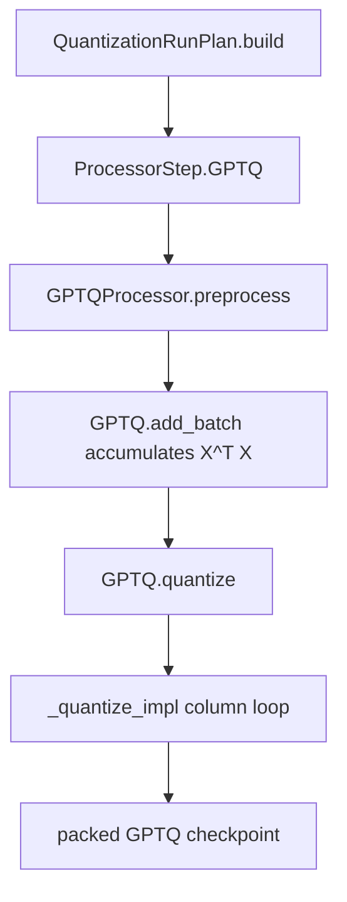
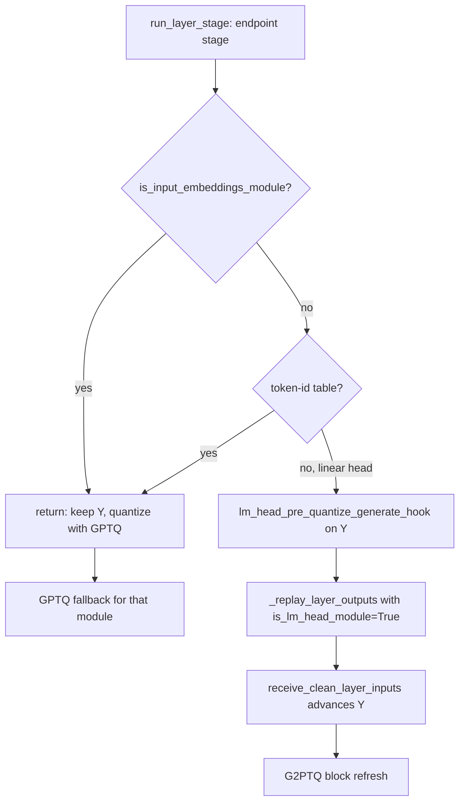
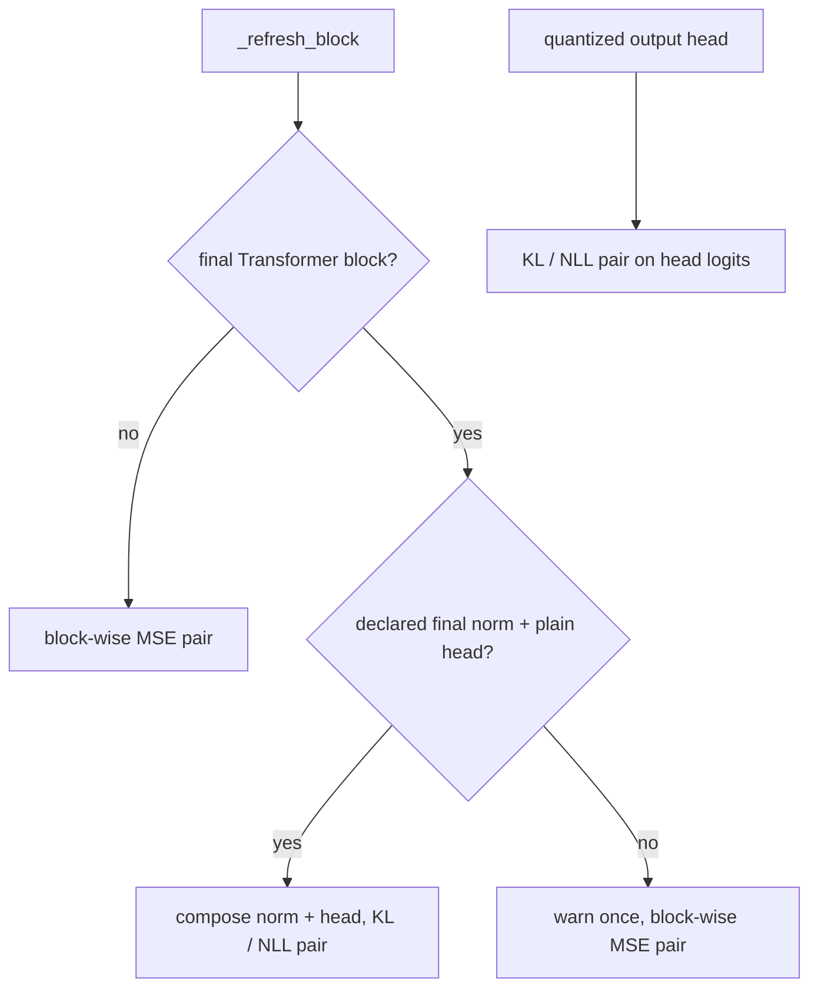
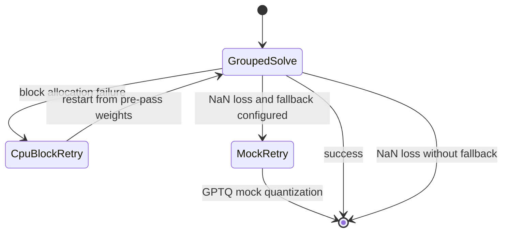

# G²PTQ block-refresh gradient compensation

[Documentation index](README.md) · [Project overview](../README.md)

G²PTQ is a GPTQ-family solver: it keeps GPTQ's column-wise second-order
compensation and adds the first-order term of a block-wise objective, bounded
by a per-row trust region. It is enabled per run and produces an ordinary GPTQ
checkpoint, so no new `METHOD`, kernel, or checkpoint format is involved.

Reference: *G²PTQ: Improving LLM Post-Training Quantization with Generalized
Gradient Compensation*, Ruikang Liu, Haoli Bai, Yuxuan Sun, Qian Zhang, Wenzheng
Cai, Yanqi Hao, Feiyu Wang, Weidong Zhong, Zhuang Wang, Tong Yang, and Xiangsheng
Zhou, [arXiv:2609.31009](https://arxiv.org/abs/2609.31009). This is a
clean-room implementation from the paper; the authors' code was not copied.

```python
from gptqmodel import GPTQModel
from gptqmodel.quantization.config import G2PTQConfig, QuantizeConfig

config = QuantizeConfig(
    bits=4,
    group_size=128,
    g2ptq=G2PTQConfig(alpha_mse=0.01, alpha_kl=0.05, num_groups=4, seed=0),
)
model = GPTQModel.load("model-path", config)
model.quantize(calibration)
```

## What changes relative to plain GPTQ

| Aspect | Plain GPTQ | G²PTQ |
| --- | --- | --- |
| Objective | per-linear layer-wise MSE | block-wise MSE; KL on the final block and a quantized output head |
| Hessian | `X^T X` from module inputs | grouped Fisher from output-activation gradients, Eq. 8/9 |
| First-order term | omitted | exact weight gradient of the block objective, Eq. 6/15 |
| Step size | fixed by the GPTQ update | per-row trust-region factor `beta` in `[0, 1]`, Eq. 13/14/56 |
| Refresh point | once per module | once per block (or per sequential subset) before it is quantized |
| Checkpoint | GPTQ | GPTQ, with `meta.g2ptq` recording the solver settings |
| Dispatch | `ProcessorStep.GPTQ` | `ProcessorStep.G2PTQ` |

## Old flow: plain GPTQ



## New flow: G²PTQ

```mermaid
flowchart TD
    A["QuantizationRunPlan.build"] -->|"g2ptq is set and method is GPTQ"| B["ProcessorStep.G2PTQ"]
    A -->|"weight-only, EXL3, or another method"| X["NotImplementedError"]
    B --> C["G2PTQProcessor"]
    C --> D["stage captures the clean block output"]
    D --> E["receive_layer_forward_context with replay masks"]
    E --> F["_refresh_block"]
    F --> G["_differentiable_block repairs inference tensors and hooked linears"]
    G --> H["_collect_block_statistics"]
    H --> I["ell_G and ell_H over kept tokens"]
    I --> J["G2PTQ.set_block_statistics"]
    J --> K["G2PTQ.quantize"]
    K -->|"usable statistics and sufficient samples"| L["_g2ptq_quantize with trust region"]
    K -->|"missing statistics or standard fallback"| M["GPTQ.quantize"]
    F -->|"refresh fails"| N["warn once per block"]
    N --> M
    L -->|"inverse allocation failure"| P["complete the grouped solve on CPU"]
    L -->|"block allocation failure"| Q["restart the block pass on CPU from pre-pass weights"]
    L -->|"NaN loss and fallback configured"| R["GPTQ mock-quantization retry"]
    L --> O["packed GPTQ checkpoint"]
    P --> O
    Q --> O
    R --> O
    M --> O
```



## Two calibration streams

The block objective compares the quantized block against the full-precision
block output, so the processor keeps two streams:

| Stream | Symbol | Owner | Content |
| --- | --- | --- | --- |
| Clean | `Y` | `clean_group_layer_inputs` / `receive_clean_layer_inputs` | input produced by the pristine previous blocks applied to the original activations |
| Noisy | `Y'` | the live calibration cache | input produced by the already-quantized previous blocks applied to their own quantized outputs |

`Y` is seeded from the captured first-decoder-layer input and advanced by
replaying each pristine float decoder block (`uses_grouped_optimization` and
`needs_pristine_layer_clone` are on). Token-id embedding endpoints are not
replayed and do not advance it. `Y'` is the stream the block being quantized sees.
`Y_hat` is the float block applied to `Y'`; the two streams differ only by the
accumulated quantization error of the previous blocks, which is what makes the
first-order term non-zero. Each independent branch starts both streams from
its captured inputs. At the output head, both streams pass through the
model's head preprocessing before projection.

### Embedding endpoints

Token-id lookups have no float activation block to differentiate, so they are
excluded from the grouped clean-target replay. `run_layer_stage` marks the
endpoint stage with `is_embeddings_module` / `is_input_embeddings_module`, and
`_capture_pristine_group_context` returns before replaying a token-id table.
The input endpoint does not advance the clean stream: `Y` is already seeded
from the captured first-decoder-layer input. A linear output head keeps the
clean replay and the KL objective, with head preprocessing applied to both
streams and no decoder kwargs.



| Situation | Before | After |
| --- | --- | --- |
| Input embedding requantized with G2PTQ | The pristine replay passed `is_lm_head_module=False`, so the executor injected `position_ids` and `attention_mask` and `AutoNF12Embedding.forward(ids)` raised `TypeError`. The embedding output also advanced the clean stream, skipping the first decoder block. | The capture returns before replay; `Y` keeps the captured first-decoder-layer input and the table is quantized by plain GPTQ. |
| Output embedding that is a token table | Same replay path, and the lookup output advanced `Y`. | The capture returns; `Y` keeps the last decoder-block output and the table is quantized by plain GPTQ. |
| Output embedding that is a linear head | The replay used the decoder contract. | The replay uses the head contract, applies head preprocessing to `Y`, and keeps the KL refresh. |

`receive_layer_forward_context` also declines to install statistics for a
token-id lookup, so the `G2PTQ` task falls back to `GPTQ.quantize` even if
another stage path reaches it.

## Per-block refresh

`_collect_block_statistics` runs one differentiable replay per captured batch:

1. Build `ell_G` and `ell_H` from the block output (Algorithm 2, lines 9-13):
   block-wise MSE for intermediate blocks, and KL / cross-entropy for the
   final Transformer block when `kl_last_block` is set. The final block
   reaches logits through the model's declared final norm and output head; a
   quantized output head uses the same pair directly. Both terms sum the
   per-token objectives in FP32 for FP16 and BF16 models, using the active
   replay keep mask.
2. Backpropagate `ell_G` for each projection's weight gradient `G` (line 16).
3. Backpropagate `ell_H` and cache each projection's output-activation
   gradient; Eq. 8 squares it per token and channel, Eq. 9 averages channels
   inside each output-channel group. The result is one `H` per group, summed
   over every invocation of the projection.
4. Install both on the task; `G2PTQ.quantize` then solves Eq. 6/15 with the
   trust region of Eq. 13.



The replay runs outside `torch.inference_mode()`, because the quantization
stage itself runs inside it and every tensor allocated there is an inference
tensor that autograd refuses to save. `_differentiable_block` therefore owns a
snapshot (a deep copy when the stage handed over the live module) and rebuilds
each frozen floating-point weight as a gradient leaf. Projections that share
a weight also share its leaf, so autograd sums both contributions. Integer
index parameters retain their values and stay outside gradient tracking. Each
replay group derives its Fisher draws from the resolved `G2PTQConfig.seed` and
the layer index; modules with different resolved seeds use separate replays.
The seed is part of the serialized configuration, so repeated and resumed runs
use the same draws without depending on the ambient process RNG state.

## Failure contracts

- **No statistics.** A module the refresh never reached (for example a routed
  expert outside the captured subset) keeps GPTQ's captured Hessian and runs
  plain `GPTQ.quantize`. This is per module, not per run. The first fallback
  logs a warning naming the module, so a silent whole-model fallback (for
  example a direct `hf_quantize` solve, which has no block refresh) is visible.
- **Refresh failure.** The exception is logged once per block and that block's
  affected modules fall back to GPTQ. The usual GPTQ sample thresholds and
  smoothing also apply when a module has refreshed statistics.
- **Block-pass allocation failure.** The column pass is retried once on the
  host from the pre-pass weights. Columns already mutated by the failed pass
  are discarded, and the host retry carries the grouped factors, gradient,
  static-group quantizers and activation ordering with it. A non-allocation
  error propagates unchanged.
- **NaN loss.** When a fallback is configured, the solver restores the captured
  Hessian diagonal and retries through GPTQ's mock-quantization path. Without a
  configured fallback it raises the same `ValueError` as GPTQ.
- **KV-cache reuse.** A block whose forward consumes a previous layer's KV
  cache cannot be replayed in isolation; the refresh refuses it and the block
  falls back.
- **Final-block logits path.** The final block uses KL only when its output
  feeds the model's declared final norm and a plain linear (or `Conv1D` /
  tied-embedding) head. A definition that preprocesses head inputs in
  `lm_head_pre_quantize_generate_hook` (an extra projection, a stream
  collapse, or a conditional norm) cannot reuse that path; the block logs one
  warning and uses block-wise MSE instead.
- **Embedding endpoints.** A token-id embedding table has no float activation
  block to differentiate, so `quantize()`/`requantize()` with
  `embed_quant_mode=INPUT` or `BOTH` quantizes it with plain GPTQ. A linear
  output head still uses the KL block refresh when it is requantized.
- **Group count.** `num_groups` must divide the module's output channels. When
  it does not (for example a vocabulary-sized head), one group is used and a
  warning is logged.
- **Method pairing.** G²PTQ is only reachable through `METHOD.GPTQ`. Weight-only
  lifecycles, EXL3, and the other calibrated methods are rejected by
  `QuantizationRunPlan.build`, and `g2ptq` cannot be combined with `gptaq` or
  `foem`.
- **Tensor-parallel padding.** The Hessian and gradient are zero-padded on the
  column axis exactly like GPTQ's padded Hessian, and the padding is removed
  from the result.

| Replay or solve boundary | Initial implementation | Current behavior |
| --- | --- | --- |
| Output head | Head preprocessing on the noisy stream | Model head preprocessing on both streams |
| Calibration rows | Objectives included all replayed rows | Replay keep mask selects rows for the objectives |
| Fisher sampling | Used the global RNG between packing operations | Each replay group uses a local stream derived from its configured seed and the layer index |
| Zero Fisher diagonal | A group could erase a calibration-live weight | GPTQ input energy identifies dead columns, and a positive diagonal stabilizes the group factorization |
| Dynamic grid refit | A refit spanning two compute blocks could read stale trailing columns | The solver flushes pending updates before fitting the next group across a block boundary |
| Inverse allocation failure | The inverse could move to CPU while the column loop still allocated on the original device | The CPU retry carries the remaining solve and its scratch tensors |
| Block allocation failure | The partially updated column pass aborted the module | The pass restarts on the host from the pre-pass weights and discards partial columns |
| NaN loss | Always raised `ValueError` | A configured fallback retries through GPTQ's mock-quantization path; otherwise the error is unchanged |

The plain GPTQ Hessian is only read as a diagonal for the dead-column
reference. Its accumulator is released before the grouped block pass, so the
solver never materializes a second full `columns x columns` matrix.



## Measured effect

The measurements below are from the initial implementation, which applied
the KL pair to the output head only. WikiText-2 perplexity at 4 bits,
`group_size=128`, fp16 weights and activations, produced by
`scripts/benchmark_g2ptq_ppl.py`. `alpha` is the trust-region budget
(`alpha_mse`); the output head keeps the default `alpha_kl`.

Qwen2.5-0.5B-Instruct, 24 x 2048 calibration tokens and 16 x 2048 evaluation
tokens:

| Method | PPL | vs. GPTQ |
| --- | ---: | ---: |
| FP16 | 13.918 | -8.8% |
| GPTQ | 15.265 | - |
| G²PTQ `alpha=0.05` | 15.015 | -1.6% |
| G²PTQ `alpha=0.2` | 14.819 | -2.9% |

Re-measured after the final-block KL change on the same Qwen2.5-0.5B setup:
14.870 at `alpha=0.05` and 14.732 at `alpha=0.2`. Repeated runs of the
unmodified objective on the same revision scored 14.911 / 14.919 and
14.788 / 14.739, so the spread is the solver's run-to-run variation at this
scale: the change restores the paper's objective without a measurable
perplexity gain here. It costs one extra vocabulary projection per
final-block subset, measured at about 7-12 s more quantization time and
0.3 GiB more peak device memory.

SmolLM2-135M, 16 x 1024 calibration tokens and 16 x 1024 evaluation tokens:

| Method | PPL | vs. GPTQ |
| --- | ---: | ---: |
| FP16 | 15.860 | -21.7% |
| GPTQ | 20.258 | - |
| G²PTQ `alpha=0.05` | 18.140 | -10.5% |
| G²PTQ `alpha=0.1` | 18.006 | -11.1% |
| G²PTQ `alpha=0.5` | 17.983 | -11.2% |
| G²PTQ `alpha=2.0` | 18.652 | -7.9% |

The refresh costs one extra differentiable block replay per subset. On the 0.5B
run the initial implementation raised quantization time from 39 s to about 99 s
and peak device memory from 0.57 GiB to 2.3-2.8 GiB; the final-block KL path
adds one vocabulary projection per subset, measured at about 7-12 s and
0.3 GiB. A larger budget is not monotonically better: the SmolLM2 row at
`alpha=2.0` is where the trust region starts trading accuracy for step size.

## Configuration

| Field | Default | Meaning |
| --- | --- | --- |
| `alpha_mse` | `0.01` | Trust-region budget for block-wise MSE blocks |
| `alpha_kl` | `0.05` | Trust-region budget for the output-head KL block |
| `num_groups` | `4` | Output-channel groups that share one Hessian |
| `kl_last_block` | `True` | Use the KL objective on the final Transformer block (through the final norm and head) and on a quantized output head |
| `seed` | `0` | Seed for the Fisher noise and KL label sampling; the draws also depend on the layer index |

Once enabled for the run, a module's `dynamic.g2ptq` rule can select its own
settings (including `seed`) or use `false` to select plain GPTQ for that module.

The paper autotunes `alpha` per block with a grid search (Appendix C.2). This
port takes it from the run configuration instead; the paper reports that
transferring one optimized threshold across bit widths and model variants keeps
the average absolute difference across layers within 0.4.

## Attribution

G²PTQ was introduced by Ruikang Liu, Haoli Bai, Yuxuan Sun, Qian Zhang, Wenzheng
Cai, Yanqi Hao, Feiyu Wang, Weidong Zhong, Zhuang Wang, Tong Yang, and Xiangsheng
Zhou. See [attributions and citations](citations.md).
