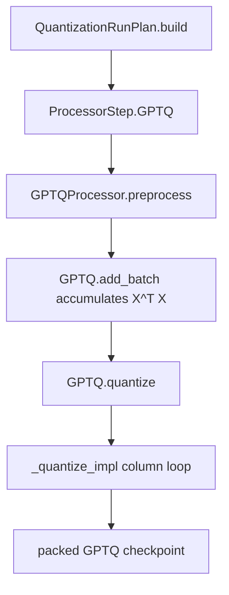
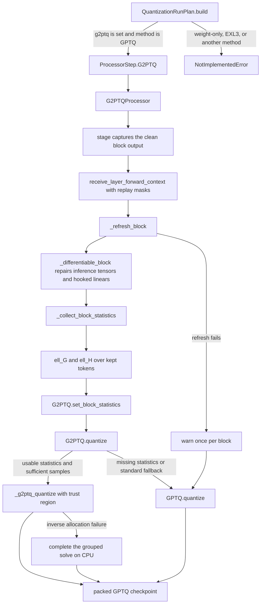

# G²PTQ block-refresh gradient compensation

[Documentation index](README.md) · [Project overview](../README.md)

G²PTQ is a GPTQ-family solver: it keeps GPTQ's column-wise second-order
compensation and adds the first-order term of a block-wise objective, bounded
by a per-row trust region. It is enabled per run and produces an ordinary GPTQ
checkpoint, so no new `METHOD`, kernel, or checkpoint format is involved.

Reference: *G²PTQ: Improving LLM Post-Training Quantization with Generalized
Gradient Compensation*, Ruikang Liu, Haoli Bai, Yuxuan Sun, Qian Zhang, Wenzheng
Cai, Yanqi Hao, Feiyu Wang, Weidong Zhong, Zhuang Wang, Tong Yang, and Xiangsheng
Zhou, [arXiv:2609.31009](https://arxiv.org/abs/2609.31009). This is a
clean-room implementation from the paper; the authors' code was not copied.

```python
from gptqmodel import GPTQModel
from gptqmodel.quantization.config import G2PTQConfig, QuantizeConfig

config = QuantizeConfig(
    bits=4,
    group_size=128,
    g2ptq=G2PTQConfig(alpha_mse=0.01, alpha_kl=0.05, num_groups=4),
)
model = GPTQModel.load("model-path", config)
model.quantize(calibration)
```

## What changes relative to plain GPTQ

| Aspect | Plain GPTQ | G²PTQ |
| --- | --- | --- |
| Objective | per-linear layer-wise MSE | block-wise MSE, KL on the output head |
| Hessian | `X^T X` from module inputs | grouped Fisher from output-activation gradients, Eq. 8/9 |
| First-order term | omitted | exact weight gradient of the block objective, Eq. 6/15 |
| Step size | fixed by the GPTQ update | per-row trust-region factor `beta` in `[0, 1]`, Eq. 13/14/56 |
| Refresh point | once per module | once per block (or per sequential subset) before it is quantized |
| Checkpoint | GPTQ | GPTQ, with `meta.g2ptq` recording the solver settings |
| Dispatch | `ProcessorStep.GPTQ` | `ProcessorStep.G2PTQ` |

## Old flow: plain GPTQ



## New flow: G²PTQ



## Two calibration streams

The block objective compares the quantized block against the full-precision
block output, so the processor keeps two streams:

| Stream | Symbol | Owner | Content |
| --- | --- | --- | --- |
| Clean | `Y` | `clean_group_layer_inputs` / `receive_clean_layer_inputs` | input produced by the pristine previous blocks applied to the original activations |
| Noisy | `Y'` | the live calibration cache | input produced by the already-quantized previous blocks applied to their own quantized outputs |

`Y` is produced by replaying the stage's pristine float block clone
(`uses_grouped_optimization` and `needs_pristine_layer_clone` are on), and is
advanced once per layer. `Y'` is the stream the block being quantized sees.
`Y_hat` is the float block applied to `Y'`; the two streams differ only by the
accumulated quantization error of the previous blocks, which is what makes the
first-order term non-zero. Each independent branch starts both streams from
its captured inputs. At the output head, both streams pass through the
model's head preprocessing before projection.

## Per-block refresh

`_collect_block_statistics` runs one differentiable replay per captured batch:

1. Build `ell_G` and `ell_H` from the block output (Algorithm 2, lines 9-13):
   block-wise MSE for body blocks, and KL / cross-entropy on the output head
   when `kl_last_block` is set. Both terms sum the per-token objectives in
   FP32 for FP16 and BF16 models, using the active replay keep mask.
2. Backpropagate `ell_G` for each projection's weight gradient `G` (line 16).
3. Backpropagate `ell_H` and cache each projection's output-activation
   gradient; Eq. 8 squares it per token and channel, Eq. 9 averages channels
   inside each output-channel group. The result is one `H` per group, summed
   over every invocation of the projection.
4. Install both on the task; `G2PTQ.quantize` then solves Eq. 6/15 with the
   trust region of Eq. 13.

The replay runs outside `torch.inference_mode()`, because the quantization
stage itself runs inside it and every tensor allocated there is an inference
tensor that autograd refuses to save. `_differentiable_block` therefore owns a
snapshot (a deep copy when the stage handed over the live module) and rebuilds
each frozen floating-point weight as a gradient leaf. Projections that share
a weight also share its leaf, so autograd sums both contributions. Integer
index parameters retain their values and stay outside gradient tracking. Each
block derives its Fisher draws from the run seed and layer index. The continuation stores the run seed so checkpoint packing and
interruption leave the draws reproducible.

## Failure contracts

- **No statistics.** A module the refresh never reached (for example a routed
  expert outside the captured subset) keeps GPTQ's captured Hessian and runs
  plain `GPTQ.quantize`. This is per module, not per run. The first fallback
  logs a warning naming the module, so a silent whole-model fallback (for
  example a direct `hf_quantize` solve, which has no block refresh) is visible.
- **Refresh failure.** The exception is logged once per block and that block's
  affected modules fall back to GPTQ. The usual GPTQ sample thresholds and
  smoothing also apply when a module has refreshed statistics.
- **KV-cache reuse.** A block whose forward consumes a previous layer's KV
  cache cannot be replayed in isolation; the refresh refuses it and the block
  falls back.
- **Group count.** `num_groups` must divide the module's output channels. When
  it does not (for example a vocabulary-sized head), one group is used and a
  warning is logged.
- **Method pairing.** G²PTQ is only reachable through `METHOD.GPTQ`. Weight-only
  lifecycles, EXL3, and the other calibrated methods are rejected by
  `QuantizationRunPlan.build`, and `g2ptq` cannot be combined with `gptaq` or
  `foem`.
- **Tensor-parallel padding.** The Hessian and gradient are zero-padded on the
  column axis exactly like GPTQ's padded Hessian, and the padding is removed
  from the result.

| Replay or solve boundary | Initial implementation | Current behavior |
| --- | --- | --- |
| Output head | Head preprocessing on the noisy stream | Model head preprocessing on both streams |
| Calibration rows | Objectives included all replayed rows | Replay keep mask selects rows for the objectives |
| Fisher sampling | Used the global RNG between packing operations | Each block uses a local stream derived from the saved run seed |
| Zero Fisher diagonal | A group could erase a calibration-live weight | GPTQ input energy identifies dead columns, and a positive diagonal stabilizes the group factorization |
| Dynamic grid refit | A refit spanning two compute blocks could read stale trailing columns | The solver flushes pending updates before fitting the next group across a block boundary |
| Inverse allocation failure | The inverse could move to CPU while the column loop still allocated on the original device | The CPU retry carries the remaining solve and its scratch tensors |

## Measured effect

The measurements below are from the initial implementation. WikiText-2 perplexity at 4 bits, `group_size=128`, fp16 weights and
activations, produced by `scripts/benchmark_g2ptq_ppl.py`. `alpha` is the
trust-region budget (`alpha_mse`); the output head keeps the default
`alpha_kl`.

Qwen2.5-0.5B-Instruct, 24 x 2048 calibration tokens and 16 x 2048 evaluation
tokens:

| Method | PPL | vs. GPTQ |
| --- | ---: | ---: |
| FP16 | 13.918 | -8.8% |
| GPTQ | 15.265 | - |
| G²PTQ `alpha=0.05` | 15.015 | -1.6% |
| G²PTQ `alpha=0.2` | 14.819 | -2.9% |

SmolLM2-135M, 16 x 1024 calibration tokens and 16 x 1024 evaluation tokens:

| Method | PPL | vs. GPTQ |
| --- | ---: | ---: |
| FP16 | 15.860 | -21.7% |
| GPTQ | 20.258 | - |
| G²PTQ `alpha=0.05` | 18.140 | -10.5% |
| G²PTQ `alpha=0.1` | 18.006 | -11.1% |
| G²PTQ `alpha=0.5` | 17.983 | -11.2% |
| G²PTQ `alpha=2.0` | 18.652 | -7.9% |

The refresh costs one extra differentiable block replay per subset. On the 0.5B
run it raised quantization time from 39 s to about 99 s and peak device memory
from 0.57 GiB to 2.3-2.8 GiB. A larger budget is not monotonically better: the
SmolLM2 row at `alpha=2.0` is where the trust region starts trading accuracy
for step size.

## Configuration

| Field | Default | Meaning |
| --- | --- | --- |
| `alpha_mse` | `0.01` | Trust-region budget for block-wise MSE blocks |
| `alpha_kl` | `0.05` | Trust-region budget for the output-head KL block |
| `num_groups` | `4` | Output-channel groups that share one Hessian |
| `kl_last_block` | `True` | Use the KL objective on the output head |

Once enabled for the run, a module's `dynamic.g2ptq` rule can select its own
settings or use `false` to select plain GPTQ for that module.

The paper autotunes `alpha` per block with a grid search (Appendix C.2). This
port takes it from the run configuration instead; the paper reports that
transferring one optimized threshold across bit widths and model variants keeps
the average absolute difference across layers within 0.4.

## Attribution

G²PTQ was introduced by Ruikang Liu, Haoli Bai, Yuxuan Sun, Qian Zhang, Wenzheng
Cai, Yanqi Hao, Feiyu Wang, Weidong Zhong, Zhuang Wang, Tong Yang, and Xiangsheng
Zhou. See [attributions and citations](citations.md).
