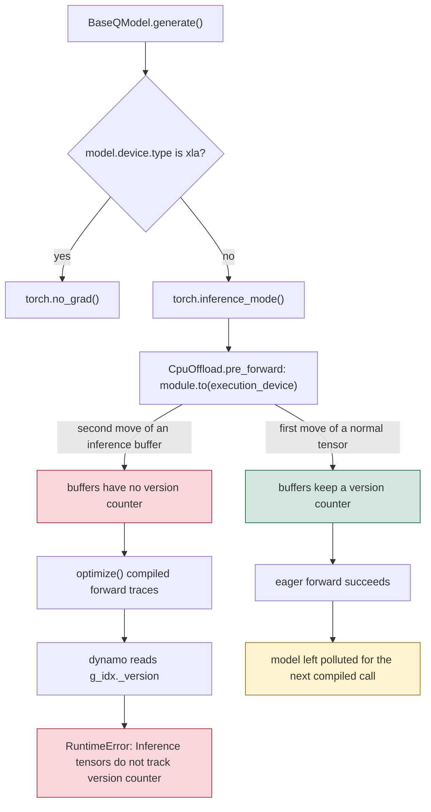
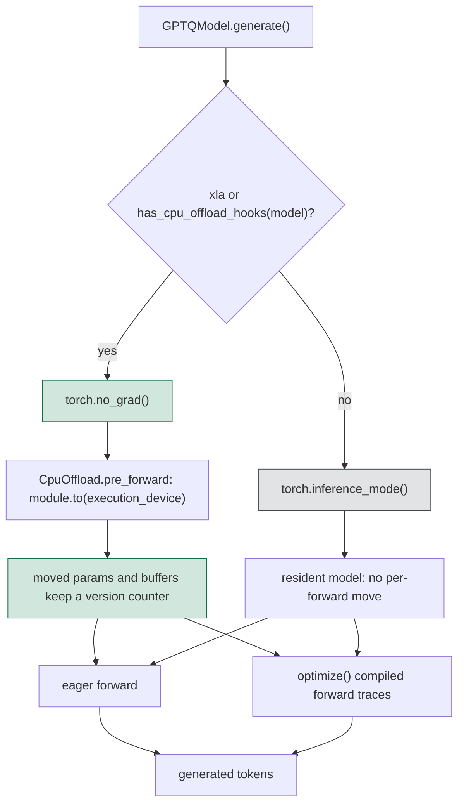

<!-- SPDX-FileCopyrightText: 2026 ModelCloud.ai -->
<!-- SPDX-License-Identifier: Apache-2.0 -->

# Generate on a CPU-offloaded model

`GPTQModel.generate()` disables autograd for the call, but the context it picks
matters to CPU offload. `torch.inference_mode()` turns the per-forward weight
moves into inference tensors, and dynamo cannot read the version counter of an
inference tensor. A model placed with a `cpu` `device_map` entry (or a
`max_memory` CPU budget) gets an Accelerate hook that moves each layer on every
forward, so `generate()` now runs under `torch.no_grad()` for exactly those
models. Every other model keeps `inference_mode` (#5099).

## Before and after

| Step | Before (`e2f9676c6`) | After |
| --- | --- | --- |
| Context selection | `no_grad` only for XLA, otherwise `inference_mode` (`gptqmodel/models/base.py:3902-3907`) | `no_grad` for XLA or `has_cpu_offload_hooks(self.model)` (`gptqmodel/models/base.py::generate`) |
| Hook detection | none | `has_cpu_offload_hooks` scans `_hf_hook`, unwraps `SequentialHook`, and matches `CpuOffload` plus `AlignDevicesHook(offload=True)` (`gptqmodel/utils/model.py::has_cpu_offload_hooks`) |
| Layer materialization | `CpuOffload.pre_forward` calls `module.to(execution_device)` under `inference_mode`; `simple_dispatch_model` installs that hook (`gptqmodel/utils/model.py::simple_dispatch_model`) | the same move runs under `no_grad` |
| Buffer lifecycle | `Module._apply` replaces buffers outright; the second move of an inference buffer stores a tensor without a version counter | the move allocates a normal tensor, so the buffer keeps its counter |
| Compiled `generate()` | dynamo's guard on `g_idx._version` raises `RuntimeError: Inference tensors do not track version counter` (`gptqmodel/nn_modules/qlinear/torch.py:1031`) | the trace succeeds and generation produces tokens |

Parameters are rebound with `param.data = ...` in `Module._apply`, which keeps
their version counter even under inference mode; packed GPT-QModel tensors
(`qweight`, `qzeros`, `scales`, `g_idx`, `qzeros_format`) are buffers, so they
are the ones that lost it.

## Old flow

## New flow

## Failure and ambiguity paths

| Situation | Behaviour |
| --- | --- |
| A layer carries `CpuOffload` or `AlignDevicesHook(offload=True)` | `generate()` uses `no_grad`; the hook's moves keep every tensor's version counter |
| A layer carries a resident `AlignDevicesHook` (`offload=False`) | not counted; the model keeps `inference_mode` |
| A `SequentialHook` wraps an offload hook | unwrapped and detected |
| The model has no offload hook | `inference_mode`, unchanged |
| The caller wraps `generate()` in an outer `torch.inference_mode()` | inference mode wins over the inner `no_grad`; the caller owns that stronger context and the hook can still strip a buffer's counter. This flow covers the documented `model.optimize(); model.generate()` call, not a caller-forced inference context |
| A runtime `generate` is bound (`sglang`) | it stays inside the selected context; the runtime owns its own tensor lifecycle |
| A hook is added or removed after load | detection runs per `generate()` call, so the current hook set decides |

## Extension points

`has_cpu_offload_hooks()` is the single place that decides whether a hook moves
tensors. A new Accelerate hook class that materializes weights on every forward
must be added there; otherwise the model keeps `inference_mode` and can lose a
buffer's version counter again.

## Evidence

- `tests/test_optimize_generate_cpu_offload_5099.py::test_eager_generate_keeps_version_counters_on_offloaded_layers`
  fails on `e2f9676c6` with 98 parameters/buffers without a version counter and
  passes with the fix.
- `tests/test_optimize_generate_cpu_offload_5099.py::test_optimize_then_generate_on_an_offloaded_placement`
  fails on `e2f9676c6` with the reported `RuntimeError` at
  `gptqmodel/nn_modules/qlinear/torch.py:1031` and passes with the fix.
- `tests/test_cpu_offload_device_map_tied_head_4866.py`,
  `tests/test_cpu_offload_tied_both_copies_4943.py`,
  `tests/test_marlin_cpu_offload_post_init.py`,
  `tests/test_optimize_generate_4669.py`,
  `tests/test_optimize_no_reference_cycle_4937.py`, and
  `tests/test_generation_compile_policy_4669.py` keep passing.
