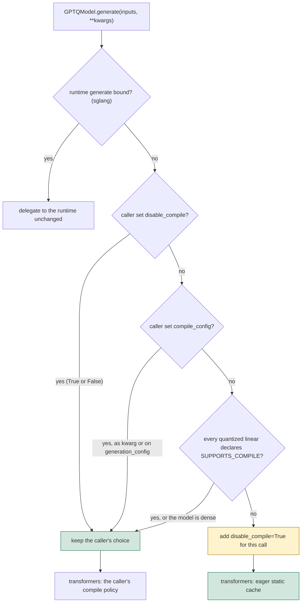

<!-- SPDX-FileCopyrightText: 2026 ModelCloud.ai -->
<!-- SPDX-License-Identifier: Apache-2.0 -->

# Generation compile policy

Transformers compiles the forward pass of a static-cache `generate()`
(`CompileConfig`, `mode="reduce-overhead"`) so a decode loop can be captured as
one CUDA graph. That only pays off when the kernels inside the loop are
traceable. Most GPT-QModel kernels call a custom op without a fake
implementation, or branch on host values (`data_ptr()`, `id()`, `._version`)
inside `forward`. Dynamo then breaks the graph on every quantized linear, so
CUDA-graph capture never covers a layer, and every decode step pays for dozens
of graph fragments and guard checks. Measured on Llama-3.2-1B with the AUTO
(Marlin) kernel, `generate(cache_implementation="static")` was 2-4x **slower**
than eager; `disable_compile=True` returned it to eager speed (#4669).

## Flow

The policy runs in `BaseQModel._generation_compile_kwargs()`. It never mutates a
`generation_config` the caller passed: the opt-out is applied to a copy.

## Kernel declaration

`BaseQuantLinear.SUPPORTS_COMPILE` (default `False`) is the per-kernel answer to
"does compiling this forward beat its eager path?". The bar is **trace-clean**,
and both halves are required:

1. `torch.compile(..., fullgraph=True)` traces the forward with **zero graph
   breaks**, and
2. a compiled decode **measures faster** on the hardware the declaration
   claims.

A graph-breaking kernel pays for dozens of graph fragments and guard checks per
decode step, so it loses even when its eager path is slow. A clean trace of a
forward whose eager path is already fast is a wash, and one timing on one
architecture does not qualify a kernel (#4739).

A kernel that reaches `INDUCTOR` or higher already satisfies half of that bar,
so it must answer the other half explicitly: either opt in, or record the
measured loss in `SUPPORTS_COMPILE_EAGER_REASON`. The protocol test rejects the
silent case, because that is exactly how `BitsAndBytesLinear` and `MacaqLinear`
ended up trace-clean and forced eager at the same time (#4984).

| Kernel | `SUPPORTS_COMPILE` | Evidence |
| --- | --- | --- |
| `TorchFP8Linear` | `True` | `fullgraph=True` traces clean (host-visible constants only; the decoded-weight bound is a load-time cache). Static-cache decode 0.126 s -> 0.055 s (2.3x, 1 graph, 0 breaks) on the tiny Llama here (#4739) |
| `AwqTorchLinear` | `True` | trace-clean since #4737's decode-range guard returns before `tensor_cache_key()` under `is_compiling()`. Static-cache decode 0.174 s -> 0.047 s (1 graph, 0 breaks) on the tiny Llama here; 1.36 s -> 0.76 s on Llama-1B/4090 (#4669). Its subclass `ParoLinear` re-declares `False` because its rotation/GEMM path branches on host row counts |
| `BitsAndBytesLinear` | `True` | the accelerator path is straight-line: 1 graph, 0 breaks, and a compiled static-cache decode is 2.2-3.5x faster than eager on 4090/5090/R9700. Reproduced here on sm_80 (Qwen2.5-0.5B BnB NF4, 4 prompts x 48 tokens): 1.78 s eager, 1.80 s on the old default path, 0.37 s on the default path after the opt-in (5.5x). AUTO selects this kernel for every BitsAndBytes checkpoint on CUDA, so the opt-out cost 2.2-3.5x by default (#4984) |
| `MacaqLinear` | `True` | `MACAQ_TORCH` traces to 1 graph with 0 breaks and the compiled decode is 9x faster than its eager torch path (6.67 s -> 0.73 s, #4984). The eager forward still cannot be captured (a host->device table copy), which is why `SUPPORTS_GRAPH_CAPTURE` stays `False`: the policy question is about dynamo, not capture |
| `MarlinLinear`, `MarlinAwqLinear`, ExLlamaV2, `TorchLinear`, `TritonV2Linear`, `QQQLinear`, EXL3, `ParoLinear` | `False` | custom op without a fake impl, or host-side `data_ptr()`/`id()`/`._version` guards in `forward` |
| `FP8MlxQuantLinear` | `False` | native Metal MXFP8 kernels on MPS; never traced or timed, so it does not inherit the Torch FP8 opt-in |

A kernel whose `SUPPORTS_COMPILE_LEVEL` is `INDUCTOR` or higher has a traceable,
lowerable forward, which is the same bar as the policy question above. Opting
out from there is still allowed (eager really can be faster), but it must record
the measured loss in `SUPPORTS_COMPILE_EAGER_REASON`, so the two declarations
cannot drift apart again:

| Kernel | Level | `SUPPORTS_COMPILE` | Recorded reason |
| --- | --- | --- | --- |
| `QQQTorchLinear` | `CUDAGRAPH` | `False` | a model-level static-cache `generate()` recompiles per step (172 graphs, 24-115 breaks) and runs 1.3-8x slower than eager |
| `ParoTritonLinear` | `CUDAGRAPH` | `False` | same model-level loss; the single-layer trace is clean, the decode loop is not |
| `VPTQLinear` | `CUDAGRAPH` | `False` | no measured static-cache win for the portable torch path yet |
| `AwqGEMVTritonLinear`, `AwqGEMVTorchLinear` | `CUDAGRAPH` | `False` | explicit-selection-only / CPU-only GEMV paths, never timed under `generate()` |
| `BitsAndBytesMlxQuantLinear`, `MacaqMlxQuantLinear` | `NOT_APPLICABLE` | `False` | native Metal matmuls; never traced or timed, so they do not inherit the Torch opt-in |

`tests/kernels/test_kernel_compile_protocol.py` rejects a `>= INDUCTOR` kernel
that opts out without a reason, and `tests/kernels/test_compile_policy_levels_4984.py`
re-checks the pairing against the measured trace on real hardware (and skips
kernels this device cannot run).

A dense model has no quantized linear to break the graph, so it keeps whatever
compile policy the caller chose.

## Measurements

Tiny Llama (2 layers, hidden 256, g128 4-bit), 4 prompts x 32 greedy tokens,
GB10 (sm_121):

| run | dynamic cache | static cache | static, `disable_compile=True` | dynamo graphs |
| --- | --- | --- | --- | --- |
| Marlin, before #4727 | 0.096 s | 0.211 s | 0.103 s | 19 |
| Marlin, after #4727 | 0.097 s | 0.099 s | 0.099 s | 0 |
| `AWQ_TORCH`, after #4737 | 0.171 s | 0.047 s | 0.174 s | 1 |
| FP8, before #4739 (declares `False`) | 0.123 s | 0.126 s | 0.126 s | 0 |
| FP8, after #4739 (declares `True`) | 0.123 s | 0.055 s | 0.126 s | 1 |

BitsAndBytes NF4, Qwen2.5-0.5B-Instruct (24 layers), 4 left-padded prompts x 48
greedy tokens, fp16, PG506 (sm_80), torch 2.15.0.dev+cu130, one shared GPU:

| run | dynamic cache | static cache | static, `disable_compile=True` | static, `disable_compile=False` | dynamo |
| --- | --- | --- | --- | --- | --- |
| before #4984 (declares `False`) | 1.873 s | 1.795 s | 1.779 s | 0.607 s | 1 graph, 0 breaks |
| after #4984 (declares `True`) | 1.961 s | 0.367 s | 2.012 s | 0.311 s | 1 graph, 0 breaks |

The compiled decode reproduced the eager greedy tokens on all four rows here;
the first compiled call costs 18-35 s of compile time. The two rows are separate
processes on a shared GPU, so the eager baseline moved (1.78 s vs 2.01 s); the
point is that the default policy now takes the compiled path instead of adding
`disable_compile=True`.

Compiling FP8 changes the reduction order, so a compiled greedy decode can pick
a different token from the eager one on some weights, while staying
deterministic run to run; `disable_compile=True` still reproduces the dynamic
tokens exactly. The same holds for the compiled AWQ decode.

The reporter's Llama-1B numbers were larger (0.33 s eager vs 0.98-1.05 s static
for Marlin).

## Capability declarations

`SUPPORTS_COMPILE` answers a policy question ("is compiling not a
pessimization?"). Two more declarations answer capability questions, so a
caller can pick the level it needs instead of guessing from a class name:

| Declaration | Question | Values |
| --- | --- | --- |
| `SUPPORTS_COMPILE_LEVEL` | how far can `torch.compile` take this `forward`? | `NOT_APPLICABLE` < `EAGER` < `DYNAMO` < `AOT_EAGER` < `INDUCTOR` < `CUDAGRAPH` |
| `SUPPORTS_GRAPH_CAPTURE` | may the **eager** `forward` run inside `torch.cuda.graph(...)`? | `bool` |

`DYNAMO` means `torch.compile(fullgraph=True, backend="eager")` traces with zero
graph breaks, `AOT_EAGER` adds `aot_autograd`/meta tensors, `INDUCTOR` lowers
the graph, and `CUDAGRAPH` means `mode="reduce-overhead"` captures it. Graph
capture is measured separately because a custom op without a meta
implementation can be capture-safe yet untraceable, and a traceable kernel can
still synchronise the host inside `forward`.

[The kernel matrix](kernel-compile-matrix.md) lists every kernel's declaration;
`tests/kernels/test_kernel_compile_protocol.py` keeps the declarations honest
and the per-family `test_kernel_compile_levels_*.py` files re-measure them on
real hardware with `tests/kernels/compile_probe.py`.

## `optimize()` and `generate()`

`generate()` resolves to the original module's `generate`, and transformers'
`generate` calls `self(...)` — the module's own `forward`. Wrapping the model in
a `torch.compile` `OptimizedModule` therefore compiled nothing that `generate()`
ran: `OptimizedModule.__getattr__` handed `generate` back to the unwrapped
module (#4669 item 2). `BaseQModel.optimize()` now compiles `forward` in place
instead of replacing `self.model`, so a direct `model(...)` call and `generate()`
both enter the compiled path. `self.model` stays the original `nn.Module`; a
repeated `optimize()` unwraps the previous proxy and recompiles the eager
callable, so wrappers do not stack. The compile fallback and `fullgraph`
semantics are unchanged.

This is an explicit opt-in: for a graph-breaking kernel the compiled forward is
still slower than eager, which is exactly why the static-cache auto-compile is
off by default for those kernels. Compiling can also change the reduction order
and therefore a greedy token, as documented for FP8/AWQ above.

### Releasing the compiled model

`optimize()` installs a `_CompiledModelForward` proxy that reaches the model
through a weak reference, so the proxy itself never closes a
`model -> forward -> model` cycle (#4937). Torch.compile adds a second, hidden
holder: every frame dynamo traces builds `VariableTracker` objects, and a graph
break leaves an `UnspecializedNNModuleVariable` -> `SideEffectsProxyDict` ->
`DunderDictVariable` cycle that keeps the traced module reachable. Reference
counting cannot reclaim those cycles, so before #5020 a compiled model kept its
weights and VRAM after the caller dropped it until a full cyclic
`gc.collect()` - the whole 0.43 GiB model on Qwen2.5-0.5B, for `GPTQ_TRITON`,
`GPTQ_TORCH` and `MARLIN` alike.

The proxy now calls `release_compile_trace_garbage()` whenever a compiled call
traces a new frame (`dynamo_traced_frames()` grew): once per new frame, not per
token. Only the unreachable cycles are collected, and dynamo's compiled-frame
cache is left intact, so the next call still takes the compiled path. Dropping
the model then frees it immediately, with cyclic GC disabled.

## What remains

- A kernel can flip `SUPPORTS_COMPILE` to `True` after it gains a fake
  implementation for its custom op and moves its identity/version guards out of
  the traced `forward`.
