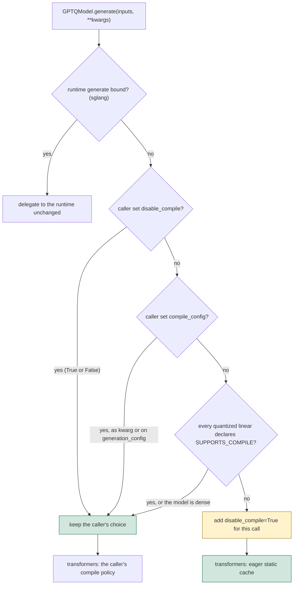

<!-- SPDX-FileCopyrightText: 2026 ModelCloud.ai -->
<!-- SPDX-License-Identifier: Apache-2.0 -->

# Generation compile policy

Transformers compiles the forward pass of a static-cache `generate()`
(`CompileConfig`, `mode="reduce-overhead"`) so a decode loop can be captured as
one CUDA graph. That only pays off when the kernels inside the loop are
traceable. Most GPT-QModel kernels call a custom op without a fake
implementation, or branch on host values (`data_ptr()`, `id()`, `._version`)
inside `forward`. Dynamo then breaks the graph on every quantized linear, so
CUDA-graph capture never covers a layer, and every decode step pays for dozens
of graph fragments and guard checks. Measured on Llama-3.2-1B with the AUTO
(Marlin) kernel, `generate(cache_implementation="static")` was 2-4x **slower**
than eager; `disable_compile=True` returned it to eager speed (#4669).

## Flow

The policy runs in `BaseQModel._generation_compile_kwargs()`. It never mutates a
`generation_config` the caller passed: the opt-out is applied to a copy.

## Kernel declaration

`BaseQuantLinear.SUPPORTS_COMPILE` (default `False`) is the per-kernel answer to
"does compiling this forward beat its eager path?". The bar is **trace-clean**,
and both halves are required:

1. `torch.compile(..., fullgraph=True)` traces the forward with **zero graph
   breaks**, and
2. a compiled decode **measures faster** on the hardware the declaration
   claims.

A graph-breaking kernel pays for dozens of graph fragments and guard checks per
decode step, so it loses even when its eager path is slow. A clean trace of a
forward whose eager path is already fast is a wash, and one timing on one
architecture does not qualify a kernel (#4739).

| Kernel | `SUPPORTS_COMPILE` | Evidence |
| --- | --- | --- |
| `TorchFP8Linear` | `True` | `fullgraph=True` traces clean (host-visible constants only; the decoded-weight bound is a load-time cache). Static-cache decode 0.126 s -> 0.055 s (2.3x, 1 graph, 0 breaks) on the tiny Llama here (#4739) |
| `AwqTorchLinear` | `True` | trace-clean since #4737's decode-range guard returns before `tensor_cache_key()` under `is_compiling()`. Static-cache decode 0.174 s -> 0.047 s (1 graph, 0 breaks) on the tiny Llama here; 1.36 s -> 0.76 s on Llama-1B/4090 (#4669). Its subclass `ParoLinear` re-declares `False` because its rotation/GEMM path branches on host row counts |
| `MarlinLinear`, `MarlinAwqLinear`, ExLlamaV2, `TorchLinear`, `TritonV2Linear`, QQQ, EXL3, Paro | `False` | custom op without a fake impl, or host-side `data_ptr()`/`id()`/`._version` guards in `forward` |
| `FP8MlxQuantLinear` | `False` | native Metal MXFP8 kernels on MPS; never traced or timed, so it does not inherit the Torch FP8 opt-in |

A dense model has no quantized linear to break the graph, so it keeps whatever
compile policy the caller chose.

## Measurements

Tiny Llama (2 layers, hidden 256, g128 4-bit), 4 prompts x 32 greedy tokens,
GB10 (sm_121):

| run | dynamic cache | static cache | static, `disable_compile=True` | dynamo graphs |
| --- | --- | --- | --- | --- |
| Marlin, before #4727 | 0.096 s | 0.211 s | 0.103 s | 19 |
| Marlin, after #4727 | 0.097 s | 0.099 s | 0.099 s | 0 |
| `AWQ_TORCH`, after #4737 | 0.171 s | 0.047 s | 0.174 s | 1 |
| FP8, before #4739 (declares `False`) | 0.123 s | 0.126 s | 0.126 s | 0 |
| FP8, after #4739 (declares `True`) | 0.123 s | 0.055 s | 0.126 s | 1 |

Compiling FP8 changes the reduction order, so a compiled greedy decode can pick
a different token from the eager one on some weights, while staying
deterministic run to run; `disable_compile=True` still reproduces the dynamic
tokens exactly. The same holds for the compiled AWQ decode.

The reporter's Llama-1B numbers were larger (0.33 s eager vs 0.98-1.05 s static
for Marlin).

## Capability declarations

`SUPPORTS_COMPILE` answers a policy question ("is compiling not a
pessimization?"). Two more declarations answer capability questions, so a
caller can pick the level it needs instead of guessing from a class name:

| Declaration | Question | Values |
| --- | --- | --- |
| `SUPPORTS_COMPILE_LEVEL` | how far can `torch.compile` take this `forward`? | `NOT_APPLICABLE` < `EAGER` < `DYNAMO` < `AOT_EAGER` < `INDUCTOR` < `CUDAGRAPH` |
| `SUPPORTS_GRAPH_CAPTURE` | may the **eager** `forward` run inside `torch.cuda.graph(...)`? | `bool` |

`DYNAMO` means `torch.compile(fullgraph=True, backend="eager")` traces with zero
graph breaks, `AOT_EAGER` adds `aot_autograd`/meta tensors, `INDUCTOR` lowers
the graph, and `CUDAGRAPH` means `mode="reduce-overhead"` captures it. Graph
capture is measured separately because a custom op without a meta
implementation can be capture-safe yet untraceable, and a traceable kernel can
still synchronise the host inside `forward`.

[The kernel matrix](kernel-compile-matrix.md) lists every kernel's declaration;
`tests/kernels/test_kernel_compile_protocol.py` keeps the declarations honest
and the per-family `test_kernel_compile_levels_*.py` files re-measure them on
real hardware with `tests/kernels/compile_probe.py`.

## What remains

- `optimize()` still compiles `self.model`, which `generate()` does not call:
  `OptimizedModule.__getattr__` resolves `generate` to the original module, so
  the compiled wrapper is bypassed. Fixing that means compiling the forward
  `generate()` actually runs, which changes what `self.model` is; it is a
  separate change.
- A kernel can flip `SUPPORTS_COMPILE` to `True` after it gains a fake
  implementation for its custom op and moves its identity/version guards out of
  the traced `forward`.
