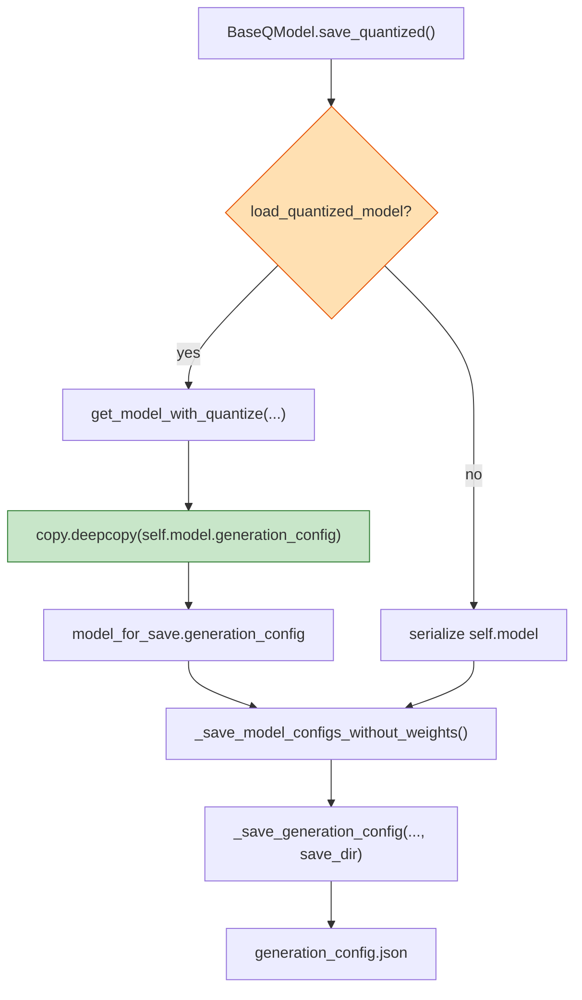

# Generation config round trip

When a loaded quantized model is saved again, its `generation_config` is part
of the checkpoint contract. The live model has the values read from the source
`generation_config.json`; the save-time shell exists only to serialize the
quantized model structure and may derive a different default from `config.json`.
`BaseQModel.save_quantized()` therefore copies the live generation config onto
the shell before `_save_model_configs_without_weights()` serializes it.

## Before and after

| Mechanism | Before | After |
| --- | --- | --- |
| Save-time shell generation config | `get_model_with_quantize()` shell retained defaults from `config.json` (`gptqmodel/models/writer.py:2218`) | Live `self.model.generation_config` is deep-copied to the shell before config serialization (`gptqmodel/models/writer.py:2150`) |
| Output fields | Sampling fields and generation-only EOS lists could be dropped or reset | The loaded checkpoint's live generation settings are serialized |
| Caller state | Serialization could observe shell state | The live object is copied, so attention-field cleanup and serialization do not mutate it |

## Failure contract

| Situation | Before | After |
| --- | --- | --- |
| Loaded quantized checkpoint with custom sampling fields | Re-save writes shell defaults | Re-save writes the live values |
| Loaded checkpoint with a generation-only EOS list | List may collapse to a scalar from model config | List remains on the saved generation config |
| No live generation config | Shell/default behavior | Existing shell behavior is preserved |

The copy is limited to the loaded-shell path; ordinary saves continue to
serialize `self.model` directly, and no environment variable changes runtime
behavior.
