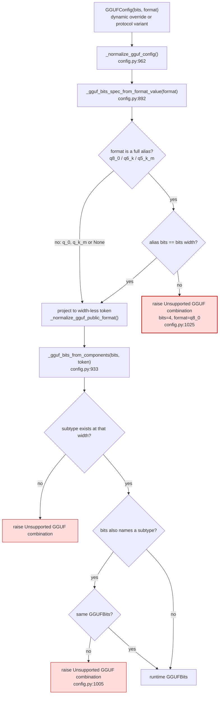
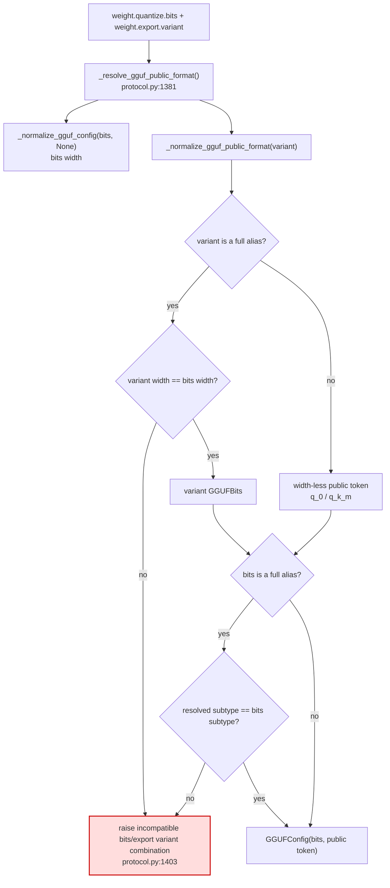

<!-- SPDX-FileCopyrightText: 2026 ModelCloud.ai
SPDX-License-Identifier: Apache-2.0 -->

# GGUF bits and subtype resolution

`GGUFConfig` accepts the bit width (`bits`) and the ggml subtype (`format`)
separately. A full subtype such as `q8_0`, `q6_k` or `q5_k_m` already carries a
bit width, so the two inputs can disagree. This page records how the pair is
resolved, which conflicts are rejected, and why a full subtype is never
projected to its width-less token before that comparison.

The same resolution feeds the base config, per-module `dynamic` overrides and
the protocol compiler. Introduced by
[#5140](https://github.com/ModelCloud/GPTQModel/pull/5140), which fixes
[#5106](https://github.com/ModelCloud/GPTQModel/issues/5106).

## Resolution flow

`_normalize_gguf_config()` (`gptqmodel/quantization/config.py:962`) is the only
place that combines the two inputs. Before projecting a full alias it asks
`_gguf_bits_spec_from_format_value()` (`config.py:892`) for the alias's own
`GGUFBits` and compares widths (`config.py:1025`).

`R1` is the width conflict added for #5106. `R2` is the pre-existing
existence check (the subtype does not exist at that width, for example
`bits=8, format=q_k_m`). `R3` covers a same-width subtype conflict such as
`bits="q4_k_m", format="q4_0"`.

## Protocol flow

The protocol compiler resolves `export.variant` before it constructs a
`GGUFConfig`. `_resolve_gguf_public_format()`
(`gptqmodel/quantization/protocol.py:1381`) normalizes the variant through the
same alias path, compares the width (`protocol.py:1403`), and, when `bits` is
also a full subtype, compares the resolved subtype (`protocol.py:1415`).

The documented payload `{"format": "gguf", "variant": "q4_k_m"}` with
`bits: q4_k_m` now compiles to `Q4_K_M`. The projected token `q_k_m` remains
accepted as well, so existing protocols keep working.

## Before and after

The removed mechanism projected a full alias to its width-less token and then
rebuilt the subtype from `bits`. The width in the alias was gone before any
comparison could run.

| Stage | Before (`e2f9676c6`) | After |
| --- | --- | --- |
| Format normalization | `_normalize_gguf_public_format()` (`config.py:867`, projection branch `config.py:882`) turned `q8_0` into `q_0`; the width was discarded | `_gguf_bits_spec_from_format_value()` (`config.py:892`) returns the full `GGUFBits`; the width is compared at `config.py:1025` before projection |
| Subtype rebuild | `_gguf_bits_from_components(bits, "q_0")` (`config.py:933`) rebuilt `Q4_0` from `bits=4` | The conflicting pair raises at `config.py:1025`; a consistent pair still rebuilds exactly as before |
| Per-module `dynamic` | `clone_weight_only_config_for_module()` (`config.py:8319`) re-ran the same projection on the merged override | The merged override goes through `_normalize_gguf_config()` in `_normalize_dynamic_layer_config()` (`config.py:8297`) and the clone (`config.py:8388`), so it inherits the same check |
| Protocol | `_resolve_gguf_public_format()` (`protocol.py:1381-1420`) returned `export.variant` unchanged for an integer `bits`, and compared a raw variant with the projected token for a string `bits` | `protocol.py:1381` normalizes the variant and compares width (`protocol.py:1403`) and subtype (`protocol.py:1415`) before returning the public token |

Observable before/after for the reported pairs:

| Input | Before | After |
| --- | --- | --- |
| `bits=4, format="q8_0"` | `q4_0` | `Unsupported GGUF combination: bits=4, format=q8_0` |
| `bits=6, format="q4_k"` | `q6_k` | `Unsupported GGUF combination: bits=6, format=q4_k` |
| `bits=8, format="q4_0"` | `q8_0` | `Unsupported GGUF combination: bits=8, format=q4_0` |
| `bits="q8_0", format="q4_0"` | `q8_0` | `Unsupported GGUF combination: bits=q8_0, format=q4_0` |
| `bits=4, dynamic={".*down_proj": {"format": "q8_0"}}` | clone `q4_0` | `Unsupported GGUF combination: bits=4, format=q8_0` |
| protocol `bits=4, variant="q8_0"` | `q4_0` | `incompatible bits/export variant combination: bits=4, export.variant=q8_0` |
| protocol `bits="q4_k_m", variant="q4_k_m"` | rejected | `q4_k_m` |
| `bits=4, format="q4_k_m"` | `q4_k_m` | `q4_k_m` |
| `bits=8, format="q8_0"` | `q8_0` | `q8_0` |

## Failure and ambiguity contract

- **Width conflict** (`q8_0` vs `bits=4`): rejected. The message names both
  requested values, so the caller can see which side to change.
- **Same-width subtype conflict** (`bits="q4_k_m"`, `format="q4_0"`): rejected.
  The requested quality/variant is not silently downgraded.
- **Width-less format** (`q_0`, `q_k`, `q_k_m`): accepted; `bits` supplies the
  width and the public token supplies the subtype.
- **Consistent full alias** (`bits=8, format="q8_0"`): accepted and resolved to
  the alias's subtype.
- **Ambiguous protocol pair**: a full variant alias plus an integer `bits` is
  compared by width; a full variant alias plus a full subtype `bits` is
  compared by width and subtype. A mismatch raises rather than picking one.

`quantize_config.json` stores the resolved width-less `format` token plus
`bits`. A conflicting request never reaches that file because construction
fails first, and a payload that still names a conflicting full subtype is
rejected on `QuantizeConfig.from_quant_config()`.

## Extension points

Add a new ggml subtype to `_GGUF_BITS_ALIAS_INFO`
(`config.py:455`). If the subtype exists at several widths, its alias width is
the value compared at `config.py:1025`; no extra branch is needed. Width-in-name
formats such as `mxfp4`/`nvfp4` keep `variant == ""` and are handled by the
same alias path.
