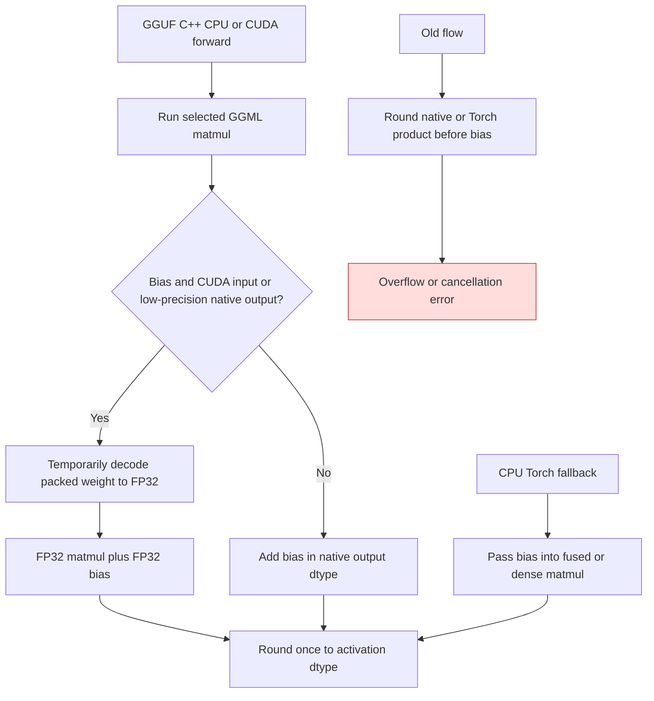

<!-- SPDX-FileCopyrightText: 2026 ModelCloud.ai
SPDX-License-Identifier: Apache-2.0 -->

# GGUF C++ bias epilogue

The CPU and CUDA GGML backends return a quantized matrix product to
`GGUFCppKernel` or `GGUFCudaKernel`. A stored FP32 bias must be added before a
low-precision activation result is rounded. This flow was corrected in the
GGUF C++ bias epilogue PR. On CUDA, the GGML output may be FP32 even when
its product has already lost precision or overflowed. The output dtype
alone therefore cannot establish that adding bias to the native result is
accurate.

| Path | Before | After |
| --- | --- | --- |
| CPU GGML FP32 output | Converted product to FP16/BF16 before adding bias | Adds original bias in FP32, then rounds output once |
| GGML low-precision output | Added bias to an already rounded product | Recomputes this biased case with a temporary FP32 decoded weight |
| CUDA GGML FP32 output | Trusted the FP32 container even when its product had overflow or finite error | Recomputes biased products from the packed weight in FP32 before adding bias |
| CPU Torch fallback | Called fused/dense matmul without bias, then added it after rounding | Passes bias into the existing wide epilogue |
| CPU autotuning | Timed the product without bias | Times the complete biased path, including rare fallback |

The packed Q8_0 regression checks a 100000 product canceled by a -100000 FP32
bias against an independent FP64 decode and matmul. It covers GGML FP32 and
low-precision outputs and the CPU Torch fallback. The decoded FP32 weight is
temporary; the module retains only packed checkpoint buffers.

The CUDA regression also checks a finite 50000 product that GGML rounded to
49984, and the 100000 case with FP16, BF16, and FP32 activations. Biased CUDA
forwards still execute the selected GGML plan, then use a temporary FP32
decoded weight and FP32 matmul for the bias epilogue. This costs an extra
`4 × in_features × out_features` bytes of transient weight storage per call;
no expanded weight survives the forward. Unbiased CUDA forwards keep the
native result.

On an RTX 4090 with PyTorch 2.15.0+cu132, the independent FP64 oracle for
Q8_0 at 1×32×1 gave zero for all four CUDA cases (FP16 activations 500 and
1000, BF16 1000, FP32 1000). The corrected outputs were exactly zero. Before
the fix, the corresponding FP16 outputs were -16 and `inf`, while the FP32
output was 12.5. With a synthetic FP16 Q8_0 1×1024×1024 layer, five
interleaved rounds of ten synchronized forwards measured median latencies of
0.050 ms before and 0.118 ms after the fix. The packed weight occupied
1,114,112 bytes; each corrected biased forward used a transient 4,194,304-byte
FP32 weight and retained zero dense-weight bytes afterward.
