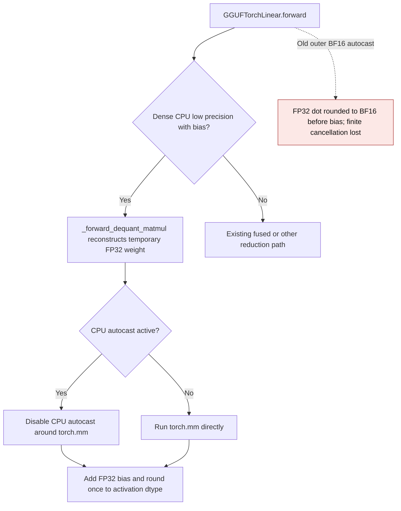
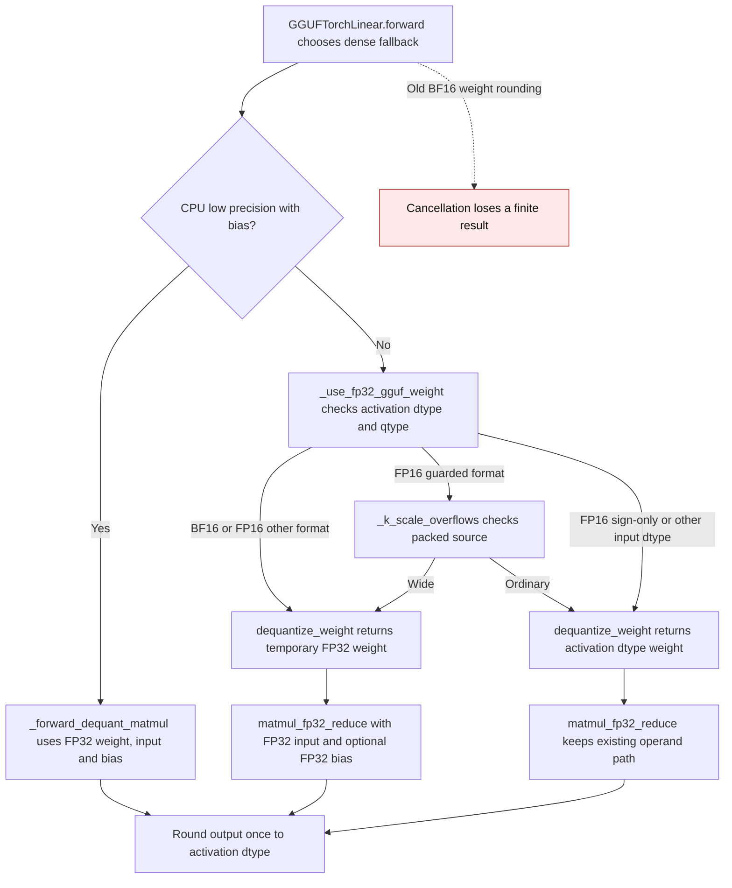
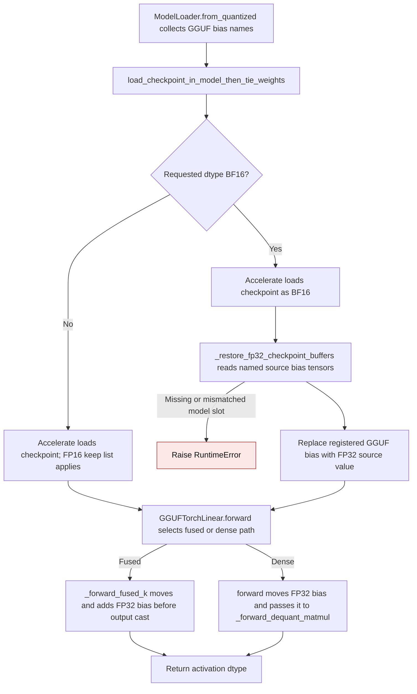

# GGUF dense fallback precision

`GGUFTorchLinear._forward_dequant_matmul` materializes a temporary dense
weight for the current matmul. BF16 activations can be represented exactly in
FP32, while decoding each weight into BF16 before a signed reduction can erase
small, finite differences. The dense fallback therefore decodes every GGUF
format into FP32 for BF16 inputs. CPU FP16/BF16 calls with bias also multiply
and add in FP32 before rounding once to the activation dtype. The FP16 K-quant
overflow guard remains selective for other calls. FP16 sign-only formats keep
their ordinary path; formats with established packed bounds select FP32 only
when needed, and the other formats use FP32 conservatively to preserve finite
dot products.

## CPU autocast and cancelling bias

The CPU dense GGUF Torch path uses FP32 operands for low-precision activations
with bias. An outer BF16 autocast context can still narrow its `torch.mm`
result to BF16 before the FP32 bias is added. An FP16 Q8_0 input with a 100000
dot and a -100000 FP32 bias then returns -160 instead of zero.
`_forward_dequant_matmul` temporarily disables CPU autocast around the FP32
matmul only when autocast is active, then adds the FP32 bias and rounds the
result once. `_forward_fused_k` already keeps this case wide when selected and
is unchanged.

| Mechanism | Before | After |
| --- | --- | --- |
| Dense CPU reduction | `gguf.py:1715-1716` called `torch.mm` under the caller's autocast context | Disable CPU autocast around FP32 `torch.mm` only when autocast is active |
| Fused CPU reduction | `_forward_fused_k` already kept this test case wide when explicitly selected | Unchanged; tested as a control |
| Inference storage | Only packed GGUF bytes survived each forward | The same packed bytes survive; temporary FP32 weight and chunks are released |

An independent FP64 and FP32 Q8_0 oracle gives exactly zero for the FP16
100000 + (-100000) case. On Torch 2.16.0.dev20261102+cu130, public dense CPU
forward returned -160 under BF16 autocast before this correction and zero
after it; normal and forced fused execution returned zero in both versions.
The tests repeat each forward, check FP16/BF16 output dtype and values, and
inspect packed buffers and module state for retained expanded tensors. The
separate llama.cpp backend uses its own reduction and bias epilogue; this
change does not alter it.
This correction was introduced in
[PR #3743](https://github.com/ModelCloud/GPTQModel/pull/3743).

For the 1 × 32 Q8_0 case, the main temporary payloads are a 128-byte FP32
weight, a 128-byte promoted activation, and a four-byte FP32 dot. No new
persistent tensor is installed. A paired CPU benchmark used one Torch thread,
100 warmups per path, and the median of five alternating batches of 500 public
forwards. Timings include dequantization and the Python call:

| Outer BF16 autocast | Before | After | Output before → after |
| --- | ---: | ---: | ---: |
| Disabled | 29.84 µs | 30.59 µs | 0 → 0 |
| Enabled | 32.25 µs | 35.47 µs | -160 → 0 |

## FP32 GGUF bias across checkpoint load and forward

PR #3727 keeps an FP32 GGUF checkpoint bias through BF16 model loading and
through `GGUFTorchLinear.forward`. Accelerate's `keep_in_fp32_modules` handles
FP16 model loads, but its BF16 path narrows every floating tensor. The loader
therefore names only GGUF bias buffers for a second, selective read of their
original checkpoint values. Single-file and indexed safetensors read only the
named tensors; legacy PyTorch shards use `torch.load` with memory mapping where
available. The restored bias remains a registered FP32 buffer on its assigned
device. No dense weight or expanded cache is retained.

| Mechanism | Before | After |
| --- | --- | --- |
| BF16 checkpoint load | `models/loader.py:2351-2364` passed a keep list that Accelerate ignores for BF16 | `utils/model.py:_restore_fp32_checkpoint_buffers` reads GGUF bias values from the checkpoint after loading |
| Checkpoint source selection | A second read could choose a different whole-file format in a directory or silently miss an indexed bias | The restoration read follows Accelerate's file preference and raises if any requested bias is absent |
| Dense forward bias | `nn_modules/qlinear/gguf.py:1913-1916` cast FP32 bias to the activation dtype before `_forward_dequant_matmul` | `GGUFTorchLinear.forward` moves bias across devices without narrowing it, then rounds the output once |
| Packed weight storage | GGUF packed bytes persisted; dense fallback weight was temporary | The same packed bytes persist and the temporary dense weight is released after each forward |

The independent FP64 Q8_0 oracle uses a 1 × 32 activation and one output.
For FP16, a 100000 dot and -100000 FP32 bias should return zero; before this
change the public dense forward returned `-inf`. For BF16, a 99840 dot and
-100000 FP32 bias should return -160; before this change it returned zero.
Both outputs now match the oracle exactly, including after single-file,
indexed-shard and PyTorch checkpoint reloads, and after a safetensors key
remap. The focused CPU suite passed 11 tests on
Torch 2.16.0.dev20261102+cu130; CUDA, ROCm and llama.cpp paths were not run
on that host. PR #3728 already widened the CPU dense reduction; this PR leaves
that arithmetic and CPU autocast handling untouched. Passing the original FP32
bias through public `forward` also removes a pre-dispatch narrowing that
affected #3728's public path. Other cancellation and autocast cases belong in
a separate follow-up PR.

| Mechanism | Before | After |
| --- | --- | --- |
| BF16 dense fallback | `gguf.py:1687-1701` used the FP32 path only for Q4_K/Q5_K/Q6_K; other formats fell through to BF16 decoded weights | `_forward_dequant_matmul` requests FP32 weight and multiplies FP32 activations for every GGUF format |
| FP16 K-quant range | `gguf.py:1687-1699` used a packed range guard for Q4_K/Q5_K/Q6_K | The same selective guard remains in place |
| Other FP16 formats | `gguf.py:1687-1703` sent formats outside five guarded qtypes to the narrow path even when their decoded weights exceeded FP16 | `_use_fp32_gguf_weight` retains sign-only FP16, extends packed bounds to Q2_0/Q8_K, and keeps other formats wide |
| Inference storage | A temporary dense weight was released after the current matmul | The FP32 temporary is also released; no expanded weight cache is installed |

Independent NumPy GGUF decoders and FP64 Torch matmuls on an NVIDIA GB10 show
the old BF16 dense fallback returned `0` for finite outputs of `1` (Q1_0),
`28` (Q4_0), and `28` (Q8_0). The corrected path matches those references.
The regression suite covers one and eight rows, optional bias, output dtype,
repeated forwards, input gradients, and the absence of a persistent expanded weight. These
formats use sign-only, nibble, and signed-byte packed representations,
respectively. The [packed scale overflow cache](gguf-k-scale-overflow-cache.md)
documents FP16 operand-width selection and the selective guards.

On the GB10 with K=N=1024 and one resident BF16 row, five warmups and the
median of seven groups of 20 synchronized wall-clock forwards measured:

| Format | Before | After | Peak allocator delta before → after |
| --- | ---: | ---: | ---: |
| Q1_0 | 0.1447 ms | 0.1460 ms | 35,655,680 → 37,756,928 bytes |
| Q4_0 | 0.1656 ms | 0.1679 ms | 35,655,680 → 37,756,928 bytes |
| Q8_0 | 0.1270 ms | 0.1283 ms | 35,655,680 → 37,756,928 bytes |

The additional FP32 weight is temporary for the current matmul. The test
checks that no expanded weight remains in module state after repeated
inference forwards.

This dense fallback correction was introduced in
[PR #3671](https://github.com/ModelCloud/GPTQModel/pull/3671).
