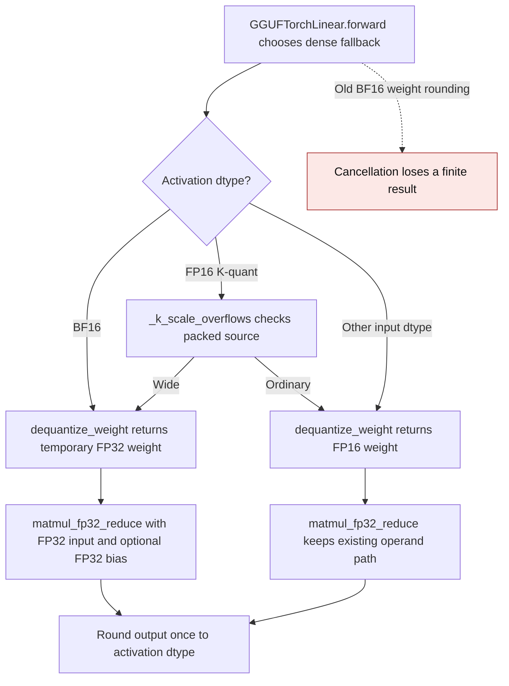

# GGUF dense fallback precision

`GGUFTorchLinear._forward_dequant_matmul` materializes a temporary dense
weight for the current matmul. BF16 activations can be represented exactly in
FP32, while decoding each weight into BF16 before a signed reduction can erase
small, finite differences. The dense fallback therefore decodes every GGUF
format into FP32 for BF16 inputs, performs the matmul and optional bias in
FP32, and rounds the output once to BF16. The FP16 K-quant overflow guard
remains selective; ordinary FP16 paths are unchanged.

| Mechanism | Before | After |
| --- | --- | --- |
| BF16 dense fallback | `gguf.py:1687-1701` used the FP32 path only for Q4_K/Q5_K/Q6_K; other formats fell through to BF16 decoded weights | `_forward_dequant_matmul` requests FP32 weight and multiplies FP32 activations for every GGUF format |
| FP16 K-quant range | `gguf.py:1687-1699` used a packed range guard for Q4_K/Q5_K/Q6_K | The same selective guard remains in place |
| Inference storage | A temporary dense weight was released after the current matmul | The FP32 temporary is also released; no expanded weight cache is installed |

Independent NumPy GGUF decoders and FP64 Torch matmuls on an NVIDIA GB10 show
the old BF16 dense fallback returned `0` for finite outputs of `1` (Q1_0),
`28` (Q4_0), and `28` (Q8_0). The corrected path matches those references.
The regression suite covers one and eight rows, optional bias, output dtype,
repeated forwards, input gradients, and the absence of a persistent expanded weight. These
formats use sign-only, nibble, and signed-byte packed representations,
respectively. The [K-scale overflow cache](gguf-k-scale-overflow-cache.md)
documents the existing selective FP16 range guard.

On the GB10 with K=N=1024 and one resident BF16 row, five warmups and the
median of seven groups of 20 synchronized wall-clock forwards measured:

| Format | Before | After | Peak allocator delta before → after |
| --- | ---: | ---: | ---: |
| Q1_0 | 0.1447 ms | 0.1460 ms | 35,655,680 → 37,756,928 bytes |
| Q4_0 | 0.1656 ms | 0.1679 ms | 35,655,680 → 37,756,928 bytes |
| Q8_0 | 0.1270 ms | 0.1283 ms | 35,655,680 → 37,756,928 bytes |

The additional FP32 weight is temporary for the current matmul. The test
checks that no expanded weight remains in module state after repeated
inference forwards.

This dense fallback correction was introduced in
[PR #3671](https://github.com/ModelCloud/GPTQModel/pull/3671).
