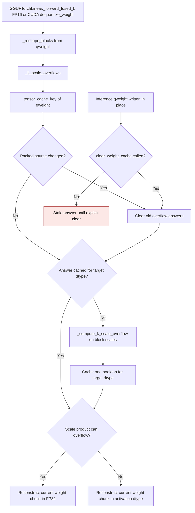
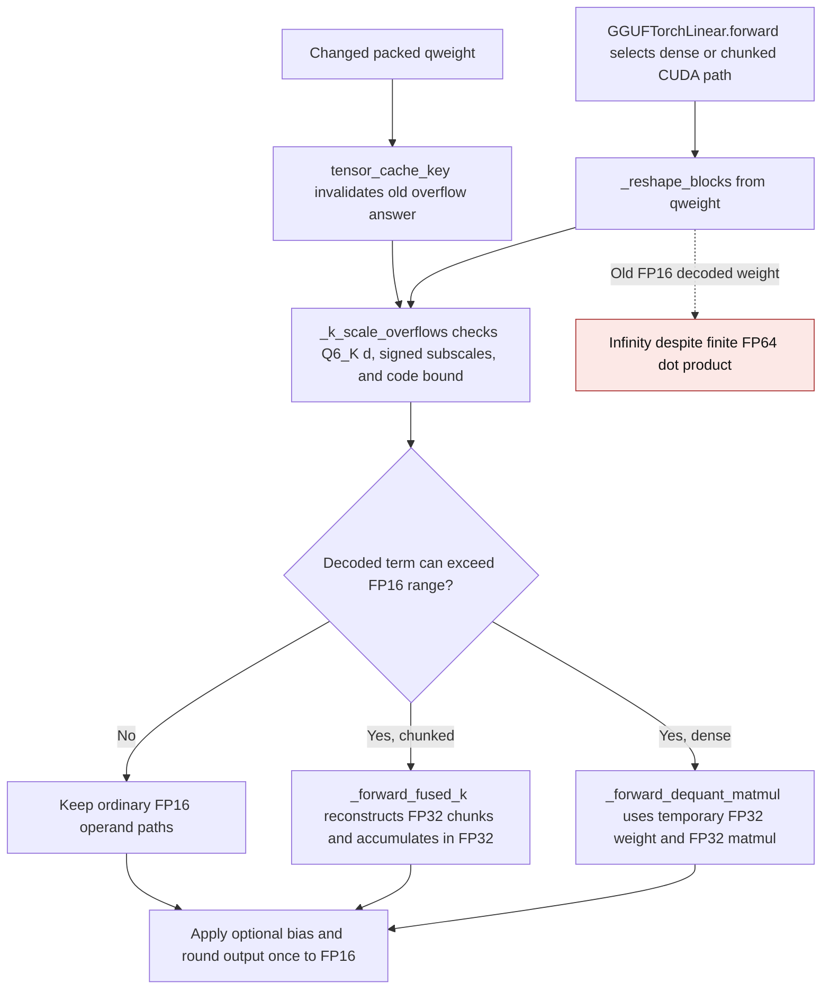

# GGUF K-scale overflow cache

Q4_K and Q5_K reconstruction can multiply a packed scale by a code large
enough to exceed FP16 range, even when the final weight is finite after
subtracting its minimum. `GGUFTorchLinear` checks the packed block scales and
uses FP32 reconstruction only when that range condition holds. The check is
cached per target dtype and packed weight so repeated CUDA forwards avoid
rescanning all block scales.
The flow below covers callers that consult this guard. CPU and BF16 fused
forwards already reconstruct in FP32 without querying it.

`tensor_cache_key` reads the packed source's identity, version when present,
storage pointer, device, dtype, shape, and inference status. A normal in-place
write changes the version and drops the old answers. Inference tensors have no
version counter, so the same key can be read without raising; callers that
mutate such weights inside `torch.inference_mode()` must call
`clear_weight_cache()`. State-dict loads, packing, and device moves clear the
cache through the shared quantized-linear lifecycle. One source can retain at
most one boolean per queried output dtype; no dequantized weight is cached.

| Mechanism | Before | After |
| --- | --- | --- |
| Cache key | `gguf.py:1698-1705` read `_version` from a temporary block view and raised for inference tensors | `_k_scale_overflows` reads `tensor_cache_key(qweight)`, which supports inference tensors |
| Weight update | Every new version left its old boolean in the dictionary | A changed source key clears prior answers before computing the new value |
| Explicit clear | `clear_weight_cache` emptied the dictionary | It also resets the tracked source key |

The old line references are from main before this correction. GPU tests run
Q4_K and Q5_K fused forwards with inference tensors against a separate NumPy
GGUF decoder and FP64 Torch dot product. They also alternate low and high
packed scales through twelve versioned writes, check that the dictionary stays
bounded, and cover state loading, device moves, and explicit clear.

On an NVIDIA GB10 (SM 12.1), PyTorch 2.15.0+cu132, the Q4_K fused path at
K=N=1024 retained one boolean and zero expanded-weight bytes. With resident
FP16 inputs, five warmups, and the median of seven sets of 20 CUDA-event
timed forwards, the old direct-version and new shared-key checks measured:

| Rows | Direct-version check | Shared-key check | Peak allocator delta |
| --- | ---: | ---: | ---: |
| 1 | 0.3218 ms | 0.3262 ms | 34.008 MiB |
| 16 | 0.3230 ms | 0.3277 ms | 34.125 MiB |

The peak includes a temporary dequantized chunk and CUDA library scratch;
the new key does not change that allocation or retain it after the forward.

This cache contract was corrected in
[PR #3666](https://github.com/ModelCloud/GPTQModel/pull/3666).

## Q6_K finite-output guard

Q6_K multiplies an FP16 block scale `d`, a signed 8-bit subscale, and a signed
code in `[-32, 31]`. A decoded weight can exceed FP16 even when a small FP16
activation produces a finite dot product. `GGUFTorchLinear` now uses the same
packed-source keyed boolean cache for a Q6_K bound: the absolute block scale
times the largest absolute signed subscale times `32`. The bound is computed
from packed metadata, without materializing a full weight.

| Mechanism | Before | After |
| --- | --- | --- |
| Dense fallback | `gguf.py:1684-1688` dequantized Q6_K into the activation dtype before matmul | `_forward_dequant_matmul` keeps the temporary Q6_K weight and matmul in FP32 only when the bound requires it |
| Chunked CUDA path | `gguf.py:1750-1759` checked the range only for Q4_K/Q5_K | `_forward_fused_k` checks Q6_K too and uses FP32 chunks for wide weights |
| Cached decision | `gguf.py:1716-1736` only computed the Q4_K/Q5_K bound | `_compute_k_scale_overflow` includes the Q6_K signed-code bound; the existing source key invalidates it on normal packed-weight writes |

With `d=1000`, subscale `127`, code `1`, and FP16 inputs of `2**-16`, both
old CUDA paths returned infinity. The independent NumPy GGUF decoder and FP64
Torch dot product give `496.09375`, which rounds to `496` in FP16. The GPU
regression covers dense and chunked paths, bias, one/eight rows, signed codes,
repeated forwards, gradient propagation, and packed-weight replacement.
Dense fallback weights are temporary for the current matmul; the chunked path
keeps its bounded tile, and neither path installs an expanded weight cache.

On an NVIDIA GB10 with K=N=1024 and one resident FP16 row, five warmups and
the median of seven groups of 20 synchronized wall-clock forwards measured:

| Path | Ordinary before → after | Wide before → after | New wide peak allocator delta |
| --- | ---: | ---: | ---: |
| Dense fallback | 0.2646 → 0.2750 ms | 0.2637 → 0.2833 ms | 37,756,928 bytes |
| Chunked CUDA | 0.2589 → 0.2641 ms | 0.2583 → 0.2777 ms | 37,756,928 bytes |

The old wide path returned infinity; the new wide path returned finite FP16
`1984` (FP64 reference `1984.375`). The ordinary path returned `1024` in
both versions. The new ordinary peak allocator deltas were 35,655,680 bytes
for dense and 35,659,776 bytes for chunked; the wide path's temporary FP32
operands added about 2.1 MB of peak allocation. No expanded weight survives
the forward.

This guard was extended in
[PR #3670](https://github.com/ModelCloud/GPTQModel/pull/3670).
