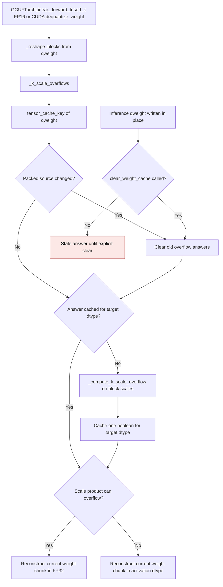

# GGUF K-scale overflow cache

Q4_K and Q5_K reconstruction can multiply a packed scale by a code large
enough to exceed FP16 range, even when the final weight is finite after
subtracting its minimum. `GGUFTorchLinear` checks the packed block scales and
uses FP32 reconstruction only when that range condition holds. The check is
cached per target dtype and packed weight so repeated CUDA forwards avoid
rescanning all block scales.
The flow below covers callers that consult this guard. CPU and BF16 fused
forwards already reconstruct in FP32 without querying it.

`tensor_cache_key` reads the packed source's identity, version when present,
storage pointer, device, dtype, shape, and inference status. A normal in-place
write changes the version and drops the old answers. Inference tensors have no
version counter, so the same key can be read without raising; callers that
mutate such weights inside `torch.inference_mode()` must call
`clear_weight_cache()`. State-dict loads, packing, and device moves clear the
cache through the shared quantized-linear lifecycle. One source can retain at
most one boolean per queried output dtype; no dequantized weight is cached.

| Mechanism | Before | After |
| --- | --- | --- |
| Cache key | `gguf.py:1698-1705` read `_version` from a temporary block view and raised for inference tensors | `_k_scale_overflows` reads `tensor_cache_key(qweight)`, which supports inference tensors |
| Weight update | Every new version left its old boolean in the dictionary | A changed source key clears prior answers before computing the new value |
| Explicit clear | `clear_weight_cache` emptied the dictionary | It also resets the tracked source key |

The old line references are from main before this correction. GPU tests run
Q4_K and Q5_K fused forwards with inference tensors against a separate NumPy
GGUF decoder and FP64 Torch dot product. They also alternate low and high
packed scales through twelve versioned writes, check that the dictionary stays
bounded, and cover state loading, device moves, and explicit clear.

On an NVIDIA GB10 (SM 12.1), PyTorch 2.15.0+cu132, the Q4_K fused path at
K=N=1024 retained one boolean and zero expanded-weight bytes. With resident
FP16 inputs, five warmups, and the median of seven sets of 20 CUDA-event
timed forwards, the old direct-version and new shared-key checks measured:

| Rows | Direct-version check | Shared-key check | Peak allocator delta |
| --- | ---: | ---: | ---: |
| 1 | 0.3218 ms | 0.3262 ms | 34.008 MiB |
| 16 | 0.3230 ms | 0.3277 ms | 34.125 MiB |

The peak includes a temporary dequantized chunk and CUDA library scratch;
the new key does not change that allocation or retain it after the forward.
