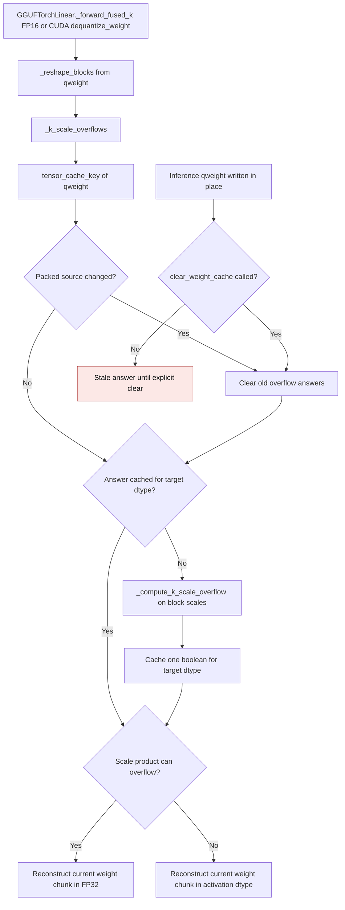
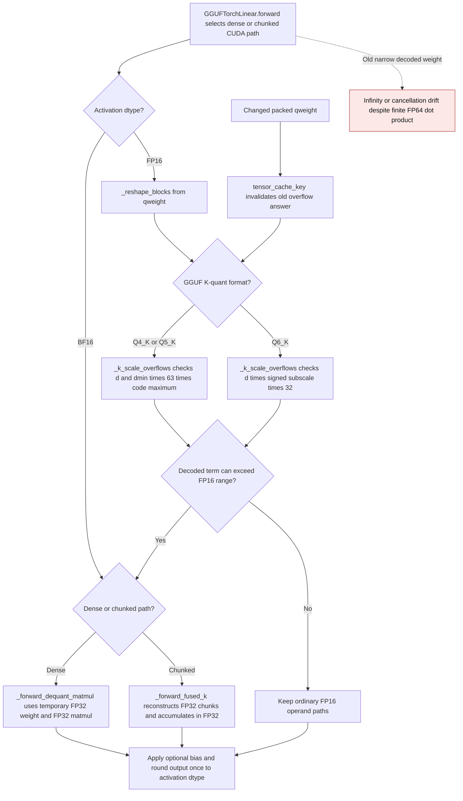
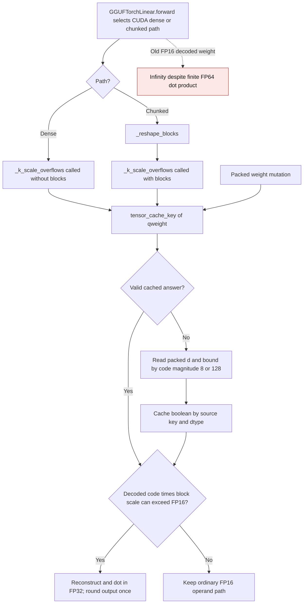
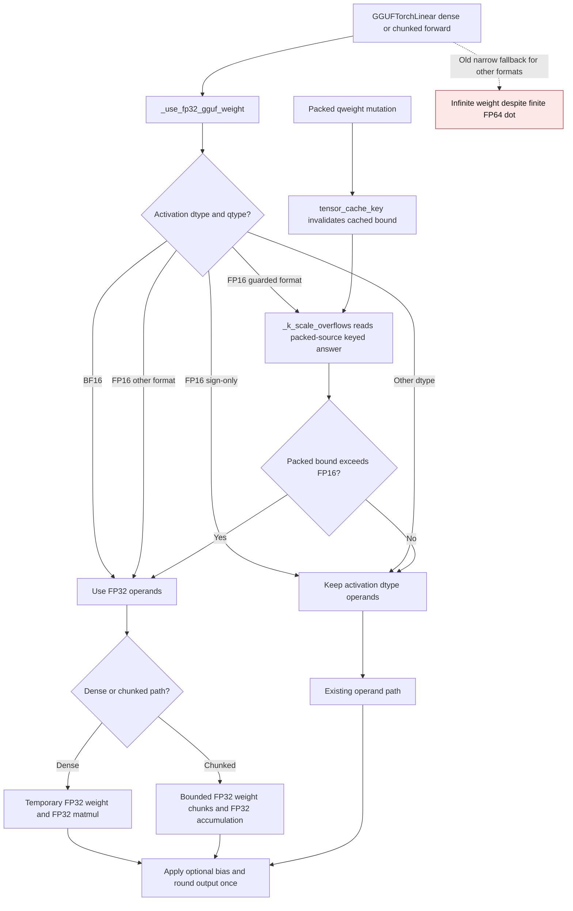

# GGUF packed scale overflow cache

Q4_K and Q5_K reconstruction can multiply a packed scale by a code large
enough to exceed FP16 range, even when the final weight is finite after
subtracting its minimum. `GGUFTorchLinear` checks the packed block scales and
uses FP32 reconstruction only when that range condition holds. The check is
cached per target dtype and packed weight so repeated CUDA forwards avoid
rescanning all block scales.
The flow below covers callers that consult this guard. CPU and BF16 fused
forwards already reconstruct in FP32 without querying it.

`tensor_cache_key` reads the packed source's identity, version when present,
storage pointer, device, dtype, shape, and inference status. A normal in-place
write changes the version and drops the old answers. Inference tensors have no
version counter, so the same key can be read without raising; callers that
mutate such weights inside `torch.inference_mode()` must call
`clear_weight_cache()`. State-dict loads, packing, and device moves clear the
cache through the shared quantized-linear lifecycle. One source can retain at
most one boolean per queried output dtype; no dequantized weight is cached.

| Mechanism | Before | After |
| --- | --- | --- |
| Cache key | `gguf.py:1698-1705` read `_version` from a temporary block view and raised for inference tensors | `_k_scale_overflows` reads `tensor_cache_key(qweight)`, which supports inference tensors |
| Weight update | Every new version left its old boolean in the dictionary | A changed source key clears prior answers before computing the new value |
| Explicit clear | `clear_weight_cache` emptied the dictionary | It also resets the tracked source key |

The old line references are from main before this correction. GPU tests run
Q4_K and Q5_K fused forwards with inference tensors against a separate NumPy
GGUF decoder and FP64 Torch dot product. They also alternate low and high
packed scales through twelve versioned writes, check that the dictionary stays
bounded, and cover state loading, device moves, and explicit clear.

On an NVIDIA GB10 (SM 12.1), PyTorch 2.15.0+cu132, the Q4_K fused path at
K=N=1024 retained one boolean and zero expanded-weight bytes. With resident
FP16 inputs, five warmups, and the median of seven sets of 20 CUDA-event
timed forwards, the old direct-version and new shared-key checks measured:

| Rows | Direct-version check | Shared-key check | Peak allocator delta |
| --- | ---: | ---: | ---: |
| 1 | 0.3218 ms | 0.3262 ms | 34.008 MiB |
| 16 | 0.3230 ms | 0.3277 ms | 34.125 MiB |

The peak includes a temporary dequantized chunk and CUDA library scratch;
the new key does not change that allocation or retain it after the forward.

This cache contract was corrected in
[PR #3666](https://github.com/ModelCloud/GPTQModel/pull/3666).

## Finite-output CUDA fallback for K-quants

Q6_K multiplies an FP16 block scale `d`, a signed 8-bit subscale, and a signed
code in `[-32, 31]`. A decoded weight can exceed FP16 even when a small FP16
activation produces a finite dot product. `GGUFTorchLinear` now uses the same
packed-source keyed boolean cache for a Q6_K bound: the absolute block scale
times the largest absolute signed subscale times `32`. The bound is computed
from packed metadata, without materializing a full weight.

Q4_K and Q5_K have the same finite-output case when a completed decoded
weight exceeds FP16. Their existing bound now also selects FP32 arithmetic
for `_forward_dequant_matmul`; the chunked path was already protected.
BF16 dense fallback is always kept wide for all three K-quants because
rounding individual reconstructed weights before cancellation can exceed the
2e-3 inference tolerance. The BF16 chunked path was already wide.

| Mechanism | Before | After |
| --- | --- | --- |
| Dense fallback | `gguf.py:1684-1688` dequantized Q4_K/Q5_K/Q6_K into the activation dtype before matmul | `_forward_dequant_matmul` keeps the temporary weight and matmul in FP32 for BF16, and for FP16 when the bound requires it |
| Chunked CUDA path | `gguf.py:1750-1759` checked the range only for Q4_K/Q5_K | `_forward_fused_k` checks Q6_K too and uses FP32 chunks for wide weights |
| Cached decision | `gguf.py:1716-1736` only computed the Q4_K/Q5_K bound | `_compute_k_scale_overflow` includes the Q6_K signed-code bound; the existing source key invalidates it on normal packed-weight writes |

With `d=1000`, subscale `127`, code `1`, and FP16 inputs of `2**-16`, both
old CUDA paths returned infinity. The independent NumPy GGUF decoder and FP64
Torch dot product give `496.09375`, which rounds to `496` in FP16. The GPU
regression covers dense and chunked paths, bias, one/eight rows, signed codes,
repeated forwards, gradient propagation, and packed-weight replacement.
Dense fallback weights are temporary for the current matmul; the chunked path
keeps its bounded tile, and neither path installs an expanded weight cache.
For Q4_K/Q5_K with `d=1000` and maximum code/scale, the old dense CUDA path
also returned infinity. Their FP64 references for one FP16 row are
`1845.703125` and `3814.453125`; the corrected visible FP16 outputs are
`1846` and `3814`. GPU tests cover both formats, bias, one/eight rows,
repeatability, and the absence of a persistent expanded weight.
With BF16 activations, the old dense path returned `59` for Q4_K/Q5_K
cancellation cases whose FP64 reference is `58.5703125` (visible BF16 `58.5`).
For alternating Q6_K signed subscales, it returned `512` for an FP64
reference of `500`. The corrected dense path matches the rounded oracles.

For ordinary BF16 dense fallback on the same GB10 at K=N=1024 and one
resident row, five warmups and the median of seven groups of 20 synchronized
wall-clock forwards measured:

| Format | Before | After | Peak allocator delta before → after |
| --- | ---: | ---: | ---: |
| Q4_K | 0.3603 ms | 0.3653 ms | 35,655,680 → 37,756,928 bytes |
| Q5_K | 0.4236 ms | 0.4294 ms | 35,655,680 → 37,756,928 bytes |
| Q6_K | 0.2710 ms | 0.2738 ms | 35,655,680 → 37,756,928 bytes |

On an NVIDIA GB10 with K=N=1024 and one resident FP16 row, five warmups and
the median of seven groups of 20 synchronized wall-clock forwards measured:

| Path | Ordinary before → after | Wide before → after | New wide peak allocator delta |
| --- | ---: | ---: | ---: |
| Dense fallback | 0.2646 → 0.2750 ms | 0.2637 → 0.2833 ms | 37,756,928 bytes |
| Chunked CUDA | 0.2589 → 0.2641 ms | 0.2583 → 0.2777 ms | 37,756,928 bytes |

The old wide path returned infinity; the new wide path returned finite FP16
`1984` (FP64 reference `1984.375`). The ordinary path returned `1024` in
both versions. The new ordinary peak allocator deltas were 35,655,680 bytes
for dense and 35,659,776 bytes for chunked; the wide path's temporary FP32
operands added about 2.1 MB of peak allocation. No expanded weight survives
the forward.

This guard was extended in
[PR #3670](https://github.com/ModelCloud/GPTQModel/pull/3670).

## Q4_0 and Q8_0 finite-output range

Q4_0 and Q8_0 decode a signed integer code multiplied by an FP16 block scale.
Their largest code magnitudes are `8` and `128` respectively. The decoded
weight can exceed FP16 even when a small FP16 activation yields a finite dot.
The existing packed-source keyed overflow answer now covers these formats.
The historical `_k_scale_overflows` name is retained for callers, but its
bound uses each format's code range. The dense path checks a valid cached
answer before reshaping packed blocks; it only scans block scales on a miss.

| Mechanism | Before | After |
| --- | --- | --- |
| Dense fallback | `gguf.py:1687-1703` selected FP32 for BF16 and FP16 K-quants only | `_forward_dequant_matmul` checks Q4_0/Q8_0 packed scales too, then uses a temporary FP32 weight only when the bound requires it |
| Chunked CUDA | `gguf.py:1773-1780` selected FP32 for Q4_K/Q5_K/Q6_K only | `_forward_fused_k` includes Q4_0/Q8_0 and reconstructs bounded FP32 chunks for wide weights |
| Cached decision | `gguf.py:1731-1759` computed only K-quant bounds | `_compute_k_scale_overflow` also bounds `|d| × 8` or `|d| × 128`; `_k_scale_overflows` skips `_reshape_blocks` on a dense cache hit |

On the NVIDIA GB10, the old Q4_0 and Q8_0 dense and chunked CUDA paths
returned infinity for independent NumPy-decoded FP64 dot products of `35000`
and `31750` respectively. The corrected visible FP16 outputs are `35008` and
`31744`. GPU tests also cover the negative code extrema, one/eight rows,
bias, repeated forwards, packed-weight replacement, and the absence of a
persistent expanded weight. Ordinary weights retain FP16 operands.

For K=N=1024 and one resident FP16 row on the same GB10, five warmups and
the median of seven groups of 20 synchronized wall-clock forwards measured:

| Format | Path | Ordinary before → after | Wide before → after | New wide peak allocator delta |
| --- | --- | ---: | ---: | ---: |
| Q4_0 | Dense | 0.1592 → 0.1666 ms | 0.1573 → 0.1782 ms | 37,756,928 bytes |
| Q4_0 | Chunked | 0.1512 → 0.1568 ms | 0.1503 → 0.1716 ms | 37,756,928 bytes |
| Q8_0 | Dense | 0.1188 → 0.1270 ms | 0.1184 → 0.1361 ms | 37,756,928 bytes |
| Q8_0 | Chunked | 0.1123 → 0.1172 ms | 0.1125 → 0.1344 ms | 37,756,928 bytes |

The old wide outputs were infinity; the new wide outputs were finite FP16
`35008` for Q4_0 and `31744` for Q8_0. Ordinary outputs stayed `1024`.
Ordinary peak allocator deltas were 35,655,680 bytes for dense and 35,659,776
bytes for chunked. The extra wide FP32 weight or chunk is temporary and is
not retained after inference.

The Q4_0/Q8_0 range guard was added in
[PR #3672](https://github.com/ModelCloud/GPTQModel/pull/3672).

## FP16 operand width for other GGUF formats

`_use_fp32_gguf_weight` now makes one decision for the dense and chunked
Torch inference paths. BF16 stays wide for accuracy. FP16 sign-only Q1_0
and Q1_0_g128 can keep FP16 weights because a finite stored FP16 scale is
only multiplied by a sign. Q2_0 and Q8_K join the packed-source cache with
bounds `|d| × 2` and `|d| × 128`. Q4_0, Q8_0, Q4_K, Q5_K, and Q6_K retain
their existing selective bounds. The remaining formats use FP32 operands
conservatively because their scale/minimum or codebook math has not been
reduced to a cheap packed bound. This choice never stores an expanded weight
between inference operations.

| Mechanism | Before | After |
| --- | --- | --- |
| Dense selection | `gguf.py:1687-1703` used FP32 for BF16 and five FP16 formats only | `_use_fp32_gguf_weight` retains the fast sign-only and guarded formats; other FP16 formats use FP32 |
| Chunked selection | `gguf.py:1794-1801` guarded only Q4_0/Q8_0/Q4_K/Q5_K/Q6_K | `_forward_fused_k` shares the same width decision and keeps dequantization bounded |
| Packed bound | `gguf.py:1743-1781` lacked Q2_0/Q8_K bounds | `_compute_k_scale_overflow` checks FP16 Q2_0 `d` times 2 and FP32 Q8_K `d` times 128, keyed by packed source and dtype |

On the NVIDIA GB10, Q2_0 with a large FP16 scale, Q8_K with a large FP32
scale, and MXFP4 with E8M0 scale `32768` and FP4 code `12` all returned
infinity on the previous dense and chunked CUDA paths. Independent NumPy
decoders with FP64 Torch dots give `49984`, `31750`, and `24576` respectively;
the corrected visible FP16 outputs are `49984`, `31744`, and `24576`. GPU
tests cover both paths, one/eight rows, bias, positive/negative signed codes,
ordinary-to-wide packed-weight replacement, and the absence of a persistent
expanded weight. MXFP4 exercises the conservative branch without a cached
bound; Q2_0 and Q8_K exercise the new packed bounds.

At K=N=1024 with one resident FP16 row on the same GB10, five warmups and
the median of seven groups of 20 synchronized wall-clock forwards measured:

| Format | Path | Ordinary before → after | Wide before → after | New wide peak allocator delta |
| --- | --- | ---: | ---: | ---: |
| Q2_0 | Dense | 6.0397 → 6.1001 ms | 6.0099 → 4.6729 ms | 37,756,928 bytes |
| Q2_0 | Chunked | 6.0363 → 6.1493 ms | 6.0082 → 4.7878 ms | 37,756,928 bytes |
| Q8_K | Dense | 2.1418 → 2.0455 ms | 2.1188 → 0.9404 ms | 37,756,928 bytes |
| Q8_K | Chunked | 2.2091 → 2.2196 ms | 2.3622 → 1.0306 ms | 37,756,928 bytes |
| MXFP4 | Dense | 10.6935 → 9.1673 ms | 10.6425 → 9.3491 ms | 37,756,928 bytes |
| MXFP4 | Chunked | 10.7332 → 9.1873 ms | 10.6710 → 9.1990 ms | 37,756,928 bytes |

Old wide outputs were infinity; new wide outputs are finite. Q2_0/Q8_K
ordinary peak allocator deltas remain 35,655,680 bytes for dense and
35,659,776 bytes for chunked. MXFP4 uses temporary FP32 operands even for
ordinary weights, adding about 2.1 MB to peak allocation; no expanded
weight remains after inference.

This width selection was extended in
[PR #3673](https://github.com/ModelCloud/GPTQModel/pull/3673).
