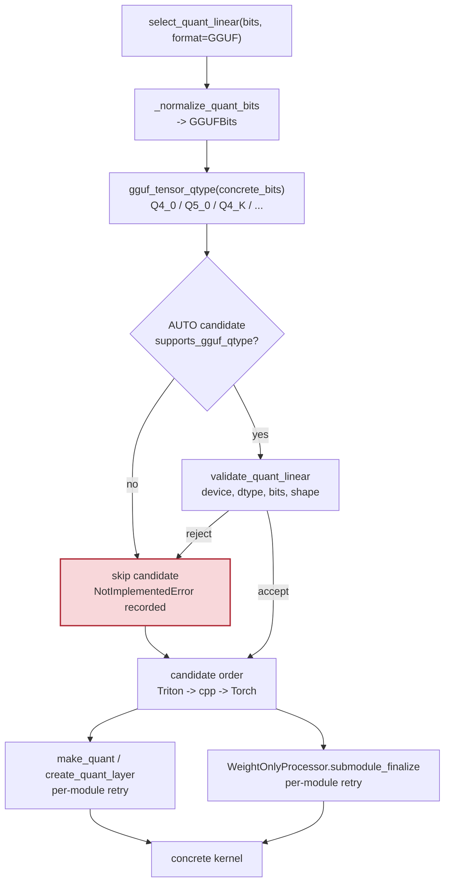
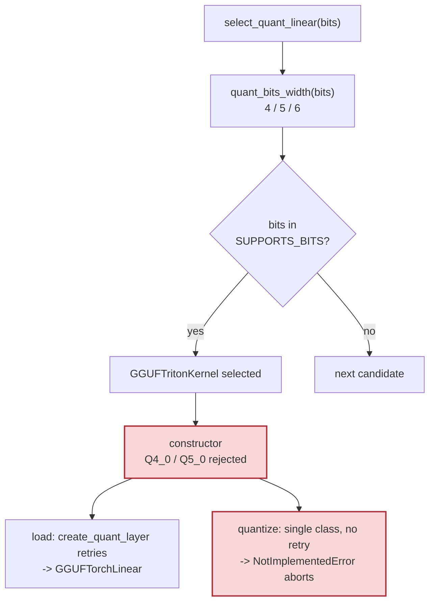

# GGUF kernel selection and fallback

GGUF quantization and loading share one kernel selector,
`select_quant_linear`. The selector orders the AUTO candidates by each kernel's
`SUPPORTS_FORMATS` priority:

| Priority | Kernel | Layouts |
| --- | --- | --- |
| 45 | `GGUFTritonKernel` | Q1_0, Q1_0_g128, Q4_K, Q5_K, Q6_K |
| 35 | `GGUFCudaKernel` | CUDA ggml bridge formats |
| 25 | `GGUFCppKernel` | CPU ggml bridge formats |
| 15 | `GGUFTorchLinear` | every `GGUFBits` layout |

The native C++ engines are the fast path but not the exact one: `ggml_mul_mat`
quantizes activations to Q8_0/Q8_1/Q8_K, so `GGUF_CPP` carries a
5e-3..1.5e-2 relative error against an FP64 dequantized-weight oracle even for
FP32 activations. That loss, its bound, and the static native-vs-exact path rule
are documented in
[GGUF C++ activation quantization](gguf-cpp-activation-quantization.md);
`GGUF_TORCH` is the exact engine. The C++ engines stay ahead of `GGUF_TORCH` in
AUTO because they are 40-97x faster per layer on CPU.

A GGUF **bit width is not a layout**. Width 4 is Q4_0 by default, but Q4_K and
IQ4_NL are also 4-bit; width 5 is Q5_K_M by default but Q5_0 is also 5-bit.
Selection therefore resolves the concrete `GGUFBits` spec to a ggml tensor type
(`gguf_tensor_qtype`) and asks each candidate
`supports_gguf_qtype(bits)`. `GGUFTritonKernel` declares
`SUPPORTS_GGUF_QTYPES = {Q1_0, Q1_0_g128, Q4_K, Q5_K, Q6_K}`; every other GGUF
kernel accepts any layout.

Before this change the selector compared only the integer width, so Q4_0 and
Q5_0 selected `GGUFTritonKernel`. Its constructor rejected them with
`NotImplementedError`. The load path survived because `create_quant_layer`
retried the remaining candidates, but the weight-only finalize path passed one
class and aborted on the first module.

## New selection flow

## Old flow

## Before and after

| Mechanism | Before | After |
| --- | --- | --- |
| AUTO layout match | integer width only, `gptqmodel/utils/importer.py::select_quant_linear` | `supports_gguf_qtype(concrete_bits)`, `gptqmodel/nn_modules/qlinear/__init__.py::BaseQuantLinear.supports_gguf_qtype` |
| Triton layout contract | constructor-only set literal, `gptqmodel/nn_modules/qlinear/gguf_triton.py::GGUFTritonKernel.__init__` | class declaration `SUPPORTS_GGUF_QTYPES`, checked before construction |
| Quantize fallback | one class, no retry, `gptqmodel/looper/weight_only_processor.py::submodule_finalize` | retries the AUTO candidate list on `NotImplementedError`, same as `gptqmodel/utils/model.py::create_quant_layer` |
| Explicit backend | constructor error only | explicit selection of an incompatible GGUF kernel fails during selection |
| Q5_0 torch packing | `NotImplementedError` (needs `llama-cpp-python`) | pure NumPy pack/dequant in `gptqmodel/nn_modules/qlinear/gguf.py` |

The fallback is only active for an AUTO request
(`model.quantize_backend in {AUTO, AUTO_TRAINABLE}`). An explicit
`BACKEND.GGUF_TRITON` with a non-fused layout keeps failing loudly, matching the
load path.

## Failure contract

| Situation | Before | After |
| --- | --- | --- |
| `GGUFConfig(bits=4)`, AUTO quantize | `GGUFTritonKernel` selected, abort on first module | `GGUFTorchLinear` selected, quantize completes |
| `GGUFConfig(bits=5, format="q_0")`, AUTO | `GGUFTritonKernel` selected, abort | `GGUFTorchLinear` packs Q5_0 |
| Base Q4_K with a dynamic Q4_0 module, AUTO | base kernel selected, abort on the Q4_0 module | base kernel plus per-module Torch fallback |
| Explicit `BACKEND.GGUF_TRITON`, Q4_0 | abort in the constructor | fail during selection with the layout named |

## Validation

- `tests/test_weight_only.py::test_baseqmodel_quantize_allows_direct_gguf_export`
  parametrizes `q4_0` and `q5_0` and asserts the Torch kernel, the packed shape,
  and the per-module `gguf_tensor_qtype`.
- `test_gguf_auto_selection_rejects_triton_for_non_fused_qtype` pins the
  selector without executing a kernel.
- `test_baseqmodel_quantize_gguf_dynamic_qtype_falls_back_to_torch` pins the
  per-module fallback with a Q4_K base and a Q4_0 dynamic module.
- The pure-NumPy Q5_0 packer and dequantizer match `gguf` 0.19.0 bit-for-bit on
  random blocks (pack bytes equal, dequant max error 0).

Measured on RTX 4090 (CUDA) and R9700 gfx1201 (ROCm 10.1): Q4_0 and Q5_0
quantize, save, reload and generate under AUTO. See the introducing PR for the
exact commands and log excerpts.
