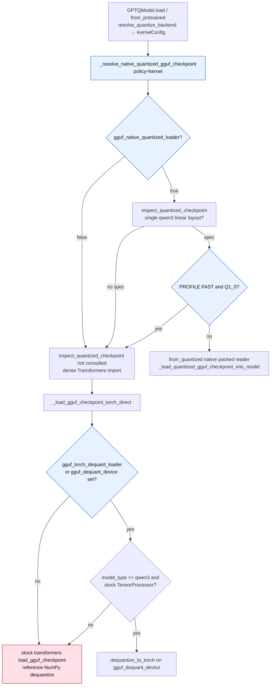

<!-- SPDX-FileCopyrightText: 2026 ModelCloud.ai
SPDX-License-Identifier: Apache-2.0 -->

# GGUF checkpoint load policy

A GGUF checkpoint can reach the model along two loaders, and the dense
Transformers import can dequantize on either the reference NumPy path or
directly into Torch. Which one runs used to be decided at the point of use by
four process-wide `GPTQMODEL_INTERNAL_GGUF_*` variables. Two processes with the
same public call options could then parse the same file differently, place the
temporary dequantized tensor on a different device, and size the transient
chunk differently. This page records the explicit policy that replaced them.

## The policy

Four `KernelConfig` fields own the decision. They are accepted through
`kernel=KernelConfig(...)` (or an equivalent mapping) and through the shared
`RuntimeConfig` adapter; typed backend configurations such as
`GGUFTorchConfig`/`GGUFCPPConfig` tune execution, not checkpoint loading, and
do not expose them.

| Field | Default | Decides |
| --- | --- | --- |
| `gguf_native_quantized_loader` | `True` | Whether `utils/internal_gguf.inspect_quantized_checkpoint` may claim the file and route the load to the native packed reader. |
| `gguf_torch_dequant_loader` | `None` | Whether the dense Transformers import converts each GGUF tensor straight to Torch. `None` follows `gguf_dequant_device`. |
| `gguf_dequant_device` | `None` | Torch device (`cpu`, `cuda`, or `cuda:INDEX`) that conversion targets. `None` keeps the NumPy reference path. |
| `gguf_dequant_chunk_bytes` | `268435456` | Transient-memory budget for one sign-only NumPy conversion chunk. |

`gguf_dequant_device` is a Torch execution device, not a hardware-family
declaration: on a ROCm host the AMD accelerator is addressed through Torch's
`cuda` spelling, as in every other Torch boundary. The device is validated when
the policy is built (`cpu`/`cuda[INDEX]`, non-empty, parseable) and again when
it is resolved. An accelerator this process cannot address raises instead of
silently falling back, because that fallback would change the device and memory
path of the same public call.

## Loader selection

The dense import is reached through an `@lru_cache`d artifact probe and then
through Transformers' process-wide `load_gguf_checkpoint` hook. Because that
hook is installed once per process, a load that carries `gguf_file` installs its
own resolved policy (`configure_kernel(kernel)`) before entering the import, so
the dequant device and loader choice come from that call's arguments rather
than the previous load's. Model construction is already serialized by
`model_load_lock`, so this is not a new ordering contract.

## Mechanism replaced

| Old mechanism | Location (before) | Replacement |
| --- | --- | --- |
| `os.getenv("GPTQMODEL_INTERNAL_GGUF_QUANTIZED_LOADER")` in the loader, and a second copy in `internal_gguf` | `models/loader.py:172-179`, `utils/internal_gguf.py:231-235` | `KernelConfig.gguf_native_quantized_loader`, read once through `resolve_kernel_config(policy)` |
| `os.getenv("GPTQMODEL_INTERNAL_GGUF_TORCH_LOADER")`, falling back to `..._DEQUANT_DEVICE` | `utils/hf.py:106,699-703` | `KernelConfig.gguf_torch_dequant_loader`, `None` following `gguf_dequant_device` |
| `os.getenv("GPTQMODEL_INTERNAL_GGUF_DEQUANT_DEVICE")` with a silent `None` on an unusable target | `utils/internal_gguf.py:281-303` | `KernelConfig.gguf_dequant_device`, validated at construction and resolved or rejected per load |
| `os.getenv("GPTQMODEL_INTERNAL_GGUF_DEQUANT_MAX_BYTES")` with an unvalidated `int()` parse | `utils/internal_gguf.py:304-318` | `KernelConfig.gguf_dequant_chunk_bytes`, range-checked as an integer >= 1 |

The retired names are listed in `gptqmodel.__init__._RETIRED_KERNEL_ENV_VARS`.
They are never read: `warn_retired_kernel_env_vars()` logs one line per set
variable naming its replacement, at import and again at each public load, so a
caller that still exports one learns that the export now has no effect.

## Failure contract

| Situation | Before | After |
| --- | --- | --- |
| `..._DEQUANT_DEVICE=cuda` with no CUDA device | quietly kept the NumPy path | `RuntimeError`: the requested device cannot be addressed |
| `..._DEQUANT_DEVICE=cuda:9` with two devices | quietly kept the NumPy path | `RuntimeError` naming the ordinal and the device count |
| `..._DEQUANT_DEVICE=<typo>` | quietly kept the NumPy path | `ValueError` at `KernelConfig` construction |
| `..._DEQUANT_MAX_BYTES=abc` | fell back to the default budget | `ValueError` at construction (`gguf_dequant_chunk_bytes` must be an integer >= 1) |
| `..._QUANTIZED_LOADER=0` | skipped the native reader | no effect; `gguf_native_quantized_loader=False` is the opt-out |

## Tests

`tests/test_gguf_load_policy_env_removal.py` pins the regressions:

| Test | Invariant |
| --- | --- |
| `test_native_quantized_loader_is_on_by_default_and_ignores_environment` | Every retired variable set at once still resolves the default policy |
| `test_native_quantized_loader_policy_selects_the_parser` | `gguf_native_quantized_loader` alone selects or skips the native spec |
| `test_dequant_device_policy_selects_torch_path_and_environment_does_not` | `gguf_dequant_device` selects the Torch conversion; the retired variable does not |
| `test_dequant_chunk_bytes_policy_controls_the_chunk_size` | `gguf_dequant_chunk_bytes` sets the chunk rows; the retired byte budget cannot override it |
| `test_torch_dequant_loader_policy_drives_the_dense_import` | The dense hook honours `gguf_torch_dequant_loader` and converts exactly once |
| `test_torch_dequant_loader_resolution_and_explicit_disable` | `None` follows the device; an explicit `False` wins over it |
| `test_invalid_dequant_device_is_rejected` / `test_unsupported_dequant_device_ordinal_is_rejected` / `test_unavailable_accelerator_is_rejected_not_downgraded` | Invalid or unusable targets fail instead of silently changing path |
| `test_public_load_uses_the_kernel_policy_to_choose_the_gguf_parser` | `from_pretrained` on a real minimal GGUF redirects with the default policy and stays on the dense import with the opt-out, with the retired variable set against both |
| `test_retired_gguf_env_vars_warn_and_have_no_effect` | Each retired name warns once and names its replacement |

The existing `tests/kernels/test_gguf_torch_cpu.py` compares the Torch path
against the NumPy reference; these tests change selection, not arithmetic.
