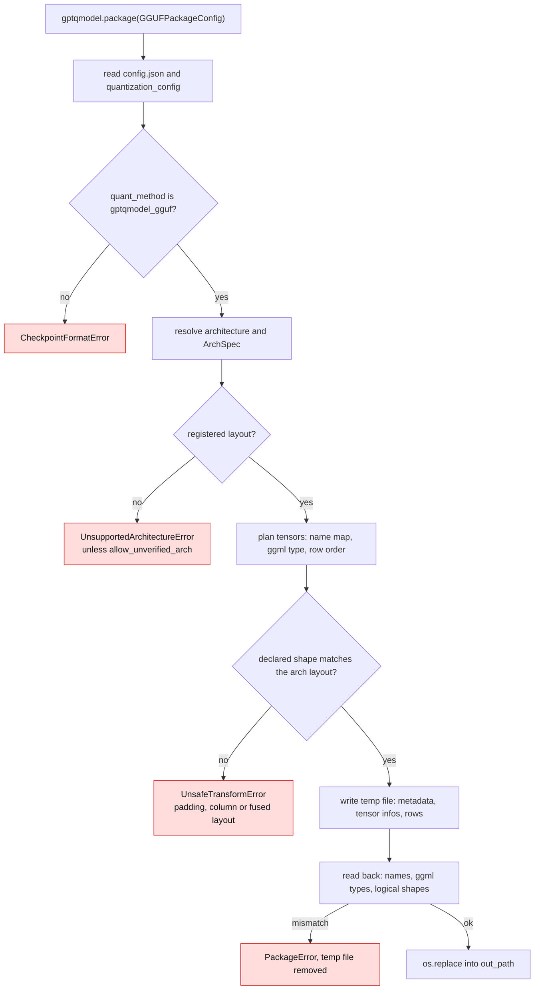

<!-- SPDX-FileCopyrightText: 2026 ModelCloud.ai
SPDX-License-Identifier: Apache-2.0 -->

# GGUF single-file packaging

`gptqmodel.package(GGUFPackageConfig(...))` writes one llama.cpp-readable
`.gguf` file from a GPT-QModel GGUF checkpoint directory. The packed payload is
already ggml block bytes, so this is a container change: tensor names move to
llama.cpp's `blk.N.*` spelling, whole output rows are reordered where an
architecture requires it, and dense tensors are stored at the target width. No
weight is dequantized, re-quantized, or rewritten.

```python
from gptqmodel import GGUFPackageConfig, package

out = package(
    GGUFPackageConfig(
        model_path="Qwen3-8B-gptqmodel-gguf",
        out_path="Qwen3-8B-Q4_K_M.gguf",
    )
)
```

The tokenizer is read from `model_path` by default. Pass `tokenizer_path=` for a
separate tokenizer directory, or a loaded `tokenizer=` object. The writer never
downloads weights and never executes checkpoint Python.

## Why this is a packing problem

A GPT-QModel GGUF linear stores its payload in `qweight` as
`[out_features, bytes_per_row]` `uint8`, where each row is a run of complete
ggml blocks. One block spans a contiguous run of `in_features` values inside
that row. A transform is therefore byte-exact only when it moves or splits
**output rows**:

| Operation | Byte-safe | Why |
| --- | --- | --- |
| rename `model.layers.N.*` to `blk.N.*` | yes | names only |
| permute q/k output rows (Llama rotary interleave) | yes | each row keeps every block |
| split a fused tensor on its output dimension | yes | block boundaries are unchanged |
| stack per-expert tensors on the expert dimension | yes, same qtype and row layout | blocks are unchanged |
| scale, shift, or reorder input columns | no | crosses block boundaries |
| split a fused tensor on its input dimension | no | crosses block boundaries |

The writer enforces this by checking every planned tensor against the
architecture's declared shape. Padding (`in_features` not divisible by the
block size), a column-wise permutation, or a fused layout that would need a
dequantize/requantize pass fails with `UnsafeTransformError` before any output
file exists.

## Flow



Tensors are streamed one at a time: the file header and every tensor info are
written first, then each payload row run, so peak memory is one tensor rather
than the whole model. The published file only appears after the read-back check
passes; a failure removes the temporary file and leaves any previous output
untouched.

## Architecture registry

`gptqmodel/packaging/arch.py` declares one `ArchSpec` per verified GGUF
architecture. A spec supplies the pre-tokenizer name, optional row
permutations, optional generated tensors (the Llama-3 `rope_freqs` table), and
the expected logical shape of every tensor. The generic metadata
(`block_count`, `context_length`, `embedding_length`, `feed_forward_length`,
`head_count`, `head_count_kv`, `head_dim`, `rope_theta`, `rms_norm_eps`,
`vocab_size`) is derived from `config.json` for every architecture.

Verified layouts: `qwen2`, `qwen3`, `llama`. An architecture without a spec has
no known transform set, so it is refused by default. `allow_unverified_arch=True`
uses the generic name map and metadata with **no** weight transform; use it only
when the layout is known to need none.

Mixture-of-experts checkpoints are refused in this version: packing routed
experts needs an architecture-specific fusion (per-expert tensors are merged and
renamed differently per model family) that the writer does not implement.

## Failure contract

| Situation | Result |
| --- | --- |
| `quant_method` is not `gptqmodel_gguf` | `CheckpointFormatError` |
| no `config.json`, or no safetensors weights | `CheckpointFormatError` |
| a quantized module also stores `weight`/`scales`/`qzeros` | `CheckpointFormatError` |
| `tie_word_embeddings` is false but there is no `lm_head` | `CheckpointFormatError` |
| a required block tensor is missing | `CheckpointFormatError` |
| an architecture without a registered layout | `UnsupportedArchitectureError` |
| a mixture-of-experts checkpoint | `UnsupportedArchitectureError` |
| padded or otherwise mismatched packed rows | `UnsafeTransformError` |
| a tensor with no llama.cpp name | `UnsupportedTensorError` |
| two sources map to one output name | `UnsupportedTensorError` |
| a ggml type the installed `gguf` package does not define | `UnsupportedQuantTypeError` |
| the `gguf` extra is not installed | `MissingDependencyError` |
| `out_path` exists and `overwrite=False` | `FileExistsError` |

## Tests

`tests/test_gguf_package.py` pins the contract:

| Test | Invariant |
| --- | --- |
| `test_packed_rows_are_copied_byte_for_byte` | every packed row and ggml type survives unchanged, including a mixed `Q4_K`/`Q6_K` plan |
| `test_dense_tensors_keep_their_declared_width` | embeddings keep F16/BF16; norms and biases are F32 |
| `test_metadata_and_tokenizer_arrays` | architecture, shape and tokenizer keys are readable by the `gguf` oracle |
| `test_native_reader_agrees_with_the_oracle` | the in-tree GGUF reader sees the same tensors and dims |
| `test_llama_permutes_qk_rows_and_keeps_every_row` | Llama's q/k reorder is a row permutation, not a rewrite |
| `test_llama3_rope_freqs_matches_the_piecewise_spec` | the generated rope table follows the documented scaling rule |
| `test_refuses_a_shape_the_arch_layout_does_not_allow` / `test_refuses_an_unmapped_tensor` / `test_refuses_mixture_of_experts` | unsafe layouts fail before a file is created |
| `test_failed_write_publishes_nothing` | a failed read-back removes the temporary file |
| `test_llamacpp_loads_the_packaged_file` | llama.cpp loads the file and tokenizes exactly like the Hugging Face tokenizer (CPU, skipped when `llama-cpp-python` is unavailable) |
