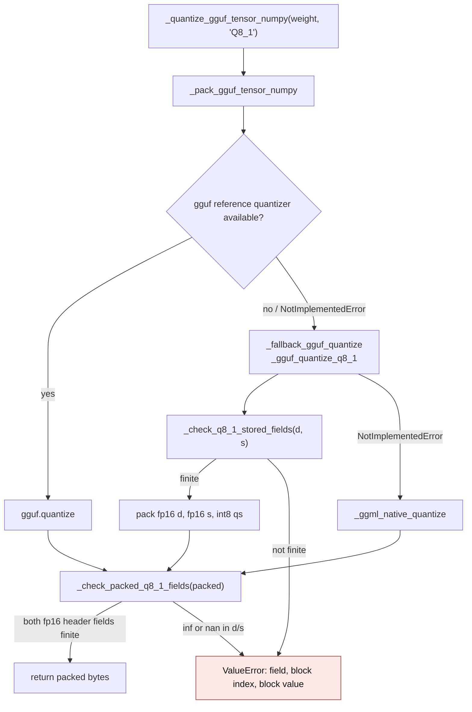

# GGUF Q8_1 auxiliary-field range

`block_q8_1` is `{ fp16 d, fp16 s, int8 qs[32] }`. The block scale
`d = max|x| / 127` is finite whenever the source block is finite, but the
auxiliary `s = d * sum(qs)` is a *different* magnitude: a block of 32 values of
3000 packs `d = 23.62` yet has `s = 96000`. FP16 stops at 65504, so the cast
published `inf` in a standard field. Decoding a weight from `d` and `qs` never
reads `s`, so the existing round-trip tests could not see it; a reader that
folds `s` into an integer dot product gets a non-finite result.

The format's field dtypes are fixed by ggml, so the fix narrows the supported
input range instead of widening the field: Q8_1 packing fails closed when either
stored header field is not finite after the cast, and names the field and block.
No other layout changes, and no persistent dense weight is introduced.

## Flow

The second check validates the bytes rather than the fallback's intermediates,
because the `gguf` package or the native bridge can produce the block instead.
Both checks read the two FP16 header fields; the `qs` codes are range-limited by
construction.

| Mechanism | Before | After |
| --- | --- | --- |
| Q8_1 NumPy packer | `gguf.py:620-636` cast `d`/`s` to FP16 and returned the bytes; NumPy emitted a `RuntimeWarning` for `s` | `_check_q8_1_stored_fields` rejects either non-finite field before writing |
| Shared entry point | Returned whatever the preferred packer emitted for Q8_1 | `_check_packed_q8_1_fields` revalidates the published header for every packer |
| Decoded weight | Unchanged: `s` is not part of weight reconstruction | Unchanged; the guard does not touch `d` or `qs` |
| In-range blocks | Bit-identical ggml layout | Bit-identical; covered by a bit-exact control test |

## Supported range

A block packs only while both `d` and `s` are finite in FP16. With
`d = max|x| / 127`, `d <= 65504` needs `max|x| <= 8_319_008`, and
`s <= 65504` bounds `sum(qs) * d`, which saturates near `max|x| = 2047` for a
block whose codes all share the block's sign (32 x 2047 = 65504). Mixed-sign
blocks can carry a larger magnitude because their codes cancel.

The rejection is therefore a supported-input-range statement, not a new error
for ordinary weights: FP16 weights below 2047 and BF16/FP32 weights below
~8.3e6 keep packing exactly as before. A block outside the range has no FP16
representation of its auxiliary sum, so the message points at a layout with a
wider field (`Q8_0` or `Q8_K`) instead of silently publishing unreadable bytes.

## Evidence

`tests/test_gguf_all_formats.py` adds the 32 x 3000 case from the report, the
`2048`/`-2048` FP16-rounding boundary (65536 rounds to `inf`) and a `1e7` block
whose scale itself overflows. Each independently recomputes `d` and `s` in
NumPy before asserting which field is named, so a guard that fired for the wrong
reason fails. Controls pin the largest finite sum (32 x 2047), the zero block
and an ordinary block, and assert that both header fields are finite in the
packed bytes. A mixed 1 x 64 matrix asserts the failing block index, and a
synthetic packed block asserts the shared entry-point check. Before the fix, the
rejection nodes fail with `DID NOT RAISE ValueError`; the controls pass on both
sides.

Q8_1 has no ggml `mul_mat` kernel upstream, so the native path still skips it
and this change makes no claim about a fused Q8_1 forward.
