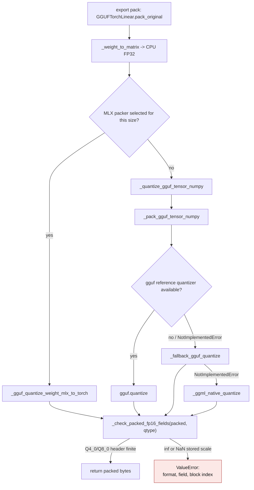

# GGUF Q4_0/Q8_0 block-scale range

`block_q4_0` is `{ fp16 d, uint8 qs[16] }` and `block_q8_0` is
`{ fp16 d, int8 qs[32] }`. Both store the block scale `d` by casting a finite
FP32 value: `d = -max(x) / 8` for Q4_0 and `d = max|x| / 127` for Q8_0. Above the
FP16 range that cast publishes `inf`. Decoding then multiplies every code by
`inf`, and a code that should be zero (Q4_0's `q - 8`, Q8_0's `0`) becomes
`NaN`.

A 1x32 block with one zero and 31 copies of the reported magnitudes is enough:

| Format | Non-zero magnitude | Stored `d` | Decoded `inf` | Decoded `NaN` |
| --- | ---: | ---: | ---: | ---: |
| Q4_0 | 524032 = 65504 x 8 | -65504 | 0 | 0 |
| Q4_0 | 524160 = 65520 x 8 | `-inf` | 31 | 1 |
| Q4_0 | 1048576 | `-inf` | 31 | 1 |
| Q8_0 | 8319008 = 65504 x 127 | 65504 | 0 | 0 |
| Q8_0 | 8321040 = 65520 x 127 | `inf` | 31 | 1 |
| Q8_0 | 16777216 | `inf` | 31 | 1 |

The rows below the range limit are correct: 65504 is the largest finite FP16
value, the next FP16 bin would be 65536, and 65520 is the exact midpoint, so
the cast rounds values at or above it to `inf`. The installed `gguf` reference
packer and the built-in NumPy fallback emit byte-identical payloads, so this is
a format range limit rather than a defect in one packer.

## Failure and new flow

The export layer owns the checkpoint bytes, so it now rejects an unreadable
header instead of publishing it. The check reads the packed header bytes, which
covers every packer: the `gguf` package, the NumPy fallback, llama.cpp's native
bridge, and the MLX packer.

| Mechanism | Before | After |
| --- | --- | --- |
| Q4_0/Q8_0 packers | Cast `d` to FP16 and returned the bytes; NumPy emitted only a `RuntimeWarning` | Unchanged; they still write the ggml layout |
| Shared entry point | Validated only the Q8_1 header fields | `_check_packed_fp16_fields` also validates the Q4_0/Q8_0 block scale |
| MLX packer path | Returned Metal-packed bytes without an exit check | The same header check runs on the returned Torch tensor |
| In-range blocks | Bit-identical ggml layout | Bit-identical; covered by a bit-exact control test |

## Supported range

A block packs while its pre-cast scale rounds to a finite FP16 value, i.e.
strictly below the 65520 overflow midpoint. For Q4_0 that is
`max|x| < 524160` (524152 verified accepted), and for Q8_0 it is
`max|x| < 8321040` (8320913 verified accepted). None of these values put the
pre-cast scale outside FP32: it is finite in FP32 and only overflows in the
format's required FP16 cast. Outside those ranges the block has no FP16
representation of its scale, so the rejection is a supported-input-range
statement, not a new error for ordinary weights. The message names the format,
`block scale d` and the block index, and points callers at a format with a
wider stored scale (`Q8_K`, FP32 `d`).

The guard intentionally covers only the two formats in this report. Other
formats that store one or more fixed-width FP16 scales have the same class of
limit, but this change makes no claim about them and their exit checks remain a
separate audit; `_GGUF_FP16_HEADER_FIELDS` is the table to extend once each
format's header layout and supported range are established.

## Evidence

`tests/test_gguf_all_formats.py` derives its inputs from FP16 itself: the
rejection cases use the `(65504, 65520)` rounding midpoint scaled by each
format's divisor, and the controls sit exactly on the largest finite value. The
rejection tests assert the format, `block scale d` and `block 0 of 1`, and
independently recompute the pre-cast FP32 scale to prove it is finite in FP32
and non-finite only after the cast. The controls assert the packed scale is
finite and byte-identical to `gguf.quantize`. A packer-coverage test runs the
shared exit with the reference package enabled and disabled, a second one feeds
the same bytes as a Torch tensor (the shape the MLX packer returns), and an
export-level test asserts `GGUFTorchLinear.pack_original` raises before any
`qweight` buffer is published. Before the fix the rejection nodes fail with
`DID NOT RAISE ValueError`; the controls pass on both sides.
