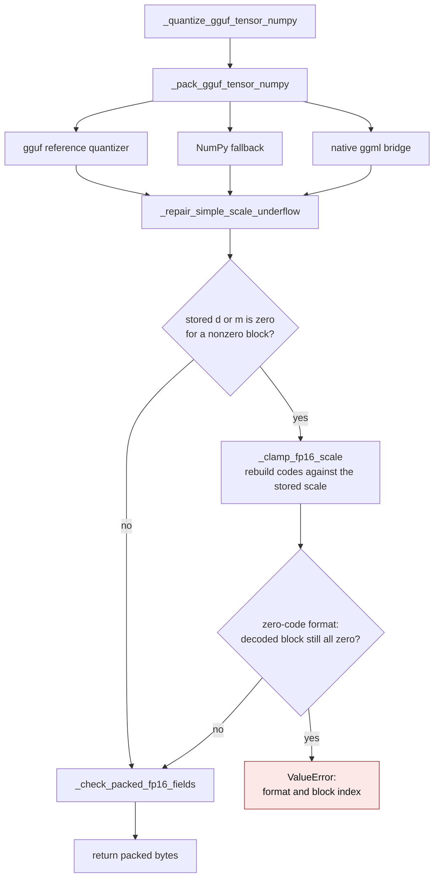

# GGUF simple block FP16 scale underflow

The simple GGUF blocks store a bare FP16 scale. `block_q4_0` is
`{ fp16 d, uint8 qs[16] }`, `block_q8_0` is `{ fp16 d, int8 qs[32] }`,
`block_q4_1` adds an FP16 `m`, and `block_iq4_nl` stores `d` plus 4-bit
codebook indices. `block_q1_0` is `{ fp16 d, uint8 qs[16] }` with one sign bit
per weight. The packers derive `d` from the block's peak magnitude, except for
the sign-only family, which uses the mean magnitude:

| Format | FP32 scale before the cast | Decoded value |
| --- | --- | --- |
| Q1_0 / Q1_0_g128 | `d = mean|x|` | `sign(bit) * d` |
| Q4_0 | `d = max(x) / -8` | `d * (q - 8)` |
| Q5_0 | `d = max(x) / -16` | `d * (q - 16)` |
| Q8_0 / Q8_1 | `d = max|x| / 127` | `d * q` |
| Q4_1 | `d = (max - min) / 15`, `m = min` | `d * q + m` |
| Q5_1 | `d = (max - min) / 31`, `m = min` | `d * q + m` |
| IQ4_NL | `d = max(x) / -127` | `d * kvalues[q]` |

When that finite FP32 scale is below the smallest FP16 subnormal
(`2^-24 = 5.960e-8`), the cast stores `d = 0`. The codes were built from the
original scale, so the block now decodes to all zeros even though the source
block was nonzero. Unlike a non-finite scale, the result is finite and
silent, so a checkpoint can look valid while one block of weights is gone.

A 1x block with one negative element and the rest positive reproduces it:

| Format | Input magnitude | Stored `d` before | Decoded before | After |
| --- | ---: | ---: | ---: | --- |
| Q4_0 | 1e-7 | 0 | all 0 | repaired, peak 1.19e-7 |
| Q5_0 | 1e-7 | 0 | all 0 | repaired, peak 1.19e-7 |
| Q8_0 | 1e-6 | 0 | all 0 | repaired, peak 1.01e-6 |
| Q8_1 | 1e-6 | 0 | all 0 | repaired, peak 1.01e-6 |
| IQ4_NL | 1e-6 | 0 | all 0 | repaired, peak 1.31e-6 |
| Q4_1 | 1e-7 | 0 | constant `m` | repaired, peak 1.19e-7 |
| Q4_1 | 1e-8 | 0 | all 0 | rejected, block index reported |
| Q5_1 | 1e-8 | 0 | all 0 | rejected, block index reported |
| Q1_0 / Q1_0_g128 | 1.28e-7 (one nonzero) | 0 | all 0 | repaired, peak 5.96e-8 |

The same limit applies to `Q2_0`, `TQ1_0` and `TQ2_0`, which also cast
`max|x|` into an FP16 `d`. The sign-only `Q1_0`/`Q1_0_g128` family stores a
mean magnitude, so a sparse block underflows even when its largest element is
representable: a single `1.28e-7` value in an otherwise zero block has mean
`1e-9`, publishes `d = 0`, and decodes to all zeros before the fix.

## Repair flow

The reference `gguf` quantizer, the NumPy fallback and llama.cpp's native
bridge all write the FP16 field themselves. The shared exit therefore reads
the published block header and rebuilds only the blocks whose nonzero scale
or offset underflowed. In-range blocks keep their original bytes.

`_clamp_fp16_scale` raises a nonzero FP32 scale to
`sign(scale) * 2^-24` before the codes are computed, so the stored scale and
the codes agree. `Q4_1`/`Q5_1` apply the same rule to `m`. A block whose
clamped scale and offset still cancel every code, or whose codes all round to
the format's zero code, cannot be represented and raises with its block index
instead of publishing zeros. Sign-only blocks have no magnitude code: every
element decodes to `+d` or `-d`, so a clamped nonzero `d` always leaves a
nonzero block and skips the zero-code probe.

| Mechanism | Before | After |
| --- | --- | --- |
| NumPy simple packers | Cast `d` directly to FP16 | Clamp the FP32 `d`/`m` before computing codes, including the sign-only mean |
| Reference/native packers | Published `d = 0` for a nonzero block | The shared exit rebuilds only the affected blocks |
| Unrepresentable block | Published an all-zero block | `ValueError` names the format and block index |
| In-range blocks | ggml layout | Byte-identical; covered by a control test |

## Supported range

A block is representable while the clamped scale produces at least one
nonzero code. For the formats with a zero code, that is approximately
`peak >= 0.5 * 2^-24`; smaller nonzero blocks are rejected. `Q4_1`/`Q5_1`
also depend on `m`: a tiny `m` can keep a block nonzero even when `d` is
clamped, but if the clamped `d` and `m` cancel every code the block is
rejected. `IQ4_NL` has no zero codebook entry, so a clamped nonzero `d` always
leaves a nonzero value. The sign-only family also has no zero code, so a
clamped nonzero `d` always leaves a nonzero block.

## Evidence

`tests/test_gguf_all_formats.py` covers every format above at `1e-6`, `1e-7`,
`1e-8` and the smallest normal FP16 value. Each case either decodes with a
nonzero element or raises with the format, `block N of M` and a pointer to a
wider stored scale (`Q8_K`/`F16`). A mixed-block control asserts the
underflowed block is rebuilt while the normal block keeps the reference
bytes, and export tests run `GGUFTorchLinear.pack_original` and its forward
on the repaired payload. The sign-only cases use a sparse block whose mean is
`1e-9` at `1.28e-7` and `1e-7` amplitudes, assert the stored scale is the
smallest FP16 subnormal, and check that both signs survive; a separate case
rebuilds bytes from a producer that casts without clamping.

Introduced in PR #6027.
