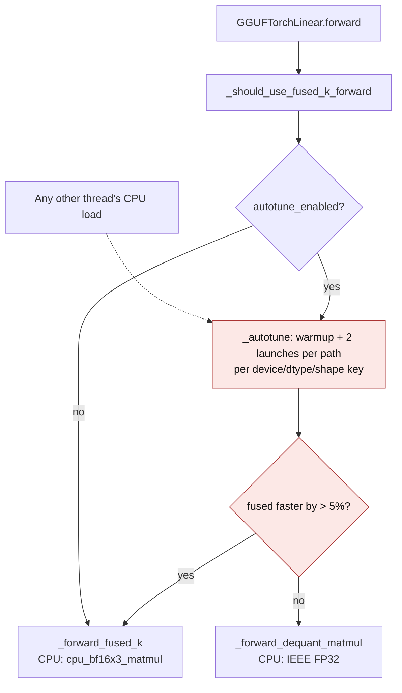
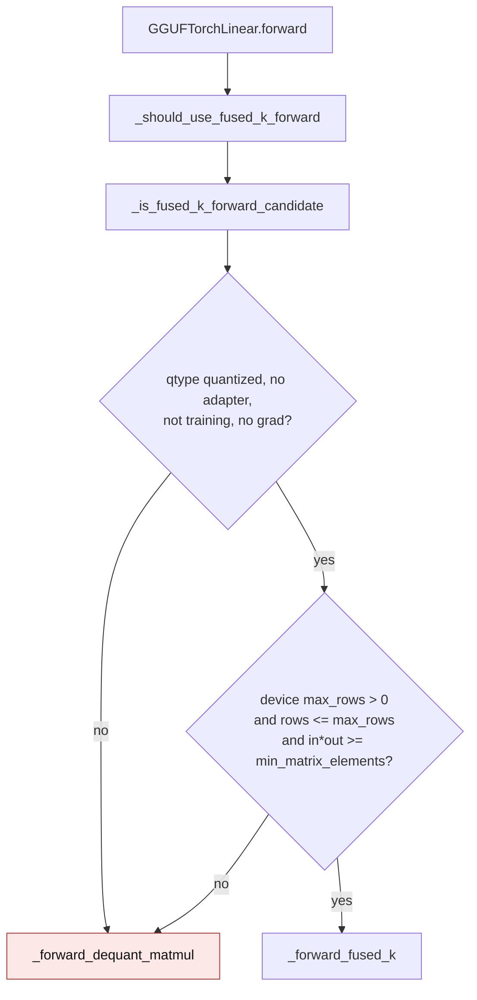

# GGUF Torch fused dispatch

`GGUFTorchLinear` has two forward implementations per quantized layer:

| Path | Arithmetic |
| --- | --- |
| `_forward_fused_k` | dequantizes one bounded K chunk at a time and accumulates with `addmm`; on CPU the GEMMs run inside `cpu_bf16x3_matmul()` |
| `_forward_dequant_matmul` | materializes the whole dequantized weight for one matmul; on CPU the reduction is IEEE FP32 |

The two are not bitwise equivalent on CPU, and on CUDA they differ in when the
output is rounded. Choosing between them is therefore a *numerical* decision,
not only a performance one: whatever selects the path decides the logits.

## What changed

Up to 7.11.0 the choice was a wall-clock race. `_should_use_fused_k_forward`
called `_autotune`, which timed one warmup plus two launches of each path and
kept the fused path only when it won by more than 5%. The winner was cached per
`(device, dtype, shape)`.

That made the arithmetic depend on unrelated process activity. A second thread
doing its own `matmul` work was enough to move a few of 168 Qwen2.5-0.5B
Q4_K_M modules onto the other path, and the logits changed with it (#4590).

Measured on this host (Qwen2.5-0.5B-Instruct, `GGUF_TORCH`, CPU, 4 processes of
the same input): 104/168, 137/168, 157/168 and 163/168 modules selected the
fused path depending on a background thread, and the logits differed by up to
0.033 between runs. The same 4 runs on the fixed code select 168/168 and are
bit-identical.

## New flow

The decision is now a pure function of the module's static gates and the
activation shape. Nothing times either implementation.

The gates are `KernelConfig` fields, so a caller can move the crossover without
touching the code:

| Field | Default | Effect |
| --- | --- | --- |
| `gguf_fused_cpu_max_rows` | `64` | Row ceiling for the fused CPU path |
| `gguf_fused_cpu_min_matrix_elements` | `0` | `in_features * out_features` floor |
| `gguf_fused_cuda_max_rows` | `32` | Row ceiling for the fused CUDA path |
| `gguf_fused_cuda_min_matrix_elements` | `8388608` | `in_features * out_features` floor |

They are tuned offline with `scripts/benchmark_gguf_fused_thresholds.py`, which
interleaves the two paths on one module and reports both timings, the output
drift, and the path the shipped gates select.

## Before and after

| Mechanism | Before | After |
| --- | --- | --- |
| Path selection | `_autotune` timing one warmup + 2 launches per path, `nn_modules/qlinear/gguf.py::GGUFTorchLinear._autotune` | `_is_fused_k_forward_candidate`, static shape gates only |
| Cache of the decision | `_gguf_fused_autotune_cache` keyed by device/dtype/shape | none; recomputed per forward from the gates |
| Config surface | `gguf_fused_autotune_warmup` / `_iters` / `_margin` | removed; only the shape gates remain |
| `AUTOTUNE` class flag | `True`, consumed by `_should_use_fused_k_forward` | `False`; the flag no longer selects the GGUF path |
| Retired env vars | mapped to the three autotune fields | mapped to "removed; GGUF fused dispatch is static" |

`BaseQuantLinear` still owns `AUTOTUNE`/`autotune_enabled` for kernels that use
it (`ParoQuantTriton`'s tile tuning, for example, is a timing search between
numerically identical layouts). GGUF Torch no longer participates.

## Numerics

Both paths stay well inside the documented GGUF Torch tolerance of an FP64
dequantized-weight oracle, so picking one statically is a performance decision.
Against an FP64 oracle over 1x7/7x7/32-row BF16 activations on Q4_K/Q6_K/Q8_0
layers, relative error is 1.6e-3..1.7e-3 for both paths (the residual is the
quantized weight itself, not the GEMM). Fused-vs-dense drift is bounded by the
activation dtype's rounding: `max|dlogit|` 0.033 on Qwen2.5-0.5B.

On CUDA the fused path is the faster one for BF16/FP32 activations (1.5-2.1x on
2048x8192 Q4_K, 4096x4096 Q6_K, measured with CUDA events) and the dense path is
slightly faster for FP16 activations (0.9x). The shipped `max_rows = 32` /
`8_388_608`-element floor keeps the fused path for the decode and short-prefill
shapes it wins, and the large FP16 prefill shapes it loses.

## Failure contract

| Situation | Before | After |
| --- | --- | --- |
| Same input, one process idle | all modules on one path | same path |
| Same input, another thread busy | 104/168 vs 157/168 modules on the fused path | same path, bit-identical logits |
| Same input, two processes | different logits | bit-identical logits |
| Shape above the row ceiling | whichever path timing preferred | dense path |
| `adapter` attached, training, or grad enabled | whichever path timing preferred | dense path |

## Validation

- `tests/kernels/test_gguf_fused_dispatch_reproducible_4590.py`: a busy
  neighbour thread cannot move modules between the paths; the decision does not
  depend on call order or shape history; two fresh processes return the same
  path and the same checksum. The first assertion fails on the pre-fix code
  (measured: `{False, True} == {True}`).
- `tests/kernels/test_gguf_torch_cpu.py`: the decision never benches either
  path, `autotune_enabled` cannot flip the result, and the shipped gate
  defaults are pinned.
- `tests/test_weight_only.py::test_gguf_forward_uses_the_static_gates_not_a_timed_plan`
  pins that widening and narrowing the gate at run time switches paths.
- `tests/kernels/test_gguf_*.py` and `tests/test_weight_only.py`: 444 passed,
  145 skipped across the `GGUF_TORCH` CPU and CUDA paths.

Measured on Qwen2.5-0.5B-Instruct Q4_K_M (`GGUFConfig(bits=4, format="q_k_m")`,
CPU, `dtype=torch.float16`): pre-fix 104/137/157/163 of 168 modules on the fused
path with up to 0.033 logit drift; post-fix 168/168 for all four runs, bitwise
identical.
