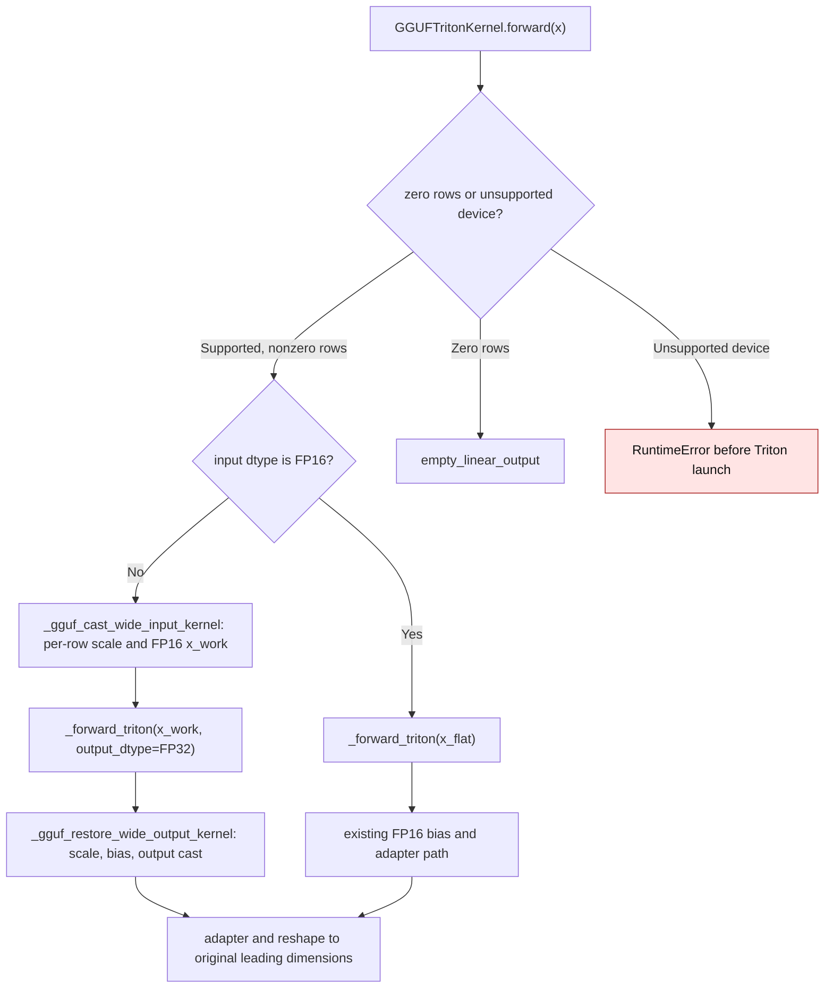

# GGUF Triton activation range

`GGUFTritonKernel.forward` accepts FP16, BF16, and FP32 activations. BF16 and
FP32 can represent finite values outside FP16's range. Before this change,
`x_flat.to(torch.float16)` converted such values to infinity or zero before
the fused GGUF kernel read them. On an NVIDIA GB10, a BF16 row filled with
99,840 and a packed Q4_K weight of about 0.000507 yielded infinity; the FP64
packed-weight oracle gave 12,956.8.

The BF16/FP32 path now normalizes each activation row on the GPU. A power-of-two
scale moves a large row into FP16's finite range; a tiny row is lifted out of
the subnormal range. `_forward_triton` consumes the normalized FP16 rows and
returns FP32. The output epilogue restores the scale, adds bias, and rounds
once to the input dtype. FP16 activations retain their existing path. The
normalization and epilogue launch without a host value read, so a warmed
forward can run in a CUDA graph.

| Mechanism | Before | Current |
| --- | --- | --- |
| BF16/FP32 input conversion | `gguf_triton.py:2015-2016` on `8a701a8` cast the whole input directly to FP16 | `gguf_triton.py:2050-2065` launches `_gguf_cast_wide_input_kernel` and keeps one FP32 scale per row |
| Fused output and bias | `gguf_triton.py:2020-2029` on `8a701a8` returned FP16 when bias was absent, then cast to the input dtype | `gguf_triton.py:2067-2084` keeps the fused result in FP32, restores row magnitude, adds bias, and writes the original dtype |
| Persistent storage | Packed GGUF weight and compact metadata | The same packed weight and metadata; activation scales and FP32 output are local to one forward |

The per-row normalization cannot recover contributions that are smaller than
FP16 can resolve *relative to another element in the same row*. It prevents
overflow and whole-row underflow while retaining the fused packed-weight path.

On GB10 with Torch 2.15.0+cu132 and Triton 3.9.0, 34 packed-weight oracle
cases passed across Q1_0, Q4_K, Q5_K, and Q6_K, BF16/FP32, one/nine rows, and
large/tiny inputs, including bias and a sliced input. The warmed Q4_K graph
replayed with the same output. A 257-column activation also matched its
packed-weight oracle after GGUF block padding. Across the 32 unbiased
un-padded oracle cases, maximum
relative error against FP64 was 0.2297% for BF16, entirely from mandatory
output rounding; the difference from the once-rounded BF16 oracle was zero.
FP32 maximum relative error was 0.0574% against both FP64 and the rounded
oracle. The 256×64 Q4_K example retains 9,216 packed-weight bytes plus 10,240
bytes of compact packed metadata; the one-row BF16 forward creates 512 bytes
of FP16 input, a four-byte row scale, 256 bytes of FP32 dot output, and a
128-byte BF16 result. No expanded weight persists.

For normal Q4_K BF16/FP32 inputs at K=N=256,
five alternating `triton.testing.do_bench` runs measured these eager medians
(microseconds):

| Rows | Dtype | Prior conversion | Row scaling |
| ---: | --- | ---: | ---: |
| 1 | BF16 | 12.38 | 12.11 |
| 1 | FP32 | 11.37 | 12.04 |
| 32 | BF16 | 14.68 | 12.27 |
| 32 | FP32 | 12.87 | 12.27 |

The prior-conversion benchmark calls `_forward_triton(x.half()).to(dtype)`;
the row-scaling benchmark calls `GGUFTritonKernel.forward(x)`. Both use the
same packed Q4_K module on GPU. These are short-kernel measurements on one
device, not a performance claim for every GGUF geometry.
