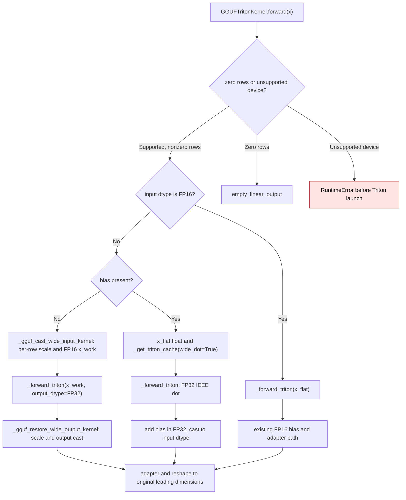

# GGUF Triton activation range

`GGUFTritonKernel.forward` accepts FP16, BF16, and FP32 activations. BF16 and
FP32 can represent finite values outside FP16's range. Before #3679,
`x_flat.to(torch.float16)` converted such values to infinity or zero before
the fused GGUF kernel read them. On an NVIDIA GB10, a BF16 row filled with
99,840 and a packed Q4_K weight of about 0.000507 yielded infinity; the FP64
packed-weight oracle gave 12,956.8.

For BF16/FP32 inputs without bias, #3679 normalizes each activation row on the
GPU. A power-of-two scale moves a large row into FP16's finite range; a tiny
row is lifted out of the subnormal range. `_forward_triton` consumes the
normalized FP16 rows and returns FP32, then the epilogue restores the scale
before output rounding.

For BF16/FP32 inputs *with* bias, near cancellation can amplify a small FP16
weight-reconstruction error. The biased route now keeps the activation and
compact GGUF scale/minimum metadata in FP32 and uses the fused kernels'
FP32 IEEE dot. It adds bias to the FP32 result before the output cast. On GB10,
Q4_K with FP32 input 100,000 and a bias of -12,900 produced 75.90 before this
change; the FP64 packed-weight oracle gives 81.60 and the new route gives
81.57. FP16 activations retain their existing direct path. Both BF16/FP32
routes run without a host value read after warmup, so they can replay inside
a CUDA graph.

| Mechanism | Before | Current |
| --- | --- | --- |
| Unbiased BF16/FP32 input | `gguf_triton.py:2015-2016` on `8a701a8` cast the whole input directly to FP16 | `gguf_triton.py:2074-2085` launches `_gguf_cast_wide_input_kernel` and keeps one FP32 scale per row |
| Biased BF16/FP32 input | `gguf_triton.py:2050-2078` on `bae2410` used FP16 activation/weight operands; near cancellation amplified their rounding error | `gguf_triton.py:2066-2073,2089-2107` uses FP32 activation and scale metadata, FP32 IEEE dot, then adds bias before casting |
| Persistent storage | Packed GGUF weight and compact metadata | Packed weight plus separate FP16/FP32 compact metadata variants; activation and dot scratch remain local to one forward |

The unbiased per-row normalization cannot recover contributions that are
smaller than FP16 can resolve *relative to another element in the same row*.
The biased FP32 dot avoids that FP16 operand limit for supported GGUF formats.

On GB10 with Torch 2.15.0+cu132 and Triton 3.9.0, 34 packed-weight oracle
cases passed across Q1_0, Q4_K, Q5_K, and Q6_K, BF16/FP32, one/nine rows, and
large/tiny inputs, including bias and a sliced input. The warmed Q4_K graph
replayed with the same output. A 257-column activation also matched its
packed-weight oracle after GGUF block padding. Across the 32 unbiased
un-padded oracle cases, maximum
relative error against FP64 was 0.2297% for BF16, entirely from mandatory
output rounding; the difference from the once-rounded BF16 oracle was zero.
FP32 maximum relative error was 0.0574% against both FP64 and the rounded
oracle. The 256×64 Q4_K example retains 9,216 packed-weight bytes plus 10,240
bytes of compact packed metadata; the one-row BF16 forward creates 512 bytes
of FP16 input, a four-byte row scale, 256 bytes of FP32 dot output, and a
128-byte BF16 result. No expanded weight persists.

For normal Q4_K BF16/FP32 inputs at K=N=256,
five alternating `triton.testing.do_bench` runs measured these eager medians
(microseconds):

| Rows | Dtype | Prior conversion | Row scaling |
| ---: | --- | ---: | ---: |
| 1 | BF16 | 12.38 | 12.11 |
| 1 | FP32 | 11.37 | 12.04 |
| 32 | BF16 | 14.68 | 12.27 |
| 32 | FP32 | 12.87 | 12.27 |

The prior-conversion benchmark calls `_forward_triton(x.half()).to(dtype)`;
the row-scaling benchmark calls `GGUFTritonKernel.forward(x)`. Both use the
same packed Q4_K module on GPU. These are short-kernel measurements on one
device, not a performance claim for every GGUF geometry.

For biased Q4_K at K=256, N=64, BF16 input, five alternating eager medians
were 12.58 µs (the #3679 scaled-FP16 calls, replayed through the same private
helpers) versus 15.32 µs (`GGUFTritonKernel.forward` with the FP32 dot) at
M=1, and 12.81 versus 15.35 µs at M=32. The biased FP32 metadata cache is
12,288 bytes, compared with 10,240 bytes for the FP16 metadata cache; both
may coexist if the same layer receives FP16 and BF16 activations. The 9,216
bytes of checkpoint-owned packed weight remain unchanged, and neither cache
contains a dense or expanded weight.
