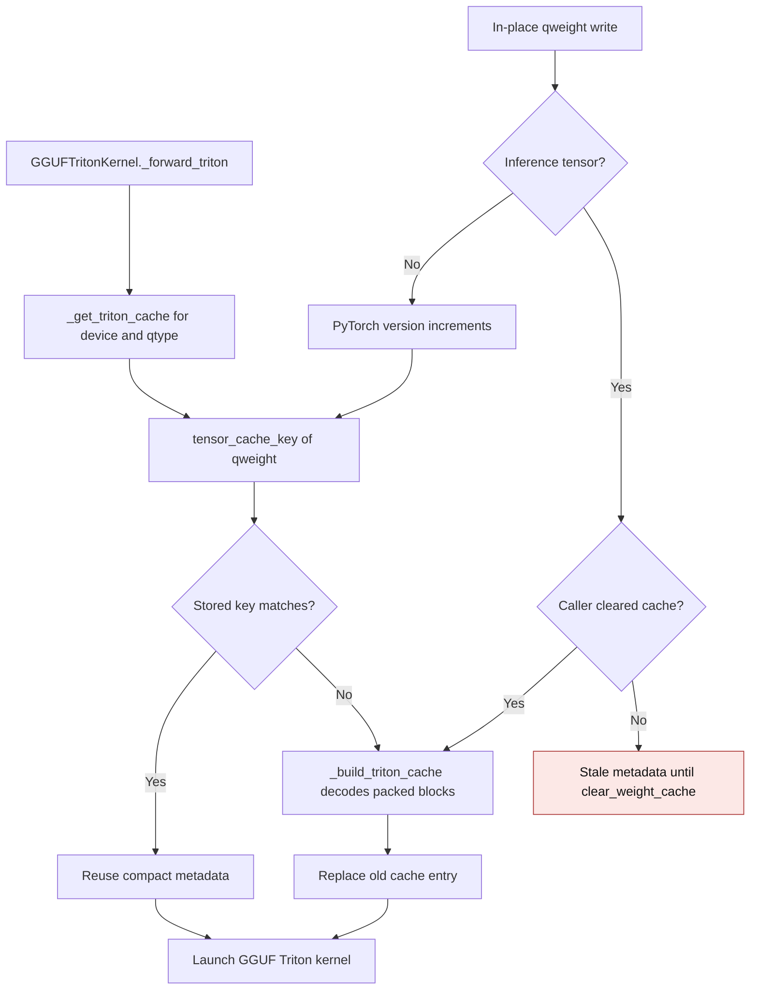

# GGUF Triton packed metadata cache

`GGUFTritonKernel` decodes compact scales, minima, and bit layouts from packed
GGUF `qweight` blocks once per device and format. The decoded metadata remains
packed or block-sized; a full dequantized layer is never retained. The cache
must be rebuilt whenever the source `qweight` changes.

## Cache flow

`tensor_cache_key` includes tensor identity, version, storage pointer, device,
dtype, shape, and inference status. Normal in-place writes increment the
version; buffer replacement changes the identity. The base quantized-linear
class clears derived caches on checkpoint load and device/dtype moves. Packing
and `GGUFTritonKernel.clear_weight_cache` also clear this cache. Inference
tensors have no version counter, so callers that mutate them inside
`torch.inference_mode()` must call `clear_weight_cache()` afterward.

| Mechanism | Before | After |
| --- | --- | --- |
| Cache hit | `gguf_triton.py:1832-1839` compared only `qweight.data_ptr()`; an in-place write kept the same pointer and reused old metadata | `_get_triton_cache` compares `tensor_cache_key(qweight)` and rebuilds when a versioned weight changes |
| Cache entry | `gguf_triton.py:1745-1829` stored the source pointer in each format-specific metadata dictionary | `_get_triton_cache` stamps one key on every rebuilt entry, independent of format |
| Inference tensor write | Pointer did not change, so stale metadata remained | The documented explicit `clear_weight_cache()` contract invalidates metadata |

The old line references are from the implementation before this cache
correction. Tests replace packed Q1_0, Q1_0_g128, Q4_K, Q5_K, and Q6_K
weights in place, then compare the fused GPU result with an independent NumPy
GGUF decoder and FP64 Torch dot product. They also cover buffer replacement,
checkpoint load, device move, repeated cache hits, and the explicit-clear
contract for inference tensors.

On an NVIDIA GB10 (SM 12.1), PyTorch 2.15.0+cu132, and Triton 3.9.0,
Q4_K with K=N=1024 retained 655,360 bytes (0.625 MiB) of compact metadata
after cache construction. Cold construction peaked 0.703 MiB above the
packed-weight baseline; the additional expanded-weight cache remained 0
bytes. With resident FP16 inputs, five warmups, and the median of seven sets
of 30 CUDA-event timed forwards, the old pointer-only cache-hit logic and
the new tensor-key logic measured:

| Rows | Pointer-only hit | Tensor-key hit | Hot peak allocator delta |
| --- | ---: | ---: | ---: |
| 1 | 0.0817 ms | 0.0846 ms | 0.002 MiB |
| 16 | 0.0817 ms | 0.0847 ms | 0.031 MiB |

The benchmark used the same fused Q4_K kernel for both paths and changed
only the cache-hit check. No weight was updated during timing.
