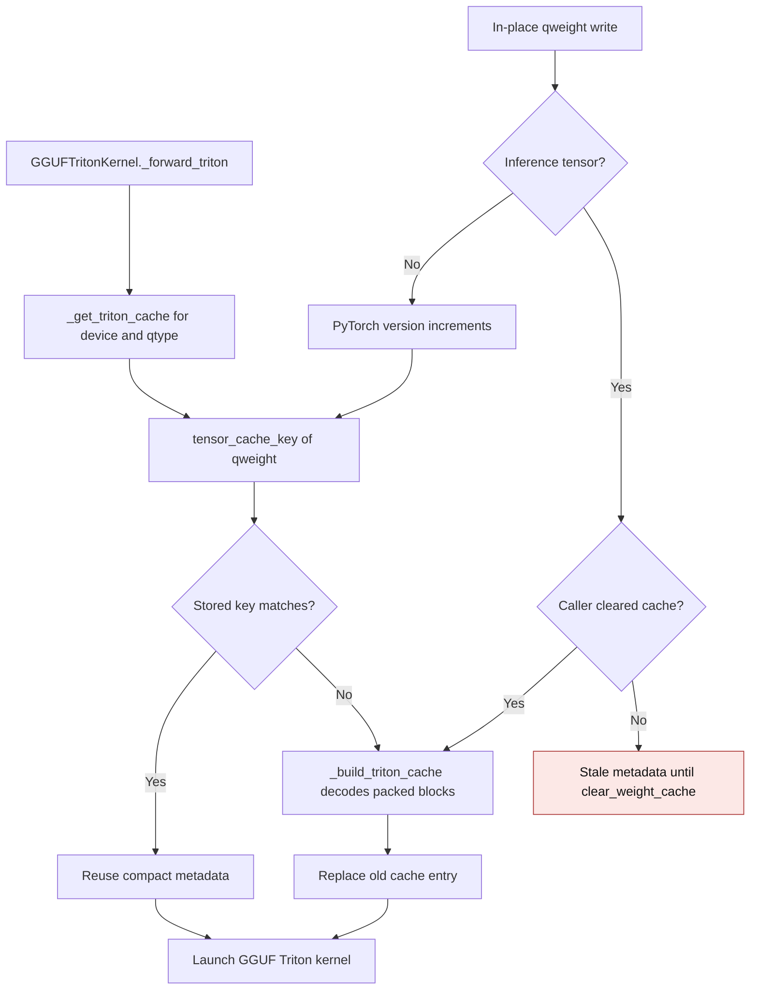
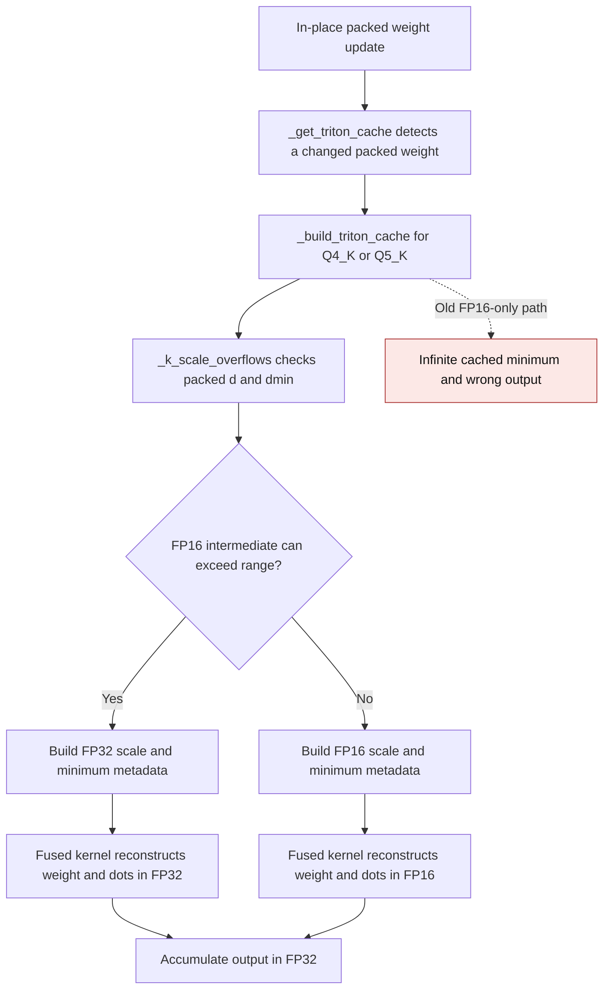

# GGUF Triton packed metadata cache

`GGUFTritonKernel` decodes compact scales, minima, and bit layouts from packed
GGUF `qweight` blocks once per device and format. The decoded metadata remains
packed or block-sized; a full dequantized layer is never retained. The cache
must be rebuilt whenever the source `qweight` changes.

## Cache flow

`tensor_cache_key` includes tensor identity, version, storage pointer, device,
dtype, shape, and inference status. Normal in-place writes increment the
version; buffer replacement changes the identity. The base quantized-linear
class clears derived caches on checkpoint load and device/dtype moves. Packing
and `GGUFTritonKernel.clear_weight_cache` also clear this cache. Inference
tensors have no version counter, so callers that mutate them inside
`torch.inference_mode()` must call `clear_weight_cache()` afterward.

| Mechanism | Before | After |
| --- | --- | --- |
| Cache hit | `gguf_triton.py:1832-1839` compared only `qweight.data_ptr()`; an in-place write kept the same pointer and reused old metadata | `_get_triton_cache` compares `tensor_cache_key(qweight)` and rebuilds when a versioned weight changes |
| Cache entry | `gguf_triton.py:1745-1829` stored the source pointer in each format-specific metadata dictionary | `_get_triton_cache` stamps one key on every rebuilt entry, independent of format |
| Inference tensor write | Pointer did not change, so stale metadata remained | The documented explicit `clear_weight_cache()` contract invalidates metadata |

The old line references are from the implementation before this cache
correction. Tests replace packed Q1_0, Q1_0_g128, Q4_K, Q5_K, and Q6_K
weights in place, then compare the fused GPU result with an independent NumPy
GGUF decoder and FP64 Torch dot product. They also cover buffer replacement,
checkpoint load, device move, repeated cache hits, and the explicit-clear
contract for inference tensors.

On an NVIDIA GB10 (SM 12.1), PyTorch 2.15.0+cu132, and Triton 3.9.0,
Q4_K with K=N=1024 retained 655,360 bytes (0.625 MiB) of compact metadata
after cache construction. Cold construction peaked 0.703 MiB above the
packed-weight baseline; the additional expanded-weight cache remained 0
bytes. With resident FP16 inputs, five warmups, and the median of seven sets
of 30 CUDA-event timed forwards, the old pointer-only cache-hit logic and
the new tensor-key logic measured:

| Rows | Pointer-only hit | Tensor-key hit | Hot peak allocator delta |
| --- | ---: | ---: | ---: |
| 1 | 0.0817 ms | 0.0846 ms | 0.002 MiB |
| 16 | 0.0817 ms | 0.0847 ms | 0.031 MiB |

The benchmark used the same fused Q4_K kernel for both paths and changed
only the cache-hit check. No weight was updated during timing.

This cache contract was corrected in
[PR #3664](https://github.com/ModelCloud/GPTQModel/pull/3664).

## Q4_K and Q5_K scale range

The packed `d` and `dmin` values are FP16, but their products with 6-bit
subscales can exceed FP16 range. A later subtraction can still leave a finite
weight. Some completed weights also exceed FP16 even though a small activation
gives a finite output. `_build_triton_cache` now uses the shared
`_k_scale_overflows` guard to keep the compact metadata arrays in FP32 for
such blocks. The fused Q4_K and Q5_K kernels reconstruct the weight in that
dtype and use an IEEE FP32 dot. Ordinary packed weights keep FP16 metadata
and the existing FP16 dot path.

| Mechanism | Before | After |
| --- | --- | --- |
| K scale metadata | `gguf_triton.py:1796-1826` multiplied `d` and `dmin` by subscales in FP16, so Q5_K could cache an infinite minimum | `_build_triton_cache` keeps the compact scale/minimum arrays in FP32 when `_k_scale_overflows` flags the packed weight |
| Weight reconstruction | `gguf_triton.py:702,801` used FP16 scale/minimum values before the Q4_K/Q5_K dot product | The fused kernels reconstruct and dot in FP32 for flagged blocks, so even a completed weight above FP16 range can contribute to a finite output |

The old line references describe the code before this range correction. On
the NVIDIA GB10, a crafted Q5_K block with `d=74`, 6-bit scale and minimum
`63`, and an encoded maximum code returned `-inf` before the correction even
though an independent NumPy GGUF decoder and FP64 Torch dot product gave a
finite `58.5625`. The corrected Q4_K and Q5_K results both gave `58.5625`.
The GPU regression covers FP16/BF16 inputs, one and eight rows, bias,
repeatability, completed weights above FP16 range, direct wrapper calls,
and packed-weight replacement. For the 64×256 case, the wide
scale and minimum arrays add 2,048 bytes to the compact cache; no expanded
weight is retained.

With normal packed weights at K=N=1024, resident FP16 inputs, five warmups,
and the median of seven sets of 20 CUDA-event timed calls, the hot path was:

| Format, rows | Before | After | Peak allocator delta | Retained compact cache |
| --- | ---: | ---: | ---: | ---: |
| Q4_K, 1 | 0.0872 ms | 0.0868 ms | 0.002 MiB | 655,360 bytes |
| Q4_K, 16 | 0.0866 ms | 0.0868 ms | 0.031 MiB | 655,360 bytes |
| Q5_K, 1 | 0.0913 ms | 0.0914 ms | 0.002 MiB | 786,432 bytes |
| Q5_K, 16 | 0.0920 ms | 0.0915 ms | 0.031 MiB | 786,432 bytes |

The FP32 arrays are selected only for packed blocks whose intermediate range
requires them. These measurements cover the ordinary FP16 metadata path.
This Q4_K/Q5_K range correction was introduced by
[PR #3668](https://github.com/ModelCloud/GPTQModel/pull/3668).
